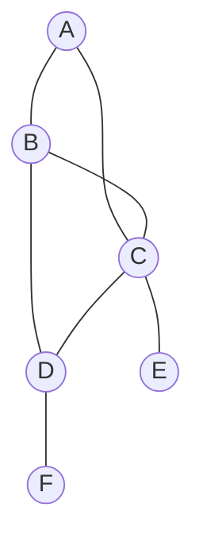
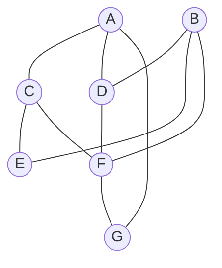
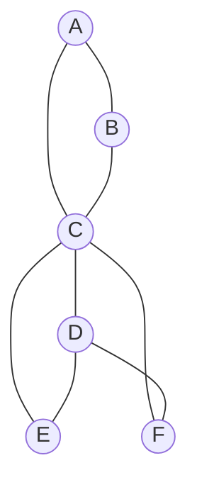
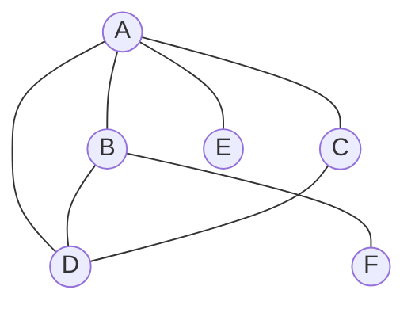
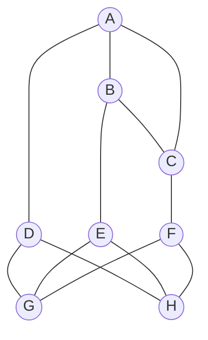

**Главная идея задания 1: на рисунке и в таблице показана одна и та же система связей, но пункты обозначены по-разному.** Нужно восстановить нужные соответствия между буквами и номерами, а затем ответить на вопрос задачи.

В твоих подборках встречаются задания, где требуется найти номера пунктов, и задания, где после сопоставления нужно определить длину дороги. В некоторых случаях отдельные пункты невозможно различить, но пару нужных номеров всё равно можно определить. Поэтому будем учиться и устанавливать соответствия, и правильно работать с неоднозначностью. [inf-ege.sdamgia.ru](https://inf-ege.sdamgia.ru/test?theme=358\&utm_source=chatgpt.com)

Все большие учебные примеры ниже составлены специально для объяснения. Решения полностью ручные: через подсчёт дорог, сравнение соседей и проверку связей.

При первом чтении двигайся от модели и таблицы к степеням, соседям и полным примерам. Затем разберись с предположениями и симметрией: несколько соответствий не всегда мешают получить один ответ. Блок о дальнем окружении, мостах и удалении вершины можно изучить после первых упражнений. Это дополнительные способы продолжить рассуждение, когда простых признаков недостаточно.

---

**Начнём со смысла информационной модели.** Представь несколько населённых пунктов и дороги между ними. Полное описание района могло бы включать расположение домов, ширину дорог, рельеф, светофоры и множество других подробностей.

Для нашей задачи достаточно гораздо меньшего:

- какие пункты существуют;
- между какими пунктами есть прямые дороги;
- какова длина каждой дороги, если она указана.

Описание, которое сохраняет нужную информацию об объекте, называют **информационной моделью**.

Один и тот же район можно описать рисунком или таблицей. Способ представления меняется, а сведения о дорогах остаются теми же.

Допустим, на рисунке есть пункты \(A\), \(B\), \(C\), а в таблице — пункты 1, 2, 3. Это не означает, что \(A\) обязательно соответствует 1.

Может оказаться:

\[
A\leftrightarrow 3,\qquad B\leftrightarrow 1,\qquad C\leftrightarrow 2.
\]

Знак \(\leftrightarrow\) здесь означает: «это два обозначения одного и того же пункта».

Если между \(A\) и \(B\) есть дорога, то при таком соответствии в таблице должна быть дорога между 3 и 1. Если между \(A\) и \(C\) дороги нет, то между 3 и 2 её тоже быть не должно.

**Мы ищем такое переименование пунктов, при котором сохраняются все связи.**

При этом соответствие должно быть взаимно однозначным:

- каждой букве соответствует один номер;
- одному номеру соответствует одна буква;
- две разные буквы не могут обозначать один и тот же номер.

Последнее ограничение очень полезно при ручном решении. Если номер уже надёжно сопоставлен с одним пунктом, другим пунктам он соответствовать не может.

---

**Теперь разберём, как устроен рисунок.** Схему из точек и соединяющих их линий называют **графом**.

В задаче о дорогах:

| Элемент графа | Что он обозначает |
|---|---|
| Точка с обозначением | Населённый пункт |
| Линия между двумя точками | Прямую дорогу между пунктами |
| Число возле линии, если оно есть | Длину дороги |

Точки графа называют **вершинами**, а соединяющие их линии — **рёбрами**.

То есть фразы «из пункта \(A\) выходят три дороги» и «у вершины \(A\) три ребра» описывают одно и то же.

Будем использовать оба языка, постепенно переходя от дорог к графам.

Здесь нужно сразу разобрать несколько тонкостей.

**Расположение точек на листе обычно не несёт информации о соответствии.** Пункт \(A\), нарисованный слева сверху, может соответствовать любой строке таблицы.

Рисунок можно повернуть, растянуть или переставить на нём точки. Пока сохраняются соединения, это тот же граф.

**Длина нарисованной линии обычно не показывает длину дороги.** Длинная линия на схеме может обозначать дорогу в 5 км, а короткая — дорогу в 30 км. Километры определяются числами из условия.

**Пересечение линий само по себе не создаёт новый пункт.** Если две линии пересеклись, но в месте пересечения не обозначена вершина, переходить с одной дороги на другую там нельзя.

При чтении сложного рисунка следи за концами каждой линии: какие именно подписанные вершины она соединяет.

**В обычной схеме дорог без стрелок соединение действует в обе стороны.** Если есть дорога \(A\)—\(B\), то из \(A\) можно попасть в \(B\), а из \(B\) — в \(A\).

Граф с такими связями называют **неориентированным**. Смысл термина простой: у дороги не задано единственное направление движения.

Если в условии появятся стрелки или специально оговорённые односторонние дороги, направления придётся учитывать отдельно. Дальнейший основной разбор относится к обычным схемам без стрелок.

---

**Чтобы читать граф уверенно, нужно различать прямую дорогу и маршрут через другие пункты.**

Пусть есть дороги из \(A\) в \(B\) и из \(B\) в \(C\).

Тогда из \(A\) можно добраться до \(C\) через \(B\):

\[
A\to B\to C.
\]

Эта последовательность переходов — **маршрут**.

Но из существования такого маршрута не следует, что между \(A\) и \(C\) есть отдельная прямая дорога.

Это различие проходит через всё задание:

- прямая дорога соединяет два пункта одним ребром;
- маршрут может состоять из нескольких дорог.

Когда будем считать дороги, выходящие из пункта, будем учитывать только непосредственные соединения.

---

**Перейдём к таблице.** В таблице каждый пункт присутствует дважды: в заголовках строк и в заголовках столбцов.

Ячейка на пересечении строки 2 и столбца 5 описывает дорогу между пунктами 2 и 5.

Встречаются два основных способа заполнения:

| Содержимое ячейки | Обычный смысл |
|---|---|
| Звёздочка | Прямая дорога существует |
| Число | Прямая дорога существует; число показывает её длину |
| Пустая ячейка | Прямой дороги нет |

Точный смысл обозначений всегда определяется условием.

В учебных таблицах ниже вместо пустых ячеек будем ставить «—», чтобы таблицы было удобнее читать.

Посмотрим на маленький пример:

| Пункт | 1 | 2 | 3 |
|---|---:|---:|---:|
| **1** | — | * | — |
| **2** | * | — | * |
| **3** | — | * | — |

Что здесь известно?

В строке 1 звёздочка стоит только под номером 2. Значит, пункт 1 напрямую соединён только с пунктом 2.

В строке 2 звёздочки стоят под номерами 1 и 3. Значит, из пункта 2 есть две дороги: в 1 и в 3.

Между 1 и 3 прямой дороги нет. Однако маршрут существует:

\[
1\to 2\to 3.
\]

**Пустая ячейка сообщает об отсутствии прямой дороги. Возможность добраться через другие пункты проверяется по остальным связям.**

Есть ещё три особенности таблицы.

**Первая: в обычной задаче таблица симметрична.** Если в строке 1 под столбцом 2 стоит звёздочка, то и в строке 2 под столбцом 1 должна стоять звёздочка.

В таблице с длинами оба числа тоже совпадают.

Это одна и та же дорога, показанная с двух сторон.

**Вторая: диагональ таблицы относится к соединениям пункта с самим собой.** Например, строка 3, столбец 3.

В обычных задачах такие дороги не рассматриваются, поэтому диагональ пустая или отмечена прочерками. При подсчёте дорог из пункта она ничего не добавляет.

**Третья: заголовок строки — обозначение пункта.** Число 5 в заголовке строки не означает ни пять дорог, ни пять километров.

Количество дорог определяется заполненными ячейками этой строки.

---

**Первый и самый простой признак пункта — количество прямых дорог из него.**

Это количество называют **степенью вершины**.

Например, если \(A\) соединена с \(B\), \(C\) и \(D\), то степень \(A\) равна 3.

Можно записать:

\[
d(A)=3.
\]

Буква \(d\) здесь просто обозначает степень. Запись читается: «степень вершины \(A\) равна трём».

На рисунке степень определяется подсчётом линий, которые заканчиваются в выбранной вершине.

В таблице — подсчётом заполненных ячеек соответствующей строки, без заголовка и диагонали.

Если строка содержит длины 7, 12 и 20, из пункта выходят **три дороги**. Для определения степени величины этих чисел не важны.

Почему степень помогает сопоставлять пункты?

Переименование пункта не меняет его дороги. Если из \(A\) выходят четыре дороги, то у соответствующего номера тоже должны быть четыре заполненные ячейки.

Следовательно:

\[
A\leftrightarrow i\quad\Longrightarrow\quad d(A)=d(i).
\]

Это читается так: «если \(A\) соответствует номеру \(i\), их степени обязательно совпадают».

Отсюда получается простой способ начать решение:

> Если на графе есть единственная вершина степени 4, а в таблице единственный пункт степени 4, они соответствуют друг другу.

Слово **«единственная»** здесь решающее.

Если степень 3 имеют сразу четыре вершины, совпадение степени пока оставляет четыре возможных номера.

Например:

| Буква | Степень | Возможные номера |
|---|---:|---|
| \(A\) | 3 | 1, 4, 6 |
| \(B\) | 1 | 2, 5 |
| \(C\) | 4 | 3 |

В этом случае \(C\leftrightarrow 3\) уже установлено. Для остальных пунктов перечислены только кандидаты.

**Равенство степеней — необходимое условие соответствия, но само по себе обычно недостаточное.**

«Необходимое» означает: без него соответствие невозможно.

«Недостаточное» означает: даже если условие выполнено, соответствие ещё нужно проверить по другим признакам.

---

**Количество дорог позволяет также проверить, правильно ли прочитаны исходные данные.**

У каждого ребра два конца. Поэтому одна дорога добавляет единицу к степени одного пункта и единицу к степени другого.

Значит:

\[
\text{сумма степеней всех вершин}
=
2\cdot\text{количество дорог}.
\]

Например, степени пунктов равны:

\[
2,\ 3,\ 4,\ 3,\ 1,\ 1.
\]

Их сумма:

\[
2+3+4+3+1+1=14.
\]

Поэтому дорог:

\[
14:2=7.
\]

Это полезная проверка, если кажется, что на сложной схеме пропущена линия.

В полной симметричной таблице каждая дорога тоже записана дважды. Поэтому для подсчёта общего количества дорог можно:

- посчитать все заполненные ячейки и разделить на 2;
- либо считать заполненные ячейки только с одной стороны от диагонали.

При подсчёте степени одного пункта делить на 2 не нужно: в его строке каждая дорога представлена один раз.

---

**Когда одной степени мало, начинаем смотреть на соседей.** Две вершины называют **соседними**, если между ними есть прямая дорога.

Например, если из \(A\) есть дороги в \(B\), \(D\) и \(E\), то соседи \(A\) — это \(B\), \(D\), \(E\).

Обрати внимание: здесь слово «сосед» определяется дорогой. Близость точек на рисунке значения не имеет.

У вершины степени 3 может быть разное окружение.

Один пункт соединён с вершинами степеней 1, 2 и 4. Другой — с вершинами степеней 2, 2 и 3.

Их собственные степени одинаковы, но характер соседей различается.

Для удобства будем записывать **список степеней соседей**. Например:

\[
(1,2,4).
\]

Это означает, что из рассматриваемого пункта идут дороги:

- к пункту степени 1;
- к пункту степени 2;
- к пункту степени 4.

Такую запись удобно называть **профилем соседей**. Это рабочее название для короткого описания окружения вершины.

Числа лучше располагать по возрастанию. Тогда записи \((4,1,2)\) и \((1,2,4)\), описывающие одно и то же окружение, будут выглядеть одинаково.

Повторяющиеся числа сохраняются.

Профиль

\[
(2,2,4)
\]

означает двух разных соседей степени 2 и одного соседа степени 4.

Если записать только \((2,4)\), часть информации потеряется.

Почему профиль сохраняется при правильном сопоставлении?

Пусть \(A\) соответствует номеру 5. Каждый сосед \(A\) должен перейти в соседа пункта 5. Степени этих соседей тоже сохраняются.

Поэтому у \(A\) и 5 должны совпадать:

1. собственная степень;
2. список степеней соседей.

В таблице профиль находится в два действия:

1. Выписываем номера, с которыми соединён рассматриваемый пункт.
2. Подставляем степени этих номеров.

Например, пункт 4 соединён с 1, 3 и 6. Если их степени равны 2, 4 и 2, профиль пункта 4:

\[
(2,2,4).
\]

---

**Как только удалось определить хотя бы один пункт, его конкретные связи становятся новым ориентиром.**

Допустим, уже известно:

\[
C\leftrightarrow 5.
\]

На графе вершина \(A\) соединена с \(C\). Значит, номер \(A\) надо искать среди пунктов, соединённых с 5.

Если у \(A\) степень 2, круг поиска дополнительно сужается: подходят только соседи 5 со степенью 2.

Это сильнее общего профиля.

Профиль говорит: «вершина соединена с каким-то пунктом степени 4».

Установленное соответствие позволяет сказать: «вершина соединена именно с пунктом 5».

Нужно учитывать и отсутствие дорог.

Допустим, известно:

\[
B\leftrightarrow 2,\qquad C\leftrightarrow 5.
\]

На графе \(A\) соединена с \(C\), но не соединена с \(B\).

Тогда номер \(A\) должен одновременно удовлетворять двум требованиям:

- иметь дорогу в 5;
- не иметь дороги в 2.

Иногда первое требование оставляет несколько кандидатов, а второе сразу выделяет нужный.

**Наличие и отсутствие связи — одинаково важные части модели.**

При проверке предположения нельзя ограничиваться мыслью: «Нужные дороги вроде бы нашлись». Лишняя дорога тоже делает соответствие неправильным.

---

**Разберём первый полноценный пример: восстановим соответствия и найдём длину дороги.**

Дана схема:

Таблица показывает длины дорог:

| Пункт | 1 | 2 | 3 | 4 | 5 | 6 |
|---|---:|---:|---:|---:|---:|---:|
| **1** | — | — | — | 12 | 7 | 24 |
| **2** | — | — | — | — | 20 | — |
| **3** | — | — | — | — | — | 9 |
| **4** | 12 | — | — | — | 18 | — |
| **5** | 7 | 20 | — | 18 | — | 11 |
| **6** | 24 | — | 9 | — | 11 | — |

Требуется найти длину дороги между \(B\) и \(D\).

Сначала прочитаем граф:

| Вершина | Соседи | Степень |
|---|---|---:|
| \(A\) | \(B,C\) | 2 |
| \(B\) | \(A,C,D\) | 3 |
| \(C\) | \(A,B,D,E\) | 4 |
| \(D\) | \(B,C,F\) | 3 |
| \(E\) | \(C\) | 1 |
| \(F\) | \(D\) | 1 |

Теперь таблицу:

| Номер | Соседи | Степень |
|---|---|---:|
| 1 | 4, 5, 6 | 3 |
| 2 | 5 | 1 |
| 3 | 6 | 1 |
| 4 | 1, 5 | 2 |
| 5 | 1, 2, 4, 6 | 4 |
| 6 | 1, 3, 5 | 3 |

Уже видны два точных соответствия.

На графе только \(C\) имеет степень 4. В таблице только пункт 5 имеет степень 4:

\[
C\leftrightarrow 5.
\]

На графе только \(A\) имеет степень 2. В таблице это пункт 4:

\[
A\leftrightarrow 4.
\]

Теперь разберём вершины \(B\) и \(D\), у которых степень 3.

Кандидаты для них — номера 1 и 6.

Вершина \(B\) соединена с \(A\). Значит, номер \(B\) должен иметь дорогу в 4.

Смотрим:

- пункт 1 соединён с 4;
- пункт 6 с 4 не соединён.

Следовательно:

\[
B\leftrightarrow 1.
\]

Для \(D\) остаётся:

\[
D\leftrightarrow 6.
\]

Теперь уже можно ответить на вопрос: дорога \(B\)—\(D\) соответствует дороге 1—6.

В ячейке строки 1 и столбца 6 находится число 24.

**Ответ: 24.**

Заметь: чтобы найти эту длину, определять \(E\) и \(F\) не потребовалось.

Но для обучения закончим сопоставление.

Вершина \(E\) имеет единственную дорогу — в \(C\), то есть в пункт 5. Из пунктов степени 1 с 5 соединён пункт 2:

\[
E\leftrightarrow 2.
\]

Вершина \(F\) имеет единственную дорогу в \(D\), то есть в 6. Это пункт 3:

\[
F\leftrightarrow 3.
\]

Полное соответствие:

| Буква | Номер |
|---|---:|
| \(A\) | 4 |
| \(B\) | 1 |
| \(C\) | 5 |
| \(D\) | 6 |
| \(E\) | 2 |
| \(F\) | 3 |

Проверим, например, \(D\).

На графе её соседи:

\[
B,\ C,\ F.
\]

По найденному соответствию это:

\[
1,\ 5,\ 3.
\]

У пункта 6 в таблице соседи действительно 1, 3, 5. Совпали все связи.

Так можно проверить каждую строку.

---

**На этом же примере удобно понять, что делать с длинами после сопоставления.**

Если просят длину одной дороги, берём одно число из одной ячейки.

Если просят сумму длин нескольких дорог, сначала переводим каждую пару букв в пару номеров, а затем складываем соответствующие числа.

Например, найдём сумму длин всех дорог, выходящих из \(C\).

Поскольку \(C\leftrightarrow 5\), берём все числа строки 5:

\[
7+20+18+11=56.
\]

Каждая дорога из \(C\) в этой строке показана один раз.

Если же попросили длину маршрута

\[
E\to C\to B\to D\to F,
\]

он превращается в:

\[
2\to 5\to 1\to 6\to 3.
\]

Его длина:

\[
20+7+24+9=60.
\]

Здесь складываются длины четырёх последовательно пройденных дорог.

Итак:

| Что требуется | Что делаем |
|---|---|
| Длина дороги \(B\)—\(D\) | Читаем одну ячейку |
| Сумма длин дорог из \(C\) | Складываем числа строки \(C\) |
| Длина заданного маршрута | Складываем длины его последовательных участков |
| Кратчайший маршрут | Сравниваем допустимые маршруты по их суммарной длине |

Последняя формулировка добавляет отдельную задачу поиска. Для вопроса о длине конкретной дороги такого сравнения не требуется.

Также важно понимать, когда длины вообще помогают сопоставлять пункты.

Если на рисунке дороги не подписаны числами, мы не знаем, какая из них самая длинная. Поэтому, например, «в строке 2 находится самое большое число» само по себе не даёт соответствия с буквой.

В этом случае сначала восстанавливаем структуру связей, затем используем длины для ответа.

Если длины указаны и на рисунке, они становятся дополнительными признаками: соответствующие дороги должны иметь одинаковые значения.

---

**Теперь рассмотрим случай, когда совпали и степень, и профиль соседей.**

Такое совпадение ещё не доказывает, что две вершины взаимозаменяемы.

Профиль сообщает степени соседей, но не сообщает, как сами эти соседи соединены между собой.

Представь вершину \(X\) с тремя соседями. Между двумя её соседями есть дорога. Тогда эти три пункта образуют замкнутую конструкцию из трёх дорог.

Такая конструкция называется **треугольником графа**.

Для пунктов \(X,Y,Z\) нужны все три дороги:

\[
X\text{—}Y,\qquad Y\text{—}Z,\qquad Z\text{—}X.
\]

Треугольник определяется связями. На рисунке его стороны могут быть кривыми, а сами точки могут стоять почти на одной линии.

Почему участие в треугольнике помогает?

При переименовании пунктов три существующие дороги должны сохраниться. Поэтому треугольник переходит в треугольник.

Вершине, которая входит в один треугольник, не может соответствовать пункт, который не входит ни в один.

Проверять треугольники в таблице удобно через соседей.

Допустим, пункт 2 соединён с 1, 4 и 6. Проверяем пары его соседей:

- есть ли дорога 1—4;
- есть ли дорога 1—6;
- есть ли дорога 4—6.

Каждая существующая дорога между двумя соседями образует вместе с пунктом 2 один треугольник.

Если есть только дорога 1—4, то пункт 2 входит в один треугольник: 2—1—4—2.

---

**Разберём более сложный пример, где два пункта имеют одинаковые первые признаки.**

Дана схема:

Таблица связей:

| Пункт | 1 | 2 | 3 | 4 | 5 | 6 | 7 |
|---|---:|---:|---:|---:|---:|---:|---:|
| **1** | — | — | * | * | — | * | — |
| **2** | — | — | — | * | — | * | — |
| **3** | * | — | — | * | * | — | — |
| **4** | * | * | * | — | — | — | * |
| **5** | — | — | * | — | — | — | * |
| **6** | * | * | — | — | — | — | * |
| **7** | — | — | — | * | * | * | — |

Требуется определить номер вершины \(B\).

Начнём с графа:

| Вершина | Соседи | Степень | Степени соседей |
|---|---|---:|---|
| \(A\) | \(C,D,G\) | 3 | \((2,3,3)\) |
| \(B\) | \(D,E,F\) | 3 | \((2,3,4)\) |
| \(C\) | \(A,E,F\) | 3 | \((2,3,4)\) |
| \(D\) | \(A,B,F\) | 3 | \((3,3,4)\) |
| \(E\) | \(B,C\) | 2 | \((3,3)\) |
| \(F\) | \(B,C,D,G\) | 4 | \((2,3,3,3)\) |
| \(G\) | \(A,F\) | 2 | \((3,4)\) |

У \(B\) и \(C\) совпадают:

- степень 3;
- профиль \((2,3,4)\).

По этим двум признакам различить их нельзя.

Посчитаем характеристики пунктов таблицы:

| Номер | Соседи | Степень | Степени соседей |
|---|---|---:|---|
| 1 | 3, 4, 6 | 3 | \((3,3,4)\) |
| 2 | 4, 6 | 2 | \((3,4)\) |
| 3 | 1, 4, 5 | 3 | \((2,3,4)\) |
| 4 | 1, 2, 3, 7 | 4 | \((2,3,3,3)\) |
| 5 | 3, 7 | 2 | \((3,3)\) |
| 6 | 1, 2, 7 | 3 | \((2,3,3)\) |
| 7 | 4, 5, 6 | 3 | \((2,3,4)\) |

Сразу получаем:

\[
F\leftrightarrow 4,
\]

потому что это единственные вершины степени 4.

По профилям также устанавливаются:

\[
A\leftrightarrow 6,\qquad D\leftrightarrow 1,
\]

\[
E\leftrightarrow 5,\qquad G\leftrightarrow 2.
\]

Для \(B\) и \(C\) остаются номера 3 и 7.

Теперь есть два удобных способа продолжить.

**Первый способ — использовать уже найденную вершину \(D\).**

На графе:

- \(B\) соединена с \(D\);
- \(C\) с \(D\) не соединена.

Мы знаем, что \(D\leftrightarrow 1\).

В таблице:

- пункт 3 соединён с 1;
- пункт 7 с 1 не соединён.

Значит:

\[
B\leftrightarrow 3,\qquad C\leftrightarrow 7.
\]

**Второй способ — сравнить треугольники.**

Вершина \(B\) входит в треугольник \(BDF\), потому что существуют дороги:

\[
B\text{—}D,\qquad B\text{—}F,\qquad D\text{—}F.
\]

Вершина \(C\) имеет соседей \(A,E,F\). Между этими соседями дорог нет:

- \(A\)—\(E\) отсутствует;
- \(A\)—\(F\) отсутствует;
- \(E\)—\(F\) отсутствует.

Поэтому \(C\) не входит ни в один треугольник.

Смотрим кандидатов в таблице.

У пункта 3 соседи 1, 4 и 5. Между 1 и 4 есть дорога. Значит, пункт 3 входит в треугольник.

У пункта 7 соседи 4, 5 и 6. Между этими тремя пунктами дорог нет. Значит, пункт 7 не входит в треугольник.

Получаем тот же результат:

\[
B\leftrightarrow 3,\qquad C\leftrightarrow 7.
\]

**Ответ: 3.**

Полное соответствие:

| Буква | Номер |
|---|---:|
| \(A\) | 6 |
| \(B\) | 3 |
| \(C\) | 7 |
| \(D\) | 1 |
| \(E\) | 5 |
| \(F\) | 4 |
| \(G\) | 2 |

В этом примере хорошо видно, как рассуждение становится точнее:

\[
\text{степень}
\;\longrightarrow\;
\text{степени соседей}
\;\longrightarrow\;
\text{конкретные связи или треугольники}.
\]

Каждый следующий признак уточняет предыдущие.

---

**Есть и другие признаки, которые можно использовать вручную.** Они нужны, когда простые сравнения оставляют несколько кандидатов.

Удобно понимать их смысл, даже если в конкретной задаче до них дело не дойдёт.

**Общие соседи двух пунктов.** Общим соседом \(A\) и \(B\) называют пункт, соединённый и с \(A\), и с \(B\).

Чтобы найти общих соседей, выпиши соседей первого пункта и соседей второго, а затем найди совпадающие обозначения.

Например:

\[
\text{соседи }A:\ C,D,E,
\]

\[
\text{соседи }B:\ D,E,F.
\]

Общие соседи — \(D\) и \(E\). Их два.

Количество общих соседей сохраняется при правильном сопоставлении.

В предыдущем примере \(B\) и \(F\) имеют общего соседа \(D\), а \(C\) и \(F\) общих соседей не имеют. Это ещё один способ различить \(B\) и \(C\), когда \(F\) уже найдена.

**Связи между соседями.** Можно смотреть не только количество таких связей, но и их устройство.

Например, у одного пункта три соседа, все соединённые друг с другом. У другого — три соседа, между которыми есть только одна дорога. Профили степеней могут совпасть, но окружение устроено по-разному.

**Минимальное количество дорог до известного пункта.** Сколько дорог нужно пройти, чтобы добраться из \(A\) в \(C\)?

Если есть прямая дорога, достаточно одной. Если можно попасть только через один промежуточный пункт, потребуется две.

Это называют **расстоянием в количестве рёбер**. Оно относится к числу переходов, а не к километрам.

Если уже найден некоторый пункт \(X\), можно сравнивать кандидатов по расстоянию до \(X\).

Например, на графе искомый пункт находится в двух переходах от \(X\). Тогда кандидат, который соединён с номером \(X\) напрямую, не подходит.

**Устройство дальнего окружения.** Иногда собственная степень и степени соседей совпадают, но различаются соседи этих соседей.

Тогда можно продолжить анализ на один шаг дальше:

- с какими уже определёнными пунктами связаны соседи;
- какие из соседей входят в треугольники;
- есть ли среди них пункт с необычным окружением.

Так мы постепенно различаем всё более сложные положения в графе.

Если считаешь пункты, расположенные ровно в двух переходах, учитывай каждый пункт один раз. Один и тот же пункт может быть достижим через разных промежуточных соседей.

**Разделение графа при удалении дороги.** Бывает дорога, после удаления которой часть пунктов оказывается отрезанной от остальных.

Такую дорогу называют **мостом**.

Слово описывает её роль в системе связей. Оно не связано с физическим мостом через реку.

При сопоставлении мост должен перейти в дорогу с такой же ролью. Можно также сравнить, сколько пунктов останется с каждой стороны.

Аналогично иногда полезно мысленно удалить вершину вместе с её дорогами и посмотреть, на сколько отдельных частей распадётся схема.

Эти признаки сложнее подсчёта степеней, поэтому разумно пользоваться ими после более простых.

---

**Теперь важный логический вопрос: почему даже несколько совпавших признаков могут быть недостаточными?**

Потому что каждый признак описывает лишь часть информации.

Степень сообщает число соседей.

Профиль сообщает степени соседей.

Количество треугольников сообщает некоторые связи между соседями.

Полная модель содержит все связи между всеми пунктами.

Рассмотрим два графа:

- в первом шесть пунктов образуют одно замкнутое кольцо;
- во втором шесть пунктов образуют два отдельных треугольника.

В обоих графах:

- шесть вершин;
- шесть дорог;
- степень каждой вершины равна 2;
- профиль каждой вершины равен \((2,2)\).

Но системы связей разные. В первом графе можно добраться между любыми двумя пунктами, во втором нельзя перейти из одного треугольника в другой.

Следовательно, совпадение всех степеней и профилей ещё не доказывает совпадение графов.

В задании обычно дано, что рисунок и таблица описывают одну систему. Нам требуется найти правильное соответствие внутри этой системы. Но логика остаётся той же:

**Совпавшие признаки разрешают оставить кандидата. Несовпавший обязательный признак позволяет его исключить.**

Окончательная проверка полного соответствия — сравнение всех связей.

---

**Что делать, если после анализа всё ещё остаются два варианта?** Можно проверить предположение.

Это тоже полноценный ручной метод, если чётко отличать предположение от доказанного результата.

Возьмём предыдущий пример. Для \(B\) остаются номера 3 и 7.

Предположим:

\[
B\leftrightarrow 7.
\]

При этом уже известно:

\[
D\leftrightarrow 1.
\]

На графе есть дорога \(B\)—\(D\). Значит, в таблице должна быть дорога 7—1.

Но её нет.

Получено **противоречие**: предположение требует существования дороги, которая отсутствует в исходных данных.

Следовательно, предположение неверно:

\[
B\not\leftrightarrow 7.
\]

Остаётся:

\[
B\leftrightarrow 3.
\]

Чтобы проверять предположения без путаницы, удобно придерживаться следующего порядка:

1. Выписать все оставшиеся кандидаты.
2. Временно выбрать одного.
3. Проверить необходимые связи и отсутствие связей.
4. При необходимости продолжить сопоставление соседних вершин.
5. Если появляется противоречие, отменить предположение и все выводы, полученные из него.
6. Проверить следующий вариант.

Последний пункт четвёртого шага важен: иногда неправильный кандидат совпадает по ближайшим признакам, а противоречие обнаруживается лишь дальше.

И ещё одно ограничение: в одном предполагаемом соответствии разные буквы должны получать разные номера. Если рассуждение заставляет присвоить номер 4 двум разным пунктам, такое предположение тоже невозможно.

Для записи на черновике полезно разделять:

- установленное соответствие: \(A\leftrightarrow 4\);
- оставшиеся кандидаты: «для \(B\): 1 или 6»;
- временное предположение: «пусть \(B\leftrightarrow 1\)».

Так временная версия не превратится незаметно в «известный факт».

---

**Теперь разберём настоящую неоднозначность.** До этого несколько вариантов означали, что нам ещё не хватает анализа.

Но иногда существуют несколько полных соответствий, каждое из которых сохраняет все связи.

Причина — **симметрия графа**.

Здесь под симметрией понимается возможность переставить обозначения некоторых вершин так, чтобы система связей осталась прежней.

Рисунок при этом может выглядеть совершенно несимметрично. Важны дороги.

Посмотрим на схему:

У вершины \(A\) два соседа: \(B\) и \(C\).

У вершины \(B\) два соседа: \(A\) и \(C\).

Если поменять обозначения \(A\) и \(B\), получатся те же связи:

- дорога между ними сохранится;
- каждый по-прежнему будет соединён с \(C\);
- других дорог у них нет.

По структуре графа различить \(A\) и \(B\) нельзя.

Вершины \(E\) и \(F\) тоже можно переставить: каждая соединена с \(C\) и \(D\).

Теперь дана таблица:

| Пункт | 1 | 2 | 3 | 4 | 5 | 6 |
|---|---:|---:|---:|---:|---:|---:|
| **1** | — | * | — | — | — | * |
| **2** | * | — | * | * | * | * |
| **3** | — | * | — | — | * | — |
| **4** | — | * | — | — | * | — |
| **5** | — | * | * | * | — | — |
| **6** | * | * | — | — | — | — |

Нужно определить номера пунктов \(A\) и \(B\), записав их по возрастанию без разделителей.

Сначала степени на графе:

| Вершины | Степень |
|---|---:|
| \(C\) | 5 |
| \(D\) | 3 |
| \(A,B,E,F\) | 2 |

В таблице:

- пункт 2 имеет степень 5;
- пункт 5 имеет степень 3;
- пункты 1, 3, 4, 6 имеют степень 2.

Значит:

\[
C\leftrightarrow 2,\qquad D\leftrightarrow 5.
\]

Осталось различить две пары вершин степени 2.

У \(A\) и \(B\) профиль соседей:

\[
(2,5).
\]

Каждый соединён с другим пунктом степени 2 и с \(C\) степени 5.

У \(E\) и \(F\) профиль:

\[
(3,5).
\]

Каждый соединён с \(D\) степени 3 и с \(C\) степени 5.

В таблице:

- пункт 1 соединён с 2 и 6: профиль \((2,5)\);
- пункт 6 соединён с 1 и 2: профиль \((2,5)\);
- пункт 3 соединён с 2 и 5: профиль \((3,5)\);
- пункт 4 соединён с 2 и 5: профиль \((3,5)\).

Следовательно:

\[
\{A,B\}\leftrightarrow\{1,6\},
\]

\[
\{E,F\}\leftrightarrow\{3,4\}.
\]

Фигурные скобки означают, что нам известен состав пары, но не порядок внутри неё.

Для \(A\) и \(B\) допустимы оба варианта:

| Вариант | \(A\) | \(B\) |
|---|---:|---:|
| Первый | 1 | 6 |
| Второй | 6 | 1 |

Оба сохраняют все связи.

Но вопрос требует номера этих двух пунктов **по возрастанию**. В обоих случаях это 1 и 6.

**Ответ: 16.**

Это запись двух номеров подряд. Складывать их не нужно.

---

**Здесь полезно разделить три разных ситуации.**

| Ситуация | Что происходит | Как действовать |
|---|---|---|
| Соответствие уже однозначно | Для нужного пункта остался один доказанный номер | Использовать его |
| Несколько кандидатов ещё не проверены | Возможно, дополнительные связи исключат лишние варианты | Продолжить анализ |
| Несколько полных соответствий действительно допустимы | Граф допускает перестановку некоторых вершин | Проверить, одинаков ли ответ во всех вариантах |

Нельзя объявлять симметрию только потому, что совпали степени или профили.

В примере с \(B\) и \(C\), где профили были одинаковыми, треугольники позволили различить вершины. Там совпадение первых признаков не означало взаимозаменяемости.

Настоящая симметрия требует сохранения **всей** системы связей после перестановки.

В простых случаях это видно сразу, как для \(A\) и \(B\) в последнем примере. В более сложных случаях могут переставляться целые части графа.

---

**Неоднозначность соответствия и неоднозначность ответа — разные вещи.**

Разберём несколько вариантов вопроса к симметричной паре \(A,B\).

Если требуется **номер \(A\)**, а возможны \(A\leftrightarrow 1\) и \(A\leftrightarrow 6\), одного номера мы не установили.

Если требуется **пара номеров \(A,B\) по возрастанию**, ответ однозначен: 16.

Если требуется **длина дороги между \(A\) и \(B\)**, перестановка концов ничего не меняет. В обоих случаях рассматривается одна и та же дорога 1—6.

Если требуется **длина дороги между \(A\) и некоторым другим пунктом \(C\)**, ситуация может быть иной:

- в первом соответствии это дорога 1—2;
- во втором — дорога 6—2.

Чтобы ответ был установлен, нужно знать, что обе дороги дают одинаковую требуемую величину, либо иметь дополнительную информацию, которая различает \(A\) и \(B\).

Поэтому нельзя взять первый найденный допустимый вариант и автоматически считать задачу законченной.

Нужно убедиться в одном из двух:

1. нужное соответствие доказано однозначно;
2. все оставшиеся допустимые соответствия дают один и тот же ответ.

**Дополнительное условие о длинах может различить симметричные вершины.** Оно должно быть прямо дано в условии; по длине нарисованных линий его угадывать нельзя.

Вернёмся к паре \(A,B\), которой соответствуют номера 1 и 6, и вершине \(C\), соответствующей номеру 2. Предположим, что теперь таблица задаёт длины: дорога 1—2 равна 4 км, а дорога 6—2 — 6 км. Дополнительно известно, что дорога \(A\)—\(C\) короче дороги \(B\)—\(C\).

Если \(A\leftrightarrow 1\), а \(B\leftrightarrow 6\), сравнение превращается в \(4<6\) и выполняется. При обратном назначении получилось бы \(6<4\), что неверно. Поэтому дополнительное условие даёт:

\[
A\leftrightarrow 1,\qquad B\leftrightarrow 6.
\]

Структура дорог по-прежнему допускает перестановку этих вершин, но условие о длинах оставляет только один порядок. Так же проверяются явно заданные равенства длин, суммы и другие дополнительные сведения: сначала переводим буквы в номера для каждого кандидата, затем проверяем требование.

В подборке неоднозначного соотнесения есть, например, задача № 15971: два возможных варианта меняют местами номера пунктов Б и В, но искомая пара в обоих случаях состоит из 2 и 6. [Задача №15971](https://inf-ege.sdamgia.ru/problem?id=15971)

При этом название подраздела «Однозначное соотнесение» не стоит воспринимать как требование обязательно определить все буквы. Например, в задаче № 9354 для ответа достаточно установить В ↔ П6 и Е ↔ П4 и прочитать длину дороги между ними: 20. [Задача №9354](https://inf-ege.sdamgia.ru/problem?id=9354)

---

**Соберём изученные приёмы в последовательный алгоритм ручного решения.**

1. **Прочитай вопрос задачи.**

   Отметь нужные буквы и выясни, что требуется записать:

   - номер одного пункта;
   - номера нескольких пунктов;
   - длину одной дороги;
   - сумму длин;
   - другую величину.

   Особенно внимательно прочитай порядок записи: по возрастанию, в порядке перечисления букв или иначе.

2. **Прочитай условные обозначения.**

   Установи, что означают пустые клетки, звёздочки и числа. Проверь, есть ли направления дорог и дополнительная информация.

3. **Посчитай степени вершин рисунка и пунктов таблицы.**

   На черновике можно подписать степень возле каждой вершины, а в таблице — справа от каждой строки.

   Сравни, сколько пунктов имеют степень 1, 2, 3 и так далее.

   Если распределения не совпали, перечитай рисунок и таблицу: вероятно, пропущена или добавлена связь.

4. **Найди самые заметные пункты.**

   Ищи уникальную степень, необычный профиль соседей, единственного соседа особого пункта, заметный треугольник.

   Начинать с первой буквы алфавита не требуется. Лучше начать с вершины, которую проще всего узнать.

5. **Запиши кандидатов для остальных пунктов.**

   Сначала по степени, затем уточни по профилю соседей.

   Если для \(A\) подходят 2 и 5, оставь оба варианта до появления достаточного основания.

6. **Используй установленные соответствия.**

   Проверяй, какие кандидаты:

   - соединены с уже найденными пунктами;
   - не соединены с ними;
   - занимают нужное положение относительно нескольких найденных пунктов.

   Убирай номера, уже надёжно закреплённые за другими буквами.

7. **Если осталась неопределённость, используй дополнительные признаки.**

   Проверяй треугольники, общих соседей, дальнее окружение или расстояния в количестве дорог.

   При необходимости сделай временное предположение и проследи его последствия.

8. **Проверь достаточность результата.**

   Для полного соответствия должны совпасть все списки соседей.

   Если найдены только нужные пункты, проверь основания, по которым они установлены.

   При нескольких допустимых вариантах убедись, что ответ во всех вариантах одинаков.

9. **Выполни требуемое действие и запиши ответ в нужном формате.**

   Прочитай ячейку, сложи длины или запиши номера.

   В конце ещё раз сравни полученный ответ с вопросом.

В обычном случае движение получается таким:

> Нашли заметный пункт → определили его соседей → уточнили соседей этих соседей → получили нужные номера.

Это последовательное распространение уже установленной информации.

---

**На черновике важнее удобство рассуждения, чем подробная перепись условия.**

Для начала часто достаточно двух коротких записей:

| По рисунку | По таблице |
|---|---|
| \(C\): степень 4 | 5: степень 4 |
| \(A\): степень 2 | 4: степень 2 |
| \(B,D\): степень 3 | 1, 6: степень 3 |
| \(E,F\): степень 1 | 2, 3: степень 1 |

Затем дописываешь:

\[
C\leftrightarrow 5,\qquad A\leftrightarrow 4.
\]

И продолжение:

> \(B\) соединена с \(A\). Среди 1 и 6 с пунктом 4 соединён только 1. Поэтому \(B\leftrightarrow 1\).

Такая запись хранит и результат, и причину.

Если рисунок запутанный, полезно выписать списки соседей всех букв. Тогда не придётся каждый раз заново прослеживать линии.

Если рисунок простой, достаточно выписать соседей нужных вершин и нескольких опорных пунктов.

Если в задаче требуется всего одна дорога, после доказанного определения обоих её концов можно читать длину. Полная расшифровка графа бывает полезна для проверки и обучения, но нужна не в каждом решении.

---

**Разберём типичные ошибки через их причины.**

| Ошибка | Почему рассуждение неверно | Как исправить |
|---|---|---|
| \(A\) соответствует 1, потому что обе стоят первыми | Порядок обозначений не связан со структурой | Сравнивать дороги |
| Два пункта имеют степень 3, значит, они соответствуют | Таких пунктов может быть несколько | Сравнить окружение |
| Профили совпали, значит, вершины симметричны | Профиль не описывает все связи | Проверить более глубокие признаки |
| Пункт выбран потому, что находится в похожем месте рисунка | Положение точек произвольно | Следить за концами линий |
| Пересечение линий принято за вершину | В месте пересечения может не быть пункта | Искать обозначенную вершину |
| Пустая ячейка означает, что добраться невозможно | Она сообщает об отсутствии прямой дороги | Проверять маршруты отдельно |
| У пункта три числа в строке, их сумма принята за степень | Степень — количество дорог | Посчитать заполненные ячейки |
| Каждая дорога посчитана дважды | Полная таблица симметрична | Считать половину таблицы либо делить общий счёт на 2 |
| Проверены только существующие дороги | Лишние связи тоже нарушают соответствие | Сверять и наличие, и отсутствие |
| Двум буквам присвоен один номер | Соответствие должно быть взаимно однозначным | Следить за занятыми номерами |
| Предположение записано как доказанный факт | Последующие выводы могут зависеть от неверного выбора | Помечать временные версии |
| Найден первый допустимый вариант, проверка остановлена | Другие допустимые варианты могут дать другой ответ | Проверить однозначность ответа |
| Найдена правильная пара, но нарушен порядок записи | Формат определяется вопросом | Перечитать последнюю фразу условия |

Особенно полезно после каждого назначения задавать себе короткий вопрос:

> «Что именно исключило остальные номера?»

Если ответ — только «этот выглядит подходящим», доказательства пока недостаточно.

---

**Теперь закрепим материал на задачах.** Лучше сначала решить их на бумаге, а затем прочитать объяснения ответов.

**Упражнение 1. Чтение таблицы.**

| Пункт | 1 | 2 | 3 | 4 |
|---|---:|---:|---:|---:|
| **1** | — | * | — | * |
| **2** | * | — | * | * |
| **3** | — | * | — | — |
| **4** | * | * | — | — |

Определи:

1. Соседей пункта 2.
2. Степень пункта 3.
3. Есть ли прямая дорога между 1 и 3.
4. Можно ли добраться из 1 в 3.
5. Общее количество дорог.
6. Есть ли в графе треугольник.

Здесь сопоставление букв и номеров пока не требуется. Цель — уверенно читать модель.

**Упражнение 2. Сопоставление и длины.**

Схема:

Таблица длин:

| Пункт | 1 | 2 | 3 | 4 | 5 | 6 |
|---|---:|---:|---:|---:|---:|---:|
| **1** | — | — | 12 | — | — | 20 |
| **2** | — | — | — | — | 6 | — |
| **3** | 12 | — | — | 10 | 15 | 8 |
| **4** | — | — | 10 | — | — | — |
| **5** | — | 6 | 15 | — | — | 7 |
| **6** | 20 | — | 8 | — | 7 | — |

Найди:

1. Длину дороги \(B\)—\(D\).
2. Сумму длин всех дорог, выходящих из \(A\).
3. Длину маршрута \(E\to A\to B\to F\).

Постарайся объяснить каждое найденное соответствие.

**Упражнение 3. Неоднозначное соответствие.**

Дороги на графе:

\[
AB,\ AC,\ BC,\ CD,\ CE,\ CF,\ DE,\ DF.
\]

Например, \(AB\) означает дорогу между \(A\) и \(B\). Это та же структура, которую мы разбирали в примере с симметрией.

Таблица:

| Пункт | 1 | 2 | 3 | 4 | 5 | 6 |
|---|---:|---:|---:|---:|---:|---:|
| **1** | — | — | * | * | — | * |
| **2** | — | — | — | * | * | — |
| **3** | * | — | — | * | — | — |
| **4** | * | * | * | — | * | * |
| **5** | — | * | — | * | — | — |
| **6** | * | — | — | * | — | — |

Определи:

1. Номера пунктов \(E\) и \(F\), записанные по возрастанию без разделителей.
2. Можно ли по этим данным установить отдельно номер \(E\)?
3. Номера пунктов \(A\) и \(B\), записанные по возрастанию без разделителей.

**Упражнение 4. У всех пунктов одинаковая степень.**

Это задача на понимание: привычный первый признак здесь ничего не различает.

Схема:

Таблица:

| Пункт | 1 | 2 | 3 | 4 | 5 | 6 | 7 | 8 |
|---|---:|---:|---:|---:|---:|---:|---:|---:|
| **1** | — | — | * | — | * | — | * | — |
| **2** | — | — | — | * | — | — | * | * |
| **3** | * | — | — | — | — | * | — | * |
| **4** | — | * | — | — | — | * | * | — |
| **5** | * | — | — | — | — | * | — | * |
| **6** | — | — | * | * | * | — | — | — |
| **7** | * | * | — | * | — | — | — | — |
| **8** | — | * | * | — | * | — | — | — |

Найди номера пунктов \(A,B,C\). Запиши их по возрастанию без разделителей.

Подсказка: сначала посчитай степени. Затем посмотри, что отличает тройку \(A,B,C\) от остальных пунктов.

---

**Проверим упражнение 1.**

У пункта 2 заполнены ячейки под номерами 1, 3 и 4. Поэтому его соседи:

\[
1,\ 3,\ 4.
\]

У пункта 3 заполнена одна ячейка, поэтому:

\[
d(3)=1.
\]

Между 1 и 3 прямой дороги нет: соответствующая ячейка пустая.

Но добраться можно:

\[
1\to 2\to 3.
\]

Степени всех пунктов:

\[
2,\ 3,\ 1,\ 2.
\]

Их сумма равна 8, поэтому дорог:

\[
8:2=4.
\]

Можно также перечислить их по одному разу:

\[
1\text{—}2,\quad
1\text{—}4,\quad
2\text{—}3,\quad
2\text{—}4.
\]

Треугольник есть: пункты 1, 2 и 4 попарно соединены.

**Ответы:** соседи 2 — 1, 3, 4; степень 3 — 1; прямой дороги 1—3 нет; маршрут есть; дорог 4; треугольник 1, 2, 4.

---

**Проверим упражнение 2.**

По графу:

- \(A\) имеет степень 4;
- \(C\) имеет степень 2;
- \(B,D\) имеют степень 3;
- \(E,F\) имеют степень 1.

В таблице:

- степень 4 имеет пункт 3;
- степень 2 имеет пункт 1;
- степень 3 имеют пункты 5 и 6;
- степень 1 имеют пункты 2 и 4.

Значит:

\[
A\leftrightarrow 3,\qquad C\leftrightarrow 1.
\]

Чтобы различить \(B\) и \(D\), посмотрим на связь с \(C\).

На графе \(D\) соединена с \(C\), а \(B\) — нет.

Из пунктов 5 и 6 с номером 1 соединён только 6. Поэтому:

\[
D\leftrightarrow 6,\qquad B\leftrightarrow 5.
\]

Вершина \(E\) соединена только с \(A\), то есть с пунктом 3. Это пункт 4:

\[
E\leftrightarrow 4.
\]

Вершина \(F\) соединена только с \(B\), то есть с 5. Это пункт 2:

\[
F\leftrightarrow 2.
\]

Полное соответствие:

| Буква | Номер |
|---|---:|
| \(A\) | 3 |
| \(B\) | 5 |
| \(C\) | 1 |
| \(D\) | 6 |
| \(E\) | 4 |
| \(F\) | 2 |

Дорога \(B\)—\(D\) соответствует дороге 5—6. Её длина:

\[
\boxed{7}.
\]

Дороги из \(A\) находятся в строке 3. Их суммарная длина:

\[
12+10+15+8=\boxed{45}.
\]

Маршрут

\[
E\to A\to B\to F
\]

превращается в:

\[
4\to 3\to 5\to 2.
\]

Его длина:

\[
10+15+6=\boxed{31}.
\]

---

**Проверим упражнение 3.**

Вершина \(C\) имеет степень 5. В таблице это пункт 4:

\[
C\leftrightarrow 4.
\]

Вершина \(D\) имеет степень 3. В таблице это пункт 1:

\[
D\leftrightarrow 1.
\]

Остальные вершины имеют степень 2.

Но их окружение различается:

- \(A,B\) соединены с вершинами степеней 2 и 5;
- \(E,F\) соединены с вершинами степеней 3 и 5.

В таблице:

- пункт 2 имеет соседей 4 и 5, их степени — 5 и 2;
- пункт 5 имеет соседей 2 и 4, их степени — 2 и 5;
- пункт 3 имеет соседей 1 и 4, их степени — 3 и 5;
- пункт 6 имеет соседей 1 и 4, их степени — 3 и 5.

Значит:

\[
\{A,B\}\leftrightarrow\{2,5\},
\]

\[
\{E,F\}\leftrightarrow\{3,6\}.
\]

Ответ для \(E,F\):

\[
\boxed{36}.
\]

Отдельный номер \(E\) установить нельзя: перестановка \(E\) и \(F\) сохраняет все связи. Поэтому возможны и \(E\leftrightarrow 3\), и \(E\leftrightarrow 6\).

Ответ для \(A,B\):

\[
\boxed{25}.
\]

---

**Проверим упражнение 4.**

У каждой вершины рисунка степень 3. У каждого пункта таблицы тоже степень 3.

Профили соседей также у всех одинаковы:

\[
(3,3,3).
\]

Следовательно, ни степень, ни профиль сейчас не различают пункты.

Но \(A,B,C\) образуют треугольник: все три пункта попарно соединены.

На рисунке других треугольников нет. Например, у \(D\) соседи \(A,G,H\), а между ними дорог нет. Аналогичная ситуация у остальных пунктов вне тройки \(A,B,C\).

Ищем треугольник в таблице.

Рассмотрим пункт 2. Его соседи:

\[
4,\ 7,\ 8.
\]

Между 4 и 7 есть дорога. Значит, пункты 2, 4 и 7 образуют треугольник:

\[
2\text{—}4,\qquad
4\text{—}7,\qquad
7\text{—}2.
\]

Проверка остальных списков соседей показывает, что другого треугольника нет.

Следовательно:

\[
\{A,B,C\}\leftrightarrow\{2,4,7\}.
\]

**Ответ: \(\boxed{247}\).**

Отдельные соответствия внутри этой тройки определять не требуется. Найден весь набор номеров, а условие задаёт порядок их записи.

При дальнейшей тренировке записывай рядом с каждым установленным соответствием короткое основание: «единственная степень 4», «соединён с уже найденным пунктом», «входит в треугольник», «другой вариант даёт лишнюю дорогу». Так каждое решение будет опираться на проверяемые связи.
