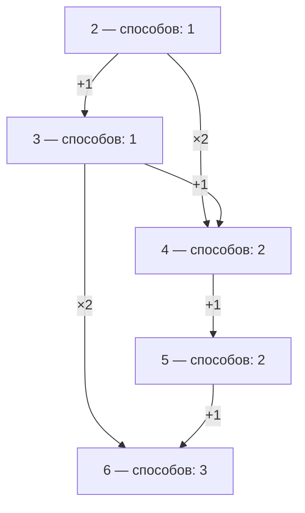

# Подсчёт программ для числового исполнителя

*Подробная теория для подготовки к ЕГЭ по информатике*

Эта глава учит считать разные последовательности команд, которые переводят исполнителя из исходного числа в конечное. Разбор охватывает получение заданного числа без дополнительных ограничений, обязательные промежуточные числа, запрещённые числа и сочетание этих условий. Сначала мы разберём смысл задачи и ручной подсчёт, затем построим решение на Python и рассмотрим случаи, в которых обычный шаблон нужно изменить.

В ЕГЭ 2027 это задание 13: подсчёт программ числового исполнителя. Спецификация ФИПИ 2027 относит к нему анализ хода исполнения алгоритма; в демоверсии есть команда перестановки двух младших цифр с условием применимости. В материалах прошлых лет такое содержание могло называться заданием 23, поэтому сверяй содержание и год, а не только номер в старой ссылке.

Главная идея: количество программ можно считать, не выписывая каждую программу целиком. Для этого достаточно понимать, какие команды могут привести в каждое число и сколько разных программ привело в предыдущие числа. Обязательное число позволяет разделить вычисление на участки; запрещённое число получает нулевое количество допустимых способов.

Как изучать материал. Сначала прочитай разделы 1–7 и самостоятельно составь простую таблицу. Затем изучи ограничения в разделах 8–12. После этого переходи к Python. Дополнительные условия, убывающие исполнители и комбинаторный способ вынесены дальше, чтобы не мешать освоению основы. Практика и подробные ответы находятся в конце. Примеры в этой главе составлены специально для объяснения методов.

## 1 Исполнитель и его команды

Исполнитель — это объект, который умеет выполнять определённые команды. В этих задачах удобно представить экран с одним числом. Исполнитель читает команду, изменяет число на экране и ждёт следующую команду.

Например, исполнителю доступны две команды:

| **Номер команды** | **Действие** | **Если на экране 5** |
| --- | --- | --- |
| 1 | Прибавить 1 | Получится 6 |
| 2 | Умножить на 2 | Получится 10 |

Номер команды служит её коротким обозначением. Команда с номером 2 не обязана прибавлять 2: в нашем примере она умножает число на 2. При решении сначала установи соответствие между номером и действием.

Текущее число — число, которое находится на экране прямо сейчас. Обозначим его буквой x. Тогда первая команда заменяет x на x + 1, а вторая заменяет x на 2x. Буква x нужна, чтобы описать действие сразу для любого исходного числа.

Если было 5, после первой команды стало 6. Если теперь выполнить вторую команду, умножается уже 6, поэтому получится 12. Каждая команда работает с результатом предыдущей команды.

Алгоритм — точное описание последовательности действий. Программа для такого исполнителя — конкретная последовательность разрешённых команд. Условие может попросить найти одну программу, её результат или количество всех подходящих программ. В нашей теме нас интересует именно последнее.

## 2 Присваивание и ветвление

### Что означает присваивание

Чтобы описать изменение числа в программе, используется присваивание. Его смысл: вычислить новое значение и записать его вместо старого.

Запись x ← x + 1 читается так: «взять старое значение x, прибавить 1 и сохранить результат в x». В Python то же действие записывают так:

```python
x = x + 1
```

Если перед строкой x равнялось 5, правая часть вычисляется как 5 + 1. После выполнения строки x равняется 6. Это не уравнение, которое требуется решить. Равенство x = x + 1 как математическое утверждение невозможно, а присваивание является обычной операцией изменения значения.

Запись x = x \* 2 означает: взять старое x, умножить его на 2 и сохранить полученное число. В Python звёздочка \* обозначает умножение.

В решении задачи часто есть ещё одна переменная — количество способов. Например, ways = ways + 3 увеличивает ранее подсчитанное количество способов на 3. Нужно всегда различать число на экране исполнителя и число программ, которые привели к нему.

### Что означает ветвление

Ветвление — выбор действия в зависимости от условия. Например, если число чётное, его можно разделить на 2 без остатка; если нечётное, такая команда может оказаться недоступной, когда исполнитель работает только с целыми числами.

В Python такой выбор записывают с помощью if — «если». Но дерево вариантов в задаче на подсчёт программ возникает ещё и потому, что мы рассматриваем разные возможные следующие команды. Одна конкретная программа уже содержит определённую команду на каждом месте. Наше решение перебирает возможные программы.

Наличие нескольких команд не означает, что сам исполнитель выбирает случайную команду. Мы должны учесть все допустимые варианты выбора при составлении программ.

## 3 Что делает программы разными

### Порядок команд

Программа 12 — сначала выполнить команду 1, затем команду 2. Программа 21 — сначала выполнить команду 2, затем команду 1.

Для команд «+1» и «×2» при исходном числе 3:

| **Программа** | **Вычисления** | **Конечное число** |
| --- | --- | --- |
| 12 | 3 → 4 → 8 | 8 |
| 21 | 3 → 6 → 7 | 7 |

Порядок команд может менять результат. Поэтому количество программ нельзя свести к количеству наборов команд без учёта их порядка.

Даже когда порядок не меняет конечное число, программы остаются разными. При командах «+1» и «+2» исходное число 2 программа 12 переводит в 2 → 3 → 5, а программа 21 — в 2 → 4 → 5. Конечный результат одинаков, но последовательности команд разные.

### Программа и траектория

Траектория вычислений — последовательность результатов выполнения команд. Для программы 12 с командами «+1» и «×2» при исходном числе 3 траектория состоит из 4 и 8.

Для объяснения мы часто пишем всю цепочку 3 → 4 → 8, включая старт. Это удобно для рассуждения, но в формальном определении траектории исходное число обычно не включается: оно не является результатом выполненной команды. Если ограничение касается самого исходного числа, внимательно прочитай определение в условии. В обычных примерах ниже обязательные и запрещённые числа расположены строго между стартом и финишем.

Теперь особенно важный случай. При командах «+1» и «×2» из 1 обе команды дают 2:

| **Команда** | **Действие** | **Результат** |
| --- | --- | --- |
| 1 | 1 + 1 | 2 |
| 2 | 1 × 2 | 2 |

Это две разные одношаговые программы. Одинаковый результат не делает команды одной командой.

Для перехода из 1 в 4 существуют четыре программы:

| **Программа** | **Полная цепочка** |
| --- | --- |
| 111 | 1 → 2 → 3 → 4 |
| 211 | 1 → 2 → 3 → 4 |
| 12 | 1 → 2 → 4 |
| 22 | 1 → 2 → 4 |

Числовых цепочек здесь две, а программ четыре. Поэтому одинаковые числа, полученные разными командами, нельзя объединять с потерей количества способов. В коде также нельзя заменять список результатов команд на множество уникальных чисел: множество удалит повторяющиеся результаты и занизит ответ.

### Длина программы

Длина программы — количество команд в ней. В программе 111 три команды, в программе 12 две команды. Если условие не ограничивает длину, учитывать нужно подходящие программы всех возможных длин. Если требуется ровно пять команд, это отдельное дополнительное условие.

Вопрос «сколько программ?» также не означает «сколько самых коротких программ?». Поиск кратчайшей программы и подсчёт всех программ — разные задачи.

## 4 Почему важно направление изменения числа

### Строгое увеличение

Для команд «+1» и «×2» на положительных целых числах каждая команда увеличивает число. Это значит, что в цепочке каждый следующий результат больше предыдущего. Такое движение называют строго возрастающим.

Из 2 можно получить 3 или 4, из 3 — 4 или 6, из 4 — 5 или 8. Вернуться из 8 в 6 этими командами невозможно.

Из строгого увеличения следуют полезные выводы:

1. Если число стало больше цели, эта ветка больше не приведёт к цели.

2. После достижения цели продолжать программу не нужно: следующая команда увеличит число и обратно вернуться не получится.

3. Одно число не встречается в такой цепочке дважды.

4. Обязательные промежуточные числа посещаются в порядке возрастания.

5. На конечном диапазоне целых чисел количество подходящих программ конечно.

Последний вывод можно объяснить без формулы. Между стартом a и целью b есть конечное число целых значений. Каждая команда переводит нас в большее значение, поэтому в одной программе не может быть больше b − a команд. Необязательно существование программы такой длины; это верхняя граница.

### Строгое уменьшение

Если команды всегда уменьшают положительное число, рассуждение строится в обратную сторону. Например, команды «вычесть 1» и «разделить на 2, если деление целочисленное» при старте выше положительной цели ведут вниз.

Когда значение стало меньше цели, вернуться наверх невозможно. Обязательные числа посещаются в порядке убывания, а таблицу заполняют от больших значений к меньшим.

### Проверка нужна для всех достижимых значений

Нельзя считать умножение или возведение в квадрат увеличивающей командой только по её названию. Умножение 0 на 2 оставляет 0; квадрат 1 оставляет 1; квадрат отрицательного числа может изменить направление движения. Для команды x → x² строгое увеличение на целых числах гарантировано при x ≥ 2.

Если старт равен 0 и доступны «+1» и «×2», можно сколько угодно раз умножать 0 на 2, а потом прибавить 1. Программы 1, 21, 221, 2221 и так далее все переводят 0 в 1. Без ограничения длины их бесконечно много. Обычный шаблон для возрастающего исполнителя здесь неприменим.

В основных примерах этой главы старт положительный, а команды строго увеличивают число. Перед применением формул в новой задаче проверь это условие заново.

### Перепрыгивание через число

Команда «×2» может перевести 4 сразу в 8. Числа 5, 6 и 7 при этом на экране не появляются. Число «перепрыгнули» означает, что одна команда перевела нас с одной стороны от него на другую.

Если обязательное число равно 6, переход 4 → 8 не подходит: при возрастающем движении 6 уже не появится. Если число 6 запрещено, тот же переход разрешён: результатом команды является 8, а не 6.

Ограничение «траектория не содержит 6» запрещает получить 6 на экране. Оно само по себе не запрещает переходить из меньшего числа в большее, минуя 6.

## 5 Дерево всех вариантов

Представим, что из исходного числа мы рисуем по одной ветке для каждой разрешённой команды. Из полученных чисел снова рисуем такие ветки. Такая схема называется деревом вариантов.

Корень дерева — исходная ситуация, то есть стартовое число. Ветка — выбор следующей команды. Лист — ситуация, в которой мы прекратили продолжение: достигли цели, вышли за неё или нарушили ограничение.

Разберём переход из 2 в 6 с командами 1 «+1» и 2 «×2».

Если начать с команды 1, получим 3. Далее возможны два выбора: прибавить 1 и получить 4 либо умножить на 2 и сразу получить 6. Во втором случае программа 12 успешно завершена. В первом случае из 4 допустимо продолжить через 5 в 6: получится программа 1111.

Если начать с команды 2, получим 4. Далее снова нужно пройти 4 → 5 → 6, поэтому получим программу 211. Умножение 4 на 2 даёт 8, что уже больше цели; эта ветка не подходит.

| **Программа** | **Вычисления** |
| --- | --- |
| 1111 | 2 → 3 → 4 → 5 → 6 |
| 12 | 2 → 3 → 6 |
| 211 | 2 → 4 → 5 → 6 |

Ответ равен 3. Мы убедились в нём полным перебором.

Успешный лист даёт один способ, а безуспешный лист — ноль способов. В каждом месте разветвления количество успешных продолжений равно сумме количеств успешных продолжений всех его ветвей.

### Почему дерево быстро становится большим

Если из каждого числа возможны две команды, после первого выбора ветвей две, после второго — до четырёх, после третьего — до восьми. Часть ветвей заканчивается раньше, но общее количество всё равно может быстро расти.

Кроме того, в разных местах дерева появляется одно и то же число. Например, 4 получено и программой 11, и программой 2. Дальнейшие возможности из 4 одинаковы, если ограничения зависят только от текущего числа. Было бы удобно вычислить эти возможности один раз.

Можно объединить одинаковые числа в схему переходов. Такая схема называется графом: вершины обозначают числа, направленные связи между вершинами — разрешённые команды. При объединении нужно сохранить количество способов, с которыми мы пришли в вершину.



<details>
<summary>Исходное изображение схемы</summary>

![Граф переходов из 2 в 6 с командами плюс 1 и умножить на 2. Количество программ до 4 равно 2, до 6 равно 3.]()

</details>

На схеме переходов 2 → 6 число 4 встречается один раз, но в него ведут две программы. Поэтому дальше через 4 идут две разные программы, хотя само число изображено одной вершиной. Табличный подсчёт будет хранить именно это количество.

## 6 Почему количества способов складываются

Обозначим W(n) количество программ, которые переводят фиксированное стартовое число a в число n. Буква W — название функции подсчёта; n — число, до которого мы считаем программы. W(6) = 3 означает «есть три программы для получения 6», а не «исполнитель находится в числе 3».

Для команд «+1» и «×2» рассмотрим последнюю команду программы, заканчивающейся в n.

Если последняя команда прибавляет 1, перед ней должно быть n − 1. Любую программу до n − 1 можно дополнить этой командой и получить программу до n. Значит, вклад такого варианта равен W(n − 1).

Если последняя команда умножает на 2, перед ней должно быть n / 2. Но исполнитель работает с целыми числами, поэтому такой предыдущий результат существует только для чётного n. Вклад равен W(n / 2), если n чётное, и нулю, если нечётное.

Таким образом, при n \> a:

**Если n нечётное, W(n) = W(n − 1).**

**Если n чётное, W(n) = W(n − 1) + W(n / 2).**

Предыдущие числа, из которых в n можно прийти одной командой, называются предшественниками. Например, предшественники 10 в нашем исполнителе — 9 по команде «+1» и 5 по команде «×2».

Почему мы складываем? Все программы до n разделены на группы по последней команде. Программа не может одновременно заканчиваться командой 1 и командой 2, поэтому группы не пересекаются. Общее количество равно сумме количеств в этих группах.

Важно: непересечение определяется последней командой, а не различием предыдущих чисел. При n = 2 и старте 1 оба предшественника численно равны 1, но команды разные. Поэтому W(2) = W(1) + W(1) = 2.

Это общий принцип: нужно складывать вклады разрешённых команд, а не только различных чисел-предшественников. Если одна команда допускает несколько предшественников, учитываются все её разрешённые переходы.

### Почему в начальном числе ставят единицу

В стартовом числе мы уже находимся. Для получения a из a ничего делать не нужно. Единственный вариант состоит в выполнении нуля команд. Его называют пустой программой.

Поэтому для внутреннего подсчёта устанавливаем W(a) = 1. Эта единица позволяет правильно посчитать программы, состоящие из одной команды: к пустой программе добавляется первая настоящая команда.

Если поставить W(a) = 0, все последующие суммы будут равны нулю. Мы потеряем факт существования исходного состояния.

Когда старт и финиш различаются, пустая программа не является ответом на исходную задачу. Она служит начальным условием подсчёта. Если в отдельной задаче старт совпадает с финишем и считаются только непустые программы, это условие необходимо учесть отдельно.

Для строго возрастающего исполнителя W(n) = 0 при n \< a. До таких чисел нельзя добраться из a. Ноль также ставится в недостижимые числа внутри диапазона.

### Почему такой подсчёт охватывает все программы

У каждой непустой программы есть последняя команда. Мы рассмотрели каждый возможный вариант последней команды. После её удаления остаётся программа до соответствующего предшественника. И обратно: любую программу до разрешённого предшественника можно дополнить нужной командой.

Следовательно, никакая подходящая программа не пропускается. Двойного учёта тоже нет: последняя команда у конкретной программы одна. Это объясняет формулу без необходимости заучивать её.

## 7 Таблица количества программ без ограничений

Найдём количество программ из 2 в 12 для команд «+1» и «×2». Сначала записываем W(2) = 1. Значения ниже 2 считаем нулевыми. Затем идём по числам в порядке возрастания.

| **Число n** | **Через команду +1** | **Через команду ×2** | **W(n)** |
| --- | --- | --- | --- |
| 2 | Начальное состояние | — | 1 |
| 3 | W(2) = 1 | Целого предшественника нет | 1 |
| 4 | W(3) = 1 | W(2) = 1 | 2 |
| 5 | W(4) = 2 | Целого предшественника нет | 2 |
| 6 | W(5) = 2 | W(3) = 1 | 3 |
| 7 | W(6) = 3 | Целого предшественника нет | 3 |
| 8 | W(7) = 3 | W(4) = 2 | 5 |
| 9 | W(8) = 5 | Целого предшественника нет | 5 |
| 10 | W(9) = 5 | W(5) = 2 | 7 |
| 11 | W(10) = 7 | Целого предшественника нет | 7 |
| 12 | W(11) = 7 | W(6) = 3 | 10 |

Ответ: 10 программ. Полное дерево для этой задачи уже менее удобно, чем таблица.

Подробно рассмотрим последнюю строку. Семь программ заканчиваются переходом 11 → 12, три программы — переходом 6 → 12. Значит, всего их 7 + 3 = 10. Три программы до 6 нам уже известны: 1111, 12 и 211. При дописывании команды 2 они превращаются в три разные программы до 12.

Такой способ называется динамическим программированием. Смысл термина здесь простой: мы решаем небольшие задачи в нужном порядке, сохраняем результаты и используем их для решения следующей задачи. Небольшая задача — подсчёт программ до одного промежуточного числа.

Не нужно сначала изучать общий курс динамического программирования. Для данной темы достаточно понимать, что хранит каждая ячейка, откуда берётся её значение и почему предыдущие значения уже известны.

### Как заполнять таблицу без ошибок

1. Определи старт и поставь под ним 1.

2. Для следующего числа найди все разрешённые предшественники.

3. Запиши вклады каждой команды отдельно.

4. Сложи вклады.

5. Повтори до цели.

Для умножения проверяй делимость. У числа 7 нет целого предшественника 7 / 2. Нельзя округлить 3,5 до 3 и добавить W(3): команда «×2» переводит 3 в 6, а не в 7.

Если предшественник меньше старта участка, его вклад равен нулю. Например, при подсчёте программ из 6 в 12 для числа 8 потенциальный предшественник 4 находится ниже старта. Из 6 до 4 дойти нельзя, поэтому вклад умножения здесь нулевой.

### Подсчёт откуда пришли и куда пойдём

Таблицу можно строить двумя равноправными способами. Первый: вычислять значение очередного числа по всем переходам, которые в него входят. Именно так мы заполнили таблицу выше.

Второй: зная количество программ до x, перенести это количество к каждому результату одной команды из x. Если до 4 существуют две программы, то после команды «+1» они дадут две программы до 5, а после «×2» — две программы до 8.

Если в 8 приходят вклады из разных чисел, их нужно прибавлять к уже имеющемуся значению. Перезаписывание потеряет ранее подсчитанные программы.

Выбери один способ построения таблицы и последовательно используй его. Если для одного перехода и внести вклад из предшественника, и повторно добавить тот же вклад при обработке назначения, он будет учтён дважды.

## 8 Обязательное промежуточное число

Пусть требуется преобразовать 2 в 12 командами «+1» и «×2», причём траектория обязательно должна содержать 6.

Каждая подходящая программа состоит из двух частей: сначала программа из 2 в 6, затем программа из 6 в 12. Поскольку число строго растёт, 6 встречается только один раз, и граница между частями определяется однозначно.

Первый участок мы уже посчитали: из 2 в 6 существуют 3 программы.

На втором участке из 6 в 12 есть два варианта: шесть раз прибавить 1 или один раз умножить на 2. Если начать с прибавления 1, умножение любого числа 7 и больше даст как минимум 14, то есть превышение цели. Поэтому других вариантов нет.

| **Выбор программы до 6** | **Продолжение шестью командами +1** | **Продолжение одной командой ×2** |
| --- | --- | --- |
| 1111 | 1111111111 | 11112 |
| 12 | 12111111 | 122 |
| 211 | 211111111 | 2112 |

Получилось 3 × 2 = 6 программ.

Обозначим C(a, b) количество программ из числа a в число b при заданных командах. Тогда для обязательного промежуточного c:

**Количество программ через c = C(a, c) × C(c, b).**

### Почему здесь умножение

Для каждой из трёх первых частей доступны обе вторые части. Мы выбираем одну первую часть и одну вторую часть одновременно. Поэтому количество пар равно 2 + 2 + 2 = 3 × 2.

Сложение 3 + 2 посчитало бы первые и вторые части как самостоятельные варианты. Но полная программа требует обе части.

Умножение верно ещё и потому, что разные пары частей дают разные полные программы. Любую полную программу можно снова разрезать в единственном месте, где появилось 6, и восстановить обе части.

### Второй участок считается заново

Для участка 6 → 12 начальное условие — одна пустая программа в числе 6. Нужно поставить новую единицу: W(6) = 1 для этого участка.

Нельзя взять W(6) = 3 из таблицы, начатой в 2, посчитать продолжения и потом ещё раз умножить ответ на 3. Это учтёт количество первых частей дважды.

На первом участке функция W означала «сколько программ из 2 в n». На втором она означает «сколько программ из 6 в n». Это разные вопросы, поэтому у них разные начальные условия.

### Когда обязательное число недостижимо

Если до обязательного числа нет программ или из него нельзя получить цель, один из множителей равен нулю. Итоговый ответ тоже нулевой.

При строгом увеличении обязательное промежуточное число должно находиться между стартом и финишем. Если требуется пройти через 15 на пути из 2 в 12, выполнить условие невозможно.

### Границы применения произведения

Этот способ применяется непосредственно, когда обязательное число посещается однозначно и дальнейшие возможности зависят только от текущего числа. В наших возрастающих задачах это выполняется.

Если существуют возвраты, одно и то же число может встретиться несколько раз. Если есть общее ограничение на длину программы или количество определённых команд, части также могут перестать быть независимыми. Эти случаи разобраны дальше.

## 9 Запрещённое число

Пусть команды снова «+1» и «×2», старт 2, цель 12. Теперь число 6 не должно встречаться в траектории.

В дереве вариантов любую ветку, получившую 6, прекращаем и считаем безуспешной. В таблице это означает W(6) = 0, даже если арифметически в 6 можно прийти несколькими способами.

| **Число n** | **Расчёт** | **Допустимое количество W(n)** |
| --- | --- | --- |
| 2 | Начальное состояние | 1 |
| 3 | W(2) | 1 |
| 4 | W(3) + W(2) | 2 |
| 5 | W(4) | 2 |
| 6 | Число запрещено | 0 |
| 7 | W(6) | 0 |
| 8 | W(7) + W(4) | 2 |
| 9 | W(8) | 2 |
| 10 | W(9) + W(5) | 4 |
| 11 | W(10) | 4 |
| 12 | W(11) + W(6) | 4 |

Ответ: 4 программы.

Обрати внимание на 8. После нулей в 6 и 7 количество снова стало ненулевым. В 8 можно попасть умножением 4 на 2, не получая ни 6, ни 7. Поэтому после запрещённого числа нельзя обнулять весь оставшийся диапазон.

Ноль в запрещённой ячейке автоматически запрещает любые дальнейшие программы, которые проходили бы через эту ячейку. Но переходы, перепрыгивающие через неё, сохраняются.

### Несколько запрещённых чисел

Каждому запрещённому числу присваиваем нулевое количество допустимых способов. Например, если запрещены 6 и 9, нулевыми должны оставаться обе ячейки. Остальные числа рассчитываются по обычному правилу.

Если запрещённое число лежит вне диапазона возможных промежуточных значений при строгом увеличении, оно не влияет на ответ. Это удобно понимать, но в коде можно сохранить проверку для всех запрещённых чисел: она просто не сработает вне диапазона.

Если запрещена конечная цель, подходящих программ нет: результат последней команды входит в траекторию. Если ограничение относится к исходному числу, проверь формальное определение траектории; ниже код использует обычное для подсчёта путей соглашение, что запрещённые состояния нельзя использовать вообще.

### Проверка через вычитание

Все программы из 2 в 12 можно разделить на две непересекающиеся группы: проходящие через 6 и не проходящие через 6.

Всего программ 10. Через 6 их 6. Следовательно, без 6 их 10 − 6 = 4. Это совпало с таблицей.

При одном запрещённом числе в строго возрастающей задаче можно использовать формулу:

**Без q = C(a, b) − C(a, q) × C(q, b).**

При нескольких запрещённых числах простое вычитание всех произведений может дать ошибку. Программа, проходящая через два запрещённых числа, окажется вычтенной дважды. Прямое обнуление запрещённых состояний обычно проще.

## 10 Обязательное и запрещённое числа вместе

Решим более сложный пример. Команды «+1» и «×2». Требуется перевести 2 в 20, обязательно получить 6 и ни разу не получить 9.

Разделяем задачу по обязательному числу: 2 → 6 и 6 → 20. На каждом участке считаем программы с учётом запрета на 9.

На первом участке число 9 недостижимо без превышения цели 6, поэтому запрет ничего не меняет. Программ из 2 в 6 три.

На втором участке начинаем с новой единицы в числе 6 и обнуляем 9.

| **n** | **Расчёт** | **W(n)** |
| --- | --- | --- |
| 6 | Старт второго участка | 1 |
| 7 | W(6) | 1 |
| 8 | W(7) + W(4), причём W(4) = 0 | 1 |
| 9 | Запрет | 0 |
| 10 | W(9) + W(5), причём W(5) = 0 | 0 |
| 11 | W(10) | 0 |
| 12 | W(11) + W(6) | 1 |
| 13 | W(12) | 1 |
| 14 | W(13) + W(7) | 2 |
| 15 | W(14) | 2 |
| 16 | W(15) + W(8) | 3 |
| 17 | W(16) | 3 |
| 18 | W(17) + W(9) | 3 |
| 19 | W(18) | 3 |
| 20 | W(19) + W(10) | 3 |

Вторых частей три. Общий ответ равен 3 × 3 = 9.

Эти три вторые части можно увидеть и вручную:

1. Из 6 умножить на 2, получить 12, затем прибавлять 1 до 20.

2. Из 6 прибавить 1, получить 7, умножить на 2, получить 14, затем прибавлять 1 до 20.

3. Из 6 дважды прибавить 1, получить 8, умножить на 2, получить 16, затем прибавлять 1 до 20.

До 9 прибавлениями доходить нельзя. После прыжка в 12, 14 или 16 ещё одно умножение уже превысит 20, поэтому дальше доступны только прибавления.

Обозначим Cq(a, b) количество программ, которые проходят из a в b без запрещённого q. Тогда ответ через обязательное c и без q равен Cq(a, c) × Cq(c, b).

Запрет учитывается на любом участке, где он может встретиться. Если запрещённое и обязательное числа совпали, выполнить оба требования невозможно, и ответ равен нулю.

## 11 Несколько обязательных чисел

Пусть нужно перейти из 2 в 12 командами «+1» и «×2», а в траектории должны присутствовать 4 и 8.

Из-за строгого увеличения порядок может быть только таким: 2 → 4 → 8 → 12. В формулировке может быть сказано «в любом порядке», но сами команды заставляют сначала посетить меньшее число.

Количество программ равно C(2, 4) × C(4, 8) × C(8, 12).

Из 2 в 4 есть две программы: 11 и 2. Из 4 в 8 тоже две: 1111 и 2. Из 8 в 12 возможна только программа 1111, потому что умножение любого числа 8 и больше на 2 превышает 12.

Ответ: 2 × 2 × 1 = 4.

Если обязательных чисел больше, добавляем участки. Для возрастающего исполнителя упорядочиваем промежуточные числа по возрастанию, для убывающего — по убыванию. Каждый участок считается со своим стартом и с учётом всех действующих запретов.

Не нужно добавлять вариант «сначала 8, потом 4» для строго возрастающего исполнителя. Такой вариант не существует.

### Разница между и и или

Требование «содержит 3 и 4» означает, что нужны оба числа. Требование «содержит 3 или 4» обычно означает хотя бы одно из них, то есть присутствие обоих тоже подходит. Требование «содержит ровно одно из чисел 3 и 4» исключает присутствие обоих.

Разберём все три условия для пути 2 → 6 с командами «+1» и «×2». Программ всего три: 1111 проходит через 3 и 4; 12 проходит через 3; 211 проходит через 4.

| **Условие** | **Подходящие программы** | **Всего** |
| --- | --- | --- |
| Содержит 3 и 4 | 1111 | 1 |
| Содержит хотя бы одно из чисел 3 и 4 | 1111, 12, 211 | 3 |
| Содержит ровно одно из чисел 3 и 4 | 12, 211 | 2 |

Количество программ через 3 равно 2. Через 4 тоже 2. Через оба числа — 1. Если просто сложить 2 + 2, программу 1111 учтём дважды.

Поэтому количество через хотя бы одно число равно 2 + 2 − 1 = 3. Мы вычли один лишний учёт пересечения. Количество через ровно одно равно 2 + 2 − 2 × 1 = 2: программу из пересечения нужно убрать из обеих групп.

Этот принцип называется учётом пересечения, или принципом включения и исключения. Название не нужно запоминать для решения: важно понимать, какие программы были посчитаны дважды.

## 12 Три команды и совпадающие переходы

Рассмотрим исполнителя с командами 1 «+1», 2 «+2», 3 «×2». Старт 1, цель 10.

В n можно попасть из n − 1 первой командой, из n − 2 второй командой и из n / 2 третьей командой, если n чётное. Значения ниже старта дают нулевой вклад. Поэтому для n \> 1:

**W(n) = W(n − 1) + W(n − 2), если n нечётное.**

**W(n) = W(n − 1) + W(n − 2) + W(n / 2), если n чётное.**

| **n** | **По команде +1** | **По команде +2** | **По команде ×2** | **Всего** |
| --- | --- | --- | --- | --- |
| 1 | Старт | — | — | 1 |
| 2 | 1 | 0 | 1 | 2 |
| 3 | 2 | 1 | 0 | 3 |
| 4 | 3 | 2 | 2 | 7 |
| 5 | 7 | 3 | 0 | 10 |
| 6 | 10 | 7 | 3 | 20 |
| 7 | 20 | 10 | 0 | 30 |
| 8 | 30 | 20 | 7 | 57 |
| 9 | 57 | 30 | 0 | 87 |
| 10 | 87 | 57 | 10 | 154 |

Ответ: 154.

Почему у 4 вклад из числа 2 появился дважды? Команда «+2» переводит 2 в 4 и команда «×2» тоже переводит 2 в 4. Каждую из двух программ до 2 можно закончить одной или другой командой. Получаются четыре программы с предпоследним числом 2: две по команде «+2» и две по команде «×2».

Если вместо сложения двух вкладов W(2) оставить один, ответ окажется заниженным. Правило подсчёта программ сохраняет номер каждой команды, даже когда числовые переходы совпали.

## 13 Как вывести формулу для новых команд

Универсальный вопрос при заполнении таблицы: «Из какого предыдущего числа эта конкретная команда могла получить n?» Нужно решить простое равенство для предыдущего числа и проверить условия применимости команды.

Обозначим предыдущее число буквой p, а результат — n. Для команды «прибавить 3» равенство выглядит как p + 3 = n, значит p = n − 3. Для команды «умножить на 3» получаем 3p = n, значит p = n / 3, причём p должно быть целым.

| **Команда** | **Как найти предыдущий результат p** | **Условие** |
| --- | --- | --- |
| Прибавить k | p = n − k | p находится в допустимом диапазоне |
| Умножить на k | p = n / k | n делится на k без остатка |
| Получить 2x + 1 | p = (n − 1) / 2 | n нечётное |
| Получить 3x + 2 | p = (n − 2) / 3 | n − 2 делится на 3 |
| Дописать справа цифру d | p = (n − d) / 10 | Последняя цифра n равна d |
| Возвести положительное число в квадрат | p = √n | n является точным квадратом |
| Вычесть k | p = n + k | Для убывающей таблицы p уже обработано |
| Разделить на 2 точно | p = 2n | Деление в исходной команде должно быть точным |
| Разделить на 2 нацело | p = 2n или p = 2n + 1 | Для неотрицательных целых чисел |

Здесь k — конкретная величина из условия. В строках про умножение и прибавление для возрастающего исполнителя обычно k положительное, а при умножении k \> 1. Каждую команду всё равно проверяют на всей области достижимых значений.

### Команда получить 2x плюс 1

Это означает сначала удвоить текущее число, затем прибавить 1 в рамках одной команды. Из 4 получится 9. Для конечного числа 9 предыдущее число равно (9 − 1) / 2 = 4. Для 10 предшественника нет, потому что (10 − 1) / 2 = 4,5.

Если доступны «+1» и «2x + 1», формула при n выше старта такая: W(n) = W(n − 1) для чётного n и W(n) = W(n − 1) + W((n − 1) / 2) для нечётного n.

Команда «сделай нечётное» может иметь именно такой смысл, но её название не заменяет точное определение. Всегда читай, какое число получается по условию.

### Дописывание цифры

Приписать к положительному числу 23 справа цифру 4 означает получить 234. Численно это действие записывается как 10 × 23 + 4. Поэтому команда «дописать 4» равна x → 10x + 4.

Обратный переход возможен только тогда, когда конечное число оканчивается на 4. Например, 154 можно получить этой командой из 15, а 153 — нельзя. Нельзя просто делить любое число на 10 с округлением: это добавит переходы, которых у исполнителя нет.

### Точное и целочисленное деление

Эти действия различаются. «Разделить на 2 при условии, что результат целый» позволяет переход 6 → 3, но не позволяет 7 → 3. «Разделить на 2 нацело» для положительных чисел позволяет и 6 → 3, и 7 → 3: дробная часть отбрасывается.

Поэтому для точного деления у результата 3 один предшественник, 6. Для деления нацело у результата 3 два предшественника, 6 и 7. При ручном подсчёте оба вклада целочисленного деления нужно учитывать.

Слово «деление» само по себе не даёт права выбрать один из вариантов. Ориентируйся на определение команды и область допустимых значений исполнителя.

### Квадрат

Если предыдущее число положительное и команда возводит его в квадрат, результат 16 может быть получен из 4. Результат 18 этой командой получить нельзя: целого числа с квадратом 18 не существует.

Если отрицательные числа тоже разрешены, у положительного квадрата могут быть два предшественника: 4 и −4 дают 16. Нельзя автоматически оставлять только положительный корень. В обычном возрастающем варианте на положительных числах этот вопрос не возникает.

В Python для проверки целого квадратного корня можно использовать isqrt из модуля math. Эта функция возвращает целую часть квадратного корня без вычисления приближённого дробного результата. После получения p = isqrt(n) нужно проверить p \* p == n, чтобы понять, является ли n точным квадратом.

### Когда проще двигаться вперёд

Для сложной команды иногда легче вычислять её результат из x, чем искать все возможные предшественники n. Например, действие с перестановкой цифр удобно буквально выполнить над текущим числом.

В таком случае можно использовать рекурсивный подсчёт продолжений или таблицу с переносом количества способов вперёд. Но нужно отдельно проверить, что все разрешённые переходы идут в направлении выбранного порядка обработки. Сам по себе удобный способ вычисления команды не гарантирует отсутствия возвратов.

### Команда может быть разрешена только при условии

Рассмотрим команду: поменять местами две младшие десятичные цифры, только если цифра десятков меньше цифры единиц. У числа 112 десятки равны 1, единицы — 2: команда разрешена и даёт 121. У числа 121 десятки равны 2, единицы — 1: команда запрещена. Это не переход в прежнее число и не нулевой вклад после выполнения: такой ветви выбора вообще нет.

Пусть t — цифра десятков, u — цифра единиц. До перестановки младшая часть равна 10t + u, после — 10u + t. Старшие разряды не меняются. Разность нового и старого чисел равна 9(u − t). При условии t \< u она строго положительна. Поэтому команда всегда увеличивает число на области, где её разрешено применять; таблицу можно заполнять по возрастанию.

Небольшой учебный пример: старт 10, цель 24, команды A «+1» и B «переставь две младшие цифры при t \< u». Без перестановки есть одна программа — четырнадцать команд A. Для второй программы сначала получаем 12, затем 21 перестановкой, затем 22, 23 и 24: программа AABAAA. Других программ нет. В 10 и 11 перестановка запрещена; из 13–19 она сразу даёт число не меньше 31; из 20–22 запрещена; из 23 даёт 32. Превысив 24, вернуться нельзя. Ответ: 2.

Схема допустимых путей: 10 → 11 → 12 → 13 → … → 24 и 10 → 11 → 12 → 21 → 22 → 23 → 24. Перестановка 12 → 21 не посещает числа 13–20, поэтому запрет на одно из них не запрещал бы сам этот переход.

Сначала проверяй разрешение команды по текущему числу, затем вычисляй её результат и добавляй вклад. Не добавляй перестановку при равных цифрах: она оставила бы число неизменным, хотя условие t \< u этого не разрешает. Именно условие применимости здесь обеспечивает отсутствие такого цикла.

## 14 Недостижимые числа и свойства которые сохраняются

Иногда невозможность перехода видна ещё до заполнения таблицы. Например, при командах «+2» и «×3» стартовое число 2 чётное. Прибавление 2 сохраняет чётность, умножение на 3 тоже сохраняет чётность. Значит, все результаты будут чётными, а получить 13 невозможно. Ответ сразу 0.

Свойство, которое сохраняется после каждой команды, называют инвариантом. В этом примере инвариант — чётность числа. Чтобы использовать его, нужно доказать сохранение для каждой доступной команды.

Если с теми же командами начать с 1, все результаты будут нечётными. Посчитаем программы из 1 в 15. Предшественники n — это n − 2 и n / 3, если деление на 3 точное.

| **n** | **W(n)** |
| --- | --- |
| 1 | 1 |
| 3 | W(1) + W(1) = 2 |
| 5 | W(3) = 2 |
| 7 | W(5) = 2 |
| 9 | W(7) + W(3) = 4 |
| 11 | W(9) = 4 |
| 13 | W(11) = 4 |
| 15 | W(13) + W(5) = 6 |

Ответ: 6. Все чётные числа в диапазоне получили бы нули, поэтому мы пропустили их в записи таблицы. Два вклада у 3 снова важны: из 1 можно прибавить 2 либо умножить на 3.

Подобным образом могут сохраняться кратность некоторому числу или определённые остатки при делении. Остаток — число, которое остаётся после выделения максимально возможного числа полных групп заданного размера. Например, 14 при делении на 4 даёт три полные четвёрки и остаток 2: 14 = 4 × 3 + 2.

Проверка свойства даёт полезное необходимое условие достижимости. Но соответствие этому условию не всегда гарантирует существование программы. При старте 1 и командах «+4», «+6» число 3 тоже нечётное, однако получить его нельзя: даже минимальная команда сразу даст 5.

Поэтому используем доказанную невозможность для отсечения, а в остальных случаях продолжаем подсчёт.

## 15 Рекурсивное решение на Python

Мы уже научились считать программы до каждого числа. Можно задать другой вопрос: сколько подходящих продолжений существует из текущего числа x до цели y?

Обозначим это количество f(x, y). Если из x можно перейти в x + 1 или 2x, то каждую программу-продолжение можно разделить по первой команде. Получаем:

**f(x, y) = f(x + 1, y) + f(2x, y).**

Функция справа обращается к самой себе, но уже для новых текущих чисел. Такой способ определения и вычисления функции называется рекурсией. В нашем случае это буквально подсчёт дерева: чтобы узнать число успешных продолжений вершины, узнаём количества для её ветвей и складываем.

### Когда вычисление останавливается

Если x \> y, цель перепрыгнута и возвращаться вниз нельзя. Подходящих продолжений ноль.

Если x == y, мы уже на цели. Есть один вариант закончить прямо сейчас, выполнив ноль дополнительных команд. Подходящих продолжений один.

Эти ситуации называются базовыми случаями: в них ответ известен сразу и дальнейших обращений к функции не нужно. Они останавливают раскрытие дерева.

Полный код для положительного строго возрастающего исполнителя:

```python
def f(x, y):
    if x > y:
        return 0
    if x == y:
        return 1
    return f(x + 1, y) + f(x * 2, y)

print(f(2, 12))
```

Вывод: 10.

### Объяснение каждой конструкции

def — слово, с которого начинается определение функции. Функция представляет собой именованный фрагмент программы: ему передают значения, он выполняет описанные действия и возвращает результат.

f — выбранное нами имя функции. Его можно заменить на count, но тогда заменить нужно во всех обращениях.

x и y в скобках — параметры, то есть имена передаваемых значений. В вызове f(2, 12) параметр x получает 2, а y получает 12. Во внутреннем вызове f(x + 1, y) создаётся новое вычисление функции с другим текущим числом, а цель сохраняется.

Двоеточие : показывает, что далее идёт блок команд функции или условной ветки. Отступы определяют, какие строки входят в этот блок. В Python отступы являются частью структуры программы.

if означает «если». Условие x \> y проверяет, превысило ли текущее число цель. Запись x == y сравнивает значения. Два знака равенства == используются для сравнения; один знак = используется для присваивания.

return возвращает результат текущего вызова и сразу завершает этот вызов. Поэтому при x \> y выполнение до последней строки не дойдёт. При x == y оно тоже остановится раньше раскрытия новых ветвей.

Последняя строка функции получает количество продолжений после команды «+1» и после команды «×2», затем складывает их. print выводит вычисленный ответ на экран.

### Почему текущие значения не мешают друг другу

У каждого вызова функции свои параметры. Когда f(2, 6) вызывает f(3, 6), исходное x в вызове f(2, 6) не превращается навсегда в 3. Первый вызов ждёт ответа второго, а затем может отдельно вызвать f(4, 6).

Это удобно представлять как листки с одинаковым вопросом. На первом записано «сколько из 2 в 6?», на втором «сколько из 3 в 6?», на третьем «сколько из 4 в 6?». Ответы на меньшие вопросы возвращаются на листок, где их запросили.

### Полная раскрутка маленького примера

Посчитаем f(2, 6):

1. f(5, 6) = f(6, 6) + f(10, 6) = 1 + 0 = 1.

2. f(4, 6) = f(5, 6) + f(8, 6) = 1 + 0 = 1.

3. f(3, 6) = f(4, 6) + f(6, 6) = 1 + 1 = 2.

4. f(2, 6) = f(3, 6) + f(4, 6) = 2 + 1 = 3.

Обрати внимание: f(4, 6) встретилась дважды. Это повторный подсчёт одинакового вопроса, а не лишняя программа. Программы, которые пришли в 4 разными путями, должны обе учитываться. Но значение одинакового вопроса можно вычислить один раз и использовать повторно.

### Как получить остальные три типа задач

Для обязательного числа 6:

```python
print(f(2, 6) * f(6, 12))
```

Вывод: 6.

Для обязательных чисел 4 и 8:

```python
print(f(2, 4) * f(4, 8) * f(8, 12))
```

Вывод: 4.

Для запрета на 6 добавляем базовый случай, который возвращает 0 для запрещённого состояния:

```python
def f(x, y):
    if x == 6 or x > y:
        return 0
    if x == y:
        return 1
    return f(x + 1, y) + f(x * 2, y)

print(f(2, 12))
```

Вывод: 4. Слово or означает «или»: ноль возвращается, если выполнено хотя бы одно из двух условий.

Проверку запрета ставим перед проверкой достижения цели. Тогда запрещённая цель даст 0. Если первой проверить x == y, запрещённая цель ошибочно будет принята как успешный конец.

Эти примеры показывают новые определения f. При проверке вариантов в одном файле помни, что новое def f заменяет предыдущее определение функции. Для одновременного сравнения можно дать вариантам разные имена.

## 16 Запоминание результатов рекурсии

Рекурсия раскрывает дерево и может многократно считать один и тот же вопрос. Чем больше цель, тем больше повторов. Например, к одному числу можно прийти несколькими программами, и для каждого прихода продолжения без запоминания будут вычислены заново.

Мы можем сохранить ответ для каждой пары x и y. При следующем таком же вопросе Python возьмёт готовый результат. Этот приём называется запоминанием результатов, или мемоизацией. В Python для него есть готовый инструмент cache из модуля functools.

Модуль — файл или набор связанных возможностей Python, которые можно подключить. Строка from functools import cache подключает конкретный инструмент cache. Запись @cache над функцией добавляет ей хранение результатов: если тот же набор аргументов уже встречался, функция не пересчитывает его.

Это пример декоратора — инструмента, который дополняет поведение функции. Для решения достаточно знать его конкретное действие: сохранять результаты по аргументам вызова.

Для задачи 2 → 20 через 6 без 9 полный код выглядит так:

```python
from functools import cache

@cache
def f(x, y):
    if x == 9 or x > y:
        return 0
    if x == y:
        return 1
    return f(x + 1, y) + f(x * 2, y)

print(f(2, 6) * f(6, 20))
```

Вывод: 9.

Можно использовать один f для двух участков, потому что цель y является аргументом. Вопрос f(6, 6) отличается от вопроса f(6, 20), и ответы сохраняются отдельно.

### Кэш не должен скрывать условия задачи

Если функция использует внешний запрет, а затем ты меняешь запрет без изменения аргументов и без очистки сохранённых ответов, ранее вычисленные значения станут неверными для новых условий. Либо определяй новую функцию для новой задачи, либо очищай сохранённые результаты командой f.cache\_clear(), либо передавай ограничения аргументами в неизменяемом виде.

В приведённом коде запрет на 9 зафиксирован и не меняется во время вычисления. Поэтому запоминание корректно.

При изменении команд тоже нужно пересчитать результаты. Сохранённый ответ относится не просто к паре чисел, а к паре чисел в задаче с конкретными командами и ограничениями.

### Почему запоминание не уменьшает количество программ

Предположим, из 4 в 6 одна программа. Если в 4 можно прийти двумя разными путями, эта одна программа-продолжение нужна для обоих путей. Кэш возвращает число 1 дважды в двух местах суммы. Он устраняет повторное вычисление, но не устраняет повторное использование результата.

Именно поэтому запоминание сохраняет правильный ответ. Объединение результатов команд в множество, наоборот, удалило бы часть различных выборов и изменило ответ.

### Ограничение глубины

Даже с запоминанием цепочка вызовов при команде «+1» может быть очень длинной. Python ограничивает глубину вложенных вызовов. Если цель велика, рекурсия может завершиться ошибкой RecursionError.

Для большого диапазона удобно использовать табличный вариант ниже. Он идёт циклом, не создавая длинную цепочку вложенных вызовов. Увеличение предела рекурсии не заменяет понимание структуры задачи.

## 17 Табличное решение на Python

Таблица на бумаге хранит количество программ под каждым числом. В Python для этого можно использовать список: последовательность ячеек, у каждой из которых есть номер — индекс.

В Python индексы начинаются с 0. В решении мы создадим список так, чтобы номер ячейки совпадал с числом исполнителя. Тогда dp\[6\] будет хранить количество программ, которые привели в число 6.

Имя dp часто используют для такой таблицы, но оно не имеет специального значения для языка. Можно назвать список ways.

Запись \[0\] создаёт список из одного нуля. Запись \[0\] \* (finish + 1) создаёт finish + 1 нулевых ячеек с индексами от 0 до finish. Дополнительная ячейка нужна, потому что последний индекс на единицу меньше длины списка.

Установим dp\[start\] = 1. Затем обработаем числа по возрастанию. Для каждого x вычислим результаты всех команд и добавим dp\[x\] к соответствующим ячейкам.

```python
def count_programs(start, finish, forbidden=()):
    if start > finish:
        return 0
    if start in forbidden or finish in forbidden:
        return 0

    dp = [0] * (finish + 1)
    dp[start] = 1

    for x in range(start, finish + 1):
        if x in forbidden:
            continue
        for next_x in (x + 1, x * 2):
            if next_x <= finish and next_x not in forbidden:
                dp[next_x] += dp[x]

    return dp[finish]

print(count_programs(2, 12))
print(count_programs(2, 12, (6,)))
print(count_programs(2, 6) * count_programs(6, 12))
print(count_programs(2, 6, (9,)) *
      count_programs(6, 20, (9,)))
```

Вывод:

```text
10
4
6
9
```

Этот код рассчитан на положительные целые старт и финиш и команды «+1», «×2», которые строго увеличивают число. Если команды меняются, нужно изменить результаты next\_x и проверить направление всех переходов. Код считает запрещённое состояние недопустимым даже в качестве старта; для редкой формулировки, которая разрешает запрещённое число только как исходное и исключает его из траектории, правило старта нужно изменить отдельно.

### Объяснение новых конструкций

for означает цикл: повторение действий для каждого элемента указанной последовательности.

range(start, finish + 1) перебирает целые числа от start до finish включительно. Правая граница range не включается, поэтому записываем finish + 1.

for next\_x in (x + 1, x \* 2) по очереди берёт результаты первой и второй команд. Скобки создают кортеж — упорядоченную последовательность значений. Она сохраняет повторения. Если обе команды дали одинаковое число, цикл обработает его дважды, что правильно для подсчёта разных программ.

forbidden — переданная последовательность запрещённых чисел. По умолчанию она равна (), то есть пустому кортежу: запретов нет. Кортеж из одного элемента записывается (6,) с запятой. Запись (6) без запятой является просто числом в скобках.

in проверяет наличие значения в последовательности. not in проверяет отсутствие. Слово and означает «и»: обе части условия должны быть выполнены.

continue пропускает оставшиеся действия текущей итерации цикла и переходит к следующему элементу. Если x запрещено, мы не распространяем способы из него дальше.

Запись dp\[next\_x\] += dp\[x\] означает то же, что dp\[next\_x\] = dp\[next\_x\] + dp\[x\]. Мы прибавляем новые способы к старым. Простое присваивание dp\[next\_x\] = dp\[x\] было бы ошибкой, потому что уничтожало бы способы, пришедшие ранее по другим переходам.

Для трёх команд «+1», «+2», «×2» можно заменить строку перебора на for next\_x in (x + 1, x + 2, x \* 2). Совпадающие результаты опять сохраняются.

Для условной перестановки из раздела 13 результаты команд удобно собирать в список: сначала в нём только x + 1. Цифра единиц находится как x % 10, цифра десятков — как (x // 10) % 10. Сначала деление на 10 убирает единицы, затем остаток от деления на 10 оставляет последнюю цифру полученного числа.

Только при t \< u добавь в список x + 9 \* (u - t). Затем переноси dp\[x\] по каждому результату этого списка с той же проверкой границы и запретов. Остальная логика таблицы сохраняется: каждый разрешённый выбор команды даёт свой вклад. Для старта 10 и цели 24 такая таблица должна дать 2 — столько же, сколько ручной разбор.

### Почему порядок цикла корректен

Все команды увеличивают число. Значит, все способы, которые могли привести к x, пришли из меньших чисел. К моменту обработки x все они уже обработаны.

Если начать обработку с больших чисел, в момент распространения из x часть способов до x ещё не будет подсчитана. Без специального другого определения таблицы такой порядок даст неправильный результат.

### Таблица по входящим переходам

Можно прямо перенести ручную формулу в код. Для команд «+1» и «×2» без запретов:

```python
start = 2
finish = 12
dp = [0] * (finish + 1)
dp[start] = 1

for n in range(start + 1, finish + 1):
    dp[n] = dp[n - 1]
    if n % 2 == 0:
        dp[n] += dp[n // 2]

print(dp[finish])
```

Вывод: 10. Ячейки ниже start остаются нулевыми и автоматически дают нулевой вклад.

Знак % возвращает остаток от деления. Проверка n % 2 == 0 означает, что n делится на 2 без остатка. Знак // выполняет деление нацело. Здесь мы применяем его после проверки делимости, поэтому он получает точного целого предшественника.

Нельзя заменить условие делимости безусловным dp\[n // 2\]. Для нечётного n это добавило бы переход от округлённого вниз числа, которое умножением на 2 не даёт n.

В Python отрицательный индекс допустим и означает обращение с конца списка. Например, dp\[-1\] — последняя ячейка. Поэтому при формуле с n − 2 или n − 3 нужно защищаться от отрицательных индексов, если они возможны в диапазоне. Математическое соглашение «значения ниже старта равны нулю» язык сам по себе не применяет.

## 18 Как связаны два направления подсчёта

W(n) в ручной таблице отвечает на вопрос «сколько программ от фиксированного старта до n?». Рекурсивная f(x, y) отвечает на вопрос «сколько продолжений из x до фиксированной цели y?».

Первая формула смотрит на последнюю команду и предшественников. Вторая — на первую команду продолжения и следующие числа. Оба способа считают одни и те же полные программы, но значения промежуточных функций имеют разный смысл.

Для пути 2 → 6 мы получали W(4) = 2: из 2 в 4 две программы. При этом f(4, 6) = 1: из 4 в 6 одно продолжение. Противоречия нет, это разные участки пути.

Нельзя подставлять W(4) вместо f(4, 6) просто потому, что в записи появилось одно и то же число 4. Сначала проговори словами, что именно хранит функция или ячейка.

Формула, которая выражает следующий ответ через ответы для других значений, называется рекуррентной. Это характеристика зависимости. Рекурсия — способ выполнения функции через вызов самой себя. Таблица может вычислять рекуррентную формулу обычным циклом без рекурсии.

## 19 Убывающий исполнитель

Рассмотрим положительные целые числа и команды 1 «вычесть 1», 2 «разделить на 2, если число чётное». Требуется перейти из 12 в 2.

Все применяемые команды до достижения цели уменьшают число. Поэтому рекурсивная ветка безуспешна, если x \< y, а не если x \> y.

```python
from functools import cache

@cache
def f(x, y):
    if x < y:
        return 0
    if x == y:
        return 1

    result = f(x - 1, y)
    if x % 2 == 0:
        result += f(x // 2, y)
    return result

print(f(12, 2))
```

Вывод: 10.

Точное деление добавляется только для чётного числа. Если вместо этого команда делит нацело любое положительное число, условие чётности нужно убрать, а количество программ пересчитать для другой системы команд.

### Таблица в порядке убывания

Теперь W(n) — количество программ из 12 в n. Для получения n последней командой «−1» предыдущее число равно n + 1. Для получения n делением на 2 предыдущее число равно 2n. Если это предыдущее число больше 12, его вклад равен нулю.

| **n** | **W(n)** |
| --- | --- |
| 12 | 1 |
| 11 | W(12) = 1 |
| 10 | W(11) = 1 |
| 9 | W(10) = 1 |
| 8 | W(9) = 1 |
| 7 | W(8) = 1 |
| 6 | W(7) + W(12) = 2 |
| 5 | W(6) + W(10) = 3 |
| 4 | W(5) + W(8) = 4 |
| 3 | W(4) + W(6) = 6 |
| 2 | W(3) + W(4) = 10 |

Здесь предшественники больше текущего числа, но они уже известны, потому что таблица заполняется сверху вниз по значению числа. Правило «использовать уже обработанные состояния» сохраняется; изменился порядок чисел.

Обязательный этап тоже работает: для пути 12 → 2 через 6 нужно умножить количество программ 12 → 6 на количество программ 6 → 2. Запрет учитывается нулевым значением соответствующего состояния. Обязательные числа идут в порядке убывания.

Можно заметить дополнительную проверку: если развернуть каждую программу из 12 в 2, команды «−1» и точное «÷2» превратятся в «+1» и «×2» для пути 2 → 12. Каждой программе соответствует одна обратная программа. Поэтому в обоих направлениях получилось по 10 программ.

## 20 Ограничение на длину программы

Обычные функции выше считают программы всех длин. Если требуется ровно L команд, нужно хранить ещё одну величину — сколько команд осталось выполнить.

Обозначим left количество оставшихся команд. Теперь вопрос выглядит так: «сколько программ из x в y существует при условии, что осталось ровно left команд?» Одного текущего числа недостаточно: из 6 до 12 за одну команду есть программа, а за две команды её нет.

После выполнения любой команды число оставшихся команд уменьшается на 1. Когда left стало 0, больше выполнять ничего нельзя. Успех есть только тогда, когда одновременно достигнута цель.

```python
from functools import cache

@cache
def f(x, y, left):
    if left == 0:
        return 1 if x == y else 0
    if x >= y:
        return 0
    return f(x + 1, y, left - 1) + f(x * 2, y, left - 1)

print(f(2, 12, 5))
```

Вывод: 2.

Запись «1 if x == y else 0» — короткий выбор: вернуть 1, если x равен y, иначе вернуть 0. Это можно заменить обычными строками if и return.

Две подходящие программы — 11112 и 21211:

| **Программа** | **Цепочка** | **Число команд** |
| --- | --- | --- |
| 11112 | 2 → 3 → 4 → 5 → 6 → 12 | 5 |
| 21211 | 2 → 4 → 5 → 10 → 11 → 12 | 5 |

Почему при оставшихся командах x == y теперь даёт ноль? Цель достигнута слишком рано, а команды ещё обязаны быть выполнены. При строгом увеличении следующая команда уведёт выше цели, и вернуться будет невозможно.

Такой ноль при x == y используется именно в этой возрастающей задаче. Если команды могут оставлять число неизменным или возвращать его назад, достижение цели раньше срока не всегда делает продолжение невозможным.

### Почему произведение по обязательному этапу требует изменения

Если нужно из 2 в 12 через 6 ровно за пять команд, обычное C(2, 6) × C(6, 12) = 6 считает также программы других длин. Условию из двух пятикомандных программ соответствует только 11112.

Чтобы разделять по участкам при общей длине L, нужно учесть, сколько команд потрачено на первый участок. Если первый участок занимает k команд, второй должен занимать L − k команд. Для каждого допустимого k умножают количества на двух участках, а затем складывают произведения по всем k.

Это объясняет общий принцип: произведение простых количеств работает, когда ограничения на двух участках независимы. Если условие связывает их, нужно хранить дополнительную информацию.

## 21 Когда нужно помнить историю

В основных примерах всё будущее определяется текущим числом. Если две разные программы привели в 8, продолжения из 8 для них одинаковы. Именно поэтому можно хранить одно количество для состояния 8.

Состояние — набор сведений, которых достаточно для решения вопроса о дальнейших действиях. В простой задаче состояние состоит только из текущего числа. В задаче с фиксированной длиной это текущее число и число оставшихся команд.

Если требуется использовать команду умножения ровно один раз, к состоянию нужно добавить количество уже использованных умножений или число оставшихся разрешённых умножений. Из числа 8 после уже использованного умножения доступны другие продолжения, чем из 8 до его использования.

Если нельзя выполнять одну и ту же команду дважды подряд, нужно помнить предыдущую команду. Если нужно получить обязательное число, а движение допускает возвраты, может понадобиться признак «обязательное число уже встречалось».

Признак — значение, которое отвечает на вопрос «да или нет». Для него удобно использовать логические значения True и False, то есть истина и ложь.

Важно различать два ограничения. «Число 9 запрещено» проверяется по текущему числу: если оно равно 9, ветка прекращается. «Число 9 уже должно было встретиться» может зависеть от истории, когда разрешены возвращения и нельзя определить это по текущему числу.

Для условий с несколькими признаками их можно хранить отдельными аргументами. Главное — не забыть включить всю информацию, которая влияет на дальнейшие возможности и на проверку конечного результата.

### Локальные и общие ограничения

Локальное ограничение проверяется в одном состоянии или при одном переходе: не получать 9, делить только чётное число, применять команду только к двузначному числу.

Общее ограничение относится к программе целиком: ровно пять команд, ровно одно умножение, обе заданные команды обязательно использованы. Его обычно нужно переносить в дополнительные компоненты состояния.

Условие на команду, зависящее только от текущего числа, не требует отдельной истории. Например, «переставлять цифры только тогда, когда десятки больше единиц» можно проверить по самому x. Запрет одинаковых соседних команд требует знания предыдущей команды.

## 22 Возвраты и циклы

Цикл в схеме переходов означает, что из некоторого состояния можно выполнить несколько команд и вернуться в это же состояние. Например, при командах «+1» и «−1» существует цепочка 2 → 3 → 2.

Если из такого состояния можно затем дойти до цели и длина программы не ограничена, цикл можно повторять любое количество раз. Тогда число подходящих программ может оказаться бесконечным.

Например, из 2 в 4 командами «+1» и «−1» можно пройти 2 → 3 → 4. Можно перед этим один раз пройти 2 → 3 → 2, два раза или любое число раз. Все получившиеся последовательности команд разные.

Не любой цикл автоматически означает бесконечное число подходящих программ: цикл должен быть достижим из старта и из него должен существовать допустимый путь к цели. Но наличие возвратов уже означает, что обычная формула с отсечением x \> y нуждается в проверке.

Кэширование само по себе не решает проблему цикла. Ответ для состояния сохранится только после завершения вычисления. Если функция снова обращается к ещё не завершённому тому же вопросу, она продолжит вызывать себя.

При фиксированном числе команд пространство вариантов конечно даже с возвратами: каждый шаг уменьшает число оставшихся команд. Можно считать по состоянию «текущее число и оставшиеся шаги», но отсекать по превышению цели тогда допустимо только при дополнительном доказательстве невозможности возвращения.

Иногда числа движутся и вверх, и вниз, но циклов нет из-за другого правила. Тогда обработку состояний нужно организовать по порядку, в котором предшественники готовы раньше следующего состояния. Возрастание самого числа — лишь один удобный случай такого порядка.

На экзамене прежде всего восстанови точный смысл команд. Разная направленность двух команд, неподвижное число или изменение разрядов — повод проверить применимость привычного шаблона, а не автоматически вставлять его.

## 23 Альтернативный подсчёт для команд сложения

Когда все команды прибавляют постоянные числа, иногда можно посчитать программы через выбор позиций команд. Это дополнительный способ и хорошая проверка таблицы.

Пусть есть команды 1 «+1» и 2 «+3». Нужно перейти из 2 в 11. Общая прибавка равна 11 − 2 = 9.

Обозначим a число команд «+1», b число команд «+3». Для получения нужной прибавки должно выполняться a + 3b = 9. Возможные неотрицательные целые пары:

| **Команд +3** | **Команд +1** | **Всего команд** | **Число порядков** |
| --- | --- | --- | --- |
| 0 | 9 | 9 | 1 |
| 1 | 6 | 7 | 7 |
| 2 | 3 | 5 | 10 |
| 3 | 0 | 3 | 1 |

Если команда «+3» одна, в программе из семи команд для неё можно выбрать любое из семи мест. Значит, порядков семь.

Если команд «+3» две, нужно выбрать два места из пяти. Всего упорядоченных выборов двух разных мест было бы 5 × 4 = 20, но выбор первого и второго мест и выбор второго и первого описывают одну и ту же пару позиций. Поэтому делим на 2 и получаем 10.

Итог: 1 + 7 + 10 + 1 = 19 программ.

Число способов выбрать k позиций из n без учёта порядка выбора называют числом сочетаний. В этом разделе обозначим его S(n, k), чтобы не путать с введённым ранее C(a, b) для количества программ. Здесь речь идёт о выборе позиций одинаковых команд; порядок команд в самой программе по-прежнему важен.

Для общего случая можно использовать формулу S(n, k) = n! / (k! × (n − k)!). Символ ! означает факториал: n! — произведение целых чисел от 1 до n. Например, 4! = 1 × 2 × 3 × 4 = 24, а 0! принимают равным 1. Деление убирает повторные перестановки выбранных и невыбранных позиций.

Для нашей задачи ту же проверку даст таблица W(n) = W(n − 1) + W(n − 3), с единицей в старте 2. Значения от 2 до 11: 1, 1, 1, 2, 3, 4, 6, 9, 13, 19.

Этот способ особенно удобен, когда не запрещены промежуточные числа. При ограничениях на траекторию один и тот же набор команд в разном порядке может давать разную допустимость. Тогда простая формула сочетаний уже не учитывает ограничение.

Для команд с умножением конечный результат зависит не только от количества команд, но и от их расположения. Например, «+1», затем «×2» и «×2», затем «+1» дают разные числа. Поэтому уравнение для общей прибавки здесь неприменимо.

## 24 Поиск числа по известному количеству программ

Раздел по твоей ссылке «Поиск количества программ по заданному числу» включает обычные вопросы о количестве программ до указанной цели. Их решает таблица из раздела 7. Отдельное возможное расширение темы — обратный вопрос: найти цель, для которой количество программ равно заданному значению.

Для обратного вопроса вычисляем таблицу в заданном условием диапазоне и ищем нужные значения. Например, при старте 2 и командах «+1», «×2»:

| **Цель** | **Количество программ** |
| --- | --- |
| 12 | 10 |
| 13 | 10 |
| 14 | 13 |
| 15 | 13 |
| 16 | 18 |
| 17 | 18 |
| 18 | 23 |
| 19 | 23 |
| 20 | 30 |
| 21 | 30 |

Если требуется наименьшая цель с 18 программами, ответ 16. Если нужно перечислить все такие цели в диапазоне от 2 до 21, получим 16 и 17. Нельзя остановиться на первом совпадении, если условие спрашивает все значения или наибольшее.

Для системы с доступной командой «+1» без запретов количество программ до следующего числа не меньше предыдущего: каждую программу можно продолжить прибавлением 1, а некоторые числа получают дополнительные способы. Но для произвольных команд или с запретами такая монотонность количества не гарантируется.

Не путай два разных свойства. Число на экране может строго расти в каждой программе, а количество программ по значениям цели может оставаться тем же, возрастать или обращаться в ноль в недостижимом либо запрещённом числе.

## 25 Типичные ошибки и их исправление

| **Ошибка** | **Почему неверно** | **Как исправить** |
| --- | --- | --- |
| Считать разные конечные числа | Все нужные программы уже имеют одну заданную цель | Считать последовательности команд |
| Объединять одинаковые результаты разных команд | Теряются разные программы | Учитывать вклад каждой команды |
| Поставить 0 в старте | Исчезает исходный способ начать вычисление | Поставить 1 для пустой части программы |
| Для обязательного числа сложить участки | Полная программа требует обе части | Перемножить независимые количества |
| На втором участке использовать старое количество в старте | Первый участок учитывается повторно | Начать новый участок с единицы |
| Для запрета обнулить весь хвост таблицы | Можно перепрыгнуть запрещённое число | Обнулить только запрещённые состояния |
| Использовать округлённое деление как обратное умножение | Получается несуществующий переход | Проверить делимость без остатка |
| При распространении записывать вместо прибавления | Теряются уже пришедшие способы | Добавлять вклад к прежнему значению |
| Обработать возрастающую таблицу в обратном порядке | Не все предшественники готовы | Идти от меньших чисел к большим |
| Для убывающего исполнителя отсекать x \> y | Старт обычно и находится выше цели | Отсекать x \< y |
| Принять x == y до проверки запрета | Запрещённая цель становится успешной | Сначала проверять запрет |
| Использовать обычный f для ровно L команд | Считаются программы всех длин | Добавить оставшиеся команды в состояние |
| Сложить количества через c или d без поправки | Программы через оба числа учтены дважды | Вычесть один повторный учёт |
| Изменить запреты и оставить старый кэш | Возвращаются ответы для прежних условий | Пересоздать функцию или очистить кэш |
| Считать cache средством от циклов | Незавершённые ответы не сохраняются | Проверить конечность задачи и структуру состояний |

Внутри конкретной задачи особенно полезно проверять смысл единицы и нуля. Единица в цели рекурсии означает один способ закончить текущую часть. Ноль в запрещённом состоянии означает отсутствие допустимых продолжений из этой ветви, а не арифметическую невозможность получить такое число.

## 26 Универсальная последовательность решения

1. Выпиши команды как преобразования текущего числа x. Например, x + 1, x + 3, 2x.

2. Выпиши старт, цель, обязательные числа, запрещённые числа и остальные ограничения. Различай «оба», «хотя бы одно», «ровно одно».

3. Проверь область значений и направление команд. Докажи, можно ли отбросить превышение цели и возможны ли повторные посещения числа.

4. Определи, что считаешь: программы всех длин или программы с дополнительными требованиями к длине и составу.

5. Для обычного монотонного варианта раздели путь по обязательным числам в порядке движения.

6. На каждом участке выбери ручную таблицу, рекурсивную функцию с запоминанием или табличный цикл. В таблице поставь новую единицу в старте участка и нули в запрещённых состояниях.

7. Учитывай каждую команду отдельно. При подсчёте по предшественникам проверяй делимость и допустимость прежнего числа.

8. Перемножь количества независимых участков. Если условие связывает участки общей длиной или общим числом команд определённого типа, расширь состояние или согласуй количества по этим величинам.

9. Проверь ответ простым рассуждением: обязательность и запрет не могут увеличить число допустимых программ по сравнению с задачей без этих ограничений.

10. Для небольшой задачи выпиши несколько программ и сравни с таблицей. Для одного запрещённого состояния можно проверить через вычитание числа программ, проходящих через него.

### Как выбрать метод

| **Ситуация** | **Удобный способ** |
| --- | --- |
| Очень маленький диапазон | Дерево или прямое перечисление |
| Нужно понять происхождение каждого числа | Таблица по предшественникам |
| Простые команды и умеренный диапазон | Рекурсия с запоминанием |
| Большой диапазон и монотонные переходы | Табличный цикл |
| Сложно найти обратные переходы | Перебор результатов команд вперёд |
| Только прибавления и нет ограничений на траекторию | Таблица или сочетания |
| Ограничения на длину или историю | Подсчёт с дополнительным состоянием |

Универсальность заключается в вопросах, которые ты задаёшь задаче: что является состоянием, какие переходы разрешены, когда ответ известен сразу и какие случаи образуют непересекающиеся группы. Одна заученная строка кода подходит лишь к определённой системе команд.

## 27 Практика

Сначала реши задания без ответов. Для первых четырёх желательно заполнить таблицу вручную, затем проверить программой. Нумерация команд в каждом упражнении задаётся отдельно.

### Упражнение 1 Смысл программы

Команда 1 прибавляет 1, команда 2 умножает на 2. При исходном числе 3 найди результат программы 121. Выпиши полную цепочку и формальную траекторию без исходного числа.

### Упражнение 2 Прямой перебор

Команды «+1» и «×2». Сколько программ переводят 3 в 9? Выпиши все программы и их цепочки.

### Упражнение 3 Таблица без ограничений

Команды «+1» и «×2». Сколько программ переводят 2 в 8? Заполни таблицу для всех чисел от 2 до 8.

### Упражнение 4 Обязательное число

Команды «+1» и «×2». Сколько программ переводят 2 в 12, если траектория должна содержать 5? Объясни, почему требуется умножение.

### Упражнение 5 Запрещённое число

Команды «+1» и «×2». Сколько программ переводят 2 в 12, если траектория не содержит 5? Найди ответ таблицей и проверь через вычитание.

### Упражнение 6 Обязательное и запрещённое

Команды «+1» и «×2». Сколько программ переводят 2 в 16 через 6 без 9? Запрет должен учитываться при подсчёте обоих участков.

### Упражнение 7 Два обязательных числа

Команды «+1» и «×2». Сколько программ переводят 2 в 16, если в траектории есть и 4, и 8? Определи порядок этих чисел.

### Упражнение 8 Три команды

Команды «+1», «+2», «×2». Сколько программ переводят 1 в 9? Особенно внимательно посчитай значения для 2 и 4.

### Упражнение 9 Сохраняемая чётность

Команды «+2» и «×3». Сколько программ переводят 1 в 15? Сколько программ переводят 2 в 13? Объясни второй ответ без таблицы.

### Упражнение 10 Составная команда

Команды «+1» и «получить 2x + 1». Сколько программ переводят 1 в 13 без 8? Выведи правило для предшественника второй команды.

### Упражнение 11 Убывание

Команды «−1» и «разделить на 2 только при точном делении». Сколько программ переводят 12 в 2? Запиши рекурсивные базовые случаи.

### Упражнение 12 Точная длина

Команды 1 «+1», 2 «×2». Сколько программ переводят 2 в 12 ровно за пять команд? Сколько из них содержат 6 в траектории?

### Упражнение 13 Разные логические условия

Команды «+1», «×2», старт 2, цель 6. Найди количества программ: а) через оба числа 3 и 4; б) через хотя бы одно из них; в) через ровно одно из них.

### Упражнение 14 Сочетания

Команды «+1» и «+3». Сколько программ переводят 2 в 11? Реши таблицей и выбором позиций команд.

### Упражнение 15 Обратный вопрос

Команды «+1» и «×2», старт 2. Найди все цели от 2 до 21, для которых существует ровно 18 программ. Какой ответ получится, если нужно указать только наименьшую цель?

### Упражнение 16 Применимость шаблона

Команды «+1» и «×2», старт 0, цель 1, длина не ограничена. Объясни, почему обычная рекурсивная функция для возрастающего исполнителя здесь не работает и почему нельзя дать конечный ответ.

## 28 Ответы и разбор практики

### Ответ 1

Программа 121 означает «+1», затем «×2», затем «+1». Получаем 3 → 4 → 8 → 9. Конечный результат 9. Формальная траектория: 4, 8, 9.

### Ответ 2

Ответ: 3. Программы 111111, 2111, 121.

Их цепочки: 3 → 4 → 5 → 6 → 7 → 8 → 9; 3 → 6 → 7 → 8 → 9; 3 → 4 → 8 → 9.

Таблица от 3 до 9: 1, 1, 1, 2, 2, 3, 3. Например, для 8 получаем W(7) + W(4) = 2 + 1 = 3.

### Ответ 3

Ответ: 5. Значения для чисел 2, 3, 4, 5, 6, 7, 8: 1, 1, 2, 2, 3, 3, 5. Последняя сумма W(7) + W(4) = 3 + 2 = 5.

### Ответ 4

Ответ: 6. Из 2 в 5 две программы: 111 и 21. Из 5 в 12 три программы: семь раз прибавить 1; сразу умножить на 2 и дважды прибавить 1; прибавить 1 до 6 и затем умножить на 2.

Каждая первая часть сочетается с каждой второй. Поэтому 2 × 3 = 6.

### Ответ 5

Ответ: 4. Значения таблицы от 2 до 12: 1, 1, 2, 0, 1, 1, 3, 3, 3, 3, 4.

После запрета на 5 в 6 остаётся переход 3 → 6. В 8 приходят способы из 7 и 4, поэтому W(8) = 1 + 2 = 3. В 12 приходят W(11) + W(6) = 3 + 1 = 4.

Проверка: всего из 2 в 12 десять программ; через 5 их шесть по предыдущему упражнению. Без 5 получаем 10 − 6 = 4.

### Ответ 6

Ответ: 9. Первый участок 2 → 6 даёт 3 программы. Второй 6 → 16 без 9 тоже даёт 3: умножение из 6 с дальнейшими прибавлениями; прибавление до 7, умножение и прибавления; прибавления до 8 и умножение.

Значения второго участка для 6–16: 1, 1, 1, 0, 0, 0, 1, 1, 2, 2, 3. Произведение 3 × 3 = 9.

### Ответ 7

Ответ: 8. Порядок только 2 → 4 → 8 → 16. На каждом участке по две программы: сразу умножить на 2 или выполнить нужное количество прибавлений 1. Поэтому 2 × 2 × 2 = 8.

### Ответ 8

Ответ: 87. Таблица для 1–9: 1, 2, 3, 7, 10, 20, 30, 57, 87.

Для 2 получаем два разных перехода из 1: «+1» и «×2». Для 4 получаем W(3) + W(2) + W(2) = 3 + 2 + 2 = 7. Два одинаковых слагаемых нужны, потому что это вклады разных команд.

### Ответ 9

Из 1 в 15 ответ 6. Для нечётных чисел 1, 3, 5, 7, 9, 11, 13, 15 количества равны 1, 2, 2, 2, 4, 4, 4, 6.

Из 2 в 13 ответ 0. Обе команды сохраняют чётность, поэтому из чётного старта невозможно получить нечётную цель.

### Ответ 10

Ответ: 8. Для второй команды 2p + 1 = n, поэтому p = (n − 1) / 2; предшественник целый только для нечётного n.

Таблица для 1–13: 1, 1, 2, 2, 3, 3, 5, 0, 2, 2, 5, 5, 8. Например, 9 получается из 8 первой командой или из 4 второй. Запрет делает первый вклад нулевым, но второй остаётся: W(9) = 0 + 2 = 2.

### Ответ 11

Ответ: 10. Базовые случаи: при x \< y вернуть 0; при x == y вернуть 1. Продолжения: f(x − 1, y), а для чётного x ещё f(x / 2, y). В Python второе выражение записываем с // после проверки чётности.

Таблица из 12 к 2: 1, 1, 1, 1, 1, 1, 2, 3, 4, 6, 10.

### Ответ 12

Ровно за пять команд есть две программы: 11112 и 21211. Через 6 проходит только 11112, поэтому второй ответ 1.

Обычная функция f(2, 12) дала бы 10 программ всех длин и не решила бы условие про пять команд. Функция с аргументом left даёт нужные 2.

### Ответ 13

Через оба числа — 1; через хотя бы одно — 3; через ровно одно — 2. Все программы: 1111, 12, 211. Первая содержит оба числа, вторая только 3, третья только 4.

### Ответ 14

Ответ: 19. По числу команд «+3» получаем четыре группы: 0, 1, 2 или 3 такие команды. Числа порядков в этих группах: 1, 7, 10, 1. Сумма 19.

Таблица от 2 до 11: 1, 1, 1, 2, 3, 4, 6, 9, 13, 19. Формула использует предшественников n − 1 и n − 3.

### Ответ 15

Все цели: 16 и 17. Наименьшая цель: 16. Количества для целей от 2 до 21: 1, 1, 2, 2, 3, 3, 5, 5, 7, 7, 10, 10, 13, 13, 18, 18, 23, 23, 30, 30.

### Ответ 16

Команда «×2» оставляет 0 неизменным. Можно повторить её любое количество раз перед единственной командой «+1». Получаем бесконечную последовательность разных программ: 1, 21, 221, 2221 и так далее.

Обычная функция содержит обращение f(0 \* 2, 1), то есть снова f(0, 1), пока предыдущее такое вычисление ещё не завершено. Возникает бесконечное раскрытие вызовов. Запоминание не исправляет ситуацию. Для конечного подсчёта нужно дополнительное условие, например ограничение длины.

## 29 Проверка понимания

Перед тем как считать тему освоенной, попробуй своими словами объяснить следующие пункты.

1. Почему в начальном числе таблицы ставится 1, хотя ни одна команда ещё не выполнена?

2. Почему программы с разными последними командами образуют отдельные группы, даже когда предыдущее число совпадает?

3. Почему обязательное промежуточное число даёт произведение количеств на участках?

4. Почему в запрещённом числе ставят 0, но после него могут снова появиться ненулевые количества?

5. Почему предшественник умножения проверяется на целочисленность?

6. Почему количество продолжений из 4 до 6 отличается от количества способов получить 4 из 2?

7. Какое дополнительное состояние нужно при ограничении на длину?

8. Почему превышение цели можно отбрасывать только при доказанной невозможности возвращения?

Если эти объяснения понятны, формулы для новых команд можно восстанавливать прямо из условия. Для закрепления полезно решать в порядке: простые задачи без ограничений, один обязательный этап, один запрет, их сочетание, несколько обязательных этапов и дополнительные условия.

## 30 Источники для сверки темы

ФИПИ. Демонстрационный вариант, спецификация и кодификатор ЕГЭ 2027 по информатике. Задание 13 демоверсии: числовой исполнитель с командами прибавления 1 и условной перестановки двух младших цифр; спецификация, раздел 11, фиксирует изменение тематики задания 13. <https://doc.fipi.ru/ege/demoversii-specifikacii-kodifikatory/2027/inf_11_2027.zip>

Решу ЕГЭ. Разделы задач, указанные в запросе: обязательный этап <https://inf-ege.sdamgia.ru/test?theme=277> ; избегаемый этап <https://inf-ege.sdamgia.ru/test?theme=217> ; обязательный и избегаемый этапы <https://inf-ege.sdamgia.ru/test?theme=183> ; получение заданного числа <https://inf-ege.sdamgia.ru/test?theme=260> .

Документация Python. Функции и управляющие конструкции: <https://docs.python.org/3/tutorial/controlflow.html> ; запоминание результатов через functools.cache: <https://docs.python.org/3/library/functools.html> ; целый квадратный корень math.isqrt: <https://docs.python.org/3/library/math.html#math.isqrt> .

Числовые примеры, объяснения и тренировочные упражнения в учебной главе составлены для данного разбора. Ответы проверены вычислением; для основных примеров сопоставлены таблица и перечисление последовательностей команд.
