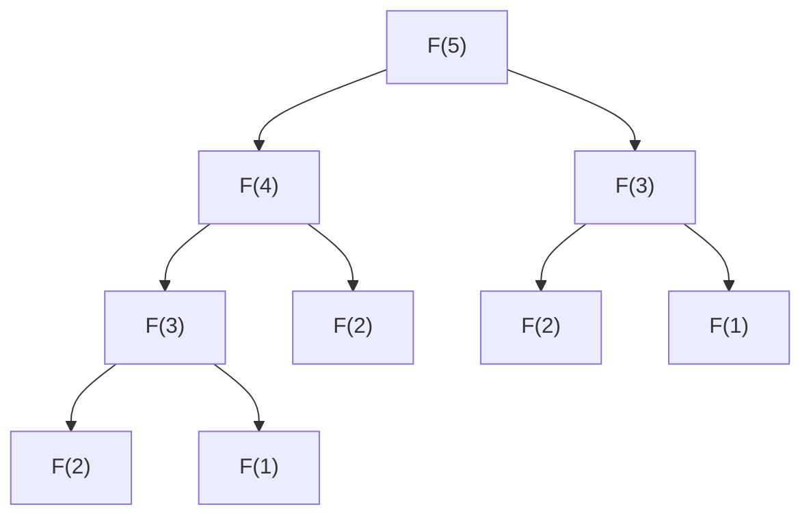

Главная идея задания 16 — **понять, как одни значения функции зависят от других, и выстроить вычисления в правильном порядке**. Когда эта зависимость понятна, задачу можно решить вручную, с помощью цикла, рекурсивной функции или преобразования формул.

В твоих подборках встречаются не только небольшие вычисления, но и выражения с большими аргументами, несколько связанных функций, обработка цифр числа и подсчёт подходящих аргументов. Поэтому разберём и основу, и более сложные разновидности. [inf-ege.sdamgia.ru](https://inf-ege.sdamgia.ru/test?theme=214\&utm_source=chatgpt.com)

Код буду писать на Python. При этом сначала будем выяснять, **почему работает решение**, и только затем переводить рассуждение в программу.

Каждая новая система формул ниже — отдельный пример: имя \(F\) будем использовать многократно, но правила вычисления в разных примерах будут различаться.

---

**Сначала разберём, что означает запись \(F(n)\).** Функция — это правило, по которому входному значению сопоставляется результат.

Например:

\[
F(n)=2n+1.
\]

Тогда:

\[
F(3)=2\cdot3+1=7,
\]

\[
F(5)=2\cdot5+1=11.
\]

Здесь:

- \(F\) — имя функции;
- \(n\) — её аргумент, то есть входное значение;
- \(F(n)\) — результат, полученный для этого аргумента.

**Аргумент и значение функции — разные числа.** В примере \(F(5)=11\) аргумент равен \(5\), результат — \(11\).

Скобки после имени функции обозначают обращение к её правилу. Поэтому \(F(n)\) не означает произведение \(F\cdot n\).

Полезно сразу различать несколько похожих записей:

| Запись | Что нужно сделать |
|---|---|
| \(F(n-1)\) | Вычислить функцию для аргумента \(n-1\) |
| \(F(n)-1\) | Вычислить функцию для аргумента \(n\), затем вычесть \(1\) |
| \(2F(n)\) | Вычислить \(F(n)\), затем умножить результат на \(2\) |
| \(F(2n)\) | Вычислить функцию для аргумента \(2n\) |
| \(F(n)+F(n-1)\) | Найти два значения функции и сложить их |
| \(F(F(n))\) | Сначала найти \(F(n)\), затем использовать полученное число как новый аргумент |

Например, для \(F(n)=2n+1\):

\[
F(4-1)=F(3)=7,
\]

а

\[
F(4)-1=9-1=8.
\]

Это разные действия, поэтому и результаты различаются.

---

**Рекурсивное определение позволяет вычислять функцию через другие значения этой же функции.** Рассмотрим:

\[
F(1)=2;
\]

\[
F(n)=F(n-1)+3n,\qquad n>1.
\]

Попробуем понять условие буквально.

Первая строка говорит:

> Для аргумента \(1\) результат уже известен: он равен \(2\).

Вторая строка говорит:

> Чтобы получить результат для аргумента \(n>1\), возьми результат для аргумента \(n-1\) и прибавь \(3n\).

Например:

\[
F(2)=F(1)+3\cdot2=2+6=8.
\]

Теперь известно \(F(2)\), поэтому можно найти:

\[
F(3)=F(2)+3\cdot3=8+9=17.
\]

Затем:

\[
F(4)=F(3)+3\cdot4=17+12=29.
\]

Получается таблица:

| \(n\) | Вычисление | \(F(n)\) |
|---:|---|---:|
| 1 | Дано в условии | 2 |
| 2 | \(2+3\cdot2\) | 8 |
| 3 | \(8+3\cdot3\) | 17 |
| 4 | \(17+3\cdot4\) | 29 |

Значение, которое задано непосредственно и не требует дальнейших обращений к функции, называют **базовым случаем**, или **базой рекурсии**.

В нашем примере база:

\[
F(1)=2.
\]

Формулу, связывающую значение функции с другими её значениями, называют **рекуррентным соотношением**:

\[
F(n)=F(n-1)+3n.
\]

Эти два понятия полезно различать:

- рекуррентное соотношение описывает зависимость между значениями;
- рекурсивная программа вычисляет эту зависимость, вызывая функцию из неё самой.

Одно и то же рекуррентное соотношение можно вычислить и без рекурсивных вызовов — например, обычным циклом. Позже мы это сделаем.

---

**При подстановке аргумента нужно заменять все вхождения \(n\) в выбранной формуле.**

Пусть:

\[
F(n)=nF(n-1)+2n.
\]

Чтобы найти \(F(4)\), подставляем \(4\) во все места:

\[
F(4)=4F(3)+8.
\]

Чтобы раскрыть \(F(3)\), используем уже аргумент \(3\):

\[
F(3)=3F(2)+6.
\]

Значит:

\[
F(4)=4\bigl(3F(2)+6\bigr)+8.
\]

Обрати внимание: множитель при \(F(2)\) внутри скобок равен \(3\), поскольку это формула для \(F(3)\).

В общем виде, если правило применимо к аргументу \(n-1\), то:

\[
F(n-1)=(n-1)F(n-2)+2(n-1).
\]

Частая ошибка — заменить только аргумент внутри \(F\), а остальные \(n\) оставить прежними.

---

**Рекурсивное вычисление сначала добирается до известного значения, а затем завершает отложенные действия.** Вернёмся к примеру:

\[
F(1)=2,\qquad F(n)=F(n-1)+3n.
\]

Нужно найти \(F(4)\).

Сначала известно только:

\[
F(4)=F(3)+12.
\]

Но \(F(3)\) ещё не найдено. Поэтому вычисление \(F(4)\) должно подождать.

Далее:

\[
F(3)=F(2)+9.
\]

Теперь ждёт и вычисление \(F(3)\).

Затем:

\[
F(2)=F(1)+6.
\]

Наконец:

\[
F(1)=2.
\]

Мы добрались до базы. Теперь можно завершать вычисления:

\[
F(2)=2+6=8,
\]

\[
F(3)=8+9=17,
\]

\[
F(4)=17+12=29.
\]

Здесь есть два направления:

\[
\text{запросы: }F(4)\to F(3)\to F(2)\to F(1);
\]

\[
\text{получение результатов: }F(1),F(2),F(3),F(4).
\]

Компьютер должен помнить, какое действие осталось выполнить после завершения вложенного вызова.

| Незавершённый вызов | Что он ожидает | Что сделает после получения результата |
|---|---|---|
| \(F(4)\) | Значение \(F(3)\) | Прибавит 12 |
| \(F(3)\) | Значение \(F(2)\) | Прибавит 9 |
| \(F(2)\) | Значение \(F(1)\) | Прибавит 6 |

Такие записи о незавершённых вызовах хранятся в **стеке вызовов**.

Слово «стек» означает организацию хранения, при которой последняя добавленная запись обрабатывается первой. Здесь последним был начат вызов \(F(1)\), и именно он первым завершился.

Очень важный момент: **каждый вызов имеет собственное значение аргумента**.

Когда внутри \(F(4)\) начинается вычисление \(F(3)\), у внешнего вызова аргумент остаётся равным \(4\). Поэтому после возвращения результата он прибавит именно \(3\cdot4\).

---

**Теперь переведём этот пример на Python и разберём каждую конструкцию.**

```python
def F(n):
    if n == 1:
        return 2

    return F(n - 1) + 3 * n


print(F(4))
```

Программа выведет:

```text
29
```

Разберём её.

`def F(n):` описывает функцию с именем `F`.

Буква `n` здесь — **параметр**, то есть имя, которым функция обозначает переданное ей значение. Когда мы пишем `F(4)`, число `4` становится значением параметра `n` в этом вызове.

Строка:

```python
if n == 1:
```

означает:

> Если значение `n` равно `1`, выполнить следующий блок.

Двойной знак `==` проверяет равенство. Одинарный знак `=` используется для присваивания:

```python
x = 5
```

означает «сохранить число \(5\) под именем `x`».

Команда:

```python
return 2
```

означает:

> Завершить текущий вызов функции и передать число \(2\) туда, откуда этот вызов был сделан.

После выполнения `return` оставшаяся часть данного вызова не выполняется.

Поэтому при `n == 1` программа не дойдёт до строки:

```python
return F(n - 1) + 3 * n
```

Если же `n > 1`, первая проверка не сработает. Тогда программа:

1. вычислит `F(n - 1)`;
2. прибавит `3 * n`;
3. вернёт полученную сумму.

Команда:

```python
print(F(4))
```

сначала получает результат `F(4)`, затем выводит его.

**`return` и `print` выполняют разные задачи.**

- `return` передаёт результат вызывающему коду;
- `print` показывает информацию на экране.

Если внутри функции просто напечатать число, это ещё не сделает его возвращаемым результатом. Функция, дошедшая до конца без `return` со значением, возвращает специальное значение `None`, обозначающее отсутствие обычного результата.

В выражении вида:

```python
F(n - 1) + 3 * n
```

нам нужен именно возвращённый результат.

Также обрати внимание на отступы. Они определяют, какие строки относятся к функции и к условию.

---

**Для правильной рекурсии нужно проверить, что все необходимые вызовы в итоге достигают базы.**

В примере:

\[
F(n)=F(n-1)+3n
\]

аргумент последовательно уменьшается на \(1\). Если начать с натурального числа, то в итоге получится \(1\).

Но самого уменьшения аргумента недостаточно.

Предположим, задано:

\[
F(1)=1;
\]

\[
F(n)=F(n-2)+n,\qquad n>1.
\]

Для \(F(7)\) возникает цепочка аргументов:

\[
7,\ 5,\ 3,\ 1.
\]

База достижима.

Для \(F(6)\):

\[
6,\ 4,\ 2,\ 0.
\]

Если функция определена только для натуральных аргументов, значение \(F(0)\) вообще не задано. Этих формул недостаточно для вычисления \(F(6)\).

Если же механически написать:

```python
def F(n):
    if n == 1:
        return 1
    return F(n - 2) + n
```

то вызов `F(6)` пойдёт дальше:

\[
6,\ 4,\ 2,\ 0,\ -2,\ -4,\ldots
\]

До \(1\) он не доберётся.

Причина понятна: вычитание \(2\) сохраняет чётность. Чётный аргумент остаётся чётным.

Поэтому при чтении условия проверяй:

- какие аргументы допускаются;
- для каких аргументов значение известно сразу;
- куда ведут переходы;
- покрываются ли формулами все достигнутые аргументы.

Если сказано «целое неотрицательное число», допустимы:

\[
0,1,2,3,\ldots
\]

Если в наших примерах сказано «натуральное число», используем:

\[
1,2,3,\ldots
\]

Если сказано просто «целое число», могут допускаться и отрицательные аргументы.

**Аргумент рекурсии может увеличиваться.** Например:

\[
F(n)=1,\qquad n\ge10;
\]

\[
F(n)=n+F(n+1),\qquad n<10.
\]

Здесь вызов \(F(7)\) дойдёт до базы по аргументам:

\[
7,\ 8,\ 9,\ 10.
\]

Важна достижимость базы за конечное число шагов.

---

**Если каждое значение зависит только от непосредственно предыдущего, вычисления удобно выполнять одной переменной.**

Для знакомой функции:

\[
F(1)=2,\qquad F(n)=F(n-1)+3n
\]

можно написать:

```python
value = 2

for n in range(2, 5):
    value = value + 3 * n

print(value)
```

Результат — \(29\).

Здесь:

```python
range(2, 5)
```

задаёт числа:

\[
2,\ 3,\ 4.
\]

Правая граница в `range` не включается.

Цикл:

```python
for n in range(2, 5):
```

поочерёдно присваивает `n` эти значения и выполняет своё тело.

Перед первой итерацией — первым выполнением тела цикла — переменная `value` содержит \(F(1)\).

Далее:

| Текущее `n` | `value` перед обновлением | `value` после обновления |
|---:|---:|---:|
| 2 | \(F(1)=2\) | \(F(2)=8\) |
| 3 | \(F(2)=8\) | \(F(3)=17\) |
| 4 | \(F(3)=17\) | \(F(4)=29\) |

Строка:

```python
value = value + 3 * n
```

сначала вычисляет правую часть со старым значением `value`, затем записывает результат обратно.

Сокращённая запись того же действия:

```python
value += 3 * n
```

Смысл решения:

> Перед очередным шагом у нас уже есть \(F(n-1)\). По формуле получаем \(F(n)\) и сохраняем его вместо предыдущего значения.

Это работает и для более сложных зависимостей от одного предыдущего значения. Например:

\[
F(n)=3F(n-1)+n
\]

переводится в обновление:

```python
value = 3 * value + n
```

Но **«одно предыдущее значение» не обязательно означает \(F(n-1)\)**. Это может быть \(F(n-2)\), \(F(n//2)\) или другое значение. В таком случае порядок вычислений и способ хранения нужно выбирать с учётом конкретной зависимости.

---

**Когда нужны несколько предыдущих значений, сначала удобно построить таблицу.**

Возьмём:

\[
F(1)=1,\qquad F(2)=3;
\]

\[
F(n)=F(n-1)+2F(n-2),\qquad n>2.
\]

Найдём несколько значений:

\[
F(3)=F(2)+2F(1)=3+2=5;
\]

\[
F(4)=F(3)+2F(2)=5+6=11;
\]

\[
F(5)=F(4)+2F(3)=11+10=21;
\]

\[
F(6)=F(5)+2F(4)=21+22=43.
\]

| \(n\) | \(F(n-1)\) | \(F(n-2)\) | \(F(n)\) |
|---:|---:|---:|---:|
| 1 | — | — | 1 |
| 2 | — | — | 3 |
| 3 | 3 | 1 | 5 |
| 4 | 5 | 3 | 11 |
| 5 | 11 | 5 | 21 |
| 6 | 21 | 11 | 43 |

Слово «предыдущие» здесь относится к аргументам. Например, для \(F(6)\) предыдущими являются значения \(F(5)\) и \(F(4)\).

Это не означает, что функция обязательно возрастает. В другой задаче результаты могут уменьшаться, менять знак или чередоваться.

На Python таблицу можно хранить в списке.

**Список** — это упорядоченный набор элементов. У каждого элемента есть номер — **индекс**. В Python индексы начинаются с нуля.

Договоримся хранить \(F(n)\) в элементе `f[n]`:

```python
N = 6

f = [0] * (N + 1)

f[1] = 1
f[2] = 3

for n in range(3, N + 1):
    f[n] = f[n - 1] + 2 * f[n - 2]

print(f[N])
```

Результат:

```text
43
```

Строка:

```python
f = [0] * (N + 1)
```

создаёт список из `N + 1` нулей.

Почему именно `N + 1`?

Потому что нам нужны элементы с индексами:

\[
0,1,2,\ldots,N.
\]

Всего их \(N+1\).

В этом примере элемент `f[0]` не используется. Его наличие не означает, что по условию \(F(0)=0\). Это лишь дополнительное место, позволяющее удобно сопоставить индекс и аргумент.

Остальные нули до заполнения — тоже заготовки, а не вычисленные значения функции.

**Смысл правильного порядка:** когда мы вычисляем `f[n]`, элементы `f[n - 1]` и `f[n - 2]` уже заполнены.

Для рассматриваемой формулы можно заполнить таблицу по возрастанию аргумента:

\[
1,2,3,\ldots,N.
\]

Такое вычисление, при котором результаты небольших подзадач сохраняют и используют для следующих, называют **динамическим программированием**. В данной задаче за этим термином стоит именно заполнение таблицы в подходящем порядке.

---

**Если будущим вычислениям нужны только два последних значения, всю таблицу хранить необязательно.**

Для той же функции:

\[
F(n)=F(n-1)+2F(n-2)
\]

можно написать:

```python
N = 6

a = 1
b = 3

for n in range(3, N + 1):
    current = b + 2 * a
    a = b
    b = current

print(b)
```

Перед очередной итерацией:

\[
a=F(n-2),\qquad b=F(n-1).
\]

Сначала получаем:

\[
current=F(n).
\]

Затем сдвигаем сохранённые значения:

- старое \(F(n-1)\) становится предпоследним;
- новое \(F(n)\) становится последним.

Здесь важен порядок присваиваний.

Ошибочная последовательность:

```python
a = b
b = b + 2 * a
```

В первой строке старое значение `a` потерялось. Во второй строке вместо двух разных предыдущих значений используется фактически одно.

Промежуточная переменная `current` позволяет сначала вычислить новое значение, пока оба старых ещё доступны.

Однако полная таблица часто удобнее для проверки. Она также нужна, если в ответе используются несколько ранее вычисленных значений.

---

**Условия внутри рекурсивного определения выбираются заново для каждого аргумента.**

Рассмотрим:

\[
F(n)=n,\qquad n\le2;
\]

\[
F(n)=F(n-1)+n,\qquad n>2\text{ и }n\text{ чётно};
\]

\[
F(n)=2F(n-2),\qquad n>2\text{ и }n\text{ нечётно}.
\]

Пусть требуется \(F(8)\).

Аргумент \(8\) чётный:

\[
F(8)=F(7)+8.
\]

Теперь вычисляем \(F(7)\). Для этого вызова аргумент равен \(7\), поэтому выбираем нечётную ветвь:

\[
F(7)=2F(5).
\]

Далее:

\[
F(5)=2F(3);
\]

\[
F(3)=2F(1).
\]

Для \(F(1)\) действует база:

\[
F(1)=1.
\]

Возвращаемся:

\[
F(3)=2;
\]

\[
F(5)=4;
\]

\[
F(7)=8;
\]

\[
F(8)=8+8=16.
\]

**Нельзя выбрать ветвь один раз по исходному аргументу и использовать её во всех вложенных вызовах.**

В Python остаток от деления записывается через `%`.

Например:

```python
8 % 2
```

равен \(0\), а:

```python
7 % 2
```

равен \(1\).

Поэтому:

```python
n % 2 == 0
```

проверяет чётность, а:

```python
n % 2 != 0
```

— нечётность. Знак `!=` означает «не равно».

Рекурсивная запись:

```python
def F(n):
    if n <= 2:
        return n
    elif n % 2 == 0:
        return F(n - 1) + n
    else:
        return 2 * F(n - 2)


print(F(8))
```

Здесь:

- `if` проверяет первое условие;
- `elif` означает «иначе, если»;
- `else` обрабатывает оставшийся случай.

После того как случай `n <= 2` исключён, для допустимого натурального аргумента остаётся `n > 2`. Поэтому повторять эту проверку в остальных ветвях необязательно.

Табличная версия:

```python
N = 8
f = [0] * (N + 1)

for n in range(1, N + 1):
    if n <= 2:
        f[n] = n
    elif n % 2 == 0:
        f[n] = f[n - 1] + n
    else:
        f[n] = 2 * f[n - 2]

print(f[N])
```

Таблица значений:

| \(n\) | 1 | 2 | 3 | 4 | 5 | 6 | 7 | 8 |
|---:|---:|---:|---:|---:|---:|---:|---:|---:|
| \(F(n)\) | 1 | 2 | 2 | 6 | 4 | 10 | 8 | 16 |

Обрати внимание: при переходе от \(n=4\) к \(n=5\) результат уменьшается с \(6\) до \(4\). Увеличение аргумента не гарантирует увеличения функции.

Также различай условия:

\[
n\text{ чётно}
\]

и

\[
F(n-1)\text{ чётно}.
\]

В первом случае проверяется аргумент, во втором — уже вычисленное значение функции.

---

**Прямая рекурсия может многократно вычислять одни и те же значения.**

Рассмотрим последовательность:

\[
F(1)=F(2)=1;
\]

\[
F(n)=F(n-1)+F(n-2),\qquad n>2.
\]

Это одно из определений чисел Фибоначчи.

Начальные значения:

\[
1,\ 1,\ 2,\ 3,\ 5,\ 8,\ldots
\]

Прямая программа:

```python
def F(n):
    if n <= 2:
        return 1

    return F(n - 1) + F(n - 2)
```

Для вычисления \(F(5)\) возникают такие вызовы:



Это схема зависимостей вызовов, а не указание на их одновременное выполнение.

Видно, что:

- \(F(3)\) вычисляется повторно;
- \(F(2)\) вызывается несколько раз;
- одинаковые подзадачи возникают в разных частях вычисления.

Без дополнительного сохранения результатов программа не знает, что такое же значение уже находилось ранее.

Для этой реализации число вызовов быстро растёт:

| Что вычисляем | Общее число вызовов, включая первоначальный |
|---|---:|
| \(F(10)\) | 109 |
| \(F(20)\) | 13 529 |
| \(F(30)\) | 1 664 079 |
| \(F(40)\) | 204 668 309 |

При этом различных нужных значений для \(F(40)\) всего сорок:

\[
F(1),F(2),\ldots,F(40).
\]

Отсюда естественная идея:

> Если значение уже найдено, сохранить его и при повторном обращении использовать готовый результат.

Такое запоминание результатов называют **мемоизацией**. Хранилище готовых результатов часто называют **кэшем**.

---

**Сначала посмотрим, как запоминание можно организовать явно.**

Для хранения пар «аргумент — результат» в Python есть **словарь**.

Например:

```python
memo = {1: 1, 2: 1}
```

означает:

- для ключа `1` сохранено значение `1`;
- для ключа `2` сохранено значение `1`.

В нашем случае ключ — аргумент функции.

Программа:

```python
memo = {1: 1, 2: 1}


def F(n):
    if n not in memo:
        memo[n] = F(n - 1) + F(n - 2)

    return memo[n]


print(F(50))
```

Проверка:

```python
n not in memo
```

означает, что результата для аргумента `n` пока нет.

Если результата нет, вычисляем и сохраняем его. Если есть — сразу возвращаем.

Здесь запись `memo[n]` обращается к значению по ключу. В отличие от индекса списка, ключ словаря может быть, например, отрицательным числом или очень большим аргументом без необходимости выделять все промежуточные позиции.

---

**Python позволяет включить такое запоминание готовой конструкцией `@cache`.**

```python
from functools import cache


@cache
def F(n):
    if n <= 2:
        return 1

    return F(n - 1) + F(n - 2)


print(F(50))
```

Программа выведет:

```text
12586269025
```

Строка:

```python
from functools import cache
```

подключает готовое средство запоминания.

Запись:

```python
@cache
```

над определением функции добавляет к ней это поведение. Такая запись называется **декоратором**: она изменяет способ работы функции, не требуя переписывать её основную формулу.

При повторном обращении с тем же аргументом используется сохранённый результат. `cache` не задаёт ограничения на количество сохраняемых результатов. Альтернативная запись — `@lru_cache(maxsize=None)`; у `@lru_cache()` без указания размера по умолчанию сохраняется ограниченное число результатов. [Python 3.14.8 documentation](https://docs.python.org/3/library/functools.html?utm_source=chatgpt.com)

Для задач с числовыми функциями это удобно: результат определяется аргументом и не меняется между вызовами.

Однако кэш хранит **уже полученные результаты**. Он не может заранее дать ответ для вычисления, которое ещё не завершилось.

Поэтому кэш не исправляет ошибочную рекурсию, бесконечно вызывающую сама себя.

---

**Повторные вычисления и большая глубина рекурсии — две разные проблемы.**

Первая проблема: программа много раз решает одинаковые подзадачи.

Её устраняют сохранением результатов.

Вторая проблема: одновременно остаётся слишком много незавершённых вызовов.

Например:

\[
F(2000)\to F(1999)\to F(1998)\to\ldots\to F(1).
\]

Даже если каждое значение вычисляется только один раз, получается длинная цепочка ожидающих вызовов.

В Python существует ограничение глубины рекурсии. При его превышении возникает ошибка `RecursionError`.

Посмотреть установленное ограничение можно так:

```python
import sys

print(sys.getrecursionlimit())
```

Изменить его позволяет команда:

```python
sys.setrecursionlimit(5000)
```

Но увеличение ограничения само по себе не ускоряет алгоритм и не устраняет повторные вычисления. Слишком большое значение ограничения также не является универсальным решением: допустимая глубина зависит от среды выполнения. [Python 3.14.8 documentation](https://docs.python.org/3/library/sys.html?utm_source=chatgpt.com)

Для длинной зависимости от предыдущих аргументов часто удобнее таблица с циклом.

Есть и другой приём: если функция кэшируется и все её зависимости ведут к меньшим аргументам, можно заранее вызывать её по возрастанию:

```python
from functools import cache


@cache
def F(n):
    if n <= 2:
        return 1

    return F(n - 1) + F(n - 2)


N = 2000

for n in range(1, N + 1):
    F(n)

print(F(N))
```

Почему это помогает?

При вычислении \(F(100)\) результаты \(F(99)\) и \(F(98)\) уже есть в кэше. Поэтому новая длинная цепочка не создаётся.

Вызов `F(n)` внутри цикла нужен ради заполнения кэша, даже если его результат отдельно никуда не присваивается.

Однако такой порядок подходит именно тогда, когда нужные зависимости уже вычислены. Для переходов к большим аргументам порядок будет другим.

---

**Размер аргумента сам по себе не определяет трудность вычисления.**

Сравним две зависимости.

Если функция обращается к:

\[
F(n-1),
\]

то для большого \(n\) цепочка может содержать почти \(n\) вызовов.

Если она обращается к:

\[
F(n//2),
\]

то аргумент на каждом шаге уменьшается примерно вдвое.

Даже число порядка \(10^{18}\) при последовательном делении на \(2\) превращается в ноль примерно за шестьдесят шагов.

Поэтому для огромного аргумента иногда достаточно короткой рекурсии. Создавать список длиной \(10^{18}\) в такой ситуации совершенно не требуется.

Для оценки решения полезно спрашивать:

- сколько различных значений понадобится;
- сколько раз вычисляется каждое;
- какова максимальная длина цепочки вызовов;
- насколько велики сами результаты.

Когда говорят, что табличное решение имеет сложность \(O(N)\), обычно имеют в виду, что число шагов пропорционально количеству вычисляемых значений \(N\).

Но арифметика с числами из тысяч цифр требует больше работы, чем арифметика с небольшими числами. Поэтому число итераций — важная, но не единственная характеристика времени выполнения.

---

**Перед вычислением больших значений нужно внимательно посмотреть на само выражение, которое требуется найти.**

Пусть снова:

\[
F(1)=2;
\]

\[
F(n)=F(n-1)+3n.
\]

Требуется:

\[
F(2026)-F(2023).
\]

Раскроем только большее значение:

\[
F(2026)=F(2025)+3\cdot2026.
\]

Ещё один шаг:

\[
F(2026)=F(2024)+3\cdot2025+3\cdot2026.
\]

Ещё один:

\[
F(2026)=F(2023)+3\cdot2024+3\cdot2025+3\cdot2026.
\]

Теперь вычитаем \(F(2023)\):

\[
F(2026)-F(2023)
=
3\cdot2024+3\cdot2025+3\cdot2026.
\]

Получаем:

\[
3(2024+2025+2026)=18225.
\]

Значение \(F(2023)\) сократилось. Вычислять его не понадобилось.

Общий принцип: если

\[
F(n)=F(n-1)+a(n),
\]

где \(a(n)\) — добавляемое на шаге число, то при \(N>M\):

\[
F(N)-F(M)=a(M+1)+a(M+2)+\ldots+a(N),
\]

если на этих шагах действует указанное правило.

Почему сумма начинается с \(M+1\)?

Потому что переход от \(F(M)\) к \(F(M+1)\) добавляет именно \(a(M+1)\). Всё, что уже содержалось внутри \(F(M)\), при вычитании исчезает.

Это полезно и при шаге \(2\), \(3\) и так далее, но сравниваемые значения должны быть связаны соответствующей цепочкой переходов.

---

**Произведения часто сокращаются столь же удобно.**

Рассмотрим:

\[
F(1)=1;
\]

\[
F(n)=nF(n-1),\qquad n>1.
\]

Последовательно:

\[
F(2)=2;
\]

\[
F(3)=3\cdot2;
\]

\[
F(4)=4\cdot3\cdot2;
\]

\[
F(5)=5\cdot4\cdot3\cdot2.
\]

Произведение натуральных чисел от \(1\) до \(n\) называют **факториалом** и обозначают:

\[
n!=1\cdot2\cdot3\cdots n.
\]

Для этой функции:

\[
F(n)=n!.
\]

Но узнавание факториала не обязательно. Достаточно раскрыть несколько шагов.

Например:

\[
\frac{F(2026)}{F(2023)}
=
\frac{2026\cdot2025\cdot2024\cdot F(2023)}{F(2023)}.
\]

Поскольку \(F(2023)\ne0\), сокращаем:

\[
\frac{F(2026)}{F(2023)}
=
2026\cdot2025\cdot2024
=
8303763600.
\]

Теперь более сложное выражение:

\[
\frac{F(2026)+2F(2025)}{F(2024)}.
\]

Приведём оба слагаемых числителя к \(F(2024)\):

\[
F(2026)=2026\cdot2025\cdot F(2024);
\]

\[
F(2025)=2025\cdot F(2024).
\]

Следовательно:

\[
\frac{
2026\cdot2025\cdot F(2024)
+
2\cdot2025\cdot F(2024)
}{
F(2024)
}.
\]

Выносим общий множитель:

\[
\frac{
2025(2026+2)F(2024)
}{
F(2024)
}
=
2025\cdot2028
=
4106700.
\]

На Python достаточно:

```python
print(2025 * (2026 + 2))
```

Важная привычка:

> Раскрывай формулы до появления общего значения функции, которое можно вынести за скобки или сократить.

При этом внимательно следи за множителем в условии:

| Формулы | Получающаяся функция |
|---|---|
| \(F(1)=1,\ F(n)=nF(n-1)\) | \(F(n)=n!\) |
| \(F(1)=1,\ F(n)=(n-1)F(n-1)\) | \(F(n)=(n-1)!\) |
| \(F(1)=3,\ F(n)=nF(n-1)\) | \(F(n)=3n!\) |

Один сдвиг в множителе меняет все последующие вычисления.

---

**В выражениях с несколькими вычитаниями удобно обозначать общее неизвестное одной буквой.**

Пусть:

\[
F(n)=1,\qquad n\le2;
\]

\[
F(n)=F(n-2)+n,\qquad n>2.
\]

Нужно найти:

\[
3F(30)-F(28)-F(26)-F(24).
\]

Обозначим:

\[
X=F(24).
\]

Тогда:

\[
F(26)=X+26;
\]

\[
F(28)=X+26+28=X+54;
\]

\[
F(30)=X+26+28+30=X+84.
\]

Подставляем:

\[
3(X+84)-(X+54)-(X+26)-X.
\]

Раскрываем скобки:

\[
3X+252-X-54-X-26-X.
\]

Все слагаемые с \(X\) сокращаются:

\[
252-54-26=172.
\]

Мы не вычисляли \(F(24)\), потому что доказали независимость ответа от этого значения.

**Произвольно заменять настоящее базовое значение нулём или единицей нельзя.** Такая замена допустима только после доказательства, что соответствующий вклад полностью сокращается.

---

**При переходах на несколько единиц нужно учитывать, в какую цепочку попадает аргумент.**

Если функция использует \(F(n-2)\), аргументы разделяются на две цепочки:

\[
1,3,5,7,\ldots
\]

и

\[
2,4,6,8,\ldots
\]

Если используется \(F(n-3)\), цепочек уже три — по возможным остаткам от деления на \(3\).

Например:

\[
F(n)=n,\qquad n\le5;
\]

\[
F(n)=F(n-3)+4,\qquad n>5.
\]

Найдём \(F(20)\).

Аргументы:

\[
20,\ 17,\ 14,\ 11,\ 8,\ 5.
\]

Сделано пять переходов, каждый добавляет \(4\).

Поэтому:

\[
F(20)=F(5)+5\cdot4=5+20=25.
\]

Но для \(F(21)\) цепочка другая:

\[
21,\ 18,\ 15,\ 12,\ 9,\ 6,\ 3.
\]

Здесь шесть переходов, а базовое значение:

\[
F(3)=3.
\]

Следовательно:

\[
F(21)=3+6\cdot4=27.
\]

Нельзя автоматически считать, что цепочка закончится ровно на граничном аргументе \(5\).

Количество переходов можно найти из неравенства. После \(k\) вычитаний тройки аргумент равен:

\[
n-3k.
\]

Нужно впервые получить:

\[
n-3k\le5.
\]

Отсюда:

\[
k\ge\frac{n-5}{3}.
\]

Берём наименьшее целое \(k\), удовлетворяющее этому условию. Для \(n>5\) на Python:

```python
k = (n - 5 + 2) // 3
```

Знак `//` для положительных чисел даёт целую часть частного. Прибавление \(2\) перед делением на \(3\) позволяет получить округление вверх.

Однако сначала полезно уверенно считать шаги по цепочке. Формула должна сокращать понятное рассуждение.

---

**Условия чётности можно сочетать с сокращением больших выражений.**

Пусть:

\[
F(1)=F(2)=1;
\]

при \(n>2\):

\[
F(n)=3F(n-2),\qquad n\text{ нечётно};
\]

\[
F(n)=2nF(n-1)+F(n-3),\qquad n\text{ чётно}.
\]

Требуется:

\[
\frac{F(12)}{F(7)}.
\]

Для чётного аргумента \(12\):

\[
F(12)=24F(11)+F(9).
\]

Оба значения справа имеют нечётные аргументы:

\[
F(11)=3F(9)=9F(7);
\]

\[
F(9)=3F(7).
\]

Подставляем:

\[
F(12)=24\cdot9F(7)+3F(7)=219F(7).
\]

Следовательно:

\[
\frac{F(12)}{F(7)}=219.
\]

Здесь понадобились только значения с аргументами \(12,11,9,7\). Вычислять подряд все значения от \(1\) до \(12\) не было необходимости.

---

**При зависимости от большего аргумента таблицу обычно заполняют по убыванию.**

Рассмотрим:

\[
F(n)=1,\qquad n\ge10;
\]

\[
F(n)=n+F(n+1),\qquad n<10.
\]

Найдём \(F(7)\):

\[
F(10)=1;
\]

\[
F(9)=9+1=10;
\]

\[
F(8)=8+10=18;
\]

\[
F(7)=7+18=25.
\]

Табличная программа:

```python
f = [0] * 11
f[10] = 1

for n in range(9, 0, -1):
    f[n] = n + f[n + 1]

print(f[7])
```

В записи:

```python
range(9, 0, -1)
```

последний аргумент задаёт шаг \(-1\). Получаются числа:

\[
9,8,7,\ldots,1.
\]

Ноль не включается.

Главное правило:

> Перед вычислением значения должны быть готовы все результаты, которые используются в его формуле.

Поэтому:

| Зависимость | Подходящий порядок при обычных целых диапазонах |
|---|---|
| \(F(n-1)\), \(F(n-2)\) | По возрастанию \(n\) |
| \(F(n+1)\), \(F(n+2)\) | По убыванию \(n\) |
| \(F(n//2)\) при положительном \(n\) | По возрастанию или через короткую рекурсию |
| Смешанные зависимости | Сначала отдельно выяснить порядок |

Если при \(n<K\) используется \(F(n+s)\), вызов может попасть не только в \(K\), но и выше. Например, при шаге \(3\) могут потребоваться базовые значения для \(K\), \(K+1\), \(K+2\).

Границы хранения должны учитывать эти переходы.

---

**При увеличении аргумента в несколько раз результат часто определяется количеством переходов до базы.**

Пусть:

\[
F(n)=n,\qquad n>100;
\]

\[
F(n)=n+F(2n),\qquad 1\le n\le100.
\]

И пусть:

\[
G(n)=\frac{F(n)}n.
\]

Найдём \(G(7)\).

Цепочка аргументов:

\[
7,\ 14,\ 28,\ 56,\ 112.
\]

Поэтому:

\[
F(7)=7+14+28+56+112.
\]

Выносим \(7\):

\[
F(7)=7(1+2+4+8+16)=7\cdot31.
\]

Значит:

\[
G(7)=31.
\]

Что определило число \(31\)? Количество удвоений до пересечения границы: их было четыре.

Вообще, если требуется \(k\) удвоений:

\[
F(n)=n(1+2+4+\ldots+2^k),
\]

поэтому:

\[
G(n)=1+2+4+\ldots+2^k=2^{k+1}-1.
\]

Последнюю формулу можно получить вычитанием:

\[
S=1+2+4+\ldots+2^k;
\]

\[
2S=2+4+8+\ldots+2^{k+1}.
\]

Тогда:

\[
2S-S=2^{k+1}-1.
\]

Теперь спросим: для каких натуральных \(n\)

\[
G(n)=G(7)?
\]

Нужны ровно четыре удвоения. После трёх аргумент ещё не должен превышать \(100\), а после четырёх — уже должен:

\[
8n\le100;
\]

\[
16n>100.
\]

Следовательно:

\[
6{,}25<n\le12{,}5.
\]

Подходят:

\[
7,8,9,10,11,12.
\]

Всего шесть чисел.

Так условие о рекурсивной функции превратилось в два неравенства.

---

**Несколько функций нужно рассматривать как несколько связанных таблиц значений.**

Пусть:

\[
F(1)=1,\qquad G(1)=2;
\]

\[
F(n)=F(n-1)+G(n-1);
\]

\[
G(n)=2F(n-1)+G(n-1),\qquad n>1.
\]

Вычисляем по строкам:

| \(n\) | \(F(n)\) | \(G(n)\) |
|---:|---:|---:|
| 1 | 1 | 2 |
| 2 | \(1+2=3\) | \(2\cdot1+2=4\) |
| 3 | \(3+4=7\) | \(2\cdot3+4=10\) |
| 4 | \(7+10=17\) | \(2\cdot7+10=24\) |
| 5 | \(17+24=41\) | \(2\cdot17+24=58\) |

Оба новых результата используют значения из предыдущей строки.

Код:

```python
N = 5

f = [0] * (N + 1)
g = [0] * (N + 1)

f[1] = 1
g[1] = 2

for n in range(2, N + 1):
    f[n] = f[n - 1] + g[n - 1]
    g[n] = 2 * f[n - 1] + g[n - 1]

print(f[N], g[N])
```

Здесь обновление `f[n]` не мешает вычислению `g[n]`, поскольку для второго используется `f[n - 1]`.

А для другой системы:

\[
G(n)=G(n-1)+1;
\]

\[
F(n)=G(n)+F(n-1)
\]

внутри цикла сначала нужно вычислять `g[n]`:

```python
g[n] = g[n - 1] + 1
f[n] = g[n] + f[n - 1]
```

Причина: \(F(n)\) использует новое значение \(G(n)\).

Если функции вызывают друг друга, такую рекурсию называют **взаимной**.

При анализе нужно различать не только аргументы, но и имена функций:

\[
F(10)\quad\text{и}\quad G(10)
\]

— разные вычисления.

Если записываешь обе функции через `def`, первый реальный вызов делай после описания обеих. При использовании кэша его следует добавить к каждой функции, результаты которой нужно запоминать.

---

**У связанных функций направления изменения аргумента могут различаться.** Такие случаи действительно есть в твоих подборках. [inf-ege.sdamgia.ru](https://inf-ege.sdamgia.ru/test?print=true\&theme=214\&utm_source=chatgpt.com)

Разберём небольшой самостоятельный пример:

\[
F(n)=F(n-4)+20,\qquad n\ge12;
\]

\[
F(n)=3\bigl(G(n-2)-1\bigr),\qquad n<12;
\]

\[
G(n)=n,\qquad n\ge30;
\]

\[
G(n)=G(n+7)+2,\qquad n<30.
\]

Нужно найти \(F(39)\).

Сначала движемся по функции \(F\):

\[
39,\ 35,\ 31,\ 27,\ 23,\ 19,\ 15,\ 11.
\]

Произошло семь переходов:

\[
F(39)=F(11)+7\cdot20.
\]

Для аргумента \(11\) действует другое правило:

\[
F(11)=3\bigl(G(9)-1\bigr).
\]

Теперь вычисляем \(G(9)\). Здесь аргумент увеличивается:

\[
9,\ 16,\ 23,\ 30.
\]

Три перехода добавляют по \(2\):

\[
G(9)=G(30)+3\cdot2=30+6=36.
\]

Следовательно:

\[
F(11)=3(36-1)=105;
\]

\[
F(39)=105+140=245.
\]

Заметь: прибавленные на внешних шагах \(140\) не попадают под умножение на \(3\).

Эту задачу можно записать без рекурсивных вызовов:

```python
def G(n):
    extra = 0

    while n < 30:
        extra += 2
        n += 7

    return n + extra


def F(n):
    extra = 0

    while n >= 12:
        extra += 20
        n -= 4

    return 3 * (G(n - 2) - 1) + extra


print(F(39))
```

Команда `while` повторяет блок, пока условие истинно.

Переменная `extra` хранит сумму накопленных прибавлений.

Такое накопление подходит здесь благодаря форме правил: на каждом переходе прибавляется константа. Для другой формулы порядок выполнения отложенных операций может быть существенным.

---

**Иногда функция зависит от суммы всех предыдущих значений.**

Например:

\[
F(1)=2;
\]

\[
F(n)=F(1)+F(2)+\ldots+F(n-1)+n,\qquad n>1.
\]

В условии длинную сумму могут записать короче:

\[
F(n)=\sum_{i=1}^{n-1}F(i)+n.
\]

Знак \(\sum\) означает суммирование:

- снизу указано, с какого значения начинается индекс \(i\);
- сверху — каким значением заканчивается;
- справа — что именно складывается.

Для \(n=4\):

\[
\sum_{i=1}^{3}F(i)=F(1)+F(2)+F(3).
\]

Начальные вычисления:

\[
F(1)=2;
\]

\[
F(2)=2+2=4;
\]

\[
F(3)=2+4+3=9;
\]

\[
F(4)=2+4+9+4=19.
\]

Можно каждый раз складывать все предыдущие элементы заново. Но сумма меняется просто: после получения нового значения оно добавляется к прежней сумме.

Поэтому будем хранить накопленную сумму отдельно:

```python
N = 5

f = [0] * (N + 1)
f[1] = 2

total = f[1]

for n in range(2, N + 1):
    f[n] = total + n
    total += f[n]

print(f[N])
```

Результат:

```text
39
```

Перед вычислением `f[n]` переменная `total` содержит:

\[
F(1)+F(2)+\ldots+F(n-1).
\]

После вычисления добавляем к ней новое \(F(n)\).

Порядок этих действий важен: в формуле требуется сумма предыдущих значений, без текущего.

Такую сумму начального отрезка последовательности называют **префиксной суммой**.

Если повторно складывать все предыдущие элементы, количество слагаемых составит примерно:

\[
1+2+\ldots+(N-1).
\]

Оно растёт примерно как \(N^2\). При сохранении накопленной суммы на каждом шаге требуется лишь несколько арифметических действий.

---

**Деление аргумента на основание системы счисления часто означает обработку цифр числа.**

Начнём с десятичной записи.

Для числа \(472\):

```python
472 // 10
```

даёт \(47\), а:

```python
472 % 10
```

даёт \(2\).

То есть:

- `n // 10` удаляет последнюю десятичную цифру;
- `n % 10` извлекает последнюю десятичную цифру.

Это следует из равенства:

\[
472=47\cdot10+2.
\]

Теперь рассмотрим:

\[
F(0)=0;
\]

\[
F(n)=F(n//10)+n\bmod10,\qquad n>0.
\]

Для \(472\):

\[
F(472)=F(47)+2;
\]

\[
F(47)=F(4)+7;
\]

\[
F(4)=F(0)+4.
\]

В итоге:

\[
F(472)=4+7+2=13.
\]

Следовательно, функция вычисляет сумму десятичных цифр.

В другой формулировке может быть:

\[
F(n)=n,\qquad n<10;
\]

\[
F(n)=F(n\bmod10)+F(n//10),\qquad n\ge10.
\]

Здесь \(n\bmod10\) — одна цифра, поэтому к ней сразу применяется база:

\[
F(n\bmod10)=n\bmod10.
\]

Получается тот же смысл — сумма цифр.

Для произвольного основания \(b\):

\[
n=bq+r,\qquad 0\le r<b.
\]

Здесь:

\[
q=n//b,\qquad r=n\bmod b.
\]

Поэтому:

- `n // b` удаляет последнюю цифру записи в основании \(b\);
- `n % b` возвращает эту цифру.

Несколько распространённых случаев:

| Правило для \(n>0\) при базе \(F(0)=0\) | Смысл |
|---|---|
| \(F(n)=F(n//10)+n\bmod10\) | Сумма десятичных цифр |
| \(F(n)=F(n//2)+n\bmod2\) | Количество единиц в двоичной записи |
| \(F(n)=1+F(n//10)\) | Количество десятичных цифр положительного числа |
| \(F(n)=1+F(n//b)\) | Количество цифр положительного числа в основании \(b\) |

Для последнего типа \(F(0)=0\) — заданная база алгоритма. Это не утверждение, что обычная запись числа \(0\) не содержит цифр.

Если в рекурсии встречается `n // 100`, за один шаг удаляются две десятичные цифры. В таких задачах особенно внимательно следи, какие позиции обрабатываются и от какого конца числа они отсчитываются.

---

**Рекурсия по двоичным цифрам может превратить перебор чисел в подсчёт вариантов записи.**

Пусть:

\[
F(0)=0;
\]

\[
F(n)=F(n//2)+n\bmod2,\qquad n>0.
\]

Она складывает двоичные цифры. Поскольку каждая из них равна \(0\) или \(1\), результат равен количеству единиц.

Например:

\[
27=11011_2,
\]

поэтому:

\[
F(27)=4.
\]

Рекурсивно:

\[
F(27)=F(13)+1;
\]

\[
F(13)=F(6)+1;
\]

\[
F(6)=F(3)+0;
\]

\[
F(3)=F(1)+1;
\]

\[
F(1)=F(0)+1.
\]

Всего прибавлены четыре единицы.

Иногда условие записывают так:

\[
F(n)=F(n/2),\quad n>0\text{ чётно};
\]

\[
F(n)=1+F(n-1),\quad n\text{ нечётно}.
\]

Для нечётного \(n>1\) число \(n-1\) чётно, и следующий шаг делит его на \(2\). В результате снова обрабатывается последняя двоичная цифра. Для \(n=1\) сразу достигается база \(F(0)\).

Теперь задача:

> Сколько чисел \(1\le n\le63\) удовлетворяют условию \(F(n)=2\)?

Прямое решение:

```python
def F(n):
    if n == 0:
        return 0

    return F(n // 2) + n % 2


count = 0

for n in range(1, 64):
    if F(n) == 2:
        count += 1

print(count)
```

Ответ — \(15\).

Но можно рассуждать через двоичную запись.

Все числа от \(0\) до \(63\) представляются шестью двоичными цифрами, если разрешить дописывать слева нули.

Нужно выбрать две позиции для единиц.

Первую можно выбрать шестью способами, вторую — пятью. Получается \(6\cdot5\), но каждая пара посчитана дважды: сначала одна позиция, потом другая, и наоборот.

Поэтому:

\[
\frac{6\cdot5}{2}=15.
\]

Число \(0\) не подходит, поэтому его включение в рассуждение не меняет ответ.

---

**Если учитываются только некоторые цифры, нужно выяснить вклад каждой цифры отдельно.**

Например:

\[
F(0)=0;
\]

при \(n>0\):

\[
F(n)=F(n//10)+n\bmod10,\quad n\text{ чётно};
\]

\[
F(n)=F(n//10),\quad n\text{ нечётно}.
\]

Чётность десятичного числа определяется его последней цифрой.

Поэтому на каждом шаге:

- чётная последняя цифра прибавляется;
- нечётная пропускается;
- затем последняя цифра удаляется.

Значит, функция вычисляет сумму чётных цифр.

Когда результат равен нулю?

Все слагаемые неотрицательны. Поэтому положительных чётных цифр в записи быть не должно.

Разрешены:

\[
0,1,3,5,7,9.
\]

Ноль разрешён: он не увеличивает сумму.

Например, количество трёхзначных чисел с такой записью:

- первая цифра — одна из \(1,3,5,7,9\): пять вариантов;
- вторая — любая из шести разрешённых;
- третья — любая из шести разрешённых.

Получаем:

\[
5\cdot6\cdot6=180.
\]

Умножение используется потому, что каждый выбор первой цифры можно сочетать с каждым выбором второй и третьей.

Если задан произвольный числовой интервал, его границы нужно учитывать отдельно. Число допустимых цифр на каждой позиции тогда может зависеть от уже выбранных старших цифр.

---

**Сравнение \(F(n)\) и \(F(n+1)\) часто связано с переносом между разрядами.**

Пусть \(F(n)\) — сумма десятичных цифр.

Если последняя цифра \(n\) меньше \(9\), при прибавлении единицы она просто увеличивается на \(1\). Поэтому:

\[
F(n+1)=F(n)+1.
\]

Например:

\[
243\to244,
\]

\[
9\to10
\]

для сумм цифр.

Если число оканчивается девятками, появляется перенос:

\[
2399\to2400.
\]

Пусть в конце числа стоит \(t\) девяток.

При прибавлении единицы:

- эти девятки превращаются в нули: сумма уменьшается на \(9t\);
- предыдущая цифра увеличивается на \(1\), либо появляется новая ведущая единица.

Поэтому:

\[
F(n+1)=F(n)+1-9t.
\]

Следовательно:

\[
F(n)>F(n+1)
\]

тогда и только тогда, когда в конце есть хотя бы одна девятка.

То есть:

\[
n\bmod10=9.
\]

Теперь вместо вычисления рекурсивной функции для огромного диапазона можно посчитать числа:

\[
9,19,29,\ldots
\]

На отрезке \([L,R]\), где \(L\ge1\), их количество:

```python
(R + 1) // 10 - L // 10
```

Например, для \(123\le n\le987\):

\[
98-12=86.
\]

Почему формула такая?

Чисел с последней цифрой \(9\), не превышающих \(R\), ровно:

\[
\left\lfloor\frac{R+1}{10}\right\rfloor.
\]

Из них вычитаем такие числа, меньшие \(L\):

\[
\left\lfloor\frac L{10}\right\rfloor.
\]

Знак \(\lfloor x\rfloor\) обозначает наибольшее целое число, не превосходящее \(x\), то есть округление вниз.

---

**Вклад цифры может отличаться от самой цифры — тогда составь таблицу этих вкладов.**

Например, при делении аргумента на \(4\) могут действовать правила:

- остаток \(0\) добавляет \(0\);
- остаток \(1\) добавляет \(1\);
- остаток \(2\) добавляет \(1\);
- остаток \(3\) добавляет \(2\).

Это обработка четверичных цифр с такими вкладами:

| Цифра | 0 | 1 | 2 | 3 |
|---|---:|---:|---:|---:|
| Вклад | 0 | 1 | 1 | 2 |

Функция вычисляет сумму вкладов цифр.

При увеличении числа на \(1\) конечные тройки превращаются в нули. Каждая такая замена уменьшает результат на \(2\).

Изменение предыдущей цифры даёт:

| Изменение цифры | Изменение её вклада |
|---|---:|
| \(0\to1\) | \(+1\) |
| \(1\to2\) | \(0\) |
| \(2\to3\) | \(+1\) |

Так можно анализировать условия сразу для \(F(n)\) и \(F(n+1)\).

Например, требуется минимальное \(n\), для которого:

\[
F(n)=7,\qquad F(n+1)=4.
\]

Результат должен уменьшиться на \(3\).

Две конечные тройки дадут уменьшение на \(4\), а переход предыдущей цифры \(0\to1\) или \(2\to3\) добавит \(1\). Получится нужное изменение:

\[
-4+1=-3.
\]

Если взять окончание \(233_4\), его вклад:

\[
1+2+2=5.
\]

До общей суммы \(7\) не хватает \(2\). Минимальная запись из одной цифры с вкладом \(2\) — это \(3\).

Получаем:

\[
n=3233_4.
\]

Проверка:

\[
F(n)=2+1+2+2=7;
\]

\[
n+1=3300_4;
\]

\[
F(n+1)=2+2=4.
\]

Окончание \(033_4\) потребовало бы более длинной записи: для недостающего вклада \(3\) одной цифры недостаточно.

Следовательно, минимальное подходящее число:

\[
3233_4=3\cdot4^3+2\cdot4^2+3\cdot4+3=239.
\]

Здесь мы использовали рекурсивное определение для выяснения смысла функции, а дальнейшее решение построили на устройстве записи числа.

---

**Если диапазон огромен, подходящие числа можно считать по цифрам, не перебирая каждое число.**

Это более сложный приём. Он нужен для задач наподобие:

> Сколько чисел до большой границы имеют заданную сумму цифр?

В твоих подборках есть такие задания, в том числе с произведением цифр в другом основании. [inf-ege.sdamgia.ru](https://inf-ege.sdamgia.ru/test?print=true\&theme=214\&utm_source=chatgpt.com)

Сначала разберём сумму цифр.

Представим, что граница равна \(250\). Будем строить числа слева направо, используя три позиции:

\[
000,\ 001,\ 002,\ldots,\ 250.
\]

Дополнительные нули слева не меняют сумму цифр. Каждое число представлено ровно одной такой записью.

Во время построения нужно помнить три вещи:

1. На какой позиции мы находимся.
2. Какую сумму ещё нужно набрать.
3. Совпадает ли уже построенное начало с началом границы.

Почему нужен третий пункт?

- Если первая цифра равна \(1\), мы уже меньше \(250\). Дальше можно ставить любые цифры.
- Если первая цифра равна \(2\), следующая цифра не должна превышать \(5\).
- Если уже записано \(25\), последняя цифра не должна превышать \(0\).

Разные начала могут приводить к одинаковой оставшейся задаче. Например, если начало уже меньше границы, остались две позиции и нужно набрать сумму \(5\), количество продолжений не зависит от того, какое именно меньшее начало было выбрано.

Значит, такие задачи можно запоминать в кэше.

Этот способ называют **динамическим программированием по цифрам**.

Для работы с произвольным основанием сначала напишем функцию, возвращающую цифры числа слева направо:

```python
def digits_in_base(number, base):
    if number == 0:
        return [0]

    digits = []

    while number > 0:
        digits.append(number % base)
        number //= base

    digits.reverse()
    return digits
```

Здесь:

- `digits = []` создаёт пустой список;
- `append` добавляет элемент в конец;
- сначала остатки дают цифры справа налево;
- `reverse()` переворачивает список;
- `number //= base` означает `number = number // base`.

Теперь функция подсчёта:

```python
from functools import cache


def count_sum(bound, target, base=10):
    if bound < 0:
        return 0

    digits = digits_in_base(bound, base)

    @cache
    def solve(position, remaining, equal):
        if remaining < 0:
            return 0

        if position == len(digits):
            if remaining == 0:
                return 1
            return 0

        if equal:
            limit = digits[position]
        else:
            limit = base - 1

        total = 0

        for digit in range(limit + 1):
            new_equal = equal and digit == digits[position]

            total += solve(
                position + 1,
                remaining - digit,
                new_equal
            )

        return total

    return solve(0, target, True)
```

Здесь `base=10` означает: если основание отдельно не передано, использовать десятичную систему.

Функция `solve` описана внутри `count_sum`, поэтому может пользоваться подготовленным списком `digits`. Для каждого запуска `count_sum` создаётся свой кэш.

Аргументы `solve` имеют следующий смысл:

| Аргумент | Что означает |
|---|---|
| `position` | Индекс следующей заполняемой позиции |
| `remaining` | Сумма, которую ещё нужно набрать |
| `equal` | Совпадает ли построенное начало с началом границы |

`True` означает «истина», `False` — «ложь».

Операция `and` даёт истину, когда истинны оба условия.

Выражение:

```python
equal and digit == digits[position]
```

означает: новое начало совпадает с границей, если совпадало старое и текущая цифра тоже совпала.

`len(digits)` — количество цифр границы.

Почему в конце возвращается `1` или `0`?

Потому что функция здесь считает **число подходящих продолжений**:

- если все позиции заполнены и нужная сумма набрана — построен один подходящий вариант;
- если сумма не совпала — подходящих вариантов в этой завершённой ветви нет.

Это уже другая функция, чем исходная \(F(n)\): исходная вычисляла характеристику одного числа, а `solve` считает количество вариантов.

Пример использования:

```python
answer = count_sum(250, 6) - count_sum(99, 6)
print(answer)
```

Получим \(11\): столько чисел от \(100\) до \(250\) имеют сумму цифр \(6\).

Общий переход от верхней границы к отрезку:

\[
\text{количество на }[L,R]
=
\text{количество до }R
-
\text{количество до }L-1.
\]

Число состояний здесь определяется количеством позиций и возможных оставшихся сумм, а не количеством чисел в диапазоне.

---

**Для произведения цифр нужно дополнительно различать ведущие нули и настоящие нули внутри числа.**

Например, запись `006` обозначает число \(6\). Её произведение цифр числа равно \(6\), а не нулю.

Но у числа \(106\) произведение цифр действительно равно нулю.

Поэтому при построении записи нужно помнить, началось ли число, то есть встретилась ли уже первая ненулевая цифра.

Для положительного требуемого произведения удобно хранить не накопленное произведение, а множитель, который ещё осталось набрать.

Например, если цель \(12\), а мы поставили цифру \(3\), оставшиеся цифры должны дать произведение:

\[
12/3=4.
\]

Если цифра не делит оставшееся произведение нацело, такая ветвь не подходит.

Ниже функция для **положительного `target`**, считающая положительные числа до `bound`. Она использует уже описанную `digits_in_base`.

```python
from functools import cache


def count_product(bound, target, base=10):
    if bound < 1:
        return 0

    digits = digits_in_base(bound, base)

    @cache
    def solve(position, remaining, equal, started):
        if position == len(digits):
            if started and remaining == 1:
                return 1
            return 0

        if equal:
            limit = digits[position]
        else:
            limit = base - 1

        total = 0

        for digit in range(limit + 1):
            new_equal = equal and digit == digits[position]

            if not started and digit == 0:
                total += solve(
                    position + 1,
                    remaining,
                    new_equal,
                    False
                )

            elif digit > 0 and remaining % digit == 0:
                total += solve(
                    position + 1,
                    remaining // digit,
                    new_equal,
                    True
                )

        return total

    return solve(0, target, True, False)
```

Дополнительный аргумент `started` означает, что число уже началось.

Условие:

```python
not started
```

означает «число ещё не началось».

Пока ставим ведущие нули, оставшееся произведение не меняется.

После начала числа ноль запрещён, поскольку положительное целевое произведение уже невозможно получить.

Проверка `digit > 0` стоит перед `remaining % digit == 0`: если цифра нулевая, Python не вычисляет вторую часть `and`, и деления на ноль не происходит.

В конце требуется:

```python
remaining == 1
```

потому что все нужные множители уже должны быть набраны.

Пример:

```python
print(count_product(500, 6))
```

Ответ — \(13\).

Для другого основания передаётся третий аргумент. Например, при основании \(15\) допустимые цифры имеют числовые значения от \(0\) до \(14\).

Случай целевого произведения \(0\) требует отдельного учёта нулевой цифры после начала числа; приведённый код рассчитан на положительную цель.

---

**Поиск аргумента по заданному значению функции начинается с вопроса, что именно функция считает.**

Допустим, требуется найти минимальное \(n\), для которого:

\[
F(n)=K.
\]

Если диапазон небольшой и задан явно, можно перебрать допустимые \(n\) по возрастанию. Первое найденное совпадение будет минимальным.

Но нельзя произвольно объявить, что достаточно проверить, например, числа до миллиона, если такого ограничения нет в условии.

Также нельзя прекращать поиск при первом случае:

\[
F(n)>K,
\]

пока не доказано, что функция дальше не уменьшается.

Мы уже видели пример, где:

\[
F(4)=6,\qquad F(5)=4.
\]

Для функции, считающей двоичные единицы:

\[
F(7)=3,\qquad F(8)=1.
\]

Поэтому поведение результатов нужно обосновывать.

---

**Рекурсия с делением на простые числа может считать их множители в разложении аргумента.**

Рассмотрим функцию для натуральных \(n\):

- если \(n\) чётно, \(F(n)=F(n/2)+3\);
- иначе, если \(n\) делится на \(3\), \(F(n)=F(n/3)+2\);
- иначе \(F(n)=0\).

Пусть число представлено как:

\[
n=2^a3^b c,
\]

где \(c\) не делится ни на \(2\), ни на \(3\).

Здесь:

- \(a\) — сколько множителей \(2\) входит в число;
- \(b\) — сколько множителей \(3\);
- \(c\) — оставшаяся часть.

Например:

\[
72=2^3\cdot3^2.
\]

Каждое деление на \(2\) убирает один множитель \(2\) и прибавляет \(3\). Таких делений будет \(a\).

Каждое деление на \(3\) убирает один множитель \(3\) и прибавляет \(2\). Таких делений будет \(b\).

Следовательно:

\[
F(n)=3a+2b.
\]

Найдём минимальное \(n\), для которого:

\[
F(n)=14.
\]

Нужно:

\[
3a+2b=14,
\]

где \(a,b\) — целые неотрицательные числа.

Подходящие пары:

| \(a\) | \(b\) | Минимальное число при этих показателях |
|---:|---:|---:|
| 0 | 7 | \(3^7=2187\) |
| 2 | 4 | \(2^2\cdot3^4=324\) |
| 4 | 1 | \(2^4\cdot3=48\) |

Почему в последнем столбце нет множителя \(c\)?

Для минимума выбираем \(c=1\). Любой больший положительный \(c\) увеличит число, не изменив значение функции.

Ответ:

\[
48.
\]

Перебор всех натуральных чисел заменён перебором нескольких показателей степеней.

---

**Точное соблюдение арифметики особенно важно в задачах с большими значениями.**

Основные обозначения:

| Математическое действие | Python |
|---|---|
| Умножение | `a * b` |
| Возведение в степень | `a ** b` |
| Обычное деление | `a / b` |
| Деление с округлением вниз | `a // b` |
| Остаток от деления | `a % b` |

В Python:

```python
n ^ 2
```

не означает квадрат. Для квадрата нужно:

```python
n ** 2
```

Целые числа Python могут храниться точно и при очень большом количестве цифр; практические ограничения связаны с памятью и временем вычислений. Обычный тип `float`, используемый для приближённых вещественных значений, имеет ограниченную точность. [Python 3.14.8 documentation](https://docs.python.org/3/library/stdtypes.html?utm_source=chatgpt.com)

Операция `/` над целыми числами создаёт результат типа `float`.

Поэтому если по математическому условию частное точно целое, предпочтительно:

```python
a // b
```

Например:

```python
print(F(2026) // F(2023))
```

при доказанной делимости.

Но здесь есть важная граница применимости:

**Целочисленный ответ всей задачи не означает, что все промежуточные деления можно заменить на `//`.**

Например:

\[
G(n)=\frac n2,\qquad n\ge10;
\]

\[
G(n)=1+G(n+3),\qquad n<10.
\]

Нужно найти:

\[
2G(2).
\]

Раскрываем:

\[
G(2)=1+G(5)=2+G(8)=3+G(11).
\]

По базе:

\[
G(11)=\frac{11}{2}=5{,}5.
\]

Следовательно:

\[
G(2)=8{,}5,
\]

\[
2G(2)=17.
\]

Если заменить \(11/2\) на `11 // 2`, получится \(5\), и итоговый ответ будет неверным.

Для точной работы с обыкновенными дробями есть `Fraction`. Запись `Fraction(a, b)` хранит дробь \(a/b\) через точные целые числитель и знаменатель. [Python 3.14.8 documentation](https://docs.python.org/3/library/fractions.html?utm_source=chatgpt.com)

```python
from fractions import Fraction


def G(n):
    if n >= 10:
        return Fraction(n, 2)

    return 1 + G(n + 3)


print(2 * G(2))
```

Результат:

```text
17
```

Если дробь нужна точно, создавай её как:

```python
Fraction(a, b)
```

а не как:

```python
Fraction(a / b)
```

Во втором случае сначала уже выполняется приближённое деление.

Также `//` округляет вниз. Для отрицательных чисел это отличается от отбрасывания дробной части:

```python
-3 // 2
```

даёт \(-2\), а:

```python
int(-3 / 2)
```

даёт \(-1\).

Поэтому внимательно читай, что именно требует условие: обычное деление, округление вниз или другое действие.

---

**Значение функции и число её вызовов — разные характеристики алгоритма.**

Пусть:

\[
F(1)=1;
\]

\[
F(n)=2F(n-1)+1.
\]

Тогда:

\[
F(2)=3,\quad F(3)=7,\quad F(4)=15.
\]

Но для вычисления \(F(4)\) программа с одним вызовом `F(n - 1)` на шаге выполняет четыре вызова:

\[
F(4),F(3),F(2),F(1).
\]

Результат равен \(15\), число вызовов — \(4\).

Множитель \(2\) умножает возвращённое число. Он не создаёт второй вызов функции.

А выражение:

```python
F(n - 1) + F(n - 1)
```

без кэша действительно запускает два одинаковых вычисления.

Для функции Фибоначчи, если считать все вызовы прямой реализации, можно ввести отдельную функцию \(C(n)\):

\[
C(1)=C(2)=1;
\]

\[
C(n)=1+C(n-1)+C(n-2).
\]

Единица учитывает текущий вызов.

Если задача спрашивает число вызовов, число выполнений команды или порядок вывода, нужно анализировать именно выполнение программы. Добавление кэша или замена двух вызовов одним меняет эти характеристики, хотя возвращаемое значение может сохраниться.

---

**Закономерность, замеченную по нескольким значениям, полезно доказать через само рекуррентное соотношение.**

Пусть:

\[
F(1)=1;
\]

\[
F(n)=F(n-1)+2n-1,\qquad n>1.
\]

Первые значения:

\[
1,\ 4,\ 9,\ 16,\ldots
\]

Похоже, что:

\[
F(n)=n^2.
\]

Но несколько совпадений ещё не доказывают формулу для всех аргументов.

Проверим два пункта.

Для начального значения:

\[
F(1)=1=1^2.
\]

Теперь допустим, что для предыдущего аргумента уже верно:

\[
F(n-1)=(n-1)^2.
\]

Тогда по условию:

\[
F(n)=(n-1)^2+2n-1.
\]

Раскрываем квадрат:

\[
F(n)=n^2-2n+1+2n-1=n^2.
\]

Получилось:

- формула верна в начале;
- если она верна на предыдущем шаге, то верна и на следующем.

Такой способ доказательства называют **математической индукцией**.

На том же принципе основана корректность табличного решения: сначала записываются правильные базовые значения, затем из уже правильных результатов получается следующее правильное значение.

---

**Для выбора решения удобно пользоваться одним и тем же порядком рассуждений.**

1. **Прочитай, что требуется получить.**  
   Одно значение, разность, отношение, количество аргументов, минимальный аргумент или характеристику выполнения программы.

2. **Выпиши допустимые аргументы и базовые случаи.**  
   Обрати внимание на \(0\), отрицательные значения, строгие и нестрогие неравенства.

3. **Определи зависимости.**  
   Какие именно значения нужны для вычисления текущего? Уменьшаются аргументы, увеличиваются или меняются сложнее?

4. **Раскрой несколько шагов вручную.**  
   Это помогает увидеть смысл функции, проверить условия и обнаружить сокращение.

5. **Выбери способ вычисления.**

   | Что видно из задачи | Что стоит попробовать |
   |---|---|
   | Нужно несколько небольших значений | Ручная таблица |
   | Разность близких значений | Раскрытие прибавлений и сокращение |
   | Отношение значений, связанных умножением | Выделение общего множителя |
   | Много значений, зависимости ведут назад | Таблица по возрастанию |
   | Зависимости ведут к большим аргументам | Вычисление от верхней базы |
   | Одни и те же подзадачи повторяются | Кэширование |
   | Огромный аргумент быстро делится | Короткая рекурсия или цикл по цепочке |
   | Деление на основание системы счисления | Анализ цифр |
   | Огромный диапазон аргументов | Математический подсчёт или подсчёт по цифрам |

6. **Проверь реализацию на маленьких аргументах.**  
   Сравни несколько результатов с ручным вычислением.

7. **Вычисли именно требуемую величину.**  
   Например, если в условии отношение, выведи отношение, а не два значения функции по отдельности.

Это универсальный порядок анализа. Конкретный код выбирается после выяснения зависимостей.

---

**Особенно полезно научиться замечать ошибки, которые программа может не обнаружить сама.**

| Ошибка | Что проверить |
|---|---|
| Вместо \(F(n-1)\) используется \(F(n)-1\) | Где именно находится вычитание |
| Неверно выбрана ветвь | Условие проверяется для текущего аргумента |
| Перепутаны `<` и `<=` | Какой случай действует прямо на границе |
| Не хватает базы | К каким аргументам реально приводят переходы |
| `range` не дошёл до нужного значения | Правая граница не включается |
| Список слишком короткий | Для индекса \(N\) нужны как минимум \(N+1\) элементов |
| Использовано ещё не вычисленное значение | Правильно ли выбран порядок заполнения |
| `f[-1]` принято за \(F(-1)\) | В Python это последний элемент списка |
| Одно предыдущее значение затёрто раньше времени | Сначала вычислить новое, потом обновлять старые |
| Внутри функции стоит `print` вместо `return` | Передаётся ли результат вызывающему коду |
| `/` приводит к потере точности | Является ли деление точным целочисленным |
| `//` отбросило нужную дробную часть | Допускает ли условие дробные промежуточные значения |
| Добавлен кэш, но осталась ошибка глубины | Повторения и глубина — разные проблемы |
| Поиск остановлен при \(F(n)>K\) | Доказано ли, что функция дальше не уменьшится |

При отладке таблицы иногда удобно заполнять её сначала значениями `None`:

```python
f = [None] * (N + 1)
```

Тогда попытка использовать незаполненное место в арифметике чаще проявится как ошибка, а не даст незаметно неверный результат из-за заготовленного нуля.

---

**Чтобы проверить понимание, реши следующие задачи сначала рассуждением, а затем при необходимости программой.** Они расположены от базовых к более сложным.

1. Дано:

   \[
   F(1)=3,\qquad F(n)=F(n-1)+2n\quad(n>1).
   \]

   Найди \(F(5)\).

2. Дано:

   \[
   F(1)=2,\qquad F(n)=3F(n-1)-1\quad(n>1).
   \]

   Найди \(F(4)\).

3. Дано:

   \[
   F(1)=2,\qquad F(2)=3;
   \]

   \[
   F(n)=F(n-1)+2F(n-2)\quad(n>2).
   \]

   Найди \(F(6)\).

4. Дано:

   \[
   F(n)=n\quad(n\le2);
   \]

   \[
   F(n)=F(n-1)+n\quad(n>2,\ n\text{ чётно});
   \]

   \[
   F(n)=2F(n-2)\quad(n>2,\ n\text{ нечётно}).
   \]

   Найди \(F(12)\), вычислив только необходимые значения.

5. Дано:

   \[
   F(1)=1,\qquad F(n)=nF(n-1)\quad(n>1).
   \]

   Найди:

   \[
   \frac{F(102)+3F(101)}{F(100)}.
   \]

6. Дано:

   \[
   F(n)=n\quad(n\ge20);
   \]

   \[
   F(n)=F(n+3)+2\quad(n<20).
   \]

   Найди \(F(4)\). Обрати внимание, на каком аргументе достигается база.

7. Дано:

   \[
   F(n)=1\quad(n\le3);
   \]

   \[
   F(n)=F(n-2)+n\quad(n>3).
   \]

   Найди:

   \[
   F(101)-F(95).
   \]

8. Дано:

   \[
   F(1)=2,\qquad G(1)=1;
   \]

   \[
   F(n)=F(n-1)+G(n-1);
   \]

   \[
   G(n)=2F(n-1)\quad(n>1).
   \]

   Найди \(F(4)\) и \(G(4)\).

9. Дано:

   \[
   F(0)=0;
   \]

   \[
   F(n)=F(n//2)+n\bmod2\quad(n>0).
   \]

   Сколько чисел \(1\le n\le127\) удовлетворяют условию \(F(n)=2\)?

10. Для натуральных аргументов записано:

    \[
    F(1)=1;
    \]

    \[
    F(n)=F(n-2)+n\quad(n>1).
    \]

    Объясни, почему этих правил недостаточно для вычисления \(F(6)\).

**Ответы для проверки:**

1. \(31\): последовательно получаются \(3,7,13,21,31\).
2. \(41\): значения \(2,5,14,41\).
3. \(53\): значения \(2,3,7,13,27,53\).
4. \(44\): \(F(11)=32\), поэтому \(F(12)=32+12\).
5. \(10605\): выражение сокращается до \(101(102+3)\).
6. \(34\): аргументы \(4,7,10,13,16,19,22\); шесть прибавлений двойки и база \(F(22)=22\).
7. \(297\): остаётся сумма \(97+99+101\).
8. \(F(4)=13,\ G(4)=14\). Предыдущие пары: \((2,1),(3,4),(7,6)\).
9. \(21\): выбираем две позиции для единиц среди семи, получаем \(7\cdot6/2\).
10. Возникают аргументы \(6,4,2,0\), а значение \(F(0)\) в указанной области определения не задано.
