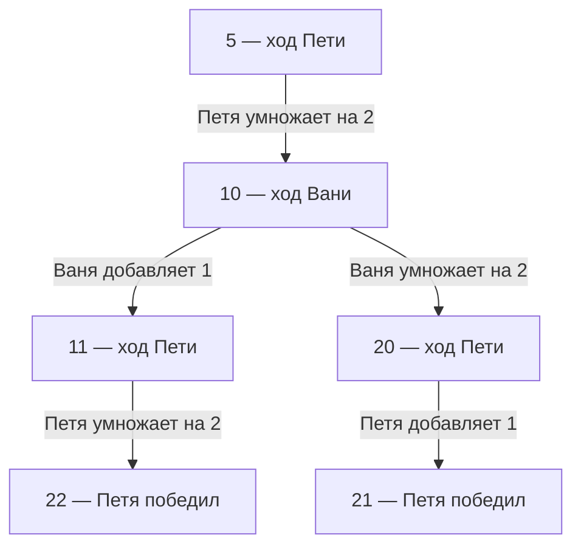

**Основная идея заданий 19–21 — научиться выбирать свой ход так, чтобы учитывать все возможные ответы соперника.** Количество камней здесь описывает ситуацию, но само решение строится на логике: где достаточно одного подходящего действия, а где необходимо проверить каждое.

Ниже разберём тему последовательно: смысл игры и стратегии, решение вручную, одну и две кучи, игры с уменьшением количества камней, а затем — Python. Код будем выводить из рассуждений.

Все небольшие числовые примеры ниже учебные: числа специально подобраны так, чтобы можно было проверить каждый шаг.

---

**1. Сначала разберём, что именно происходит в игре.** Для этого возьмём одну игру и будем возвращаться к ней на протяжении объяснения.

Её правила:

- В куче первоначально лежит \(S\) камней.
- Первым ходит Петя, затем Ваня, затем снова Петя.
- За один ход разрешается либо добавить один камень, либо удвоить количество камней.
- Игра заканчивается, когда в куче становится **не менее 21 камня**.
- Побеждает игрок, который своим ходом получил такое количество.

Например, из 7 камней можно получить:

\[
7+1=8
\]

или

\[
7\cdot2=14.
\]

За один ход выбирается **одно** из разрешённых действий. Получить сначала 8, а затем 16 — уже два хода.

**Позицией** будем называть состояние игры перед очередным ходом. В игре с одной кучей это прежде всего количество камней.

Например:

> В куче 10 камней, сейчас ходит Ваня.

Чтобы полностью понимать ситуацию, нужно учитывать и количество камней, и того, чья очередь ходить.

Однако позже мы научимся описывать позиции относительно **игрока, которому сейчас предстоит ходить**. Тогда имя игрока временно станет неважно.

**Условие окончания проверяется после каждого отдельного хода.**

Если Петя из 12 камней получил 24, он уже победил. Ваня после этого не ходит.

Фраза «не менее 21» означает:

\[
s\ge21.
\]

Подходят и 21, и 22, и 40. Получать ровно 21 необязательно.

Сравни:

| Формулировка | Проверка |
|---|---|
| Не менее 21 | `s >= 21` |
| Более 21 | `s > 21` |
| Не более 21 | `s <= 21` |
| Менее 21 | `s < 21` |
| Ровно 21 | `s == 21` |

Одно слово в условии может изменить ответы на все три задания.

---

**2. «Второй ход Пети» — это третий ход всей игры.** Этот момент нужно понять до любого программирования.

Поскольку первым ходит Петя, порядок такой:

| Номер хода во всей игре | Кто ходит | Какой это личный ход игрока |
|---:|---|---|
| 1 | Петя | Первый |
| 2 | Ваня | Первый |
| 3 | Петя | Второй |
| 4 | Ваня | Второй |
| 5 | Петя | Третий |
| 6 | Ваня | Третий |

Поэтому:

- победа Пети первым ходом — завершение игры на общем ходе № 1;
- победа Вани первым ходом — на общем ходе № 2;
- победа Пети вторым ходом — на общем ходе № 3;
- победа Вани вторым ходом — на общем ходе № 4.

Частая ошибка — прочитать «своим вторым ходом» и проверить всего два хода игры.

Ещё одна тонкость: когда мы говорим, что из некоторой позиции игрок выигрывает своим вторым ходом, личные ходы отсчитываются **с рассматриваемой позиции**. Если сейчас ходит Ваня, первым действием этого фрагмента будет ход Вани.

---

**3. Одна удачная последовательность ходов ещё не доказывает наличие выигрышной стратегии.** Посмотрим на различие между партией и стратегией.

**Партия** — одна конкретная последовательность уже выбранных ходов.

Например:

\[
6\xrightarrow{\text{Петя: }\times2}12
\xrightarrow{\text{Ваня: }\times2}24.
\]

Здесь победил Ваня.

Но означает ли это, что Ваня обязательно победит первым ходом при начальном \(S=6\)?

Нет. Петя мог выбрать другой ход:

\[
6\xrightarrow{\text{Петя: }+1}7.
\]

Из 7 Ваня получит либо 8, либо 14. Ни один результат не завершает игру.

Следовательно, мы нашли **возможную победу Вани**, но не доказали её гарантированность.

**Стратегия** — правило выбора своих действий в зависимости от того, какая ситуация возникла.

**Выигрышная стратегия** гарантирует победу при любых разрешённых действиях соперника. Именно такое понимание используется в приведённых тобой подборках. [inf-ege.sdamgia.ru](https://inf-ege.sdamgia.ru/test?theme=407\&utm_source=chatgpt.com)

Рассмотрим \(S=5\).

Петя может удвоить кучу и передать Ване 10 камней. Дальше у Вани два варианта:

- добавить один и получить 11;
- удвоить и получить 20.

Из обеих получившихся позиций Петя может немедленно выиграть:



Здесь показана стратегия Пети: его выбранный первый ход, **все ответы Вани** и подходящий ответ Пети на каждый из них.

Обрати внимание:

1. Петя не обязан выигрывать после любого собственного первого хода. Ему достаточно выбрать правильный.
2. После выбранного хода Пети необходимо учесть все ответы Вани.
3. Последний ход Пети может зависеть от ответа Вани.
4. Стратегия не требует заранее назначить одну и ту же команду на все будущие ситуации.

Например, правило «если осталось 11 — удвоить, если осталось 20 — добавить один» является совершенно нормальной стратегией.

Разветвляющееся изображение возможных продолжений называется **деревом игры**. В полном дереве показывают все разрешённые ходы. В дереве выигрышной стратегии можно оставить выбранные действия победителя, но необходимо сохранить все возможные ответы его соперника.

---

**4. В основе решения стоят два разных требования: «существует подходящий ход» и «подходят все ходы».** Это главный логический переход в теме.

Представим, что мы проверяем стратегию Пети.

На ходе Пети спрашиваем:

> Есть ли хотя бы один ход, после которого Петя сможет выполнить требование задачи?

Если подходящий ход найден, остальные собственные ходы Петя просто не выбирает.

На ходе Вани спрашиваем:

> Сохранится ли нужный результат после каждого разрешённого хода Вани?

Если есть хотя бы один ответ Вани, который разрушает план Пети, гарантии уже нет.

В Python для этих двух проверок используются функции:

- `any` — хотя бы одна проверка истинна;
- `all` — все проверки истинны.

Значения `True` и `False` означают соответственно «да, утверждение верно» и «нет, утверждение неверно».

| Результаты проверок продолжений | `any` | `all` |
|---|---:|---:|
| `True, True` | `True` | `True` |
| `True, False` | `True` | `False` |
| `False, True` | `True` | `False` |
| `False, False` | `False` | `False` |

Например, из позиции у игрока есть три хода. Они дают результаты:

```python
[False, True, False]
```

Если это **наш ход**, мы выберем второй:

```python
any([False, True, False])  # True
```

Если это **ход соперника**, он может выбрать первый или третий и разрушить нашу гарантию:

```python
all([False, True, False])  # False
```

Здесь «наш» означает игрока, чью победу мы сейчас проверяем. Если проверяем стратегию Вани, то:

- на ходе Вани используется выбор подходящего варианта;
- на ходе Пети проверяются все варианты.

**Нельзя навсегда привязать `any` к Пете, а `all` — к Ване.** Они привязаны к тому, чью стратегию мы доказываем.

Эту логику можно записать словами:

> Петя выбирает первый ход → Ваня отвечает как угодно → Петя выбирает подходящий ответ.

Иногда используют короткие математические обозначения:

- \(\exists\) — «существует»;
- \(\forall\) — «для любого».

Тогда победа Пети вторым ходом имеет структуру:

\[
\exists\text{ ход Пети}\quad
\forall\text{ ответ Вани}\quad
\exists\text{ завершающий ход Пети}.
\]

Порядок важен. Сначала Петя выбирает один первый ход. Он не может задним числом изменить его, узнав ответ Вани.

---

**5. Решать игру удобно от ближайшей победы к более далёким позициям.** Вместо попытки сразу представить все партии начнём с вопроса: из каких состояний можно закончить игру одним действием?

Введём четыре обозначения. Они относятся **к игроку, которому сейчас предстоит ходить**, а не постоянно к Пете или Ване.

Буква `W` происходит от *win* — выиграть, `L` — от *lose* — проиграть.

| Обозначение | Смысл |
|---|---|
| `W1` | Текущий игрок может выиграть одним ходом |
| `L1` | После любого хода текущего игрока соперник может выиграть своим первым ходом |
| `W2` | Текущий игрок не может выиграть сразу, но может гарантировать победу своим вторым ходом |
| `L2` | Соперник может гарантировать победу первым или вторым своим ходом, но не может гарантировать её первым |

Разберём, откуда берётся каждое правило.

**Позиция `W1`: существует ход, немедленно завершающий игру победой.**

Например, из 11 можно получить 22. Значит, 11 — позиция `W1`.

Неважно, что другой ход, \(11\to12\), не завершает игру. Игрок выбирает удвоение.

**Позиция `L1`: все ходы передают сопернику позицию `W1`.**

Например, из 10 можно получить только 11 или 20.

Оба результата — `W1` для следующего игрока:

- из 11 он получает 22;
- из 20 — 21 или 40.

Поэтому 10 — `L1`.

Слово «проигрышная» здесь означает, что соперник способен обеспечить победу. Если соперник ошибётся и не воспользуется возможностью, фактическая партия может сложиться иначе.

**Позиция `W2`: можно передать сопернику `L1`, при этом выиграть сразу нельзя.**

Допустим, текущий игрок передал сопернику 10.

Дальше соперник вынужден получить 11 или 20. Текущий игрок дождётся своей очереди и выиграет.

Значит, нужен хотя бы один ход в `L1`.

И отдельно нужно проверить запрет на победу за один ход, если он есть в задаче.

**Позиция `L2`: каждый ход передаёт сопернику либо `W1`, либо `W2`, причём не все ходы ведут в `W1`.**

Почему допускаются оба типа?

- Передали сопернику `W1` — он выигрывает первым своим ходом.
- Передали `W2` — он гарантирует победу вторым.

Почему необходимо исключить случай «все ходы ведут в `W1`»?

Потому что тогда соперник уже гарантирует победу первым ходом. Это `L1`, а во многих заданиях 21 такую возможность нужно исключить.

Важно: для `L2` **необязательно**, чтобы были одновременно переходы и в `W1`, и в `W2`.

Может оказаться, что все ходы ведут в `W2`. Это тоже подходит: соперник гарантирует победу вторым ходом, а первым — не гарантирует.

Получается следующая последовательность рассуждений:

| Что определяем | Что проверяем |
|---|---|
| `W1` | Есть ход к немедленной победе |
| `L1` | Все ходы ведут в `W1` |
| `W2` | Нет немедленной победы, есть ход в `L1` |
| `L2` | Все ходы ведут в `W1` или `W2`, но позиция не `L1` |

Это называют **анализом от конца игры**: сначала изучаем ситуации, где до победы один ход, а затем отступаем всё дальше.

Окончившуюся игру не будем обозначать `W1`. `W1` — активная позиция, из которой ещё нужно сделать победный ход. Если порог уже достигнут, игра завершена, и победил предыдущий ходивший.

---

**6. Теперь полностью решим учебную игру с одной кучей вручную.** Напомню правила:

\[
s\to s+1,\qquad s\to2s,\qquad \text{победа при }s\ge21.
\]

Начальные значения:

\[
1\le S\le20.
\]

Сначала найдём `W1`.

Чтобы выиграть удвоением, нужно:

\[
2S\ge21.
\]

Следовательно:

\[
S\ge10{,}5.
\]

Количество камней целое, поэтому первое подходящее значение — 11.

Прибавлением единицы можно выиграть из 20, но 20 уже попало в найденную группу.

Получаем:

\[
W1=\{11,12,\ldots,20\}.
\]

Теперь найдём `L1`.

Игрок не должен иметь немедленной победы, поэтому рассматриваем только:

\[
S\le10.
\]

После любого его действия соперник должен получить `W1`.

В частности, это должно произойти после прибавления единицы:

\[
S+1\ge11.
\]

Отсюда:

\[
S\ge10.
\]

Одновременно \(S\le10\) и \(S\ge10\), поэтому остаётся только:

\[
S=10.
\]

Проверяем оба хода:

\[
10\to11,\qquad10\to20.
\]

Оба результата находятся в `W1`. Значит:

\[
L1=\{10\}.
\]

Теперь найдём `W2`.

Нужно попасть в 10 одним действием:

\[
S+1=10
\]

или

\[
2S=10.
\]

Получаем:

\[
S=9
\]

или

\[
S=5.
\]

Ни из 5, ни из 9 нельзя выиграть первым ходом.

Поэтому:

\[
W2=\{5,9\}.
\]

Стратегии:

- из 5 удвоить и получить 10;
- из 9 добавить один и получить 10.

Дальше работает уже разобранная ловушка.

Теперь найдём `L2`.

Все ходы должны вести в:

\[
W1\cup W2=\{5,9,11,12,\ldots,20\}.
\]

Знак \(\cup\) означает объединение: берём числа, которые входят хотя бы в одну из двух групп.

Позиции `W1` и `L1` нам не подходят, поэтому остаётся рассматривать \(S\le9\).

После прибавления единицы получится число не больше 10. Из таких чисел в нужной группе есть только 5 и 9.

Поэтому:

\[
S+1=5\quad\text{или}\quad S+1=9.
\]

Кандидаты:

\[
S=4,\quad S=8.
\]

Проверим удвоение:

- из 4 получается 8, которое не относится ни к `W1`, ни к `W2`;
- из 8 получается 16, которое относится к `W1`.

Подходит только:

\[
L2=\{8\}.
\]

Разберём стратегию Вани при \(S=8\).

| Первый ход Пети | Позиция перед Ваней | Действие Вани |
|---|---:|---|
| Прибавить 1 | 9 | Прибавить 1 и передать Пете 10 |
| Удвоить | 16 | Удвоить и немедленно выиграть |

В первой ветке:

\[
8\to9\to10.
\]

Теперь ходит Петя. Из 10 он получает 11 или 20, после чего Ваня выигрывает своим вторым ходом.

Во второй ветке:

\[
8\to16\to32.
\]

Ваня выигрывает первым ходом.

Следовательно:

- при любом первом ходе Пети Ваня выиграет не позднее второго своего хода;
- гарантировать победу именно первым ходом Ваня не может: Петя способен выбрать переход в 9.

Для нашей игры получилась такая таблица:

| Тип | Начальные количества камней |
|---|---|
| `W1` | 11–20 |
| `L1` | 10 |
| `W2` | 5, 9 |
| `L2` | 8 |

Числа 1–4, 6 и 7 пока не классифицированы. Это **не означает**, что они все проигрышные или что игра из них не заканчивается. Для их полной оценки нужно рассматривать более далёкие ходы.

---

**7. Формулировку задания 19 необходимо читать отдельно: под одним номером встречаются разные логические вопросы.** В твоих подборках есть задачи о победе Вани после неудачного хода Пети. В демоверсии 2026 года, например, требуется ситуация, в которой Ваня выигрывает первым ходом после любого первого хода Пети. Это разные условия. [inf-ege.sdamgia.ru](https://inf-ege.sdamgia.ru/test?theme=407\&utm_source=chatgpt.com)

Рассмотрим обе формулировки на нашей игре.

**«Ваня выиграл первым ходом после неудачного первого хода Пети».**

Здесь требуется найти возможность:

> Есть такой ход Пети, после которого Ваня может сразу выиграть.

Нужно:

1. выбрать подходящий первый ход Пети;
2. выбрать победный ответ Вани.

Поэтому логика такая:

\[
\exists\text{ ход Пети}\quad\exists\text{ ход Вани}.
\]

При \(S=6\):

\[
6\to12\to24.
\]

Такая партия возможна.

Почему 6 — минимальное значение?

Если \(S\le5\), даже два последовательных удвоения дадут не более:

\[
5\cdot2\cdot2=20.
\]

Добавление единицы не увеличивает положительную кучу сильнее удвоения. Следовательно, за два хода получить 21 невозможно.

Ответ для этой формулировки:

\[
S_{\min}=6.
\]

**«При любом первом ходе Пети Ваня выигрывает своим первым ходом».**

Теперь требуется:

\[
\forall\text{ ход Пети}\quad\exists\text{ победный ответ Вани}.
\]

Это уже позиция `L1`, то есть:

\[
S=10.
\]

Таким образом, в одной и той же игре:

| Вопрос | Ответ |
|---|---:|
| Минимальное \(S\), при котором возможна победа Вани после неудачного хода Пети | 6 |
| \(S\), при котором Ваня гарантирует победу первым ходом | 10 |

**Не стоит выбирать алгоритм по одному только номеру 19.** Сначала выясни, что требуется: возможность удачной партии или гарантия.

Если отдельно сказано, что Петя не может выиграть первым ходом, это тоже нужно учитывать. Из условия о существовании неудачного хода такой запрет автоматически не следует: игрок иногда способен и немедленно выиграть, и вместо этого ошибиться.

---

**8. В задании 21 особенно важно правильно понимать отрицание: «нет гарантии победить первым» не означает «невозможно победить первым».**

Вернёмся к \(S=8\):

- Петя выбрал \(8\to16\) — Ваня может выиграть сразу;
- Петя выбрал \(8\to9\) — Ваня сразу выиграть не может.

Поэтому у Вани:

- есть возможность выиграть первым ходом при определённой игре Пети;
- нет стратегии, гарантирующей такую быструю победу при любой игре Пети.

Это разные утверждения.

Чтобы опровергнуть фразу:

> После каждого первого хода Пети Ваня может выиграть сразу,

достаточно показать:

> Есть хотя бы один первый ход Пети, после которого Ваня не может выиграть сразу.

Это общее правило логики:

\[
\text{не «для всех»}=\text{«существует исключение»}.
\]

В терминах Python:

```python
not all(checks)
```

означает, что хотя бы одна проверка не выполнена.

А выражение:

```python
all(not check for check in checks)
```

означает более сильное требование: не выполнена ни одна проверка.

Для типичного задания 21 требуется первое: отсутствие гарантии победы первым ходом.

---

**9. Переведём рассуждения в Python без рекурсии.** Начнём с функций, которые буквально повторяют определения четырёх типов позиций.

Сначала несколько обозначений:

- `p` — рассматриваемая позиция;
- `q` — позиция после одного разрешённого хода;
- `moves(p)` — список всех позиций, которые можно получить одним ходом;
- `finished(p)` — проверка, закончилась ли игра.

Слово `def` объявляет функцию, а `return` возвращает результат её работы.

Правила нашей игры:

```python
def moves(s):
    return [s + 1, s * 2]


def finished(s):
    return s >= 21
```

Например:

```python
moves(10)
```

возвращает:

```python
[11, 20]
```

А:

```python
finished(20)  # False
finished(21)  # True
finished(40)  # True
```

Теперь разберём короткую конструкцию, которая будет встречаться в коде:

```python
any(finished(q) for q in moves(p))
```

Она означает:

> Для каждой позиции `q`, полученной одним ходом из `p`, проверить окончание игры. Затем выяснить, есть ли хотя бы один результат `True`.

Её можно записать длиннее:

```python
checks = []

for q in moves(p):
    checks.append(finished(q))

result = any(checks)
```

Здесь:

- `checks = []` создаёт пустой список;
- цикл `for` перебирает следующие позиции;
- `.append(...)` добавляет очередной результат в список;
- `any(checks)` проверяет, есть ли среди результатов хотя бы одно `True`.

Теперь сами четыре проверки:

```python
def win1(p):
    return (
        not finished(p)
        and any(finished(q) for q in moves(p))
    )


def lose1(p):
    return (
        not finished(p)
        and all(win1(q) for q in moves(p))
    )


def win2(p):
    return (
        not finished(p)
        and not win1(p)
        and any(lose1(q) for q in moves(p))
    )


def lose2(p):
    return (
        not finished(p)
        and not lose1(p)
        and all(win1(q) or win2(q) for q in moves(p))
    )
```

Слова `not`, `and`, `or` означают:

- `not` — отрицание;
- `and` — должны выполняться оба условия;
- `or` — достаточно выполнения хотя бы одного.

Поясним функции по очереди.

`win1(p)`:

> Игра ещё не закончилась, и существует ход, который её завершает.

`lose1(p)`:

> Игра ещё не закончилась, и после любого нашего хода соперник получает возможность немедленно выиграть.

`win2(p)`:

> Игра ещё не закончилась, немедленно выиграть нельзя, но можно передать сопернику позицию `L1`.

`lose2(p)`:

> Игра ещё не закончилась, позиция не является `L1`, а после любого нашего хода соперник получает `W1` или `W2`.

Отдельно проверим возможность неудачного хода:

```python
def after_mistake(p):
    return (
        not finished(p)
        and any(win1(q) for q in moves(p))
    )
```

Здесь стоит `any`, потому что нам достаточно **одного** хода, после которого соперник сможет выиграть сразу.

**Зачем в функциях стоит `not finished(p)`?**

Чтобы не анализировать уже завершившуюся игру как активную.

Например, `win1(22)` должно вернуть `False`: из 22 уже не требуется выигрывать новым ходом — партия закончилась раньше.

Это важно и внутри других функций. Если Петя своим ходом получил 22, нельзя продолжать рассуждение так, будто Ваня теперь получил удобную позицию для следующего хода.

В выражении:

```python
not finished(p) and ...
```

Python сначала проверяет левую часть. Если игра закончилась, левая часть равна `False`, и дальнейшие ходы вычислять уже не нужно.

Эти определения рассчитаны на игры, где у каждой незавершённой позиции есть хотя бы один разрешённый ход. Если возможна ситуация без ходов, её исход нужно обработать отдельно по правилам задачи.

---

**10. После того как проверка одного значения \(S\) готова, остаётся перебрать допустимые начальные значения.** Не нужно смешивать поиск стратегии с поиском минимума: это два отдельных действия.

Сначала собираем все подходящие значения:

```python
answer19_mistake = []
answer19_guaranteed = []
answer20 = []
answer21 = []

for s in range(1, 21):
    p = s

    if after_mistake(p):
        answer19_mistake.append(s)

    if lose1(p):
        answer19_guaranteed.append(s)

    if win2(p):
        answer20.append(s)

    if lose2(p):
        answer21.append(s)

print("19, после неудачного хода:", min(answer19_mistake))
print("19, при любом ходе:", answer19_guaranteed)
print("20:", answer20)
print("21:", answer21)
```

Получится:

```text
19, после неудачного хода: 6
19, при любом ходе: [10]
20: [5, 9]
21: [8]
```

`range(1, 21)` перебирает числа от 1 до 20 включительно. Правая граница в `range` не включается.

`min(...)` находит наименьшее число из найденных.

При этом формат конечного ответа определяется условием:

- нужны все подходящие значения — берём весь список;
- нужен минимум — выбираем наименьшее;
- нужен максимум — наибольшее;
- нужны два наименьших — берём первые два числа при переборе по возрастанию.

Если программа нашла три подходящих значения, а условие просит **два наименьших**, это не ошибка программы. Просто требуется выбрать часть найденных значений.

Если верхняя граница \(S\) не указана, произвольный перебор до 1000 сам по себе не доказывает, что дальше ничего нет. Для поиска первого или первых нескольких значений можно двигаться по возрастанию до их нахождения. Для поиска максимума или всех значений нужна обоснованная граница.

---

**11. В игре с двумя кучами логика стратегии остаётся той же, но позиция теперь состоит из двух чисел.**

Если в первой куче \(a\) камней, а во второй \(b\), записываем:

\[
(a,b).
\]

Например:

\[
(3,8).
\]

Если разрешается добавить один камень в одну выбранную кучу или удвоить одну выбранную кучу, есть четыре действия:

\[
(a,b)\to(a+1,b),
\]

\[
(a,b)\to(2a,b),
\]

\[
(a,b)\to(a,b+1),
\]

\[
(a,b)\to(a,2b).
\]

Такая структура ходов, в частности, встречается в указанных тобой подборках на две кучи. [inf-ege.sdamgia.ru](https://inf-ege.sdamgia.ru/test?theme=420\&utm_source=chatgpt.com)

**Один ход изменяет одну выбранную кучу.**

Если условие не разрешает иное, нельзя за один ход:

- добавить по камню в обе кучи;
- удвоить обе кучи;
- сначала изменить первую, затем вторую.

Для учебного примера примем:

- ходы — добавить один или удвоить одну кучу;
- игра заканчивается при сумме не менее 20;
- начальная позиция — \((3,S)\).

В Python пара чисел записывается как **кортеж**:

```python
p = (3, 8)
```

Для нашей задачи достаточно понимать кортеж как одну запись, которая хранит два значения.

Строка:

```python
a, b = p
```

извлекает из неё первое и второе числа:

```python
a = 3
b = 8
```

Правила игры:

```python
def moves(p):
    a, b = p

    return [
        (a + 1, b),
        (a * 2, b),
        (a, b + 1),
        (a, b * 2),
    ]


def finished(p):
    a, b = p
    return a + b >= 20
```

Функции `win1`, `lose1`, `win2`, `lose2`, `after_mistake` менять не нужно. Они работают с позицией через `moves` и `finished` и не требуют, чтобы позиция была одним числом.

В переборе меняются начальная позиция и диапазон:

```python
for s in range(1, 17):
    p = (3, s)

    # Далее те же проверки для позиции p.
```

Почему \(S\) от 1 до 16?

Начальная игра ещё не закончена:

\[
3+S<20.
\]

Значит:

\[
S<17.
\]

Теперь разберём конкретные стратегии.

При \(S=8\) начальная позиция:

\[
(3,8).
\]

Посмотрим на все первые ходы Пети:

| Ход Пети | Позиция перед Ваней | Победный ответ Вани |
|---|---|---|
| Добавить в первую кучу | \((4,8)\) | Удвоить вторую: \((4,16)\), сумма 20 |
| Удвоить первую | \((6,8)\) | Удвоить вторую: \((6,16)\), сумма 22 |
| Добавить во вторую | \((3,9)\) | Удвоить вторую: \((3,18)\), сумма 21 |
| Удвоить вторую | \((3,16)\) | Добавить в первую: \((4,16)\), сумма 20 |

Все ответы Пети дают Ване немедленную победу. Поэтому \((3,8)\) — `L1`.

Для начальных позиций \((3,S)\) получаются:

| Тип | Значения \(S\) |
|---|---|
| `W1` | 9–16 |
| `L1` | 8 |
| `W2` | 4, 6, 7 |
| `L2` | 3 |

Проверим позиции `W2`.

При \(S=4\):

\[
(3,4)\to(3,8).
\]

Петя удваивает вторую кучу и передаёт Ване `L1`.

При \(S=7\):

\[
(3,7)\to(3,8).
\]

Петя добавляет один во вторую кучу.

При \(S=6\):

\[
(3,6)\to(6,6).
\]

Позиция \((6,6)\) тоже `L1`. Действительно:

- после прибавления единицы получится \((7,6)\) или \((6,7)\), откуда соперник удвоит семёрку и получит сумму 20;
- после удвоения получится \((12,6)\) или \((6,12)\), откуда соперник сможет сразу достичь нужной суммы.

Особенно полезен случай \(S=3\), то есть \((3,3)\).

| Первый ход Пети приводит к | Ваня передаёт Пете |
|---|---|
| \((4,3)\) | \((8,3)\) |
| \((6,3)\) | \((6,6)\) |
| \((3,4)\) | \((3,8)\) |
| \((3,6)\) | \((6,6)\) |

В правом столбце находятся позиции `L1`. Поэтому после следующего хода Пети Ваня выиграет.

Из всех четырёх позиций левого столбца Ваня не может выиграть немедленно. Здесь он гарантирует именно второй свой ход.

Это пример `L2`, где **все** первые ходы Пети передают Ване `W2`. Наличие ветки с победой Вани первым ходом не требуется.

---

**12. Даже если победа зависит от суммы двух куч, одной суммы обычно недостаточно для описания позиции.**

Возьмём две позиции с одинаковой суммой:

\[
(6,6),\qquad(2,10).
\]

В обеих сумма равна 12.

Но при удвоении одной кучи:

| Позиция | Наибольшая сумма после одного хода | Можно сразу получить не менее 20? |
|---|---:|---|
| \((6,6)\) | 18 | Нет |
| \((2,10)\) | 22 | Да |

Причина: удваивается одна куча, а не общая сумма.

После удвоения большей кучи новая сумма равна:

\[
a+b+\max(a,b).
\]

Здесь \(\max(a,b)\) — большее из двух чисел.

Например, для \((2,10)\):

\[
2+10+10=22.
\]

Поэтому одинаковая сумма не делает позиции равнозначными.

**Сумма может определять окончание игры, но разрешённые продолжения могут зависеть от распределения камней между кучами.**

Также неверно считать, что каждый игрок управляет «своей» кучей. Если по условию каждый может выбрать любую, то и Петя, и Ваня на каждом своём ходе рассматривают все четыре действия.

---

**13. Игры с уменьшением количества камней решаются теми же логическими проверками.** Меняются только разрешённые действия и условие окончания.

Рассмотрим другую учебную игру:

- разрешено убрать один камень;
- либо разделить количество камней на 2 с округлением вниз;
- выигрывает получивший не более 10 камней;
- первоначально \(S\ge11\).

Правила:

```python
def moves(s):
    return [s - 1, s // 2]


def finished(s):
    return s <= 10
```

Операция `//` для неотрицательных целых чисел означает целочисленное деление с округлением вниз:

```python
20 // 2  # 10
21 // 2  # 10
22 // 2  # 11
```

Поэтому из 21 можно выиграть сразу:

\[
21\to10.
\]

А из 22 делением получится 11 — игра ещё продолжается.

Найдём ближайшие типы позиций.

`W1`:

\[
11,12,\ldots,21.
\]

`L1`:

\[
22.
\]

Потому что:

\[
22\to21
\]

или

\[
22\to11.
\]

Оба результата — `W1`.

Для `W2` нужно одним ходом попасть в 22.

Убавлением единицы:

\[
S-1=22\Rightarrow S=23.
\]

Делением на 2 с округлением вниз:

\[
44//2=22,
\]

\[
45//2=22.
\]

Поэтому:

\[
W2=\{23,44,45\}.
\]

Для этой игры `L2` — позиции:

\[
24,\ 46.
\]

Проверим:

\[
24\to23\quad\text{или}\quad24\to12.
\]

Здесь 23 — `W2`, а 12 — `W1`.

И:

\[
46\to45\quad\text{или}\quad46\to23.
\]

Здесь оба результата — `W2`.

Таким образом, даже при уменьшении куч работают те же правила:

- есть победный ход;
- все ходы дают сопернику немедленную победу;
- есть переход в такую ловушку;
- все ходы дают сопернику победу за один или два его хода.

**Округление нужно переносить из условия буквально.**

Для положительных целых чисел:

| Что требуется | Запись |
|---|---|
| Деление с округлением вниз | `s // d` |
| Деление с округлением вверх | `(s + d - 1) // d` |
| Деление только при делимости без остатка | Сначала проверить `s % d == 0` |

`%` возвращает остаток от деления. Например:

```python
10 % 3  # 1
12 % 3  # 0
```

Обычное `/` может дать дробное число, а `round()` округляет по другому правилу. Подставлять их вместо нужного округления нельзя.

Полезно понимать границу для деления вниз.

Например:

\[
s//4\le10
\]

выполняется вплоть до \(s=43\), потому что:

\[
43//4=10,
\]

но:

\[
44//4=11.
\]

Поэтому граница здесь 43, а не 40.

---

**14. Рекурсия позволяет описать проверку стратегии одной функцией.** Сначала разберём её в форме, где явно указаны игрок и проверяемая цель.

Ранее мы последовательно проверяли:

> Можем ли выиграть сразу?  
> А что получит соперник после нашего хода?  
> А что получим мы после его ответа?

На каждом следующем шаге возникает тот же вопрос, только для другой позиции и с меньшим числом оставшихся ходов.

**Рекурсией** называется ситуация, когда функция вызывает саму себя, чтобы решить более маленькую часть той же задачи.

В нашем случае «меньше» означает:

> Осталось рассмотреть на один ход меньше.

Пусть функция называется:

```python
can_win(p, turn, target, left)
```

Смысл параметров:

| Параметр | Что хранит |
|---|---|
| `p` | Текущую позицию |
| `turn` | Чья очередь ходить: `0` — Петя, `1` — Ваня |
| `target` | Чью гарантированную победу проверяем |
| `left` | Сколько общих ходов ещё разрешено рассмотреть |

Например:

```python
can_win(5, 0, 0, 3)
```

означает:

> Из позиции 5, когда ходит Петя, может ли Петя гарантировать победу не позднее чем за три общих хода?

Три общих хода — это первый ход Пети, первый ход Вани и второй ход Пети.

Функция:

```python
def can_win(p, turn, target, left):
    if finished(p):
        return turn != target

    if left == 0:
        return False

    results = [
        can_win(q, 1 - turn, target, left - 1)
        for q in moves(p)
    ]

    if turn == target:
        return any(results)

    return all(results)
```

Разберём каждую часть.

**Проверка окончания:**

```python
if finished(p):
    return turn != target
```

Если игра уже закончилась, последний ход сделал **предыдущий** игрок.

`turn` хранит того, кто ходил бы следующим, если бы игра продолжалась.

Поэтому:

- если следующим должен был ходить проверяемый игрок, последним сходил его соперник — это поражение;
- если следующим должен был ходить соперник, последним сходил проверяемый игрок — это победа.

Операция `!=` означает «не равно».

Например, проверяем Петю, то есть `target = 0`.

Если Петя достиг порога, следующий предполагаемый игрок — Ваня, `turn = 1`.

Получаем:

```python
1 != 0  # True
```

**Проверка количества оставшихся ходов:**

```python
if left == 0:
    return False
```

Если игра ещё не закончилась, а разрешённые для проверки ходы исчерпаны, требование не выполнено.

Это не обязательно означает, что проверяемый игрок вообще проигрывает. Возможно, он победит позже. Но в отведённое число ходов гарантии нет.

**Переход к следующему ходу:**

```python
can_win(q, 1 - turn, target, left - 1)
```

Здесь:

- позиция `p` заменяется на результат хода `q`;
- игрок меняется;
- цель остаётся прежней;
- оставшихся ходов становится на один меньше.

Почему игрок меняется через `1 - turn`?

```python
1 - 0 == 1
1 - 1 == 0
```

**Выбор между `any` и `all`:**

```python
if turn == target:
    return any(results)
```

На ходе проверяемого игрока достаточно выбрать одно успешное продолжение.

```python
return all(results)
```

На ходе соперника успешными должны быть все продолжения.

Получаются такие вызовы из начальной позиции, где первым ходит Петя:

| Что проверяем | Вызов |
|---|---|
| Петя выигрывает первым ходом | `can_win(p, 0, 0, 1)` |
| Ваня гарантирует победу первым ходом | `can_win(p, 0, 1, 2)` |
| Петя гарантирует победу первым или вторым ходом | `can_win(p, 0, 0, 3)` |
| Ваня гарантирует победу первым или вторым ходом | `can_win(p, 0, 1, 4)` |

Поэтому типичное условие задания 20:

```python
not can_win(p, 0, 0, 1) and can_win(p, 0, 0, 3)
```

А задания 21:

```python
not can_win(p, 0, 1, 2) and can_win(p, 0, 1, 4)
```

Этот вариант длиннее коротких шаблонов, зато смысл каждого параметра виден непосредственно.

---

**15. Короткий шаблон с `f(p, m)` получается из той же логики, но часть информации в нём спрятана в чётности числа ходов.** Именно поэтому его опасно заучивать без расшифровки.

Код:

```python
def f(p, m):
    if finished(p):
        return m % 2 == 0

    if m == 0:
        return False

    results = [f(q, m - 1) for q in moves(p)]

    if m % 2 == 1:
        return any(results)

    return all(results)
```

Здесь `m` — количество общих ходов, которое ещё можно рассмотреть.

Но нужно добавить ключевое соглашение:

> Проверяется гарантированная победа того игрока, которому принадлежал бы последний из этих `m` ходов. Его более ранняя победа тоже засчитывается.

Разберём это без формул.

Если сейчас ходит Петя и `m = 3`, возможный порядок:

1. Петя.
2. Ваня.
3. Петя.

Последний разрешённый ход принадлежит Пете. Значит, проверяем победу Пети не позднее этого момента.

Если `m = 4`:

1. Петя.
2. Ваня.
3. Петя.
4. Ваня.

Проверяем победу Вани.

Из начальной позиции:

| Вызов | Смысл |
|---|---|
| `f(p, 1)` | Петя может выиграть первым ходом |
| `f(p, 2)` | Ваня гарантирует победу первым ходом |
| `f(p, 3)` | Петя гарантирует победу первым или вторым ходом |
| `f(p, 4)` | Ваня гарантирует победу первым или вторым ходом |
| `f(p, 5)` | Петя гарантирует победу не позднее третьего своего хода |

Теперь объясним две проверки чётности.

**Почему при нечётном `m` используется `any`?**

Если осталось нечётное число ходов, первый и последний из них принадлежат одному игроку.

Например:

\[
\text{Петя, Ваня, Петя}.
\]

Значит, сейчас ходит тот игрок, чью победу проверяем. Он выбирает подходящий ход:

```python
any(results)
```

Если осталось чётное число ходов, последний принадлежит сопернику текущего игрока:

\[
\text{Петя, Ваня}.
\]

Сейчас ходит противник того, чью победу проверяем. Нужно выдержать все его действия:

```python
all(results)
```

**Почему при завершённой игре возвращается `m % 2 == 0`?**

После окончания игры последним сходил предыдущий игрок.

Если оставшееся `m` чётно, проверяемый победитель — как раз противоположный текущему, то есть предыдущий игрок.

Можно увидеть это на конкретной проверке:

```python
f(p, 3)
```

Мы проверяем победу Пети первым или вторым ходом.

| Когда закончилась игра | Кто сделал последний ход | Сколько ходов осталось `m` | Результат |
|---|---|---:|---|
| После общего хода 1 | Петя | 2 | `True` |
| После общего хода 2 | Ваня | 1 | `False` |
| После общего хода 3 | Петя | 0 | `True` |

Петины победы соответствуют чётному остатку: 2 или 0.

Поэтому:

```python
return m % 2 == 0
```

проверяет победителя, а не количество камней.

**Почему сначала проверяется окончание игры, а потом `m == 0`?**

Предположим, победа произошла последним разрешённым ходом. После него:

- порог уже достигнут;
- оставшихся ходов ровно 0.

Победу нужно засчитать.

Если сначала написать:

```python
if m == 0:
    return False
```

программа ошибочно отвергнет все победы на последнем разрешённом ходе.

Правильный порядок:

```python
if finished(p):
    ...

if m == 0:
    ...
```

---

**16. Проследим работу короткой рекурсии на одном конкретном значении.** Для игры \(+1,\times2\), порог 21, проверим:

```python
f(5, 3)
```

Здесь Петя должен гарантировать победу не позднее второго собственного хода.

Из 5 получаются 6 и 10:

```python
f(5, 3)
```

проверяет:

```python
any([
    f(6, 2),
    f(10, 2),
])
```

Пете достаточно одного удачного первого хода.

Посмотрим на ветку `f(10, 2)`.

Теперь ходит Ваня. Из 10 он получает 11 или 20:

```python
all([
    f(11, 1),
    f(20, 1),
])
```

Пете нужна победа после обоих вариантов Вани.

Для `f(11, 1)`:

```python
any([
    f(12, 0),
    f(22, 0),
])
```

- `f(12, 0)` — `False`: ходы закончились, порог не достигнут.
- `f(22, 0)` — `True`: игра завершена победой нужного игрока.

Поэтому:

```python
f(11, 1) == True
```

Для `f(20, 1)` оба возможных хода завершают игру:

```python
f(21, 0) == True
f(40, 0) == True
```

Следовательно:

```python
f(20, 1) == True
```

Возвращаемся выше:

```python
f(10, 2) == all([True, True]) == True
```

И ещё выше:

```python
f(5, 3) == True
```

Пете достаточно выбрать ход из 5 в 10.

Это и есть ручное рассуждение, записанное в виде функции.

Теперь основные условия:

```python
# Ваня гарантированно выигрывает первым ходом.
f(p, 2)
```

```python
# Петя не может выиграть первым,
# но гарантирует победу не позднее второго своего хода.
not f(p, 1) and f(p, 3)
```

```python
# Ваня гарантирует победу первым или вторым своим ходом,
# но не гарантирует победу первым.
not f(p, 2) and f(p, 4)
```

Для вопроса о неудачном ходе Пети используем отдельную проверку:

```python
any(
    not finished(q) and f(q, 1)
    for q in moves(p)
)
```

Она означает:

> Есть такой первый ход Пети, который не завершает игру его победой и после которого Ваня может выиграть одним ходом.

**`f(p, 2)` здесь использовать нельзя:** эта функция проверяет гарантию против любого первого хода Пети.

Для двух куч короткая функция `f` тоже остаётся прежней. Меняются только `moves`, `finished` и представление начальной позиции.

---

**17. «Не позднее второго хода» и «ровно вторым ходом» — разные требования.** Этот нюанс объясняет, почему в условиях нужны дополнительные отрицания.

Функция:

```python
f(p, 3)
```

засчитывает Петину победу:

- первым ходом;
- вторым ходом.

Поэтому для формулировки:

> Петя не может выиграть первым ходом, но может гарантированно выиграть вторым,

нужно:

```python
not f(p, 1) and f(p, 3)
```

Одна только проверка `f(p, 3)` недостаточна.

При этом утверждение:

> Игрок способен организовать победу ровно вторым ходом

само по себе ещё не означает, что он не мог победить первым.

Покажем на маленькой отдельной игре:

- в куче 3 камня;
- можно убрать 1 или 3, если камней хватает;
- выигрывает забравший последний камень.

Первый игрок может сразу убрать 3 и победить.

Но может выбрать и такую стратегию:

1. Убрать 1: останется 2.
2. Соперник вынужден убрать 1: останется 1.
3. Убрать последний камень и победить вторым собственным ходом.

Получается, возможность победить ровно вторым ходом есть, но условие «не может выиграть первым» не выполнено.

Если в нестандартной задаче требуется **именно заданный момент завершения**, это нужно проверять отдельно.

Например, в подробной функции `can_win` можно заменить проверку завершения на:

```python
if finished(p):
    return turn != target and left == 0
```

Теперь победа нужного игрока засчитывается только последним разрешённым ходом. Более ранние завершения не подходят.

Это уже другая проверка. Для стандартной формулировки «первым или вторым» такая замена неверна.

---

**18. Некоторые изменения правил требуют изменить описание позиции или окончания игры, а не `any` и `all`.** Полезно заранее понимать, что именно в решении зависит от условия.

Если добавлены новые команды, изменяется `moves`.

Например, ходы \(+1,+3,\times2\):

```python
def moves(s):
    return [s + 1, s + 3, s * 2]
```

Если в двух кучах конец определяется суммой:

```python
return a + b >= limit
```

Если достаточно достижения порога хотя бы одной кучей:

```python
return a >= limit or b >= limit
```

Если порог должны достичь обе кучи:

```python
return a >= limit and b >= limit
```

Это разные игры.

Если нужно попасть **ровно** в заданное число и превышение запрещено, необходимо не только изменить проверку окончания, но и убрать запрещённые ходы.

Например:

```python
def moves(s):
    candidates = [s + 1, s * 2]
    return [q for q in candidates if q <= 21]


def finished(s):
    return s == 21
```

Конструкция:

```python
[q for q in candidates if q <= 21]
```

создаёт список из тех кандидатов `q`, для которых выполнено условие `q <= 21`.

Если же превышение порога разрешено, но приводит к поражению сделавшего ход, это уже другой исход завершения. Нельзя считать любой конец победой предыдущего игрока. Функция должна различать победное завершение и проигрышное.

Если некоторые команды разрешены только при определённых условиях, в `moves` включаются только разрешённые действия.

Например, деление без остатка:

```python
def moves(s):
    result = [s - 1]

    if s % 2 == 0:
        result.append(s // 2)

    return result
```

Если выбор следующего действия зависит от предыдущего, количества камней уже недостаточно для полного описания ситуации.

Например, правило:

> Нельзя повторять команду, применённую предыдущим ходом.

Тогда состояние должно хранить:

```python
(количество_камней, предыдущая_команда)
```

Почему?

Потому что при одинаковом количестве камней разрешённые действия могут различаться из-за разных предыдущих команд.

Если запрет касается предыдущего хода **каждого конкретного игрока**, потребуется помнить историю отдельно для игроков.

Общее правило такое:

> В позиции нужно хранить всю информацию, которая влияет на допустимые следующие ходы и на исход игры.

---

**19. Для стандартных задач достаточно просмотреть небольшую глубину дерева, поэтому короткая рекурсия обычно не требует сложной оптимизации.**

Если из каждой позиции есть четыре хода, то на глубине четырёх общих ходов будет не более:

\[
4^4=256
\]

конечных ветвей.

С учётом промежуточных позиций:

\[
1+4+16+64+256=341
\]

вызов на одно начальное значение в полном дереве.

Некоторые ветви закончатся раньше из-за достижения порога.

Если одинаковые вычисления встречаются многократно, их можно запоминать. Такое сохранение результатов называется **кешированием**.

В Python:

```python
from functools import cache


@cache
def f(p, m):
    ...
```

Строка `@cache` делает так, что при повторном обращении с теми же аргументами Python использует сохранённый ответ.

Для двух куч позицию удобно хранить кортежем:

```python
(a, b)
```

Обычный список `[a, b]` для такого кеширования аргументов не подходит.

Для неглубоких проверок на один–четыре общих хода кеширование не является обязательной частью решения. Сначала важнее добиться правильной логики.

Если после добавления кеширования изменил правила `moves` или `finished`, старые сохранённые ответы использовать нельзя. Нужно перезапустить программу либо очистить кеш:

```python
f.cache_clear()
```

Также различай два вида рекурсии:

- рекурсия с ограничением `m` останавливается, потому что число оставшихся ходов уменьшается;
- рекурсия «играть до конца» требует уверенности, что бесконечные последовательности невозможны.

В играх, где положительное количество камней строго увеличивается до верхнего порога или строго уменьшается до нижнего, завершение обосновать легко.

Если разрешены и увеличение, и уменьшение, возможны возвращения к прежним позициям. Тогда простая неограниченная рекурсия требует дополнительного анализа.

---

**20. На экзамене удобно придерживаться одного порядка решения.** Он одинаково полезен и при ручном анализе, и при написании программы.

1. **Выпиши правила игры.** Что хранится в позиции? Какие действия разрешены? Кто ходит первым?
2. **Запиши условие окончания точным сравнением.** Например, `s >= 68` или `a + b <= 40`.
3. **Установи, кто считается победителем.** В рассмотренных шаблонах — сделавший завершающий ход.
4. **Переведи вопрос на понятный язык.** Требуется один удачный вариант или гарантия против всех действий?
5. **Переведи личные ходы в общие.** Второй ход Пети — третий общий, второй ход Вани — четвёртый.
6. **Найди позиции немедленной победы.** Это помогает и решить задачу, и проверить код.
7. **Построй следующие типы позиций либо используй рекурсию.**
8. **Перебери только допустимые начальные значения.**
9. **Выбери именно то, что просят:** минимум, максимум, два наименьших или все значения.
10. **Проверь найденную стратегию на конкретных ходах.** Укажи выбранный ход победителя и убедись, что учтены все ответы соперника.

Для самопроверки полезны такие вопросы:

| Вопрос | Что он помогает обнаружить |
|---|---|
| Не продолжаю ли я игру после достижения порога? | Ошибку в обработке завершения |
| Все ли ответы соперника я проверил? | Подмену гарантии одной удачной партией |
| Не требую ли я успеха после всех собственных ходов? | Неверное применение `all` |
| Не перепутал ли личный ход с общим? | Неверную глубину проверки |
| Не исключил ли раннюю победу, которую условие разрешает? | Ошибку в задании 21 |
| Не забыл ли запрет на победу первым ходом? | Лишние ответы в задании 20 |
| Не потерял ли распределение камней между кучами? | Неверное описание позиции |
| Перенёс ли я округление буквально? | Ошибочные границы при делении |

Ещё две распространённые ошибки заслуживают отдельного пояснения.

**«Чем больше камней, тем позиция лучше».**

В нашей первой игре:

- 9 — выигрышная позиция `W2`;
- 10 — проигрышная `L1`;
- 11 — выигрышная `W1`.

Добавление одного камня может изменить выгодность позиции в любую сторону. Близость к порогу сама по себе ничего не гарантирует.

**«Нужно выбрать самый сильный арифметический ход».**

Из 9 удвоение даёт 18 и позволяет сопернику немедленно выиграть.

А прибавление единицы даёт 10 и гарантирует победу самому игроку.

Хороший ход определяется тем, **какие ответы он оставляет сопернику**.

---

**21. Закрепить понимание лучше на коротких задачах, где можно объяснить каждый ответ.** Сначала попробуй решить их без программы, затем проверь кодом.

**Упражнение 1.** В игре \(+1,\times2\), победа при \(s\ge21\), начальное \(S=6\).

Петя удвоил кучу, Ваня тоже удвоил и победил.

Доказывает ли это, что Ваня имеет стратегию победы первым ходом при любой игре Пети? Объясни, какой ход Пети нужно проверить.

**Упражнение 2.** В той же игре начальное \(S=9\).

Какой первый ход должен выбрать Петя? Почему второй возможный ход плох?

**Упражнение 3.** В той же игре начальное \(S=8\).

Объясни одновременно два утверждения:

- Ваня может выиграть первым ходом при некоторых действиях Пети.
- Ваня не может гарантировать победу первым ходом.

**Упражнение 4.** Из некоторой позиции возможны три хода. Они передают сопернику позиции:

```text
W1, W2, W1
```

Какой это тип позиции?

А если:

```text
W2, W2, W2
```

Изменится ли ответ?

**Упражнение 5.** Новая игра: \(+1,\times2\), победа при \(s\ge30\), начально \(1\le S\le29\).

Найди:

- все `W1`;
- все `L1`;
- все `W2`;
- все `L2`;
- минимальное \(S\), при котором возможна победа Вани первым ходом после неудачного хода Пети.

**Упражнение 6.** Новая игра: \(+1,+3\), победа при \(s\ge12\), начально \(1\le S\le11\).

Найди `W1`, `L1`, `W2`, `L2`.

**Упражнение 7.** Две кучи, ходы \(+1\) или удвоение одной кучи, победа при сумме не менее 20.

Почему позиции \((6,6)\) и \((2,10)\) нельзя объединить в одну позицию «12 камней»?

**Упражнение 8.** Игра заканчивается при \(s\le10\), разрешено деление на 4 с округлением вниз.

Какое наибольшее количество камней можно превратить в победную позицию одним делением?

**Ответы для проверки:**

1. Нет. Петя может перейти из 6 в 7. Из 7 Ваня не достигнет 21 за один ход.
2. Нужно получить 10 прибавлением единицы. Удвоение до 18 позволяет Ване сразу выиграть.
3. После \(8\to16\) Ваня выигрывает сразу; после \(8\to9\) — сразу выиграть не может.
4. В обоих случаях `L2`: соперник гарантирует победу не позднее второго своего хода, но не гарантирует первым.
5. `W1`: 15–29; `L1`: 14; `W2`: 7, 13; `L2`: 12; минимум после неудачного хода — 8.
6. `W1`: 9, 10, 11; `L1`: 8; `W2`: 5, 7; `L2`: 4, 6.
7. У них разные возможные продолжения. Из \((2,10)\) можно сразу получить сумму 22, а из \((6,6)\) наибольшая сумма после одного хода — 18.
8. 43, потому что `43 // 4 == 10`, а `44 // 4 == 11`.
