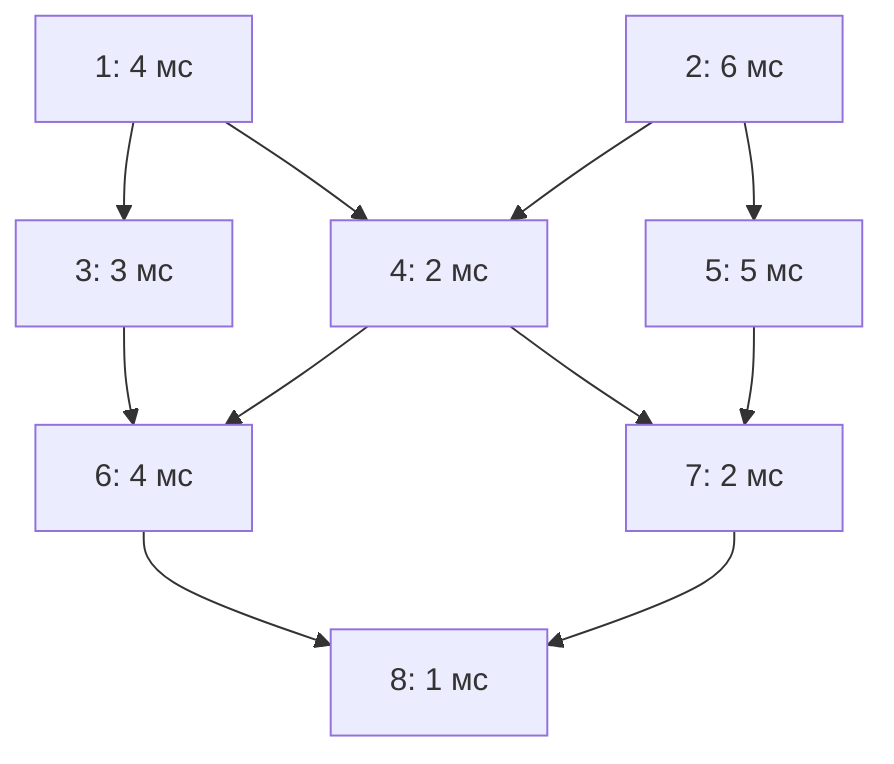

**В задании 22 нужно понять, когда каждый процесс получит все необходимые результаты и сможет начать работу.** После этого мы строим таблицу «начало — окончание» и используем её для ответа на конкретный вопрос задачи.

Основной упор сделаем на Excel: сначала разберём смысл вычислений, затем перенесём их в формулы. После базового метода рассмотрим параллельность, задержки, неизвестную длительность и ограничения системы.

Сначала достаточно освоить зависимости, начала и окончания, полный пример и обычные ссылки Excel. После этого переходи к неизвестной длительности, активности процессов и непрерывным промежуткам. Раздел ВПР автоматизирует поиск строк: его можно прочитать после базовой практики. Затем изучи задачи, где запуск разрешено сдвигать, — для них одного самого раннего расписания недостаточно. Задержки и ограничения числа исполнителей разбирай отдельным проходом, когда уверенно работаешь с обычной системой.

Учебная книга: [ege22_training.xlsx](ege22_training.xlsx). В ней семь листов: подробный пример, решение через ВПР, шкала времени, неизвестная длительность, сдвиги запуска, шесть самостоятельных задач и решения. Формулы и сохранённые результаты сверены. При изменении данных проверяй границы временной шкалы; в задаче с ограниченными ресурсами расписание нужно строить заново, как поясняется на листе «Решения».

---

**Начнём с того, что именно называют процессом в этих задачах.**

Представь, что компьютеру нужно выполнить несколько отдельных работ:

- прочитать данные;
- обработать первую часть данных;
- обработать вторую часть;
- объединить результаты;
- сохранить итог.

Каждая такая работа в условии называется **процессом**.

Для решения нам обычно нужны только две характеристики процесса:

1. Сколько времени занимает его выполнение.
2. Результаты каких других процессов нужны для его запуска.

Внутреннее устройство работы нас не интересует. Например, процесс может сортировать данные или рассчитывать изображение, но в задаче достаточно знать, что он выполняется 6 мс и ждёт результаты процессов 2 и 5.

**Последовательное выполнение** означает, что одна работа должна закончиться до начала другой.

Если процесс A выполняется 4 мс, а процесс B — 6 мс и B ждёт результат A, то:

\[
4+6=10\text{ мс}.
\]

**Параллельное выполнение** означает, что работы могут идти одновременно.

Если A и B не мешают друг другу и запускаются одновременно, то через 4 мс A уже завершится, а B будет работать ещё 2 мс. Обе работы закончатся через:

\[
\max(4;6)=6\text{ мс}.
\]

Здесь появляются две основные операции задания:

- **сложение** — когда времена идут последовательно;
- **максимум** — когда нужно дождаться окончания нескольких параллельных работ.

Но применять их нужно к правильным величинам. Именно это мы подробно разберём.

---

**Теперь прочитаем таблицу так, как её нужно понимать.**

В базовых задачах обычно даны три столбца:

| ID процесса | Длительность, мс | ID процессов, от которых он зависит |
|---:|---:|---|
| 1 | 4 | 0 |
| 2 | 6 | 0 |
| 3 | 3 | 1 |
| 4 | 2 | 1; 2 |

Такое представление используется и в вашей подборке: зависимости перечисляются через точку с запятой, а значение `0` обозначает отсутствие зависимостей. [inf-ege.sdamgia.ru](https://inf-ege.sdamgia.ru/test?theme=215\&utm_source=chatgpt.com)

**ID — это обозначение процесса.**

ID расшифровывается как идентификатор. По смыслу это просто имя.

Процесс с ID `20`:

- не обязан находиться в двадцатой строке;
- не обязан запускаться двадцатым;
- не обязан выполняться после процесса с ID `19`;
- не выполняется 20 мс только из-за своего номера.

Если процесс `20` зависит от процесса `50`, сначала должен завершиться `50`, несмотря на то что его номер больше.

**Длительность — это время собственной работы процесса.**

Запись:

| ID | Длительность |
|---:|---:|
| 3 | 3 |

означает: после запуска процесс 3 будет работать 3 мс.

Она ещё ничего не говорит о моменте его запуска.

Если он начнёт в момент 10 мс, то завершится в момент:

\[
10+3=13\text{ мс}.
\]

**Запись `1; 2` означает, что нужны результаты обоих процессов.**

Процесс 4 должен дождаться:

- завершения процесса 1;
- завершения процесса 2.

Порядок перечисления не задаёт порядок выполнения. Записи `1; 2` и `2; 1` имеют одинаковый смысл.

**Запись `0` означает отсутствие поставщиков данных.**

В исходной задаче обычно нет настоящего процесса 0. Это условное обозначение:

> Для запуска этого процесса результаты других процессов не нужны.

Позже мы специально добавим в Excel служебную строку с ID 0. Это будет технический приём для удобства формул.

---

**Нужно различать длительность, момент начала и момент окончания.**

Пусть процесс работает 5 мс и запускается через 8 мс после начала всей системы.

Тогда:

| Величина | Значение |
|---|---:|
| Собственная длительность | 5 мс |
| Момент начала | 8 мс |
| Момент окончания | 13 мс |

Эти величины связаны так:

\[
\boxed{\text{Окончание}=\text{Начало}+\text{Длительность}}
\]

Или в обратную сторону:

\[
\text{Длительность}=\text{Окончание}-\text{Начало}.
\]

Для удобства введём обозначения:

- \(d_i\) — длительность процесса \(i\);
- \(s_i\) — момент его начала;
- \(f_i\) — момент его окончания.

Буква \(i\) здесь обозначает конкретный процесс.

Тогда:

\[
f_i=s_i+d_i.
\]

Все моменты измеряем **от одного общего начала отсчёта**.

Если \(f_6=25\), это означает, что процесс 6 завершится через 25 мс после начала всей системы. Это не означает, что сам процесс 6 работает 25 мс.

Именно путаница между этими двумя смыслами часто приводит к неправильному решению.

---

**Разберём, почему зависимый процесс ждёт максимум окончаний своих поставщиков.**

Предположим, процесс C зависит от процессов A и B.

A заканчивается в момент 5 мс.

B заканчивается в момент 12 мс.

Когда C сможет начать работу?

В момент 5 мс результат A уже готов. Но результата B ещё нет.

В момент 10 мс ситуация такая же: одного результата не хватает.

В момент 12 мс готовы оба результата. Теперь можно запускать C.

Следовательно:

\[
s_C=\max(5;12)=12.
\]

Почему нельзя складывать \(5+12\)?

Потому что это **моменты времени на общей шкале**. Они оба отсчитываются от одного начала. Пока B работал до момента 12, A тоже успел выполнить свою работу.

Мы не ждём сначала 5 мс, а потом ещё 12 мс. Мы ждём до момента, когда закончит последний поставщик.

Если C работает ещё 3 мс:

\[
f_C=\max(5;12)+3=15.
\]

**Для запуска нужны окончания поставщиков, а не их собственные длительности.**

Предположим, процесс A сам работает только 2 мс, но перед этим ждёт результаты других процессов и запускается в момент 20 мс.

Тогда A заканчивается в момент:

\[
20+2=22.
\]

Его получатель должен ждать до момента 22. Число 2 само по себе не говорит, когда результат будет готов.

Поэтому правильное правило:

\[
\boxed{\text{Начало процесса}
=\text{максимум моментов окончания его поставщиков}}
\]

Для независимого процесса в расписании с самым ранним запуском:

\[
s_i=0,\qquad f_i=d_i.
\]

Для зависимого:

\[
s_i=\max(f_{\text{поставщиков}}),
\]

\[
f_i=\max(f_{\text{поставщиков}})+d_i.
\]

Пока предполагаем, что:

- ресурсов достаточно для всех готовых процессов;
- дополнительных задержек нет;
- процессы запускаются как можно раньше.

Другие условия рассмотрим отдельно.

---

**Посмотрим, как зависимости образуют общую схему работы.**

Возьмём учебный пример:

| ID | Длительность, мс | Зависит от |
|---:|---:|---|
| 1 | 4 | 0 |
| 2 | 6 | 0 |
| 3 | 3 | 1 |
| 4 | 2 | 1; 2 |
| 5 | 5 | 2 |
| 6 | 4 | 3; 4 |
| 7 | 2 | 4; 5 |
| 8 | 1 | 6; 7 |

Стрелка ниже означает: результат первого процесса нужен для запуска второго.



Такая схема называется **графом зависимостей**: процессы изображены отдельными элементами, а стрелки показывают связи между ними.

Обрати внимание на два важных свойства.

**Общий поставщик не заставляет получателей работать последовательно.**

Например, процессы 4 и 5 используют результат процесса 2. После получения нужных результатов они могут работать одновременно.

Результат процесса 2 не «занимается» одним получателем. Его могут использовать несколько процессов.

**Зависимость может быть косвенной.**

Процесс 3 зависит от процесса 1.

Процесс 6 зависит от процесса 3.

Значит, процесс 6 косвенно зависит и от процесса 1, хотя ID 1 не записан в строке процесса 6.

Это уже учтено в моменте окончания процесса 3. Не нужно отдельно добавлять длительности всех его предков.

---

**Теперь полностью рассчитаем пример.**

Процессы 1 и 2 независимы. Запускаем их в момент 0:

\[
f_1=0+4=4,
\]

\[
f_2=0+6=6.
\]

Процесс 3 зависит только от процесса 1:

\[
s_3=f_1=4,
\]

\[
f_3=4+3=7.
\]

Процесс 4 зависит от процессов 1 и 2:

\[
s_4=\max(4;6)=6,
\]

\[
f_4=6+2=8.
\]

Процесс 5 зависит только от процесса 2:

\[
s_5=6,
\]

\[
f_5=6+5=11.
\]

Процесс 6 зависит от процессов 3 и 4:

\[
s_6=\max(7;8)=8,
\]

\[
f_6=8+4=12.
\]

Процесс 7 зависит от процессов 4 и 5:

\[
s_7=\max(8;11)=11,
\]

\[
f_7=11+2=13.
\]

Процесс 8 зависит от процессов 6 и 7:

\[
s_8=\max(12;13)=13,
\]

\[
f_8=13+1=14.
\]

Получилась таблица:

| ID | Длительность | Зависит от | Начало | Окончание |
|---:|---:|---|---:|---:|
| 1 | 4 | 0 | 0 | 4 |
| 2 | 6 | 0 | 0 | 6 |
| 3 | 3 | 1 | 4 | 7 |
| 4 | 2 | 1; 2 | 6 | 8 |
| 5 | 5 | 2 | 6 | 11 |
| 6 | 4 | 3; 4 | 8 | 12 |
| 7 | 2 | 4; 5 | 11 | 13 |
| 8 | 1 | 6; 7 | 13 | 14 |

Когда закончится вся система?

Когда завершится последний из процессов:

\[
\boxed{T=\max(f_1;f_2;\ldots;f_8)=14}.
\]

**Ответ: 14 мс.**

В этом примере последний по ID процесс действительно заканчивается последним. Но это свойство именно этих данных. В другой таблице последним может завершиться, например, независимый процесс с ID 3.

Поэтому общее время нужно искать как максимум **всего столбца окончаний**.

---

**Важно понять, почему это действительно минимальное общее время.**

Мы пока рассматриваем систему без ограничения ресурсов.

Зависимый процесс нельзя запустить раньше готовности последнего необходимого результата. Значит, найденные моменты начала являются нижними границами: раньше начать невозможно.

При этом найденное расписание выполнимо:

- независимые процессы запускаются в 0;
- каждый зависимый процесс запускается после своих поставщиков;
- любое число готовых процессов может работать одновременно.

Получается, мы построили расписание, в котором каждый процесс стартует в самый ранний разрешённый момент.

Если задержать какой-нибудь процесс, результаты раньше не появятся. Следовательно, задержками нельзя уменьшить время завершения всей системы.

Поэтому для поиска **минимального общего времени** этот метод обоснован.

Позже мы увидим тонкость: минимальное общее время не всегда означает, что для вопросов о параллельности существует только одно допустимое расписание.

---

**Перенесём этот расчёт в Excel с помощью обычных ссылок на ячейки.**

Это первый способ, который стоит освоить. В нём хорошо видно, что именно делает каждая формула.

Разместим данные так:

| Столбец | Содержимое |
|---|---|
| A | ID процесса |
| B | Собственная длительность |
| C | ID поставщиков |
| D | Момент начала |
| E | Момент окончания |

Заголовки находятся в строке 1.

Процесс 1 находится в строке 2.

Процесс 2 — в строке 3.

И так далее.

**Адрес ячейки и ID процесса — разные вещи.**

Процесс с ID 1 находится в строке 2, потому что первая строка занята заголовком.

Поэтому:

- `E2` — окончание процесса 1;
- `E3` — окончание процесса 2;
- `E4` — окончание процесса 3.

Буква обозначает столбец, число — строку листа.

Для нашего примера формулы начала будут такими:

| Процесс | Ячейка начала | Формула |
|---:|---|---|
| 1 | D2 | `=0` |
| 2 | D3 | `=0` |
| 3 | D4 | `=E2` |
| 4 | D5 | `=МАКС(E2;E3)` |
| 5 | D6 | `=E3` |
| 6 | D7 | `=МАКС(E4;E5)` |
| 7 | D8 | `=МАКС(E5;E6)` |
| 8 | D9 | `=МАКС(E7;E8)` |

Функция `МАКС` возвращает наибольшее из переданных значений. Например:

```excel
=МАКС(4;6)
```

даёт 6.

Запись:

```excel
=МАКС(E2;E3)
```

означает: взять значения из ячеек E2 и E3 и выбрать большее. Назначение этой функции описано и в официальном справочнике Excel. [Microsoft Support](https://support.microsoft.com/ru-ru/excel/excel-functions-alphabetical?utm_source=chatgpt.com)

**Формула окончания для всех строк имеет одинаковую структуру.**

В E2 вводим:

```excel
=D2+B2
```

То есть:

> Начало процесса плюс его длительность.

Теперь эту формулу можно скопировать вниз до E9.

Получится:

| Ячейка | Формула |
|---|---|
| E2 | `=D2+B2` |
| E3 | `=D3+B3` |
| E4 | `=D4+B4` |
| … | … |
| E9 | `=D9+B9` |

При копировании Excel автоматически изменяет номер строки.

Это удобно: в каждой строке окончание рассчитывается по началу и длительности **этой же строки**.

Чтобы скопировать формулу, можно потянуть за маленький квадрат в правом нижнем углу выделенной ячейки.

**Формулы начала в этом способе нельзя бездумно протянуть одной формулой на всю таблицу.**

Для одного процесса нужны результаты 1 и 2.

Для другого — 3 и 4.

Для третьего — только 2.

Поэтому ссылки в столбце D мы составляем по зависимостям конкретной строки.

Формулы в E устроены одинаково. Формулы в D отражают разные связи.

**Общее время:**

```excel
=МАКС(E2:E9)
```

Двоеточие в `E2:E9` означает непрерывный диапазон: все ячейки от E2 до E9 включительно.

Здесь берём максимум окончаний всех восьми процессов.

В русском Excel в формулах обычно используется `;` между аргументами. В английской локализации названия функций и разделители могут отличаться:

```excel
=MAX(E2,E3)
```

Смысл вычисления при этом остаётся тем же.

---

**Почему обычные ссылки удобны даже при перепутанных строках.**

Допустим, таблица начинается так:

| Строка Excel | ID | Длительность | Зависит от |
|---:|---:|---:|---|
| 2 | 20 | 3 | 10 |
| 3 | 10 | 5 | 0 |

Процесс 20 расположен выше своего поставщика 10.

В ячейку начала процесса 20 можно поставить ссылку на окончание процесса 10:

```excel
=E3
```

Excel умеет ссылаться на ячейки ниже. Сама по себе такая ссылка не является ошибкой.

Главное, чтобы в зависимостях не было замкнутой цепочки.

Например:

- процесс 1 ждёт процесс 2;
- процесс 2 ждёт процесс 1.

Тогда никто не может начать первым.

Такую замкнутую зависимость называют **циклом**. В корректных задачах с конечным расписанием подобных циклов быть не должно.

При работе с обычными ссылками Excel сам пересчитывает связанные ячейки. Физический порядок строк может отличаться от порядка выполнения.

Однако для понимания полезно считать процессы в таком порядке, чтобы результаты поставщиков уже были известны.

---

**Этот порядок можно построить без привязки к номерам процессов.**

Действуй так:

1. Найди все процессы с зависимостью `0`.
2. Рассчитай их окончания.
3. Найди процессы, у которых уже рассчитаны все поставщики.
4. Рассчитай их.
5. Повторяй, пока не обработаешь всю таблицу.

В нашем примере это можно сделать по группам:

| Шаг | Какие процессы уже можно рассчитать |
|---:|---|
| 1 | 1, 2 |
| 2 | 3, 4, 5 |
| 3 | 6, 7 |
| 4 | 8 |

Это **порядок вычисления таблицы**, а не приказ процессам работать группами.

Например, процесс 3 начинает в момент 4, а процессы 4 и 5 — в момент 6. Они находятся в одной группе расчёта, но запускаются в разное время.

Порядок строк, при котором каждый поставщик расположен выше своего получателя, называется **топологическим порядком**. Сначала мы объяснили его смысл, теперь можно использовать это название.

Сортировка по возрастанию ID создаёт такой порядок только тогда, когда зависимости в исходных данных действительно направлены от меньших ID к большим.

Сортировка по количеству поставщиков тоже не гарантирует нужного порядка. Процесс с одним поставщиком может зависеть от длинной цепочки, которую ещё не рассчитали.

---

**Теперь объясним, почему всё время определяет одна из последовательных цепочек.**

В нашем примере есть цепочка:

\[
2\longrightarrow5\longrightarrow7\longrightarrow8.
\]

Внутри неё процессы должны выполняться последовательно:

\[
6+5+2+1=14.
\]

Даже если компьютер сможет параллельно выполнять тысячу других процессов, эту цепочку нельзя закончить быстрее 14 мс.

При этом мы уже построили расписание, в котором все процессы заканчиваются к моменту 14.

Значит, 14 — и необходимое, и достижимое время.

Самую длинную по суммарной длительности цепочку зависимостей называют **критическим путём**.

Слово «длинную» здесь относится к времени, а не к количеству процессов.

Цепочка из двух процессов по 20 мс длиннее цепочки из пяти процессов по 1 мс.

При достаточных ресурсах и отсутствии дополнительных задержек:

\[
\boxed{\text{Минимальное общее время}
=\text{длительность критического пути}}.
\]

Вручную перебирать все пути обычно не нужно. Формулы с максимумами уже находят нужные времена.

Чтобы восстановить критический путь после расчёта:

1. Найди процесс с максимальным окончанием.
2. Среди его поставщиков выбери того, чьё окончание определило запуск.
3. Для выбранного поставщика повтори тот же шаг.
4. Продолжай до независимого процесса.

Для процесса 8 поставщики заканчиваются в 12 и 13. Выбираем процесс 7.

Для процесса 7 поставщики заканчиваются в 8 и 11. Выбираем процесс 5.

Процесс 5 ждёт процесс 2.

Получаем цепочку 2 → 5 → 7 → 8.

Если у поставщиков одинаковые определяющие окончания, критических путей может быть несколько.

**Из этого становится понятно, почему ускорение отдельного процесса не всегда ускоряет всю систему.**

В нашем примере процесс 6 заканчивается в момент 12, а процесс 7 — в момент 13.

Процесс 8 всё равно ждёт до 13.

Если процесс 6 начнёт завершаться в момент 11, общий итог не изменится: процесс 7 всё ещё не готов до 13.

И наоборот, длительность процесса 6 можно увеличить с 4 до 5 мс. Он закончится в 13, и общее время останется 14.

А увеличение до 6 мс уже даст:

\[
f_6=8+6=14,
\]

\[
f_8=\max(14;13)+1=15.
\]

Изменилась ветвь, которая определяет окончание системы.

---

**Когда процессов много, поиск поставщиков можно поручить функции ВПР.**

В обычном способе мы сами находили нужную строку и писали, например:

```excel
=E2
```

Но если процессов несколько десятков, искать каждый ID глазами неудобно.

Нам нужна операция:

> Найди строку с указанным ID и возьми из неё момент окончания.

Это умеет делать **ВПР** — функция поиска значения в таблице.

Её общий смысл:

```excel
=ВПР(что_ищем;где_ищем;какой_столбец_вернуть;точный_поиск)
```

Она ищет значение в первом столбце указанного диапазона и возвращает значение из найденной строки. Последний аргумент `0`, или `ЛОЖЬ`, задаёт точное совпадение. [Microsoft Support](https://support.microsoft.com/ru-ru/excel/functions/vlookup-function?utm_source=chatgpt.com)

Например, у нас есть отдельная таблица:

| ID | Окончание |
|---:|---:|
| 10 | 5 |
| 20 | 8 |
| 30 | 12 |

Если она находится в A2:B4:

```excel
=ВПР(20;A2:B4;2;0)
```

даст 8.

Разберём аргументы:

| Аргумент | Значение |
|---|---|
| `20` | Ищем процесс с ID 20 |
| `A2:B4` | Ищем в этой таблице |
| `2` | Возвращаем значение из второго столбца диапазона |
| `0` | Нужен именно ID 20 |

Число 2 здесь означает **номер столбца внутри диапазона**, а не номер процесса.

Точное совпадение обязательно: ID 19 или 21 не может заменять ID 20.

---

**Перед использованием ВПР удобно разделить список поставщиков на отдельные ячейки.**

Сейчас в одной ячейке может находиться текст:

```text
3; 4
```

ВПР должна отдельно искать ID 3 и отдельно ID 4.

Поэтому подготовим такую структуру:

| A | B | C | D | E | F | G |
|---|---|---|---|---|---|---|
| ID | Длительность | Поставщик 1 | Поставщик 2 | Поставщик 3 | Начало | Окончание |

В этом примере предусмотрели до трёх поставщиков. Если в задаче их больше, нужно добавить соответствующие столбцы.

Список можно разделить средствами Excel:

1. Выделить ячейки со списками зависимостей.
2. Открыть **Данные → Текст по столбцам**.
3. Выбрать данные с разделителями.
4. Указать разделитель **точка с запятой**.
5. Проверить предварительный просмотр.
6. Указать область, куда поместить результат.
7. Завершить разделение.

У мастера есть настройка места назначения, поэтому можно вывести разделённые значения в свободную область, сохранив исходный столбец. [support.microsoft.com](https://support.microsoft.com/ru-ru/excel/get-started/split-text-into-different-columns-with-the-convert-text-to-columns-wizard?utm_source=chatgpt.com)

**Освободи нужные столбцы справа до разделения.** Иначе полученные значения могут занять ячейки с уже существующими данными.

После разделения проверь, что ID поставщиков записаны числами и совпадают по типу с ID в основном столбце. Например, число `3` и текст с лишними пробелами вокруг `3` могут вызвать проблемы поиска.

---

**Добавим служебный процесс 0, чтобы одинаковая формула работала и для независимых процессов.**

В строке 2 создадим:

| ID | Длительность | Поставщик 1 | Поставщик 2 | Поставщик 3 | Начало | Окончание |
|---:|---:|---:|---:|---:|---:|---:|
| 0 | 0 | 0 | 0 | 0 | 0 | 0 |

Для этой служебной строки начало и окончание записываем как готовые нули.

Настоящие процессы разместим начиная со строки 3.

Пустые места в столбцах поставщиков тоже заполним числовыми нулями.

Тогда начало таблицы будет выглядеть так:

| Строка | ID | Длительность | Поставщик 1 | Поставщик 2 | Поставщик 3 |
|---:|---:|---:|---:|---:|---:|
| 2 | 0 | 0 | 0 | 0 | 0 |
| 3 | 1 | 4 | 0 | 0 | 0 |
| 4 | 2 | 6 | 0 | 0 | 0 |
| 5 | 3 | 3 | 1 | 0 | 0 |
| 6 | 4 | 2 | 1 | 2 | 0 |

Зачем это нужно?

Для процесса без поставщиков получим:

\[
\max(f_0;f_0;f_0)=\max(0;0;0)=0.
\]

Для процесса с одним поставщиком, например 1:

\[
\max(f_1;f_0;f_0)=\max(f_1;0;0)=f_1.
\]

Для процесса с двумя поставщиками:

\[
\max(f_1;f_2;0)=\max(f_1;f_2).
\]

Отсутствующие поставщики больше не требуют отдельных специальных формул.

Служебный процесс 0 нельзя включать в ответ на вопрос о количестве настоящих процессов.

---

**Для ВПР используем диапазон, который заканчивается на предыдущей строке.**

Сначала расположим реальные процессы в топологическом порядке: поставщики выше получателей.

В F3 вводим формулу начала:

```excel
=МАКС(ВПР(C3;$A$2:$G2;7;0);ВПР(D3;$A$2:$G2;7;0);ВПР(E3;$A$2:$G2;7;0))
```

В G3 вводим формулу окончания:

```excel
=F3+B3
```

Теперь обе формулы можно скопировать вниз.

Что делает формула F3?

1. Берёт ID первого поставщика из C3.
2. Ищет его строку.
3. Возвращает окончание из столбца G.
4. Повторяет поиск для D3 и E3.
5. Выбирает самое позднее окончание.

Почему в ВПР стоит число 7?

Потому что диапазон начинается с A, и G — его седьмой столбец:

| Номер внутри диапазона | Столбец |
|---:|---|
| 1 | A |
| 2 | B |
| 3 | C |
| 4 | D |
| 5 | E |
| 6 | F |
| 7 | G |

Если ты добавишь столбец перед окончанием, номер возвращаемого столбца нужно будет изменить.

**Теперь разберём знаки `$`.**

Диапазон:

```excel
$A$2:$G2
```

при копировании вниз становится:

```excel
$A$2:$G3
```

затем:

```excel
$A$2:$G4
```

и так далее.

Начало диапазона `$A$2` закреплено полностью.

У его конца `$G2`:

- столбец G закреплён;
- номер строки не закреплён.

Поэтому верхняя граница остаётся на строке 2, а нижняя растёт.

В текущей строке мы ищем только среди предыдущих строк, где расположены поставщики.

Для процесса 3, находящегося в строке 5, формула будет искать в диапазоне:

```excel
$A$2:$G4
```

Там уже есть служебный процесс 0, процесс 1 и процесс 2.

**Почему не стоит сразу искать по всему столбцу собственных результатов.**

Начала и окончания в нашей таблице зависят друг от друга. Диапазон поиска по всей таблице усложняет эти связи и может привести к проблемам с циклическими ссылками.

Для учебного и экзаменационного решения понятнее организовать данные так, чтобы:

- поставщики находились выше;
- формула искала только в предыдущих строках.

Тогда структура вычислений явно направлена от уже рассчитанных процессов к следующим.

Итог для восьми настоящих процессов:

```excel
=МАКС(G3:G10)
```

Служебную строку 2 в подсчёт количества процессов не включаем.

**В этом способе порядок строк важен.** Если нужный поставщик находится ниже текущей строки, ВПР не найдёт его в диапазоне предыдущих строк. Нужно исправить порядок данных до протягивания формул.

---

**Дополнительная задержка меняет момент готовности результата для получателя.**

В подборке есть задачи, где зависимый процесс может запускаться только спустя некоторое время после завершения поставщика. Например, в одной из задач задана задержка 5 мс. [inf-ege.sdamgia.ru](https://inf-ege.sdamgia.ru/problem?id=48470\&utm_source=chatgpt.com)

Пусть A заканчивается в момент 10.

Его результат становится доступным получателю через 5 мс.

Тогда получатель может начать не раньше:

\[
10+5=15.
\]

Если поставщиков два и задержка для каждого одинакова:

\[
s_i=\max(f_A+5;f_B+5).
\]

Поскольку к обоим значениям добавляется одно и то же число:

\[
\max(f_A+5;f_B+5)=\max(f_A;f_B)+5.
\]

Поэтому:

\[
\boxed{s_i=\max(f_{\text{поставщиков}})+5}.
\]

А окончание:

\[
f_i=\max(f_{\text{поставщиков}})+5+d_i.
\]

В Excel:

```excel
=МАКС(E2;E3)+5
```

Это формула начала зависимого процесса.

**Задержку не нужно добавлять независимо к каждому поставщику и затем складывать результаты.**

Если поставщики заканчиваются в 4 и 6, а задержка равна 5:

\[
\max(4+5;6+5)=11.
\]

Число поставщиков не превращает задержку в \(5+5\). Мы ждём наиболее поздний доступный результат.

**Независимый процесс обычно не получает эту задержку.**

Если условие говорит о передаче результата от поставщика к получателю, у независимого процесса такой передачи нет.

Поэтому в расписании с ранним запуском:

\[
s_{\text{независимого}}=0.
\]

Нельзя одинаково прибавить 5 ко всем началам: тогда независимые процессы тоже ошибочно сдвинутся.

Если задержки для разных связей отличаются, нужно сравнивать уже скорректированные моменты:

\[
s_i=\max(f_A+\delta_A;f_B+\delta_B).
\]

Например:

| Поставщик | Окончание | Задержка | Результат доступен |
|---|---:|---:|---:|
| A | 10 | 2 | 12 |
| B | 9 | 7 | 16 |

Хотя сам B заканчивается раньше A, его результат доходит позже. Получатель должен ждать до 16.

---

**Неизвестную длительность удобно исследовать через уже построенную таблицу.**

Вернёмся к основному примеру.

Пусть длительность процесса 6 неизвестна и равна положительному целому числу \(x\).

Остальные данные не меняются.

Начало процесса 6 остаётся равным 8:

\[
s_6=\max(7;8)=8.
\]

Окончание:

\[
f_6=8+x.
\]

Процесс 7 по-прежнему заканчивается в 13.

Процесс 8 ждёт процессы 6 и 7 и работает ещё 1 мс:

\[
f_8=\max(8+x;13)+1.
\]

Все процессы нашего примера прямо или косвенно входят в работу процесса 8, поэтому общий итог:

\[
T(x)=\max(8+x;13)+1.
\]

Можно перенести единицу внутрь максимума:

\[
\boxed{T(x)=\max(9+x;14)}.
\]

Теперь видно, как система реагирует на изменение \(x\).

| \(x\) | Окончание процесса 6 | Общее время |
|---:|---:|---:|
| 1 | 9 | 14 |
| 2 | 10 | 14 |
| 3 | 11 | 14 |
| 4 | 12 | 14 |
| 5 | 13 | 14 |
| 6 | 14 | 15 |
| 7 | 15 | 16 |
| 8 | 16 | 17 |

До некоторого значения процесс 6 успевает раньше процесса 7. Поэтому его длительность не определяет общий итог.

После этого именно процесс 6 становится определяющим.

**Если общее время должно быть 16:**

\[
\max(9+x;14)=16.
\]

Вторая величина равна 14 и не может дать 16. Значит:

\[
9+x=16,
\]

\[
\boxed{x=7}.
\]

**Если общее время должно быть 14:**

\[
\max(9+x;14)=14.
\]

Для этого достаточно, чтобы:

\[
9+x\le14,
\]

\[
x\le5.
\]

Поскольку \(x\) — положительное целое число:

\[
x\in\{1,2,3,4,5\}.
\]

Если требуется наибольшая длительность, ответ — 5.

Если требуется количество подходящих длительностей, ответ тоже 5, но смысл этого числа другой.

Если требуется время 13, решения нет: другая ветвь уже требует 14 мс.

**В Excel здесь есть два понятных способа работы.**

Первый: менять длительность процесса 6 в B7 и смотреть, как изменяется итог.

Второй: если выражение удалось вывести, создать столбец кандидатов \(x\) и рядом рассчитывать итог.

Например, если кандидат находится в J2:

```excel
=МАКС(9+J2;14)
```

Такой перебор будет понятным и проверяемым.

Но числа 9 и 14 получены из конкретного примера. Для другой задачи сначала нужно заново вывести соответствующее выражение.

Если неизвестен ID поставщика, принцип похожий: рассматриваем разрешённые варианты зависимости, пересчитываем таблицу и проверяем условие. При этом нужно исключать зависимости, которые создают цикл.

---

**Для вопросов о параллельности нам понадобится точный смысл временного промежутка.**

Процесс, начинающийся в момент 4 и заканчивающийся в момент 7, работает:

- от 4 до 5;
- от 5 до 6;
- от 6 до 7.

Всего:

\[
7-4=3\text{ мс}.
\]

В момент 7 его работа уже завершена.

Поэтому удобно обозначать время его работы так:

\[
[4;7).
\]

Квадратная скобка слева означает, что начало включено.

Круглая скобка справа означает, что окончание не включено.

Такой промежуток называют **полуинтервалом**.

Это помогает точно записать условие активности процесса:

\[
\boxed{s_i\le t<f_i}.
\]

В момент \(t\) процесс работает, если:

- он уже начался;
- он ещё не закончился.

Например, процесс с началом 4 и окончанием 7:

| Момент \(t\) | Работает? |
|---:|---|
| 3 | Нет |
| 4 | Да |
| 6 | Да |
| 7 | Нет |
| 8 | Нет |

**При завершении поставщика следующий процесс может начаться в тот же момент.**

Если A заканчивается в 7, а B запускается сразу после A, начало B равно 7.

Не нужно добавлять единицу:

\[
s_B=7,\quad \text{а не }8.
\]

Дополнительное время появляется только тогда, когда оно прямо задано условием.

---

**Не путай координаты времени и номера миллисекунд.**

Между моментами 4 и 7 проходят три миллисекунды.

Поэтому длина промежутка:

\[
7-4=3.
\]

Но если кто-то подписал отдельные миллисекунды номерами 5, 6, 7, количество этих подписей равно:

\[
7-5+1=3.
\]

Формула с `+1` относится к подсчёту целочисленных номеров включительно.

Формула без `+1` относится к разности моментов времени.

Чтобы не смешивать способы, в своих таблицах будем всегда использовать моменты:

\[
0,\ 1,\ 2,\ 3,\ldots
\]

А столбец с подписью \(t\) будет обозначать промежуток:

\[
[t;t+1).
\]

Столбец `0` — это первая миллисекунда работы, от момента 0 до момента 1.

Столбец `4` — промежуток от 4 до 5.

**Если миллисекунды нумеруются с 1, то n-я миллисекунда — это промежуток \([n-1;n)\).** Например, седьмая миллисекунда занимает \([6;7)\), а не \([7;8)\). При целочисленных началах и окончаниях для ответа «кто работает на седьмой миллисекунде» проверяем активность при \(t=6\).

В нашем примере на \([6;7)\) работают процессы 3, 4 и 5 — всего три. Ровно в момент 7 процесс 3 уже завершён, поэтому работают только 4 и 5 — два. Это разные вопросы, а не два способа записать один ответ.

Если номер миллисекунды находится в H2, для подсчёта используй момент `H2-1`: начало должно быть не больше `H2-1`, а окончание — строго больше `H2-1`. Когда условие спрашивает именно момент времени, вычитать единицу не нужно. Так перевод формулировки сохраняет нашу единую шкалу моментов и правило \(s_i\le t<f_i\).

---

**Посчитаем число работающих процессов в конкретный момент средствами Excel.**

Используем нашу основную таблицу:

- D2:D9 — начала;
- E2:E9 — окончания.

Пусть интересующий момент времени записан в H2.

Тогда число активных процессов:

```excel
=СЧЁТЕСЛИМН($D$2:$D$9;"<="&H2;$E$2:$E$9;">"&H2)
```

Функция `СЧЁТЕСЛИМН` считает строки, которые одновременно удовлетворяют всем указанным условиям. Диапазоны условий должны иметь одинаковый размер. [Microsoft Support](https://support.microsoft.com/ru-ru/excel/functions/countifs-function?utm_source=chatgpt.com)

Первое условие:

```excel
$D$2:$D$9;"<="&H2
```

означает: начало не позже выбранного момента.

Второе:

```excel
$E$2:$E$9;">"&H2
```

означает: окончание позже выбранного момента.

Знак `&` соединяет текст условия с числом.

Если H2 содержит 7:

```excel
"<="&H2
```

превратится в условие:

```text
<=7
```

А:

```excel
">"&H2
```

— в условие:

```text
>7
```

Для нашего примера в момент 7 работают:

- процесс 4: \([6;8)\);
- процесс 5: \([6;11)\).

Процесс 3 уже завершился в момент 7.

Ответ:

\[
\boxed{2\text{ процесса}}.
\]

Если вместо строгого `>` поставить `>=`, процесс 3 ошибочно окажется среди работающих в момент своего завершения.

---

**По этой же таблице можно считать завершившиеся, начавшиеся и ожидающие процессы.**

Число процессов, завершившихся к моменту H2:

```excel
=СЧЁТЕСЛИМН($E$2:$E$9;"<="&H2)
```

Здесь окончание включаем: если процесс закончился ровно в выбранный момент, он уже завершён.

Число процессов, которые к этому моменту уже начали работу:

```excel
=СЧЁТЕСЛИМН($D$2:$D$9;"<="&H2)
```

Среди начавшихся будут и работающие, и уже завершившиеся.

Для момента 8 в нашем примере:

| Состояние | Процессы | Количество |
|---|---|---:|
| Завершены | 1, 2, 3, 4 | 4 |
| Работают | 5, 6 | 2 |
| Ещё не начали | 7, 8 | 2 |

Проверка:

\[
4+2+2=8.
\]

**Если спрашивают, когда завершится определённое количество процессов, важен порядок окончаний, а не ID.**

Наши окончания:

\[
4,\ 6,\ 7,\ 8,\ 11,\ 12,\ 13,\ 14.
\]

Хотим узнать, когда завершатся хотя бы пять процессов.

Пятое по величине снизу окончание равно 11.

В Excel:

```excel
=НАИМЕНЬШИЙ(E2:E9;5)
```

Функция выбирает пятый элемент в упорядоченном по возрастанию наборе значений.

Если несколько процессов заканчиваются одновременно, количество завершённых может увеличиться сразу на несколько.

Например, оно может перейти с 4 сразу на 6. Тогда:

- момент, когда завершились **хотя бы 5**, существует;
- момент, когда завершились **ровно 5**, может не существовать.

Поэтому слова «ровно», «не менее», «не более» нельзя считать взаимозаменяемыми.

---

**Построим в Excel наглядную шкалу работы процессов.**

Она удобна для вопросов:

- сколько процессов работает одновременно;
- когда достигается максимум;
- сколько времени сохраняется определённое число работающих процессов.

В подборке встречаются вопросы именно о длительности отрезка с максимальным числом одновременно выполняемых процессов. [inf-ege.sdamgia.ru](https://inf-ege.sdamgia.ru/problem?id=70549\&utm_source=chatgpt.com)

Используем нашу таблицу A:E.

Оставим F свободным.

В строке 1 начиная с G запишем моменты:

| G1 | H1 | I1 | J1 | … |
|---:|---:|---:|---:|---|
| 0 | 1 | 2 | 3 | … |

Каждый столбец обозначает одну миллисекунду:

- G — \([0;1)\);
- H — \([1;2)\);
- I — \([2;3)\).

В G2 вводим:

```excel
=ЕСЛИ(И($D2<=G$1;G$1<$E2);1;0)
```

Разберём её последовательно.

Условие:

```excel
$D2<=G$1
```

проверяет, успел ли процесс начаться.

Условие:

```excel
G$1<$E2
```

проверяет, не завершился ли он.

Функция `И` требует, чтобы оба условия выполнялись.

Функция `ЕСЛИ` возвращает:

- 1 — если процесс работает;
- 0 — если не работает.

**Здесь единица означает работу в течение соответствующей миллисекунды.**

При целочисленных началах и окончаниях процесс либо работает весь промежуток \([t;t+1)\), либо не работает в нём.

Теперь формулу можно скопировать:

- вправо по шкале времени;
- вниз по процессам.

Разберём закрепления:

| Ссылка | Что закреплено | Зачем |
|---|---|---|
| `$D2` | Столбец D | При копировании вправо начало остаётся в D |
| `$E2` | Столбец E | Окончание остаётся в E |
| `G$1` | Строка 1 | Время всегда берётся из верхней строки |

При копировании вниз строка процесса изменяется.

При копировании вправо столбец времени изменяется.

Поэтому одна формула строит всю сетку.

**Чтобы посчитать активные процессы в столбце G:**

```excel
=СУММ(G2:G9)
```

Если единицы стоят у двух процессов, сумма равна 2.

Если у трёх — 3.

Разместим эти суммы в строке 11 и скопируем вправо.

Для нашего примера получатся следующие участки:

| Промежуток | Работающие процессы | Количество |
|---|---|---:|
| \([0;4)\) | 1, 2 | 2 |
| \([4;6)\) | 2, 3 | 2 |
| \([6;7)\) | 3, 4, 5 | 3 |
| \([7;8)\) | 4, 5 | 2 |
| \([8;11)\) | 5, 6 | 2 |
| \([11;12)\) | 6, 7 | 2 |
| \([12;13)\) | 7 | 1 |
| \([13;14)\) | 8 | 1 |

Максимальное число работающих процессов равно:

\[
\boxed{3}.
\]

В нашей книге шкала построена от 0 до 29: она покрывает промежуток \([0;30)\).

Если после изменения данных система работает дольше 30 мс, шкалу и формулы нужно продолжить вправо. Иначе сетка покажет только часть расписания.

---

**Число одновременно работающих процессов и длительность такого состояния — разные ответы.**

В основном примере максимум равен 3.

Но три процесса работают только на промежутке:

\[
[6;7).
\]

Его длительность:

\[
7-6=1\text{ мс}.
\]

Таким образом:

| Вопрос | Ответ |
|---|---:|
| Какое максимальное число процессов работает одновременно? | 3 |
| Как долго длится самый длинный отрезок с этим максимумом? | 1 мс |

Нельзя ответить числом 3 на второй вопрос только потому, что максимум равен трём процессам.

---

**Самый длинный непрерывный отрезок нельзя заменять суммой отдельных отрезков.**

Предположим, три процесса одновременно работают:

- с 2 до 5;
- с 8 до 12.

Общая длительность такого состояния:

\[
(5-2)+(12-8)=3+4=7.
\]

Но самый длинный **непрерывный** отрезок:

\[
\max(3;4)=4.
\]

Если вопрос содержит слово «отрезок», обычно требуется один непрерывный промежуток.

Чтобы найти его в Excel, можно считать длину текущей серии подходящих миллисекунд.

Пусть:

- числа активных процессов находятся в G11:AJ11;
- максимум записан в E14.

В E14:

```excel
=МАКС(G11:AJ11)
```

В первой ячейке серии, G12:

```excel
=ЕСЛИ(G11=$E$14;1;0)
```

В следующей, H12:

```excel
=ЕСЛИ(H11=$E$14;G12+1;0)
```

Эту формулу протягиваем вправо.

Логика:

- если сейчас выполняется нужное условие, увеличиваем длину серии;
- если условие перестало выполняться, обнуляем серию.

Например:

| Количество активных | 2 | 3 | 3 | 3 | 2 | 3 | 3 |
|---|---:|---:|---:|---:|---:|---:|---:|
| Длина текущей серии для 3 | 0 | 1 | 2 | 3 | 0 | 1 | 2 |

Максимум второй строки равен 3. Значит, самый длинный отрезок длится 3 мс.

Итог:

```excel
=МАКС(G12:AJ12)
```

**Можно менять само условие серии.**

Для «ровно четыре процесса»:

```excel
=ЕСЛИ(H11=4;G12+1;0)
```

Для «не менее четырёх»:

```excel
=ЕСЛИ(H11>=4;G12+1;0)
```

Для «не более четырёх»:

```excel
=ЕСЛИ(H11<=4;G12+1;0)
```

В последнем случае обязательно ограничивай анализ временем работы системы. После завершения всех процессов активных будет 0, что тоже удовлетворяет условию «не более четырёх». Бесконечное время после завершения системы обычно не относится к искомому отрезку.

---

**Состав работающих процессов может меняться, пока их количество остаётся тем же.**

В нашем примере:

- на \([0;4)\) работают процессы 1 и 2;
- на \([4;6)\) работают процессы 2 и 3.

Количество всё время равно двум.

Поэтому для условия:

> Одновременно работают ровно два процесса.

это один непрерывный отрезок:

\[
[0;6),
\]

длительность:

\[
6\text{ мс}.
\]

Замена процесса 1 процессом 3 не разрывает отрезок с количеством 2.

Далее ровно два процесса работают на \([7;12)\). Этот отрезок длится 5 мс.

Получаем:

| Что считаем | Значение |
|---|---:|
| Самый длинный отрезок с ровно двумя активными процессами | 6 мс |
| Суммарное время с ровно двумя активными процессами | \(6+5=11\) мс |
| Самый длинный отрезок с не менее чем двумя активными процессами | 12 мс |

В последнем случае промежуток \([6;7)\), где работают три процесса, подходит под условие «не менее двух». Поэтому весь участок \([0;12)\) непрерывен.

**Если условие говорит о конкретных процессах, нужен другой расчёт.**

Например:

> Как долго одновременно работают процессы 5 и 6?

Процесс 5:

\[
[6;11).
\]

Процесс 6:

\[
[8;12).
\]

Общий участок:

\[
[8;11),
\]

длительность:

\[
3\text{ мс}.
\]

Для выбранной группы процессов:

\[
\text{Начало общего участка}=\max(s_i),
\]

\[
\text{Окончание общего участка}=\min(f_i).
\]

Поэтому:

\[
\boxed{L=\max\bigl(0;\min(f_i)-\max(s_i)\bigr)}.
\]

Внешний максимум с нулём нужен на случай, когда общего участка нет.

Для процессов 5 и 6 в нашей Excel-таблице:

```excel
=МАКС(0;МИН(E6;E7)-МАКС(D6;D7))
```

Этот расчёт требует, чтобы **именно выбранные процессы** работали одновременно. Простое постоянство количества процессов такого требования не содержит.

---

**Если время большое, можно анализировать события вместо каждой миллисекунды.**

Шкала на 30 или 100 мс удобна. Шкала на сотни тысяч миллисекунд уже громоздкая.

Но состояние системы меняется только тогда, когда какой-нибудь процесс:

- начинается;
- заканчивается.

Между такими моментами число работающих процессов постоянно.

Поэтому можно:

1. Выписать все моменты начала и окончания.
2. Добавить момент 0.
3. Удалить повторяющиеся моменты.
4. Расположить их по возрастанию.
5. Рассматривать промежутки между соседними моментами.

Для нашего примера события:

\[
0,\ 4,\ 6,\ 7,\ 8,\ 11,\ 12,\ 13,\ 14.
\]

Вместо четырнадцати отдельных миллисекунд получаем восемь промежутков:

| Начало | Конец | Длительность | Активных процессов |
|---:|---:|---:|---:|
| 0 | 4 | 4 | 2 |
| 4 | 6 | 2 | 2 |
| 6 | 7 | 1 | 3 |
| 7 | 8 | 1 | 2 |
| 8 | 11 | 3 | 2 |
| 11 | 12 | 1 | 2 |
| 12 | 13 | 1 | 1 |
| 13 | 14 | 1 | 1 |

Допустим, в отдельной области листа:

- G — начало промежутка;
- H — конец;
- I — длительность;
- J — число активных процессов.

Для строки 2:

```excel
=H2-G2
```

в столбце I.

В J2:

```excel
=СЧЁТЕСЛИМН($D$2:$D$9;"<="&G2;$E$2:$E$9;">"&G2)
```

Мы считаем активность в левом конце промежутка. До следующего события состав не меняется.

**Теперь серия должна увеличиваться на длительность промежутка, а не на единицу.**

Пусть нужное число активных процессов записано в M1.

В K2:

```excel
=ЕСЛИ(J2=$M$1;I2;0)
```

В K3:

```excel
=ЕСЛИ(J3=$M$1;K2+I3;0)
```

Протягиваем вниз.

Для условия «ровно два» серия сначала получает 4, затем 6, потому что два соседних промежутка подходят:

\[
4+2=6.
\]

Этот способ подходит и для нецелых моментов времени. А сетка с шагом 1 мс требует отдельной осторожности, если процессы начинают или заканчивают работу между целыми отметками.

---

**Условие об исключённом ID обычно меняет подсчёт, но не сами зависимости.**

В подборке есть задачи, где нужно получить одновременную работу четырёх процессов, причём определённый ID не должен входить в выбранную четвёрку. [inf-ege.sdamgia.ru](https://inf-ege.sdamgia.ru/problem?id=63038\&utm_source=chatgpt.com)

Например, процесс 2 нельзя учитывать в группе.

Это не означает, что нужно удалить процесс 2 из системы.

Другие процессы могут использовать его результат. Его выполнение и окончание всё равно нужны для расчёта расписания.

Меняется только число процессов, которые мы учитываем.

Для нашего расположения столбцов:

```excel
=СЧЁТЕСЛИМН($D$2:$D$9;"<="&H2;$E$2:$E$9;">"&H2;$A$2:$A$9;"<>2")
```

Дополнительное условие:

```excel
"<>2"
```

означает «ID не равен 2».

При этом нужно внимательно читать вопрос:

- должны работать **ровно четыре процесса всего**;
- или нужно, чтобы одновременно работали **хотя бы четыре подходящих процесса**;
- или речь идёт о конкретной неизменной группе.

Это разные требования.

---

**Теперь разберём важную тонкость: когда процессы можно сдвигать.**

Встречаются разные формулировки:

| Формулировка | Что она задаёт |
|---|---|
| Независимые процессы запускаются в начальный момент | Их начало закреплено в 0 |
| Зависимый процесс начинается сразу после поставщиков | Дополнительное ожидание запрещено |
| Процесс не может начаться раньше завершения поставщиков | Позднее начало может быть допустимо |
| Независимые процессы можно запускать в любой момент | Их начало можно выбирать |
| Время окончания всей системы должно быть минимально | Нужно сохранить минимальный общий итог |

В частности, в подборке есть задачи, которые допускают выбор моментов запуска независимых процессов. [inf-ege.sdamgia.ru](https://inf-ege.sdamgia.ru/problem?id=48470\&utm_source=chatgpt.com)

**Минимальное общее время само по себе не доказывает, что любой сдвиг запрещён.**

Рассмотрим небольшой пример:

| ID | Длительность | Зависит от |
|---:|---:|---|
| 1 | 4 | 0 |
| 2 | 4 | 0 |
| 3 | 2 | 2 |
| 4 | 4 | 2 |

При самых ранних запусках:

| ID | Начало | Окончание |
|---:|---:|---:|
| 1 | 0 | 4 |
| 2 | 0 | 4 |
| 3 | 4 | 6 |
| 4 | 4 | 8 |

Общее время равно 8.

Одновременно работает не более двух процессов.

Но предположим, что поздний запуск процесса 1 разрешён. Запустим его в момент 4:

| ID | Начало | Окончание |
|---:|---:|---:|
| 1 | 4 | 8 |
| 2 | 0 | 4 |
| 3 | 4 | 6 |
| 4 | 4 | 8 |

Общее время снова равно 8.

Однако теперь на \([4;6)\) работают одновременно процессы 1, 3 и 4.

Пик стал равен 3.

Оба расписания имеют минимальное общее время: цепочка 2 → 4 сама требует \(4+4=8\) мс.

Следовательно:

> Для минимального общего времени раннего расписания достаточно. Для оптимизации параллельности при разрешённых сдвигах может понадобиться другое расписание.

На листе «Сдвиги» этот пример можно проверить, изменив начало процесса 1 с 0 на 4.

---

**Как решать задачи со сдвигами в Excel.**

Сначала рассчитай самое раннее расписание обычным методом.

Затем установи, какие моменты начала условие разрешает выбирать.

Для каждого выбранного расписания проверяй:

1. Каждый процесс начинается после готовности всех необходимых результатов.
2. Его окончание равно началу плюс длительность.
3. Если задан предельный общий срок, он соблюдён.
4. Если ограничены ресурсы, ограничение соблюдено.
5. Число активных процессов рассчитано для полученного расписания.

Нельзя просто передвинуть один прямоугольник на диаграмме и оставить его получателей на прежнем месте, если теперь они запускаются раньше готовности результата.

**Для заданного общего срока можно определить запас времени.**

В последнем примере система должна закончиться к моменту 8.

Процесс 1 длится 4 мс и никому не передаёт результат. Поэтому он может начать не позже:

\[
8-4=4.
\]

Его самое раннее начало равно 0.

Допустимый запас для сдвига:

\[
4-0=4\text{ мс}.
\]

Процесс 2 должен успеть дать результат процессу 4.

Процесс 4 длится 4 мс и должен закончиться к 8, значит, его нужно начать не позже 4.

Следовательно, процесс 2 должен закончиться не позже 4, а начать не позже 0.

У процесса 2 запаса нет.

В общем случае расчёт можно вести в обратном направлении:

- у процесса без получателей предельно позднее окончание равно общему сроку;
- у процесса с получателями предельно позднее окончание определяется самым ранним из их предельно поздних начал;
- предельно позднее начало равно предельно позднему окончанию минус длительность.

Так мы получаем границы допустимых сдвигов.

**Найденное удачное расписание доказывает достижимость результата, но ещё не доказывает максимум.**

Чтобы утверждать, что результат максимален, нужно объяснить, почему лучше сделать нельзя.

В нашем примере одновременно работать все четыре процесса не могут: процесс 2 предшествует процессам 3 и 4.

Три процесса одновременно возможны только за счёт группы 1, 3, 4.

Процесс 3 длится всего 2 мс. Поэтому эта тройка не может работать вместе дольше 2 мс.

Мы построили расписание, где тройка работает вместе ровно 2 мс. Значит, максимальная длительность действительно равна 2.

Для задач со свободными запусками именно такое сочетание важно:

- построить подходящее расписание;
- обосновать верхнюю границу результата.

---

**Ограничение числа исполнителей добавляет ещё одну причину ожидания.**

До этого готовый процесс мог начать сразу.

Но если одновременно разрешено выполнять только два процесса, третий готовый процесс должен ждать свободного места.

Теперь нужно различать:

- **процесс готов** — все результаты поставщиков доступны;
- **процесс запущен** — для него действительно выделено свободное место.

В подборке встречаются и более сложные варианты: одна задача требует запуска нескольких процессов, а общее число одновременно работающих процессов ограничено. [inf-ege.sdamgia.ru](https://inf-ege.sdamgia.ru/problem?id=76690\&utm_source=chatgpt.com)

В таких задачах простая формула

\[
s_i=\max(f_{\text{поставщиков}})
\]

определяет только момент готовности по данным. Фактический запуск может быть позже из-за занятости системы.

Рассмотрим пример из учебной книги.

Одновременно работают не более двух процессов. Из готовых выбирается процесс с меньшим ID.

| ID | Длительность | Зависит от |
|---:|---:|---|
| 1 | 4 | 0 |
| 2 | 4 | 0 |
| 3 | 3 | 0 |
| 4 | 2 | 1 |
| 5 | 1 | 2; 3 |

В момент 0 готовы процессы 1, 2, 3.

Есть два места. По приоритету запускаем 1 и 2.

Оба заканчиваются в момент 4.

В момент 4:

- процесс 3 давно готов;
- процесс 4 теперь получил результат процесса 1;
- процесс 5 ещё ждёт процесс 3.

Запускаем 3 и 4.

Процесс 3 заканчивается в 7.

Процесс 4 заканчивается в 6.

В момент 6 место освобождается, но процесс 5 ещё не готов: процесс 3 продолжает работать.

В момент 7 запускаем 5. Он заканчивается в 8.

Итог:

| ID | Начало | Окончание |
|---:|---:|---:|
| 1 | 0 | 4 |
| 2 | 0 | 4 |
| 3 | 4 | 7 |
| 4 | 4 | 6 |
| 5 | 7 | 8 |

Ответ:

\[
\boxed{8\text{ мс}}.
\]

**При ограниченных ресурсах удобно двигаться от события к событию.**

Алгоритм построения расписания:

1. В текущий момент отметь все завершившиеся процессы.
2. Освободи занятые ими места.
3. Определи процессы, у которых готовы все результаты.
4. Выбери процессы для запуска по правилу из условия.
5. Запусти столько, сколько разрешают свободные ресурсы.
6. Перейди к ближайшему следующему завершению.

Если в один момент заканчиваются несколько процессов, сначала учитывай все эти завершения, затем выбирай новые запуски.

Переход к следующему событию не означает прибавление одной миллисекунды. Можно сразу перейти, например, от 0 к 4.

**Правило выбора готовых процессов берём именно из условия.**

Это может быть:

- меньший ID;
- порядок поступления в очередь;
- другое заданное правило.

Приоритет по меньшему ID не является универсальным способом получить минимальное время для любой системы. В конкретной задаче он может быть обязательным правилом работы.

Если задача требует минимизировать время, но не задаёт порядок выбора, нужно сравнивать допустимые расписания и обосновывать оптимальность.

---

**Если одна задача занимает несколько мест, в сетке нужно учитывать их количество.**

Допустим, задача A занимает 2 места, B — 1 место, C — 3 места.

Одновременная работа A и B требует:

\[
2+1=3\text{ места}.
\]

Одновременная работа A и C:

\[
2+3=5\text{ мест}.
\]

Если в системе всего 4 места, A и C вместе запускать нельзя.

В основной таблице можно сохранить:

- D — фактическое начало;
- E — фактическое окончание;

и добавить:

- F — количество занятых мест.

Если время в H1, формула сетки:

```excel
=ЕСЛИ(И($D2<=H$1;H$1<$E2);$F2;0)
```

Она возвращает количество ресурсов, занятых задачей, пока та работает.

Сумма по столбцу показывает общую занятость.

Эта сумма в любой момент должна быть не больше ограничения.

Не нужно искусственно умножать длительность задачи на число занимаемых мест. Если задача занимает три места в течение 5 секунд, её длительность остаётся 5 секунд. Увеличивается одновременная занятость системы.

Если задача должна получить сразу все необходимые места, нельзя запустить только часть её процессов и остальную часть добавить позже — если такой режим прямо не разрешён.

---

**Проверять решение полезно не только по итоговому числу.**

Для каждой строки должны выполняться два условия.

Первое:

\[
f_i-s_i=d_i.
\]

Второе, при отсутствии задержки:

\[
s_i\ge f_j
\]

для каждого поставщика \(j\).

Если процесс начинается в момент 8, а один из его поставщиков заканчивается в 11, расписание невозможно.

Для расписания с самым ранним запуском без ограничения ресурсов дополнительно должно быть:

\[
s_i=\max(f_{\text{поставщиков}}).
\]

Если начало больше этого максимума, процесс зачем-то задержан. Это может быть разрешено условием, но требует осмысленного объяснения.

**Полезная проверка для временной сетки: сумма всех единиц равна сумме длительностей.**

В нашем примере:

\[
4+6+3+2+5+4+2+1=27.
\]

Каждая единица сетки означает одну миллисекунду работы одного процесса.

Поэтому сумма всех единиц должна быть 27.

Из таблицы параллельности:

\[
2\cdot4+
2\cdot2+
3\cdot1+
2\cdot1+
2\cdot3+
2\cdot1+
1\cdot1+
1\cdot1=27.
\]

Совпадение помогает обнаружить ошибку на границах.

Но 27 — это **суммарный объём работы всех процессов**. Общее время системы равно 14, потому что часть работ идёт одновременно.

Для такой проверки шкала должна покрывать всё расписание.

---

**Вот ошибки, которые особенно важно замечать по их смыслу.**

| Ошибка | Почему неверно | Что делать |
|---|---|---|
| Сложить длительности всех процессов | Параллельные работы посчитаны последовательно | Рассчитать окончания и взять их максимум |
| Взять самую большую собственную длительность | Не учтено ожидание зависимостей | Учитывать момент запуска |
| Сравнивать длительности поставщиков | Результат может быть готов намного позже собственной длительности | Сравнивать окончания |
| Сложить окончания поставщиков | Это координаты на общей шкале времени | Взять максимум |
| Запустить процесс после первого готового поставщика | Остальные необходимые результаты ещё отсутствуют | Дождаться всех |
| Добавить 1 после окончания поставщика | В условии обычно нет такой задержки | Запускать в тот же момент |
| Считать ID номером строки | Процессы могут быть расположены произвольно | Найти настоящую строку нужного ID |
| В ВПР использовать приблизительный поиск | Можно получить результат чужого процесса | Использовать `0` или `ЛОЖЬ` |
| Оставить нулевого служебного процесса в подсчёте количества | Он не относится к исходным процессам | Считать только реальные строки |
| В условии активности использовать `окончание >= t` | Уже завершившийся процесс посчитан работающим | Использовать `окончание > t` |
| Сложить отдельные подходящие отрезки | Получено суммарное время вместо самого длинного отрезка | Считать непрерывную серию |
| Ограничиться ранним расписанием при свободных сдвигах | Оно может не давать нужного максимума параллельности | Проверить допустимые сдвиги |
| Игнорировать ограничение ресурсов | Готовность по данным не гарантирует запуск | Построить фактическое расписание |

Ещё одна практическая ошибка — воспринимать пустую ячейку окончания как настоящий ноль. Если процесс ещё не рассчитан, его результат неизвестен. Он не становится готовым в момент 0.

Поэтому итоговый максимум имеет смысл брать после того, как рассчитаны все реальные процессы.

---

**Для экзамена удобно использовать один порядок действий, который начинается с чтения условий системы.**

1. **Определи, что требуется найти.**  
   Общее время, начало конкретного процесса, число активных процессов, неизвестную длительность или длину отрезка.

2. **Проверь правила запуска.**  
   Закреплены ли независимые начала в 0? Нужно ли запускать получателей немедленно? Можно ли специально ждать?

3. **Проверь ресурсы и задержки.**  
   Есть ли ограничение числа одновременно выполняемых процессов? Есть ли время передачи результата?

4. **Разбери исходную таблицу.**  
   Найди ID, длительности и все зависимости. Не пропускай второй или третий ID в списке.

5. **Рассчитай начала и окончания.**  
   Для обычной системы используй максимум окончаний поставщиков и прибавление собственной длительности. Для ограниченной системы построй расписание по событиям.

6. **Проверь несколько строк по смыслу.**  
   Особенно строки с несколькими поставщиками и процессы, заканчивающиеся позднее остальных.

7. **Получи именно требуемый показатель.**  
   Максимум окончаний, условный подсчёт, временную сетку, непрерывную серию или результат перебора.

8. **Проверь единицы и границы.**  
   Мс и секунды не смешиваем. Длительность между моментами считаем как разность. Процесс в момент окончания уже завершён.

9. **Если искался максимум или минимум среди расписаний, обоснуй его.**  
   Одно допустимое расписание показывает, что результат достижим. Для оптимальности нужна граница, лучше которой сделать невозможно.

---

**Чтобы закрепить понимание, сначала попробуй ответить на несколько коротких вопросов без формул Excel.**

1. Процессы A и B запускаются в 0 и выполняются 8 и 5 мс. Процесс C ждёт оба результата и работает 3 мс. Когда закончится C?

2. Процесс A сам работает 2 мс, но запускается в момент 10. Его получатель B работает 4 мс и запускается сразу после A. Когда закончится B?

3. Процесс работает на \([5;9)\). Работает ли он в момент 5? В момент 9? Какова его длительность?

4. Три процесса одновременно работают на \([2;6)\) и \([9;12)\). Каково суммарное время? Какова длина самого длинного отрезка?

5. Два процесса работают на \([1;8)\) и \([5;10)\). Как долго они работают одновременно?

6. Общий итог описывается выражением \(T(x)=\max(12;x+5)\). Какие положительные целые \(x\) дают итог 12? Какое \(x\) даёт итог 15?

Ответы для самопроверки:

| Вопрос | Ответ и объяснение |
|---:|---|
| 1 | 11 мс: \(\max(8;5)+3\) |
| 2 | 16 мс: \(10+2+4\) |
| 3 | В момент 5 работает, в момент 9 уже завершён; длительность 4 мс |
| 4 | Суммарно 7 мс, самый длинный отрезок — 4 мс |
| 5 | 3 мс: общий участок \([5;8)\) |
| 6 | Для 12 подходят \(x=1,\ldots,7\); для 15 нужно \(x=10\) |

После этого переходи к учебной книге: сначала воспроизведи лист «Разбор» обычными ссылками, затем реши задачи на листе «Практика». К ВПР стоит переходить, когда для каждой строки уже понятно, **чьи окончания нужно сравнить и почему**.
