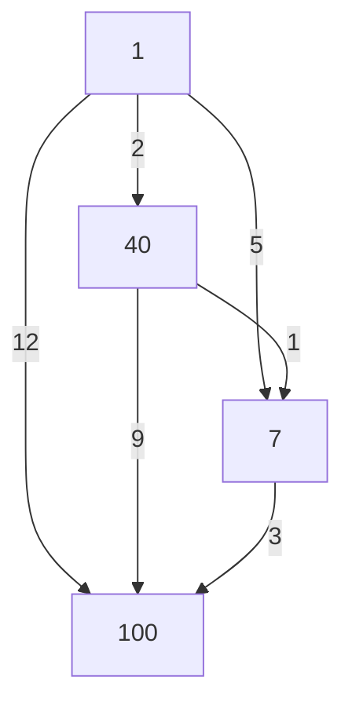

**Для решения этого типа задач нужно понять одну основную идею: как из уже найденного пути получить новый и определить, стал ли он лучше.** Когда эта идея ясна, программа перестаёт быть набором команд, которые нужно запоминать.

Я проверил твою ссылку. Там представлена задача № 92565: граф записан в текстовом файле, у каждого перехода есть направление и положительный вес. Нужно найти минимальную сумму весов при движении из вершины `1` в вершину `100` и записать целую часть результата. Граф не содержит направленных циклов; в файле не более 200 рёбер, а номера вершин могут идти с пропусками. Именно этот тип подробно разберём ниже. [inf-ege.sdamgia.ru](https://inf-ege.sdamgia.ru/problem?id=92565\&utm_source=chatgpt.com)

Будем использовать Python. Сначала построим понимание на маленьком примере, затем превратим рассуждение в программу. После основного решения разберём рекурсию, другие способы поиска пути и изменения условий.

**Граф — это набор объектов и связей между ними.** Например, объектами могут быть города, а связями — дороги между городами.

У этих двух составляющих есть специальные названия:

| Обычное описание | Термин |
|---|---|
| Отдельный город | Вершина |
| Дорога между городами | Ребро |
| Все города и дороги вместе | Граф |

Вершина не обязана обозначать настоящий город. Она может обозначать состояние исполнителя, страницу сайта, станцию, компьютер или просто объект с некоторым номером.

Для решения задачи важно не то, что именно изображают вершины, а то, **какие переходы между ними разрешены**.

Если на рисунке есть вершины `1`, `40`, `7` и `100`, это четыре вершины. Большой номер не означает большого количества вершин:

- `100` — название одной вершины;
- количество вершин в этом примере — `4`.

Это различие понадобится при написании программы.

Теперь разберём три слова из условия: «ориентированный», «взвешенный», «ациклический».

**В ориентированном графе у каждого ребра есть направление.**

Запись

\[
1 \rightarrow 40
\]

означает, что из вершины `1` можно перейти в вершину `40`.

Она сама по себе не разрешает движение из `40` обратно в `1`. Для обратного движения понадобилось бы отдельное ребро:

\[
40 \rightarrow 1.
\]

На рисунках направление показывают стрелкой. В файле его задаёт порядок чисел.

Например:

```text
1 40 2.5
```

означает переход **из `1` в `40`**, а не произвольное соединение двух вершин.

Направленное ребро также называют **дугой**. Если встретишь это слово в другом объяснении, речь идёт о той же стрелке.

**Во взвешенном графе каждому ребру сопоставлено число — его вес.**

Вес можно представить как:

- длину дороги;
- стоимость проезда;
- время движения;
- количество ресурса, которое тратится на переход.

В нашей задаче конкретный физический смысл не нужен. Достаточно понимать:

> Когда мы проходим по ребру, к общей стоимости пути прибавляется его вес.

Для ребра

\[
1 \xrightarrow{2.5} 40
\]

стоимость перехода равна `2.5`.

Номер вершины и вес ребра — совершенно разные величины. Вершина `40` не обязана находиться дальше вершины `7`, а переход в вершину `100` не обязан стоить `100`.

**Путь — это последовательность разрешённых переходов.**

Например:

\[
1 \rightarrow 40 \rightarrow 7 \rightarrow 100.
\]

Этот путь существует, если в графе есть все три ребра:

\[
1\rightarrow40,\qquad
40\rightarrow7,\qquad
7\rightarrow100.
\]

Если хотя бы одной нужной стрелки нет, такой последовательностью двигаться нельзя.

Пусть веса этих рёбер равны `2`, `1` и `3`. Тогда длина пути:

\[
2+1+3=6.
\]

В этой задаче **длина пути — сумма весов его рёбер**.

Количество переходов — другая характеристика. В приведённом пути три перехода, но его длина равна шести.

Прямой переход между началом и концом тоже может проигрывать пути через промежуточные вершины:

\[
1\xrightarrow{12}100
\]

дороже, чем

\[
1\xrightarrow{2}40\xrightarrow{1}7\xrightarrow{3}100.
\]

Один переход стоит `12`, три перехода вместе — `6`.

Поэтому поиск пути с наименьшим количеством рёбер и поиск пути с наименьшей суммой весов могут давать разные ответы.

**Цикл возникает, если можно пройти по стрелкам и вернуться в исходную вершину.**

Например:

\[
1\rightarrow40\rightarrow7\rightarrow1.
\]

Мы начали в `1`, сделали несколько переходов и снова оказались в `1`.

**Ациклический граф** — граф без таких направленных циклов.

Здесь важно именно направление. Если есть стрелки

\[
1\rightarrow40,\qquad
40\rightarrow7,\qquad
1\rightarrow7,
\]

на рисунке может получиться треугольник. Но направленного цикла нет: из `7` нельзя вернуться в `1`.

Отсутствие циклов даёт полезное свойство:

> Двигаясь по стрелкам, мы не можем повторно попасть в уже посещённую вершину.

Иначе участок между первым и вторым посещением этой вершины образовал бы цикл.

Также ацикличность **не означает**, что номера вершин должны увеличиваться. Переход

\[
40\rightarrow7
\]

вполне допустим. Номера служат обозначениями и не задают порядок движения.

Посмотрим на граф, который будем использовать в объяснении.



В нём четыре пути из `1` в `100`:

| Путь | Сумма весов |
|---|---:|
| \(1\rightarrow100\) | \(12\) |
| \(1\rightarrow7\rightarrow100\) | \(5+3=8\) |
| \(1\rightarrow40\rightarrow100\) | \(2+9=11\) |
| \(1\rightarrow40\rightarrow7\rightarrow100\) | \(2+1+3=6\) |

Кратчайший путь:

\[
1\rightarrow40\rightarrow7\rightarrow100.
\]

Его длина — `6`.

Слово «кратчайший» здесь означает, что мы сравнили **полные суммы** и выбрали наименьшую.

На маленьком рисунке можно выписать все варианты. Но для программы нам нужен способ, который не требует перечислять каждый путь отдельно.

**Первая естественная идея — каждый раз выбирать самое дешёвое исходящее ребро. Она не гарантирует правильного результата.**

Представь два варианта:

| Первый переход | Затем переход к цели | Общая стоимость |
|---|---|---:|
| Из начала в `A` за `1` | Из `A` к цели за `100` | `101` |
| Из начала в `B` за `5` | Из `B` к цели за `1` | `6` |

Самый дешёвый первый шаг ведёт к дорогому полному пути.

Причина проста: стоимость ближайшего перехода ничего не говорит о стоимости продолжения.

Другая идея — полностью перебрать все пути. Она правильная по смыслу, но количество путей может быть огромным даже при сравнительно небольшом графе.

Если на каждом из 30 последовательных этапов есть два независимых выбора, получится:

\[
2^{30}=1\,073\,741\,824
\]

различных путей.

Нам поможет возможность **объединять информацию о путях, которые пришли в одну и ту же вершину**.

Представь, что мы нашли два способа попасть в вершину `7`:

- первый стоит `5`;
- второй стоит `3`.

Из `7` до цели можно пройти ещё за `3`.

Тогда полные стоимости:

\[
5+3=8;
\]

\[
3+3=6.
\]

Более дорогой способ попасть в `7` не нужен для поиска минимальной стоимости. Из вершины `7` дальнейшие возможности одинаковы независимо от того, каким из этих двух путей мы пришли.

Это рассуждение работает для любого продолжения. Если оно стоит \(r\), то:

\[
3+r<5+r.
\]

**Для каждой вершины достаточно хранить стоимость лучшего найденного пути от начала до неё.**

Это центральная идея решения.

Здесь есть важное условие: дальнейшие возможности определяются текущей вершиной. Если условие дополнительно учитывает историю движения — например, сколько раз использован некоторый тип перехода, — одной стоимости на вершину может оказаться недостаточно. Такие дополнительные ограничения обсудим позже.

Пока введём обозначение:

\[
d[v]
\]

— лучшая **найденная к текущему моменту** стоимость пути из начальной вершины в вершину \(v\).

Например:

\[
d[7]=5
\]

означает:

> Мы уже знаем способ добраться из начала в вершину `7` за `5`.

Но это ещё не обязательно окончательный ответ. Позже может обнаружиться путь за `3`.

Именно поэтому я подчёркиваю слова «найденная к текущему моменту».

**До начальной вершины стоимость равна нулю.**

Если мы уже стоим в вершине `1`, то для попадания в неё не нужно проходить ни одного ребра:

\[
d[1]=0.
\]

Путь без переходов имеет нулевую стоимость: мы ничего не прибавили.

До остальных вершин в начале никакого пути ещё не найдено. Как это обозначить?

Ставить `0` нельзя: это означало бы, что до каждой вершины уже можно добраться бесплатно.

Нужно значение, которое будет хуже любой настоящей стоимости. Для этого используют положительную бесконечность:

\[
+\infty.
\]

Начальная таблица для нашего графа:

| Вершина | Лучшая найденная стоимость |
|---|---:|
| `1` | \(0\) |
| `40` | \(+\infty\) |
| `7` | \(+\infty\) |
| `100` | \(+\infty\) |

Бесконечность здесь — удобное обозначение состояния **«путь пока не найден»**.

У неё нужные нам свойства:

\[
5<+\infty;
\]

\[
+\infty+3=+\infty.
\]

Любая реальная найденная стоимость улучшит бесконечность.

**Теперь научимся обрабатывать одно ребро.**

Пусть есть ребро:

\[
u\xrightarrow{w}v.
\]

Здесь:

- \(u\) — вершина, из которой выходит ребро;
- \(v\) — вершина, в которую оно приходит;
- \(w\) — вес ребра.

Если до \(u\) мы уже умеем добираться за \(d[u]\), то через это ребро можно попасть в \(v\) за:

\[
d[u]+w.
\]

Сравним новый вариант с тем, что уже известно о вершине \(v\).

Если

\[
d[u]+w<d[v],
\]

найден более дешёвый путь. Тогда заменяем старую стоимость:

\[
d[v]=d[u]+w.
\]

Если новый путь дороже или равен старому, ничего менять не нужно.

Например:

\[
d[40]=2,\qquad d[7]=5.
\]

Есть ребро:

\[
40\xrightarrow{1}7.
\]

Новый вариант:

\[
2+1=3.
\]

Поскольку

\[
3<5,
\]

обновляем:

\[
d[7]=3.
\]

В Python эта идея записывается так:

```python
candidate = distance[u] + w

if candidate < distance[v]:
    distance[v] = candidate
```

Здесь:

- `distance` хранит стоимости;
- `candidate` — стоимость нового рассматриваемого варианта;
- `<` означает «меньше»;
- присваивание `distance[v] = candidate` сохраняет улучшение.

Проверку и возможное улучшение стоимости через одно ребро называют **релаксацией ребра**.

Термин запоминать необязательно. Смысл операции такой:

> «Можно ли попасть в конец этого ребра дешевле, если сначала добраться до его начала?»

**Почему нельзя просто один раз прочитать все рёбра и закончить?**

Потому что строки файла могут находиться в неудобном порядке.

Запишем наш граф так:

```text
7 100 3.0
40 7 1.0
40 100 9.0
1 100 12.0
1 7 5.0
1 40 2.0
```

Это тот же граф, что на рисунке. Изменился только порядок перечисления рёбер.

Обработаем строки один раз.

Изначально:

\[
d[1]=0,
\]

остальные стоимости равны бесконечности.

Первая строка:

```text
7 100 3.0
```

Мы пока не знаем пути до `7`, поэтому не можем получить через неё полезный путь до `100`.

Следующие две строки начинаются в `40`. До неё путь тоже пока неизвестен.

Затем встречается:

```text
1 100 12.0
```

До `1` стоимость равна нулю, поэтому:

\[
d[100]=0+12=12.
\]

После строки

```text
1 7 5.0
```

получаем:

\[
d[7]=5.
\]

После строки

```text
1 40 2.0
```

получаем:

\[
d[40]=2.
\]

Файл закончился. Но нужные рёбра из `40` и `7` находились выше, и мы уже прошли мимо них!

Следовательно, **нужно снова пройти по рёбрам с обновлённой информацией**.

Второй проход:

1. Ребро `7 → 100` даёт стоимость \(5+3=8\). Улучшаем `12` до `8`.
2. Ребро `40 → 7` даёт стоимость \(2+1=3\). Улучшаем `5` до `3`.
3. Ребро `40 → 100` даёт стоимость \(2+9=11\). Она хуже уже найденной `8`, поэтому ничего не меняем.
4. Остальные рёбра улучшений не дают.

Но стоимость до `7` стала равна `3` **после** обработки ребра `7 → 100`. Значит, улучшение ещё не дошло до цели.

На третьем проходе:

\[
d[100]=d[7]+3=3+3=6.
\]

Все изменения можно увидеть в таблице:

| Момент | \(d[1]\) | \(d[40]\) | \(d[7]\) | \(d[100]\) |
|---|---:|---:|---:|---:|
| До обработки рёбер | 0 | \(\infty\) | \(\infty\) | \(\infty\) |
| После первого прохода | 0 | 2 | 5 | 12 |
| После второго прохода | 0 | 2 | 3 | 8 |
| После третьего прохода | 0 | 2 | 3 | 6 |

Обрати внимание на два вывода.

Во-первых, **первый найденный путь до цели не обязательно кратчайший**. Сначала мы получили `12`, затем `8`, затем `6`.

Во-вторых, **порядок строк влияет на скорость распространения улучшений, но не должен влиять на окончательный ответ**.

В удачном порядке правильный ответ может получиться за один проход. Но программа должна работать и при неудачном.

**Осталось понять, сколько проходов гарантированно достаточно.**

Обозначим количество вершин буквой \(V\).

В ациклическом графе путь не может повторять вершины. Поэтому в нём максимум \(V\) вершин.

Между \(V\) последовательными вершинами находится \(V-1\) ребро.

Например:

\[
1\rightarrow40\rightarrow7\rightarrow100
\]

содержит четыре вершины и три ребра.

Следовательно:

> Любой путь в нашем графе содержит не более \(V-1\) рёбер.

Теперь свяжем это с проходами по файлу.

После первого полного прохода гарантированно будут найдены лучшие пути, состоящие из одного ребра от начала.

Почему? Каждое ребро из начальной вершины было просмотрено, а стоимость до начала с самого начала равна нулю.

После второго полного прохода гарантированно будут учтены все варианты, которым нужно не более двух рёбер.

Почему? Стоимости, полученные за первый проход, уже известны до начала второго. Их можно продолжить ещё одним ребром.

После третьего прохода — не более трёх рёбер.

И так далее.

При удачном порядке строк за один проход улучшение может распространиться сразу через несколько рёбер. Поэтому правильная формулировка такая:

> После \(k\) проходов гарантированно учтены пути не более чем из \(k\) рёбер; некоторые более длинные пути тоже могут быть учтены.

Мы не перечисляем эти пути по отдельности. Их влияние объединяется в лучших стоимостях до вершин.

Поскольку больше \(V-1\) рёбер в пути быть не может, достаточно:

\[
V-1
\]

полных проходов.

Такой способ поиска кратчайших путей называется **алгоритмом Беллмана — Форда**.

Но теперь название относится к уже понятному действию: несколько раз просмотреть рёбра и распространять улучшения.

**Почему результат точно правильный, а не просто похож на правильный?**

Разделим доказательство на две части.

Первая: программа не придумывает несуществующие дешёвые пути.

Изначально известен только путь нулевой длины из начала в него же.

Каждое новое значение получается так:

\[
\text{стоимость существующего пути до }u
+
\text{вес существующего ребра }u\rightarrow v.
\]

Значит, каждое конечное значение в таблице соответствует некоторому реальному пути.

Программа не может получить стоимость меньше настоящего минимума: тогда существовал бы реальный путь, который дешевле минимума, а это противоречие.

Вторая: программа не пропустит настоящий кратчайший путь.

У него не более \(V-1\) рёбер. После достаточного количества проходов улучшения смогут пройти по всей его цепочке.

В результате найденная стоимость будет не больше стоимости этого кратчайшего пути.

Получается одновременно:

\[
\text{найденная стоимость}\geq\text{настоящий минимум};
\]

\[
\text{найденная стоимость}\leq\text{настоящий минимум}.
\]

Следовательно, они равны.

Это и есть обоснование алгоритма.

**Иногда можно закончить раньше, чем выполнены все \(V-1\) проходов.**

Предположим, мы полностью просмотрели все рёбра и ни одно значение не изменилось.

Есть ли смысл повторять тот же просмотр?

Нет:

- стоимости остались прежними;
- рёбра остались прежними;
- все сравнения будут такими же;
- новых улучшений не появится.

Поэтому после прохода без изменений можно остановиться.

Для этого заведём переменную:

```python
changed = False
```

`False` означает «нет», `True` — «да».

В начале каждого прохода говорим:

> Пока изменений не было.

При улучшении стоимости записываем:

```python
changed = True
```

А после полного прохода проверяем:

```python
if not changed:
    break
```

`not changed` означает «изменений не было».

`break` завершает цикл.

Здесь принципиально, что проверка выполняется **после просмотра всех рёбер**. Отсутствие улучшения на одном ребре не означает, что улучшений не будет на остальных.

**Теперь подготовим данные для программы.**

В файле каждая строка описывает одно ребро:

```text
40 7 1.3
```

Её смысл:

| Часть строки | Значение |
|---|---|
| `40` | Откуда идём |
| `7` | Куда идём |
| `1.3` | Сколько стоит переход |

В этом формате первая строка тоже описывает ребро. Отдельного заголовка с количеством вершин или рёбер нет.

Поэтому нельзя автоматически пропускать первую строку через `f.readline()`: так мы потеряем одно ребро.

Пробелов между числами может быть несколько, также могут встречаться табуляции. Подходящая команда:

```python
line.split()
```

Она разбивает строку на части по пробельным символам.

Например:

```python
line = "40     7\t1.3"
parts = line.split()

print(parts)
```

Результат:

```python
['40', '7', '1.3']
```

Все три элемента пока являются текстом. Кавычки показывают, что это строки.

Строка `'40'` и число `40` — разные значения:

- `'40'` — текстовое обозначение;
- `40` — число, с которым можно выполнять арифметические операции.

Для номеров вершин подходит преобразование:

```python
u = int(parts[0])
v = int(parts[1])
```

Счёт элементов в списке Python начинается с нуля:

- `parts[0]` — первый элемент;
- `parts[1]` — второй;
- `parts[2]` — третий.

С весом нужно поступить иначе, потому что он может быть дробным.

**Дробную часть веса нельзя отбрасывать во время чтения.**

Допустим, путь состоит из двух рёбер:

\[
2.8+3.6=6.4.
\]

Целая часть полной суммы равна:

\[
6.
\]

Если сначала отбросить дробные части отдельных весов, получим:

\[
2+3=5.
\]

Это уже неверный результат.

Правильный порядок:

1. Прочитать веса с дробными частями.
2. Найти минимальную полную сумму.
3. Только после этого взять целую часть.

Отдельно различай получение целой части и округление.

Для положительного числа `7.9`:

```python
int(7.9)    # 7
round(7.9)  # 8
```

В нашей задаче требуется первая операция.

**Есть ещё техническая тонкость: обычные дробные числа `float` могут храниться приближённо.**

Причина в том, что компьютер представляет их в двоичной системе. Некоторые конечные десятичные дроби, например `0.1`, не имеют конечной двоичной записи. Поэтому хранится очень близкое приближение. [Python 3.14.8 documentation](https://docs.python.org/3/tutorial/floatingpoint.html?utm_source=chatgpt.com)

Например:

```python
total = 0.0

for step in range(10):
    total = total + 0.1

print(total)
print(int(total))
```

При обычной арифметике `float` результат:

```text
0.9999999999999999
0
```

Математически сумма равна единице, но небольшая погрешность перед взятием целой части изменила ответ.

Для нашего решения воспользуемся `Decimal` — стандартным типом Python для десятичных чисел.

Он подключается так:

```python
from decimal import Decimal
```

И создаётся непосредственно из текста:

```python
w = Decimal('1.3')
```

Пиши именно `Decimal('1.3')`, а не `Decimal(1.3)`: во втором случае сначала создаётся приближённый `float`. `Decimal` точно принимает десятичную запись из строки, а арифметику выполняет с заданной точностью; по умолчанию это 28 значащих цифр. Для проверенного файла и наших примеров этого достаточно. Это не бесконечная точность: для необычных данных с десятками дробных знаков её пришлось бы увеличить. [Python 3.14.8 documentation](https://docs.python.org/3/library/decimal.html?utm_source=chatgpt.com)

Обычное сложение остаётся обычным:

```python
Decimal('2.8') + Decimal('3.6')
```

даёт точное для этого примера значение:

```python
Decimal('6.4')
```

Положительную бесконечность можно представить так:

```python
INF = Decimal('Infinity')
```

`INF` — выбранное нами имя переменной. Заглавные буквы здесь лишь подчёркивают, что это вспомогательное постоянное значение.

**Для хранения графа нам понадобятся три структуры данных.**

Первая — **список рёбер**.

Список хранит несколько элементов. Пустой список создаётся квадратными скобками:

```python
edges = []
```

Одно ребро будем хранить как тройку:

```python
(u, v, w)
```

Такая группа значений в круглых скобках называется **кортежем**. Здесь он объединяет три характеристики одного ребра.

Добавить ребро в конец списка:

```python
edges.append((u, v, w))
```

В итоге получится структура вида:

```python
[
    (1, 40, Decimal('2')),
    (40, 7, Decimal('1')),
    (7, 100, Decimal('3'))
]
```

Вторая структура — **множество вершин**.

Множество хранит разные значения без повторений.

```python
vertices = {1, 100}
```

Добавление номера:

```python
vertices.add(40)
```

Если `40` уже была в множестве, второй экземпляр не появится.

Так удобно собрать все номера вершин, встречающиеся в рёбрах.

Команда:

```python
len(vertices)
```

вернёт количество разных вершин.

Третья структура — **словарь стоимостей**.

Словарь хранит соответствия:

\[
\text{ключ}\longrightarrow\text{значение}.
\]

У нас:

\[
\text{номер вершины}\longrightarrow
\text{лучшая найденная стоимость}.
\]

Создание пустого словаря:

```python
distance = {}
```

Запись значения для вершины:

```python
distance[40] = Decimal('2')
```

Чтение этого значения:

```python
distance[40]
```

Здесь `40` — ключ словаря. Нам не нужно создавать 41 элемент, чтобы обратиться к ключу `40`.

Поэтому словарь удобен, когда номера вершин идут с пропусками.

**Соберём основное решение целиком.**

Сохрани входные данные под именем `23.txt` в рабочей папке программы или подставь своё имя файла в `open`.

```python
from decimal import Decimal

SOURCE = 1
TARGET = 100

# Список всех рёбер.
edges = []

# Множество всех вершин.
vertices = {SOURCE, TARGET}

# Читаем файл.
with open("23.txt") as f:
    for line in f:
        # Пропускаем пустые строки, если они встретятся.
        if not line.strip():
            continue

        parts = line.split()

        u = int(parts[0])
        v = int(parts[1])
        w = Decimal(parts[2])

        edges.append((u, v, w))

        vertices.add(u)
        vertices.add(v)

# Пока пути не найдены, стоимости равны бесконечности.
INF = Decimal("Infinity")

distance = {}

for v in vertices:
    distance[v] = INF

# До начальной вершины идти не нужно.
distance[SOURCE] = Decimal(0)

# Достаточно не более V - 1 полных проходов.
for step in range(len(vertices) - 1):
    changed = False

    for u, v, w in edges:
        # Если до u путь пока не найден,
        # через неё нельзя получить новый путь до v.
        if distance[u] == INF:
            continue

        candidate = distance[u] + w

        if candidate < distance[v]:
            distance[v] = candidate
            changed = True

    # Полный проход не дал ни одного улучшения.
    if not changed:
        break

# По условию путь до TARGET существует.
print(int(distance[TARGET]))
```

Разберём конструкции, которые ещё могли остаться неясными.

Запись:

```python
with open("23.txt") as f:
```

открывает файл и позволяет работать с ним через имя `f`. После завершения блока файл автоматически закрывается.

Цикл:

```python
for line in f:
```

последовательно получает строки файла.

Команда:

```python
line.strip()
```

убирает пробельные символы с начала и конца строки. Если строка содержала только пробелы или перевод строки, результат будет пустым.

Условие:

```python
if not line.strip():
```

проверяет именно этот случай.

Команда:

```python
continue
```

пропускает оставшуюся часть текущего повторения цикла и переходит к следующему.

Поэтому для пустой строки программа сразу начинает читать следующую строку.

Запись:

```python
for u, v, w in edges:
```

по очереди берёт каждую тройку из списка рёбер и раскладывает её по трём переменным.

Если очередное ребро такое:

```python
(40, 7, Decimal('1.3'))
```

то внутри этого повторения цикла:

```python
u = 40
v = 7
w = Decimal('1.3')
```

Запись:

```python
range(len(vertices) - 1)
```

задаёт количество повторений внешнего цикла.

Если вершин четыре, получаем:

```python
range(3)
```

Цикл выполнится три раза. Значения `step` будут `0`, `1`, `2`, но сами эти числа нам не нужны: важно количество повторений.

Наконец, отступы определяют, к какому циклу относится действие.

В программе:

```python
for step in range(len(vertices) - 1):
    changed = False

    for u, v, w in edges:
        ...

    if not changed:
        break
```

проверка `if not changed` находится **после внутреннего цикла**, поэтому выполняется после просмотра всех рёбер.

Если по ошибке сдвинуть её внутрь, программа сможет остановиться слишком рано.

**Почему эта программа достаточно быстрая?**

Обозначим:

- \(V\) — количество вершин;
- \(E\) — количество рёбер.

Один проход проверяет \(E\) рёбер.

Проходов не больше \(V-1\).

Значит, число проверок примерно ограничено произведением:

\[
V\cdot E.
\]

Это записывают как:

\[
O(VE).
\]

Обозначение \(O(\ldots)\) описывает, как объём работы растёт вместе с размером данных. Здесь важно произведение количества вершин и количества рёбер.

В рассматриваемом условии не более 200 рёбер. У 200 рёбер не может быть больше 400 разных концов. Для поиска пути достаточно вершин, встречающихся в этих рёбрах.

Поэтому даже грубая оценка:

\[
399\cdot200=79\,800
\]

проверок невелика для Python.

В реальном файле я получил 50 вершин и 200 рёбер. Основная программа даёт ответ:

\[
\boxed{10971}.
\]

Один из найденных кратчайших путей:

\[
1\rightarrow173\rightarrow975\rightarrow625
\rightarrow312\rightarrow633\rightarrow825
\rightarrow96\rightarrow59\rightarrow698
\rightarrow221\rightarrow56\rightarrow100.
\]

Сумма весов вдоль него:

\[
2034+278+44+193+93+1508+1112+
443+1987+459+2547+273=10971.
\]

Это вычислено по приложенному к задаче файлу. [inf-ege.sdamgia.ru](https://inf-ege.sdamgia.ru/get_file?id=283084\&utm_source=chatgpt.com)

Основное решение я также сверил с полным перебором путей на маленьких графах.

**Полезно понимать, как получить сам путь, если программа пока хранит только его стоимость.**

Когда мы улучшаем стоимость до вершины `v` через вершину `u`, можно запомнить:

> В лучшем найденном пути перед `v` стояла `u`.

Для этого создадим ещё один словарь:

```python
previous = {}
```

Его нужно создать до циклов улучшения.

Внутри обновления добавим одну строку:

```python
if candidate < distance[v]:
    distance[v] = candidate
    previous[v] = u
    changed = True
```

После завершения расчёта начнём с цели и будем двигаться по сохранённым предшественникам назад:

```python
path = []
v = TARGET

while v != SOURCE:
    path.append(v)
    v = previous[v]

path.append(SOURCE)
path.reverse()

print(path)
```

Здесь:

- `while v != SOURCE` означает «повторять, пока не дошли до начала»;
- `previous[v]` сообщает предыдущую вершину;
- `path.reverse()` переворачивает список, потому что мы собирали путь от конца к началу.

Для учебного графа получим:

```text
[1, 40, 7, 100]
```

В самом задании требуется число, поэтому восстановление пути не обязательно. Но оно помогает проверять рассуждение.

**Тот же поиск можно организовать через вопрос: «Сколько ещё осталось пройти от текущей вершины до цели?»**

Это приведёт к рекурсивному решению.

До сих пор мы хранили стоимость **от начала до вершины**:

\[
d[v].
\]

Теперь введём другую величину:

\[
f(v)
\]

— минимальная стоимость пути **из вершины \(v\) до цели**.

Не смешивай эти два смысла:

| Обозначение | Что измеряет |
|---|---|
| \(d[v]\) | Сколько стоит добраться из начала до \(v\) |
| \(f(v)\) | Сколько стоит добраться из \(v\) до цели |

Для нового способа сначала ответим на самый простой вопрос.

Сколько осталось идти, если мы уже стоим в целевой вершине?

Нисколько:

\[
f(100)=0.
\]

Теперь возьмём вершину `7`. Из неё есть переход в `100` за `3`.

Значит:

\[
f(7)=3+f(100)=3.
\]

Из вершины `40` есть два варианта:

- перейти в `7` за `1`, а потом продолжить за \(f(7)\);
- перейти в `100` за `9`, а потом продолжить за \(f(100)\).

Поэтому:

\[
f(40)=\min(1+f(7),\;9+f(100)).
\]

Подставляем известные значения:

\[
f(40)=\min(1+3,\;9+0)=4.
\]

Из `1` можно пойти в `40`, `7` или `100`:

\[
f(1)=
\min(
2+f(40),\;
5+f(7),\;
12+f(100)
).
\]

Следовательно:

\[
f(1)=\min(2+4,\;5+3,\;12+0)=6.
\]

Это тот же ответ.

Общее правило:

> Чтобы найти лучший путь от текущей вершины до цели, нужно рассмотреть каждый первый переход и прибавить к его весу лучший путь от следующей вершины.

Если функция для вершины вызывает такую же функцию для следующей вершины, это называется **рекурсией**.

Рекурсия здесь соответствует естественному рассуждению:

> «Чтобы ответить для этой вершины, сначала получу ответы для вершин, в которые из неё можно перейти».

**Очень важен случай, когда из вершины нельзя добраться до цели.**

Допустим, есть два ребра:

\[
1\xrightarrow{12}100;
\]

\[
1\xrightarrow{2}81.
\]

Из `81` дальше идти некуда.

Правильный ответ — `12`.

Если ошибочно считать:

\[
f(81)=0,
\]

программа сравнит:

\[
12+0=12
\]

и

\[
2+0=2,
\]

после чего выберет `2`.

Но путь за `2` заканчивается в `81`, а не в `100`.

Поэтому:

- если уже находимся в цели, возвращаем `0`;
- если до цели добраться нельзя, возвращаем \(+\infty\).

Эти состояния имеют разный смысл:

| Состояние | Значение |
|---|---:|
| Цель уже достигнута | \(0\) |
| Достичь цели невозможно | \(+\infty\) |

На странице задачи в опубликованном рекурсивном коде для вершины без исходящих рёбер возвращается `0`. Для произвольного графа из этого условия такая обработка тупика неверна; в варианте ниже этот случай учтён. [inf-ege.sdamgia.ru](https://inf-ege.sdamgia.ru/problem?id=92565\&utm_source=chatgpt.com)

**Для рекурсии удобнее хранить рёбра по начальным вершинам.**

Нужно быстро отвечать:

> Куда можно перейти из вершины `v` и сколько стоит каждый переход?

Создадим словарь:

```python
graph = {}
```

Для каждой вершины в нём будет список исходящих переходов.

Например, по смыслу:

```python
graph[40] = [
    (7, Decimal('1')),
    (100, Decimal('9'))
]
```

Это означает:

- из `40` можно перейти в `7` за `1`;
- из `40` можно перейти в `100` за `9`.

Такое представление называют **списком смежности**. Смежность здесь означает наличие непосредственного соединения ребром.

Из уже прочитанного списка `edges` его можно получить так:

```python
graph = {}

for u, v, w in edges:
    if u not in graph:
        graph[u] = []

    graph[u].append((v, w))
```

Условие:

```python
if u not in graph:
```

проверяет, есть ли в словаре запись для вершины `u`.

Если её ещё нет, создаём пустой список, а затем добавляем переход.

Чтобы получить исходящие переходы, используем:

```python
graph.get(v, [])
```

Это означает:

- вернуть значение для ключа `v`, если оно есть;
- иначе вернуть пустой список `[]`.

Таким образом, вершина без исходящих рёбер тоже обрабатывается нормально.

**Рекурсивные ответы нужно запоминать.**

Представь, что из нескольких вершин можно попасть в одну и ту же вершину `7`.

Для каждой из них понадобится значение \(f(7)\). Но оно одинаково: граф и цель не меняются.

Если каждый раз заново вычислять \(f(7)\), одни и те же участки графа будут обрабатываться повторно.

Лучше:

1. При первом вызове вычислить ответ.
2. Сохранить его.
3. При следующем таком же вызове сразу вернуть сохранённое значение.

Это называется **запоминанием результатов**, или **мемоизацией**.

В Python для этого есть `cache`:

```python
from functools import cache
```

Строка:

```python
@cache
```

перед определением функции подключает автоматическое запоминание её результатов по аргументам. Такая запись с `@` называется декоратором; здесь достаточно понимать её конкретное действие: повторный вызов с той же вершиной использует сохранённый ответ. [Python 3.14.8 documentation](https://docs.python.org/3/library/functools.html?utm_source=chatgpt.com)

После чтения `edges` альтернативный расчёт выглядит так:

```python
from functools import cache

graph = {}

for u, v, w in edges:
    if u not in graph:
        graph[u] = []

    graph[u].append((v, w))


@cache
def best(v):
    # Мы уже в цели.
    if v == TARGET:
        return Decimal(0)

    # Пока подходящий путь до цели не найден.
    answer = INF

    for next_vertex, weight in graph.get(v, []):
        candidate = weight + best(next_vertex)

        if candidate < answer:
            answer = candidate

    return answer


print(int(best(SOURCE)))
```

Этот фрагмент использует `edges`, `SOURCE`, `TARGET`, `Decimal` и `INF` из части программы, где мы прочитали файл. Он заменяет расчёт через повторные проходы.

Посмотри, как автоматически обрабатывается тупик:

```python
answer = INF
```

Исходящих рёбер нет, поэтому цикл не выполняется.

Функция возвращает:

```python
INF
```

Если исходящие рёбра есть, но все они ведут в вершины, из которых цель недостижима, результат тоже останется бесконечным:

\[
w+\infty=\infty.
\]

При этом целевая вершина обрабатывается раньше цикла. Даже если из неё есть исходящие рёбра, идти по ним уже не требуется: цель достигнута.

**Почему такая рекурсия завершается?**

Каждый вложенный вызов соответствует движению по стрелке.

Если бы функция могла бесконечно переходить к новым вложенным вызовам в конечном графе, какая-то вершина повторилась бы.

Это означало бы наличие направленного цикла.

По условию циклов нет, поэтому цепочка вызовов обязательно закончится:

- либо на целевой вершине;
- либо на вершине без исходящих рёбер.

Сам по себе `cache` не устраняет циклы. Если есть переходы `A → B → A`, результат для `A` ещё не вычислен к моменту повторного вызова `A`, поэтому брать из памяти пока нечего.

Именно гарантия ацикличности делает этот рекурсивный способ подходящим.

Также сохранённые ответы относятся к конкретному графу и конкретной цели. Если менять их в уже работающей программе, старые результаты нельзя автоматически использовать для новой задачи.

**Оба наших способа используют результаты более простых подзадач.**

В первом способе подзадача звучит так:

> Найти лучшую стоимость от начала до некоторой вершины.

Во втором:

> Найти лучшую стоимость от некоторой вершины до цели.

Сохранение ответов на такие подзадачи и построение через них более сложных ответов относится к **динамическому программированию**.

Это название не означает какой-то особой команды Python. Речь о способе рассуждения:

1. Определить, какую информацию хранить.
2. Задать простейшие начальные значения.
3. Вывести правило получения новых значений.
4. Организовать вычисления так, чтобы не выполнять одну и ту же работу бессмысленно много раз.

В рекурсивном решении с запоминанием каждая нужная вершина полноценно вычисляется один раз, а её исходящие рёбра просматриваются один раз. Поэтому объём работы после построения графа оценивается как:

\[
O(V+E).
\]

Повторные проходы по рёбрам обычно делают больше работы, зато дают прямое решение без рекурсии. Для размера файла из твоей задачи этого вполне достаточно.

**Есть ещё способ получить правильные стоимости за один проход по вершинам: расположить их в подходящем порядке.**

В нашем учебном графе подходит порядок:

\[
1,\;40,\;7,\;100.
\]

Почему?

- До обработки `40` уже обработана `1`.
- До обработки `7` уже обработаны `1` и `40`.
- До обработки `100` уже обработаны все вершины, из которых в неё можно прийти.

Такой порядок называется **топологическим порядком**:

> Для каждого ребра его начало расположено раньше его конца.

Получение такого порядка называется **топологической сортировкой**.

Это не обычная сортировка номеров.

Для нашего графа сортировка чисел дала бы:

\[
1,\;7,\;40,\;100.
\]

Она не подходит: есть ребро `40 → 7`, а `40` стоит после `7`.

Если обработать каждую вершину в таком неправильном порядке только один раз, улучшение до `7` может прийти слишком поздно.

Идея построения правильного порядка:

1. Найти вершину, в которую сейчас не входит ни одно ребро.
2. Записать её в порядок.
3. Удалить её вместе с исходящими рёбрами из рассматриваемого остатка графа.
4. Повторить.

Почему в ациклическом графе найдётся вершина без входящих рёбер?

Предположим обратное: в каждую вершину что-то входит. Тогда можно от любой вершины постоянно переходить к её предшественнику. Граф конечный, поэтому одна из вершин обязательно повторится. Получится цикл — противоречие.

После построения такого порядка достаточно распространять стоимости по исходящим рёбрам каждой вершины один раз.

Это ещё один способ использовать отсутствие циклов.

**Для положительных весов существует и алгоритм Дейкстры.**

Его полезно понимать, чтобы не путать с ошибочной идеей «всегда выбирать самое дешёвое ребро».

Алгоритм Дейкстры выбирает:

> Ещё не обработанную вершину с наименьшей найденной **полной стоимостью от начала**.

Порядок действий:

1. До начала стоимость `0`, до остальных вершин — бесконечность.
2. Выбираем ещё не обработанную вершину с наименьшей стоимостью.
3. Улучшаем стоимости через её исходящие рёбра.
4. Отмечаем вершину как обработанную.
5. Повторяем.

Для нашего графа:

| Выбранная вершина | Её стоимость | Что улучшаем |
|---|---:|---|
| `1` | 0 | До `40`: 2; до `7`: 5; до `100`: 12 |
| `40` | 2 | До `7`: 3; до `100`: 11 |
| `7` | 3 | До `100`: 6 |
| `100` | 6 | Цель обработана |

Почему выбранную вершину можно считать окончательно обработанной?

Представь, что выбрана вершина со стоимостью `3`.

Среди ещё не обработанных вершин нет найденной стоимости меньше `3`. Кроме того, продолжение любого пути добавляет неотрицательные веса.

Если бы существовал более дешёвый путь к выбранной вершине, на этом пути была бы первая ещё не обработанная вершина. До неё уже можно было бы получить стоимость не больше стоимости всего этого более дешёвого пути — то есть меньше `3`. Тогда алгоритм выбрал бы её раньше.

Получается противоречие.

Дейкстра работает и при наличии циклов, если веса неотрицательные. Но при отрицательных весах это обоснование перестаёт действовать.

Для ориентирования полезно держать в голове такое сравнение:

| Способ | Основная идея | Подходящие условия |
|---|---|---|
| Повторные улучшения, Беллман — Форд | Несколько раз просматривать все рёбра | Полностью подходит для рассматриваемой задачи |
| Рекурсия с запоминанием | Найти лучший остаток пути через ответы соседей | Граф без направленных циклов |
| Топологический порядок | Обрабатывать вершины после всех их предшественников | Граф без направленных циклов |
| Дейкстра | Каждый раз выбирать ближайшую ещё не обработанную вершину | Неотрицательные веса |

Для решения задачи по ссылке тебе достаточно уверенно понимать и уметь написать один из первых двух вариантов.

**Важно различать задачи, которые внешне похожи, но требуют разных вычислений.**

Возьмём вопрос:

> Сколько различных путей ведёт из начала в конец?

Теперь нужна не минимальная стоимость, а количество вариантов.

Пусть:

\[
c(v)
\]

— количество путей из вершины \(v\) до цели.

Если из \(v\) можно перейти в `A` или `B`, то каждый путь начинается одним из этих переходов.

Поэтому:

\[
c(v)=c(A)+c(B).
\]

Мы складываем количество вариантов.

Для минимальной стоимости было иначе:

\[
f(v)=\min(w_{vA}+f(A),\;w_{vB}+f(B)).
\]

Здесь выбирается лучший вариант.

Разница:

| Что требуется | Что делаем с вариантами |
|---|---|
| Количество путей | Складываем количества |
| Минимальная стоимость | Выбираем минимум сумм |
| Максимальная стоимость | Выбираем максимум сумм |

Начальные значения тоже отличаются.

Для минимальной оставшейся стоимости:

\[
f(\text{цель})=0.
\]

Для количества путей:

\[
c(\text{цель})=1.
\]

Почему один?

Потому что, оказавшись в цели, мы имеем один способ успешно завершить путь: больше никуда не идти.

Если поставить ноль, то путь, который пришёл в цель, не добавит ни одного успешного варианта.

А для тупика, который не является целью:

\[
c(v)=0,
\]

потому что из него нет ни одного пути до цели.

Есть и техническая ловушка: **нельзя заменить улучшение минимума на прибавление количества в цикле многократных проходов** и оставить всё остальное как было.

Если каждый проход снова выполнять:

```python
count[v] += count[u]
```

одни и те же пути могут посчитаться повторно.

Для подсчёта путей в ациклическом графе удобно использовать рекурсию с запоминанием или топологический порядок: вклад каждого перехода учитывается в нужный момент один раз.

**Если нужен самый длинный путь, отсутствие циклов становится особенно важным.**

Для ациклического графа рассуждение об остатке пути сохраняется, но вместо минимума выбирается максимум:

\[
g(v)=\max(w_{vA}+g(A),\;w_{vB}+g(B)).
\]

В цели:

\[
g(\text{цель})=0.
\]

Недостижимость теперь нужно обозначать значением, которое хуже любого настоящего результата при поиске максимума:

\[
-\infty.
\]

Тогда невозможное продолжение не выиграет у существующего пути.

Автоматически переносить этот способ на граф с циклами нельзя. Например, при разрешённом повторном прохождении положительного цикла суммарную стоимость можно увеличивать сколько угодно.

**Если путь должен пройти через определённую вершину, задачу можно разделить на части.**

Пусть требуется пройти:

\[
S\rightarrow K\rightarrow T.
\]

Здесь:

- \(S\) — начало;
- \(K\) — обязательная промежуточная вершина;
- \(T\) — цель.

В ациклическом графе минимальная стоимость такого пути равна:

\[
\operatorname{dist}(S,K)+\operatorname{dist}(K,T),
\]

если обе части существуют.

Почему можно сложить два независимо найденных минимума?

Любой подходящий путь состоит из части до \(K\) и части после \(K\). Каждая из этих частей не может быть дешевле своего минимума.

С другой стороны, два кратчайших участка можно соединить.

В ациклическом графе они не могут иметь общую вершину, отличную от \(K\): иначе возникло бы движение от этой вершины к \(K\) и обратно к ней, то есть цикл.

Если хотя бы одна часть недостижима, подходящего пути нет.

И здесь тоже сначала складывают полные стоимости, а целую часть берут только в конце.

**Если вершину запрещено посещать, можно удалить все связанные с ней рёбра.**

Для запрещённой вершины `K` не оставляем:

- рёбра, которые ведут в `K`;
- рёбра, которые выходят из `K`.

После этого ищем кратчайший путь в оставшемся графе.

Но сначала проверь, не запрещена ли сама начальная или конечная вершина. В таком случае обычного допустимого пути между ними не будет.

**Если требуется ровно заданное количество переходов, одной стоимости на вершину уже недостаточно.**

Допустим, в одну вершину можно попасть:

- за `3`, использовав пять рёбер;
- за `4`, использовав два ребра.

При обычном поиске кратчайшего пути первый вариант лучше.

Но если разрешено ровно три перехода, первый вариант вообще нельзя использовать.

Теперь нужно хранить две характеристики:

\[
D[k][v]
\]

— минимальную стоимость попадания в вершину \(v\) **ровно за \(k\) переходов**.

Здесь \(k\) — дополнительная часть описания состояния.

Начало:

\[
D[0][S]=0.
\]

До остальных вершин за ноль переходов попасть нельзя:

\[
D[0][v]=+\infty,\qquad v\ne S.
\]

Переход по ребру \(u\xrightarrow{w}v\):

\[
D[k+1][v]
=
\min\bigl(D[k+1][v],\;D[k][u]+w\bigr).
\]

Смысл:

> Чтобы попасть в `v` ровно за \(k+1\) переход, нужно сначала попасть в `u` ровно за \(k\) переходов и пройти ещё одно ребро.

При таком расчёте значения для следующего количества переходов нужно хранить отдельно от предыдущего. Иначе обновлённая стоимость может сразу использоваться повторно, и число рёбер перестанет контролироваться.

Это хороший пример общего принципа:

> Храни столько информации, сколько нужно для проверки ограничений и выбора дальнейших действий.

**Перед решением нового условия полезно последовательно ответить на несколько вопросов.**

1. **Есть ли направление у рёбер?**  
   Если есть, обратный переход нельзя добавлять без основания.

2. **Что означает вес?**  
   Уточни, требуется ли минимальная сумма весов или минимальное количество переходов.

3. **Где начало и где цель?**  
   Не путай номер целевой вершины с количеством вершин.

4. **Есть ли циклы?**  
   От этого зависит применимость рекурсии без дополнительных мер и топологического порядка.

5. **Какие разрешены веса?**  
   Положительные, неотрицательные или любые — это разные условия для выбора алгоритма.

6. **Есть ли ограничения на путь?**  
   Обязательные вершины, запрещённые вершины, точное количество рёбер могут изменить то, что нужно хранить.

7. **Как устроен файл?**  
   Есть ли заголовок? Что находится в каждой строке? Какими символами разделены значения?

8. **Что нужно вывести?**  
   Полную стоимость, целую часть, количество путей или последовательность вершин?

9. **Насколько велики данные?**  
   Для 200 рёбер многократные проходы вполне подходят. Для гораздо больших графов выбор способа может стать важнее.

10. **Каким маленьким примером проверить программу?**  
    Лучше всего подходит пример, где правильный ответ можно получить вручную.

Вот ошибки, которые особенно часто мешают в этом типе задач:

| Ошибка | Почему неверно |
|---|---|
| Считать, что из `u → v` разрешён переход `v → u` | У ребра задано направление |
| Принять номер `100` за количество вершин | Номер является обозначением |
| Считать, что по пути номера обязаны возрастать | Условие этого не гарантирует |
| Один раз обработать рёбра в порядке файла | Улучшение может прийти после обработки нужного ребра |
| Завершить поиск при первом попадании в цель | Первый путь может быть дорогим |
| Инициализировать все стоимости нулями | Это означает бесплатную достижимость всех вершин |
| Возвращать `0` для тупика в поиске минимальной стоимости | Тупик ошибочно превращается в успешное завершение |
| Выбирать самое дешёвое ближайшее ребро | Дальнейшая часть пути может быть дорогой |
| Отбросить дробные части отдельных весов | Изменятся суммы путей |
| Использовать `round` вместо получения целой части | Это другая математическая операция |
| Использовать рекурсию без запоминания на большом числе путей | Одни и те же подзадачи будут вычисляться многократно |

Если в другой задаче существование пути не гарантируется, перед выводом нужно проверить результат:

```python
if distance[TARGET] == INF:
    print("Пути нет")
else:
    print(int(distance[TARGET]))
```

Преобразовывать бесконечность в целое число нельзя.

**Теперь проверь понимание на небольших заданиях.** Сначала попробуй рассуждать без программы, а затем используй её для проверки.

1. В файле записано:

   ```text
   80 12 4.7
   ```

   Откуда и куда можно перейти? Разрешён ли обратный переход? Нарушает ли уменьшение номера вершины ацикличность?

2. Есть два пути до цели:

   \[
   S\xrightarrow{1}A\xrightarrow{20}T;
   \]

   \[
   S\xrightarrow{6}B\xrightarrow{2}T.
   \]

   Какой путь кратчайший? Почему выбор самого дешёвого первого ребра не помогает?

3. Дан файл:

   ```text
   1 20 2.4
   1 7 6.0
   20 7 1.3
   7 100 3.2
   20 100 8.0
   1 100 15.0
   ```

   Найди все пути из `1` в `100`, их стоимости, кратчайший путь и целую часть его стоимости.

4. Для графа из предыдущего задания найди:
   
   - кратчайший путь при запрете посещать вершину `7`;
   - кратчайший путь с обязательным посещением вершины `20`;
   - путь с наименьшим количеством рёбер;
   - минимальную стоимость пути ровно из двух рёбер.

5. Вершины соединены так:

   \[
   1\xrightarrow{12}100;
   \]

   \[
   1\xrightarrow{2}81.
   \]

   Из `81` рёбер нет. Какие значения должны иметь \(f(100)\), \(f(81)\) и \(f(1)\)?

6. В файле рёбра расположены так:

   ```text
   7 100 3.0
   40 7 1.0
   1 40 2.0
   ```

   Какие стоимости будут известны после первого, второго и третьего проходов?

7. Почему нельзя прервать внешний цикл после первого ребра, которое не дало улучшения?

8. Почему для подсчёта количества путей из цели в неё же используется `1`, а для оставшейся стоимости — `0`?

9. Что произойдёт, если все начальные значения `distance[v]` установить в `0`, а веса рёбер положительные?

10. Для графа из задания 3 определи количество путей из `1` в `100` и стоимость самого длинного пути.

Ответы для проверки:

1. Разрешён переход `80 → 12` стоимостью `4.7`. Обратное направление из этой строки не следует. Уменьшение номера допустимо: ацикличность связана с невозможностью вернуться по стрелкам, а не с величиной номеров.

2. Первый путь стоит:

   \[
   1+20=21.
   \]

   Второй:

   \[
   6+2=8.
   \]

   Кратчайший — через `B`.

3. Все варианты:

   | Путь | Стоимость |
   |---|---:|
   | \(1\rightarrow100\) | \(15.0\) |
   | \(1\rightarrow7\rightarrow100\) | \(6.0+3.2=9.2\) |
   | \(1\rightarrow20\rightarrow100\) | \(2.4+8.0=10.4\) |
   | \(1\rightarrow20\rightarrow7\rightarrow100\) | \(2.4+1.3+3.2=6.9\) |

   Минимум — `6.9`, в ответ записывается `6`.

4. При запрете вершины `7`:

   \[
   1\rightarrow20\rightarrow100,
   \]

   стоимость `10.4`.

   При обязательном посещении `20`:

   \[
   1\rightarrow20\rightarrow7\rightarrow100,
   \]

   стоимость `6.9`.

   По количеству рёбер выигрывает прямой переход `1 → 100`: одно ребро, хотя стоимость равна `15`.

   Ровно из двух рёбер лучше путь:

   \[
   1\rightarrow7\rightarrow100,
   \]

   стоимость `9.2`.

5. Правильные значения:

   \[
   f(100)=0;
   \]

   \[
   f(81)=+\infty;
   \]

   \[
   f(1)=12.
   \]

6. После первого прохода известна стоимость до `40`: `2`.

   После второго — до `7`: `3`.

   После третьего — до `100`: `6`.

   Каждому следующему ребру мешает то, что оно записано раньше предыдущего ребра пути.

7. Неудача на одном ребре ничего не говорит о других. Остановиться можно после полного прохода без улучшений.

8. В цели оставшаяся стоимость нулевая, потому что больше не нужно двигаться. Успешное завершение при подсчёте путей одно: остановиться в достигнутой цели.

9. Новая стоимость будет положительной, а сохранённая — нулевой. Условие улучшения не выполнится. Программа ошибочно сохранит нули.

10. Путей четыре. Самый длинный имеет стоимость `15.0` и состоит из прямого ребра `1 → 100`.

Когда будешь восстанавливать решение самостоятельно, начни с фразы: **«Я храню лучшую найденную стоимость до каждой вершины»**. Затем выведи из её смысла три вещи: почему в начале стоят `0` и бесконечности, почему новый вариант равен `distance[u] + w` и зачем повторять просмотр рёбер. Если эти три шага можешь объяснить своими словами, основа алгоритма уже понята.
