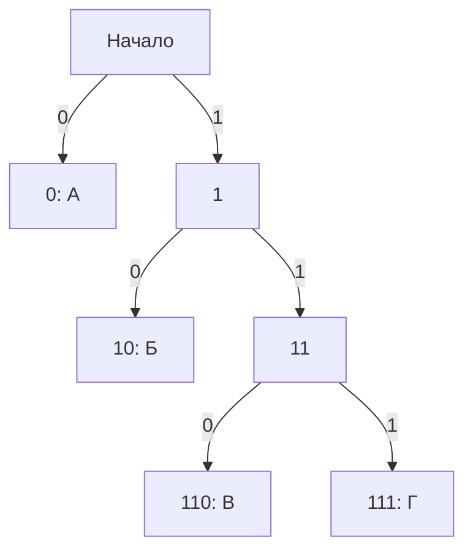

**В задании 4 нужно понять, как устроена таблица кодов и почему по ней можно однозначно восстановить сообщение.** После этого выбор коротких кодов, учёт неиспользуемых букв и поиск минимальной длины превращаются в понятные задачи о размещении букв в дереве.

В ваших подборках встречаются разные формулировки: найти код одной буквы, минимизировать длину сообщения или сумму длин кодов, восстановить код по готовой записи, посчитать допустимые варианты. Поэтому ниже разберём не только условие Фано, но и способы рассуждения для этих разновидностей. Все учебные примеры далее подобраны для объяснения. [inf-ege.sdamgia.ru](https://inf-ege.sdamgia.ru/test?theme=369\&ttest=true\&utm_source=chatgpt.com)

---

**1. Начнём с того, что именно называется кодированием.**

Представим, что нужно передавать сообщения, состоящие из четырёх букв:

\[
А,\ Б,\ В,\ Г.
\]

Этот набор разрешённых символов называется **алфавитом сообщения**. Здесь слово «алфавит» означает просто набор символов, которые могут встречаться: это могут быть буквы, цифры, цвета или условные сигналы.

Пусть устройство передаёт только два знака: `0` и `1`. Тогда каждой букве нужно сопоставить некоторую последовательность этих знаков.

Например:

| Буква | Её код |
|---|---|
| А | `0` |
| Б | `10` |
| В | `110` |
| Г | `111` |

Такая таблица задаёт правило кодирования.

**Кодовое слово** — последовательность знаков, которая обозначает один символ исходного алфавита. Например, `110` — кодовое слово буквы В.

Здесь важно различать:

- обычное слово, например `БАВ`;
- кодовое слово одной буквы, например `110`.

Чтобы закодировать обычное слово, заменяем каждую букву её кодом и соединяем результаты:

\[
БАВ \longrightarrow 10\;|\;0\;|\;110
\longrightarrow 100110.
\]

Вертикальные черты я поставил только для объяснения. Обычно в передаваемой последовательности разделителей между кодами нет.

**Декодирование** — обратная операция: по последовательности `100110` нужно восстановить `БАВ`.

**Длина кодового слова** — количество знаков в нём:

| Кодовое слово | Длина |
|---|---:|
| `0` | 1 |
| `10` | 2 |
| `110` | 3 |
| `00101` | 5 |

Поскольку используются два знака, код называется **двоичным**. Один двоичный знак в такой записи занимает один бит. Поэтому «длина 5 двоичных знаков» и «длина 5 бит» в этих задачах означают одно и то же.

Несколько важных договорённостей:

- одна и та же буква во всех местах сообщения имеет один и тот же код;
- разные буквы должны иметь разные коды;
- кодовые слова непустые;
- заданные в условии коды менять нельзя.

Почему нельзя использовать пустое кодовое слово? Если буква А передавалась бы «ничем», получатель не смог бы различить сообщения Б, АБ, БА, ААБ и так далее.

Ещё одна тонкость: **кодовое слово — прежде всего последовательность знаков, а не число**.

Например:

```text
1
01
001
```

Как двоичные записи чисел они обозначают одинаковое числовое значение. Но как кодовые слова это три разные последовательности разной длины. Ведущие нули в кодах удалять нельзя.

---

**2. Коды одинаковой и разной длины ведут себя по-разному.**

Если все кодовые слова имеют одинаковую длину, код называется **равномерным**.

Например:

| Буква | Код |
|---|---|
| А | `00` |
| Б | `01` |
| В | `10` |
| Г | `11` |

Получив последовательность

```text
011011
```

мы просто разбиваем её на группы по два знака:

```text
01 | 10 | 11
```

и получаем БВГ.

Здесь границы кодовых слов известны заранее: через каждые два знака начинается следующая буква.

Если длины различаются, код называется **неравномерным**. Например:

```text
А — 0
Б — 10
В — 110
Г — 111
```

Теперь разрезать сообщение на равные части нельзя. Нужно другое правило, которое позволит находить границы букв.

Зачем вообще использовать разные длины? Чтобы частые символы передавать короткими кодами и тем самым уменьшать длину сообщения. Позже мы подробно разберём, как это работает и какие ограничения возникают.

Сначала полезно понять, сколько вообще бывает двоичных последовательностей одной длины.

Для одного знака есть два варианта:

```text
0, 1
```

Для двух:

```text
00, 01, 10, 11
```

Для трёх — восемь.

Каждый новый знак удваивает количество вариантов: к каждой уже полученной последовательности можно приписать либо `0`, либо `1`.

Поэтому:

\[
\boxed{\text{Количество двоичных последовательностей длины }k=2^k.}
\]

| Длина | Количество последовательностей |
|---:|---:|
| 1 | 2 |
| 2 | 4 |
| 3 | 8 |
| 4 | 16 |
| 5 | 32 |

Например, для равномерного кодирования пяти букв двух знаков недостаточно: есть только четыре различных двухзначных кода. Трёх знаков достаточно: вариантов уже восемь.

Но для неравномерного кода нельзя просто выбрать любые пять последовательностей разной длины. Нужно обеспечить правильное декодирование.

---

**3. Разных кодов для букв ещё недостаточно для однозначного декодирования.**

Рассмотрим таблицу:

| Буква | Код |
|---|---|
| А | `0` |
| Б | `01` |
| В | `1` |

Все три кода различаются. Но что означает последовательность

```text
01
```

?

Возможны два варианта:

\[
01=Б,
\]

или

\[
0\;|\;1=АВ.
\]

Одному переданному сообщению соответствуют два разных исходных сообщения. Получатель не может определить, какое из них было отправлено.

Код называется **однозначно декодируемым**, если любая последовательность, полученная кодированием допустимого сообщения, восстанавливается единственным способом.

Обрати внимание на слово **любая**. Недостаточно проверить, что одно конкретное слово удалось прочитать. Правило должно работать для всех сообщений из заданного алфавита.

В задании 4 обычно используется удобное требование, которое гарантирует однозначность: условие Фано.

---

**4. Условие Фано запрещает одному кодовому слову быть началом другого.**

Сначала определим слово «начало».

Последовательность `01` является началом последовательности `0110`, потому что первые два знака `0110` — это именно `01`.

Для начала последовательности есть специальный термин — **префикс**.

Например, непустые начала последовательности `0101`:

```text
0
01
010
0101
```

При проверке разных кодовых слов нас интересует ситуация, когда более короткое полностью совпадает с началом более длинного.

**Условие Фано: ни одно кодовое слово не должно быть началом другого кодового слова.**

Код с таким свойством также называют **префиксным кодом**. Он допускает однозначное декодирование слева направо. [ocw.mit.edu](https://ocw.mit.edu/courses/6-441-information-theory-spring-2010/a8525ccc542cccf186535efcf673ab36_MIT6_441S10_lec05.pdf?utm_source=chatgpt.com)

Разберём пары:

| Два кодовых слова | Совместимы по условию Фано? | Причина |
|---|---|---|
| `0` и `01` | Нет | `0` — начало `01` |
| `10` и `1011` | Нет | `10` — начало `1011` |
| `010` и `01011` | Нет | `010` — начало `01011` |
| `010` и `011` | Да | Ни один код не является началом другого |
| `010` и `110` | Да | Начала различаются |
| `010` и `0010` | Да | `010` не является началом `0010` |

Последняя строка особенно важна. Последовательность `010` находится **в конце** `0010`, но прямое условие Фано запрещает именно совпадение с началом.

Ещё одна тонкость: общие начальные знаки разрешены.

Например:

```text
010
011
```

Оба кода начинаются с `01`. Это не нарушает условие Фано, потому что `01` не является отдельным кодом какой-либо буквы в рассматриваемой паре.

Запрещено не «иметь общее начало», а **целиком совпадать с началом другого кодового слова**.

Почему условие Фано помогает декодировать?

Вернёмся к таблице:

```text
А — 0
Б — 10
В — 110
Г — 111
```

Читаем сообщение слева направо и накапливаем знаки.

Если накопилось `0`, мы сразу узнаём А. Ждать продолжения не нужно: никакая другая буква не имеет кода, начинающегося с `0`.

Если накопилось `1`, буква ещё не определена: такого кодового слова в таблице нет. Читаем дальше.

Если получилось `10`, узнаём Б. Продолжения, которое превратило бы `10` в код другой буквы, быть не может.

Так происходит после каждой буквы.

Можно обосновать это и строже. Предположим, что у сообщения есть два разных разбиения на кодовые слова. Рассмотрим первое место, где эти разбиения различаются. Один из выбранных кодов должен закончиться раньше другого. Тогда он окажется началом более длинного кода — вопреки условию Фано.

---

**5. При проверке нового кода нужно проверять оба направления.**

Пусть уже существует код:

```text
А — 010
```

Нельзя добавить код Б:

```text
01
```

Потому что новый код `01` является началом существующего `010`.

Но нельзя добавить и такой:

```text
0101
```

Потому что существующий код `010` является началом нового `0101`.

Поэтому для каждого нового кандидата нужно задать два вопроса:

1. Не является ли новый код началом какого-нибудь существующего?
2. Не является ли какой-нибудь существующий код началом нового?

Проверка только одного направления — распространённая ошибка.

При этом код `011` добавить можно:

```text
010
011
```

Они имеют общие первые два знака, но затем расходятся.

А одинаковый код `010` второй букве назначить нельзя: две буквы стали бы неразличимыми.

---

**6. Кодовое дерево позволяет увидеть эти ограничения сразу.**

Вместо постоянного сравнения строк удобно изображать все возможные коды в виде дерева.

Начинаем с начальной точки. Она называется **корнем дерева**.

Из каждой точки можно сделать два шага:

- по ветви `0`;
- по ветви `1`.

Пройденные знаки образуют код.

Например:

- один шаг `0` даёт код `0`;
- шаги `1`, затем `0` дают `10`;
- шаги `1`, затем `1`, затем `0` дают `110`.

Таблица

```text
А — 0
Б — 10
В — 110
Г — 111
```

изображается так:



Точки дерева называют **вершинами**.

Количество шагов от корня до вершины называется её **глубиной**. В кодовом дереве глубина совпадает с длиной кода.

Например, до `110` нужно сделать три шага, поэтому его глубина и длина равны трём.

Вершина, в которой заканчивается путь к букве и дальше нет используемых продолжений, называется **листом**.

Теперь условие Фано можно сформулировать через дерево:

> **Буквы располагаются в листьях. Ниже вершины, уже занятой буквой, других букв быть не должно.**

Если мы назначили букве код `10`, то под ней нельзя размещать коды:

```text
100
101
1000
1001
1010
1011
...
```

Все они начинаются с `10`.

И наоборот: если где-то ниже уже есть код `100`, то вершину `10` нельзя назначить другой букве. Она лежит на пути к существующему коду.

Это и есть две проверки из предыдущего пункта, показанные геометрически.

---

**7. В дереве важно различать занятую вершину, путь к ней и свободную ветвь.**

Рассмотрим заданные коды:

```text
А — 00
Б — 010
В — 10
```

Разберём, где можно размещать остальные буквы.

- `00` занято буквой А. Все продолжения `00...` запрещены.
- `010` занято буквой Б. Все продолжения `010...` запрещены.
- `10` занято буквой В. Все продолжения `10...` запрещены.
- `0`, `01` и `1` нельзя назначить новым буквам: они являются началами существующих кодов.

Но остаются две полностью свободные ветви:

```text
011...
11...
```

Что означает «ветвь `011...` свободна»?

В ней можно:

- использовать сам код `011` для одной буквы;
- либо не занимать `011`, а размещать буквы глубже: `0110`, `0111` и так далее.

То же относится к `11`.

Это принципиальный выбор:

> **Свободную вершину можно занять одной буквой или разветвить для нескольких букв. Одновременно сделать и то и другое нельзя.**

Если назначили:

```text
Г — 11
```

то использовать `110` и `111` для других букв уже нельзя.

Если нужны:

```text
Г — 110
Д — 111
```

то `11` остаётся промежуточной вершиной, а не кодом отдельной буквы.

При поиске свободных ветвей записывай их у ближайших к корню свободных вершин. Например, достаточно записать `11`, а не перечислять отдельно `110`, `111`, `1100` и все остальные продолжения.

---

**8. Самый короткий код ищется по длине, а затем — по числовому значению.**

Разберём задачу полностью.

Есть четыре буквы А, Б, В, Г. Заданы:

```text
А — 1
Б — 000
В — 011
```

Нужно найти кратчайший код Г. Если вариантов несколько, выбрать код с наименьшим числовым значением.

Сначала проверяем длину 1.

| Кандидат | Почему не подходит |
|---|---|
| `0` | Является началом `000` и `011` |
| `1` | Уже занят |

Значит, одного знака недостаточно.

Проверяем длину 2.

| Кандидат | Почему не подходит |
|---|---|
| `00` | Является началом `000` |
| `01` | Является началом `011` |
| `10` | Начинается с занятого кода `1` |
| `11` | Начинается с занятого кода `1` |

Двух знаков тоже недостаточно.

Проверяем длину 3.

| Кандидат | Результат |
|---|---|
| `000` | Занят |
| `001` | Подходит |
| `010` | Подходит |
| `011` | Занят |
| Любой код, начинающийся с `1` | Не подходит |

Кратчайшие допустимые варианты:

```text
001
010
```

Они имеют одинаковую длину. Меньшее числовое значение имеет `001`.

**Ответ: `001`.**

Почему сравнение одинаковых по длине двоичных кодов можно делать слева направо?

Смотрим на первый знак, в котором они различаются. Код, у которого в этой позиции стоит `0`, меньше кода, у которого стоит `1`.

Например:

```text
001
010
```

Первый знак одинаковый. Во втором знаке у первого кода `0`, у второго — `1`. Поэтому первый меньше.

Два правила оформления ответа:

- если спрашивают код, записываем саму последовательность, включая ведущие нули;
- если спрашивают длину, записываем количество знаков.

Для найденного кода ответы на эти разные вопросы были бы соответственно `001` и `3`.

---

**9. Декодирование по готовой таблице выполняется последовательным чтением.**

Пусть:

```text
А — 0
Б — 10
В — 110
Г — 111
```

Получено:

```text
111010110
```

Читаем слева направо.

| Прочитанная часть | Что происходит |
|---|---|
| `1` | Такого кодового слова нет, читаем дальше |
| `11` | Такого кодового слова нет, читаем дальше |
| `111` | Узнали Г |
| Следующий `0` | Узнали А |
| Следующие `10` | Узнали Б |
| Последние `110` | Узнали В |

Получается:

```text
111 | 0 | 10 | 110
 Г    А    Б     В
```

**Ответ: ГАБВ.**

После каждой найденной буквы начинаем поиск следующей заново — с корня дерева.

Не нужно специально выбирать «самый длинный подходящий код». При выполнении условия Фано первое найденное кодовое слово уже определяет букву.

Если сообщение закончилось, а прочитанный остаток не образует кодовое слово, последовательность не является полной корректной записью сообщения по этой таблице.

Например, одиночное `11` здесь не обозначает букву. Это только начало кодов В и Г.

---

**10. Код нужен всем буквам алфавита, даже если некоторые не встречаются в данном слове.**

Это основная трудность задач из раздела о неиспользуемых сигналах.

Пусть в условии сказано, что сообщения могут содержать буквы:

\[
А,\ Б,\ В,\ Г.
\]

Известно:

```text
А — 0
Б — 10
```

Нужно подобрать кратчайший код В.

На первый взгляд подходит:

```text
В — 11
```

Он не конфликтует с `0` и `10`.

Но тогда получается:

```text
0
10
11
```

Эта таблица заняла всё дерево:

- всё, начинающееся с `0`, занято буквой А;
- всё, начинающееся с `10`, занято буквой Б;
- всё, начинающееся с `11`, занято буквой В.

Для Г не осталось ни одного возможного кода.

Поэтому `В — 11` — недопустимый выбор для полного алфавита задачи.

Нужно разделить последнюю свободную ветвь:

```text
В — 110
Г — 111
```

Теперь всё корректно.

**Кратчайший код В с учётом существования Г — `110`.**

Обрати внимание:

> Код может быть совместим со всеми уже заданными кодами, но при этом не позволять закончить таблицу для остальных букв.

Поэтому проверка нового кода состоит из двух частей:

1. он не нарушает условие Фано с уже назначенными кодами;
2. после его выбора можно назначить коды всем оставшимся буквам.

В задачах, где кодируются все буквы русского алфавита, это особенно важно. Если в сообщении встречаются только три буквы, остальные всё равно нельзя вычеркнуть из алфавита.

Однако для большого количества отсутствующих букв не обязательно сразу рисовать десятки листьев.

**Если длины кодов не ограничены, одной свободной ветви достаточно для любого конечного количества оставшихся букв.**

Например, свободную ветвь `111` можно разделить:

Для двух букв:

```text
1110
1111
```

Для трёх:

```text
1110
11110
11111
```

Для четырёх:

```text
11100
11101
11110
11111
```

В общем случае можно спуститься достаточно глубоко и выбрать нужное количество одинаковых по длине продолжений.

Если нужно разместить 20 букв, достаточно добавить к свободному префиксу пять знаков: получится \(2^5=32\) варианта.

Здесь нет противоречия с условием Фано: сам резервируемый префикс, например `111`, **не назначается отдельной букве**. Он обозначает место, внутри которого будут построены коды остальных букв.

Если же в условии ограничена максимальная длина кодов, одной свободной ветви может оказаться недостаточно. Этот случай разберём отдельно.

---

**11. Перед поиском минимума нужно определить, какую величину требуется уменьшить.**

Внешне похожие задачи могут требовать разных вычислений.

| Что требуется | Что считаем |
|---|---|
| Длина кода одной буквы | Количество знаков только в её коде |
| Сумма длин нескольких кодовых слов | Длину каждого указанного кода по одному разу |
| Сумма длин всех кодовых слов | Длины кодов всех букв алфавита по одному разу |
| Длина закодированного сообщения | Длины кодов с учётом всех повторений букв |
| Произведение длин | Умножение указанных длин |

Например, для таблицы

```text
А — 0
Б — 10
В — 110
Г — 111
```

сумма длин всех кодов:

\[
1+2+3+3=9.
\]

А длина сообщения АААБВ:

\[
1+1+1+2+3=8.
\]

Это разные величины.

Чтобы быстро считать длину длинного сообщения, удобно сначала подсчитать, сколько раз встречается каждая буква.

Количество появлений буквы будем называть её **частотой в данном сообщении**.

| Буква | Частота | Длина кода | Вклад в длину сообщения |
|---|---:|---:|---:|
| А | 3 | 1 | \(3\cdot1=3\) |
| Б | 1 | 2 | \(1\cdot2=2\) |
| В | 1 | 3 | \(1\cdot3=3\) |
| Г | 0 | 3 | \(0\cdot3=0\) |

Итого:

\[
3+2+3=8.
\]

Общее правило:

\[
\boxed{
\text{Длина сообщения}
=
\text{сумма произведений частот букв на длины их кодов}.
}
\]

Буква с нулевой частотой не увеличивает длину конкретного сообщения. Но её код по-прежнему занимает место в дереве.

---

**12. Минимальная сумма длин кодов находится через необходимые разветвления.**

Пусть алфавит содержит шесть букв:

\[
А,\ Б,\ В,\ Г,\ Д,\ Е.
\]

Известно:

```text
А — 00
Б — 01
В — 10
```

Нужно минимизировать сумму длин кодов всех шести букв.

Для трёх оставшихся букв свободна только ветвь:

```text
11...
```

Использовать сам код `11` нельзя: тогда две другие буквы останутся без кодов.

Разделим ветвь:

```text
110
111
```

Теперь есть два места. Но нужны три.

Разделим ещё одно из них:

```text
110
1110
1111
```

Получаем:

```text
Г — 110
Д — 1110
Е — 1111
```

Длины новых кодов:

\[
3,\ 4,\ 4.
\]

Их сумма:

\[
3+4+4=11.
\]

Сумма длин всех шести кодов:

\[
2+2+2+3+4+4=\boxed{17}.
\]

Но почему это действительно минимум?

Необходимо доказать, что лучше сделать нельзя.

- Кода длины 1 для новых букв нет.
- Единственный свободный код длины 2 — `11`. Его нельзя занять одной буквой, потому что нужно разместить три.
- На глубине 3 есть только два места: `110` и `111`.
- Если занять оба, третьей букве не останется места.

Следовательно, среди трёх новых кодов **не больше одного может иметь длину 3**. Остальные имеют длину не меньше 4.

Поэтому:

\[
\text{сумма новых длин}\ge 3+4+4=11.
\]

Мы построили коды, для которых достигается именно 11. Значит, меньшая сумма невозможна.

Так устроено хорошее доказательство минимума:

1. устанавливаем границу, ниже которой опуститься нельзя;
2. показываем конкретный вариант, достигающий этой границы.

Просто найти работающий код — ещё не значит доказать его оптимальность.

---

**13. Разберём минимальную длину слова с буквой, которая в нём не используется.**

Алфавит:

\[
М,\ О,\ Л,\ К,\ Н.
\]

Заданы:

```text
О — 00
К — 01
```

Нужно минимизировать длину записи слова:

```text
МОЛОКО
```

Сначала считаем частоты:

| Буква | Частота в слове |
|---|---:|
| О | 3 |
| К | 1 |
| М | 1 |
| Л | 1 |
| Н | 0 |

Известные коды дают неизменный вклад:

\[
3\cdot2+1\cdot2=8.
\]

Остаётся выбрать коды М, Л и Н.

Ветка `0...` полностью занята:

```text
00 — О
01 — К
```

Все новые коды должны находиться в ветви `1...`.

Если забыть о Н, можно предложить:

```text
М — 10
Л — 11
```

Тогда длина слова получилась бы:

\[
8+2+2=12.
\]

Но это неверное решение: букве Н не осталось места.

Правильный вариант:

```text
М — 10
Л — 110
Н — 111
```

Тогда:

\[
L=8+2+3=\boxed{13}.
\]

Проверим запись целиком:

```text
М  | О  |  Л  | О  | К  | О
10 | 00 | 110 | 00 | 01 | 00
```

Длины:

\[
2+2+3+2+2+2=13.
\]

Почему меньше нельзя?

Код `1` использовать нельзя: он занял бы всё место для М, Л и Н. Значит, коды М и Л имеют длины хотя бы 2.

Но дать обеим буквам двухзначные коды тоже нельзя: `10` и `11` заняли бы всю свободную ветвь, не оставив места Н.

Следовательно, один из кодов М и Л должен иметь длину хотя бы 3:

\[
l(М)+l(Л)\ge2+3=5.
\]

Добавляем неизменные 8 бит:

\[
L\ge8+5=13.
\]

Полученный вариант достигает этой границы.

---

**14. Более частым буквам выгодно давать более короткие коды — но важно понимать границы этого правила.**

Предположим, мы уже выбрали два свободных кодовых слова:

- одно длины 2;
- другое длины 4.

Буква А встречается пять раз, буква Б — один раз.

Если короткий код отдать А:

\[
5\cdot2+1\cdot4=14.
\]

Если короткий код отдать Б:

\[
5\cdot4+1\cdot2=22.
\]

Первый вариант лучше на 8 бит.

Причина проста: сокращение кода А на два знака экономит два знака **при каждом из пяти появлений**, а увеличение кода Б на два знака добавляет их только один раз.

Можно записать это в общем виде.

Пусть:

- \(p\) — большая частота;
- \(q\) — меньшая частота;
- \(a\) — меньшая длина;
- \(b\) — большая длина.

Разница между невыгодным и выгодным назначением:

\[
(pb+qa)-(pa+qb)=(p-q)(b-a).
\]

Обе разности неотрицательны, поэтому результат тоже неотрицателен.

Следовательно:

> **Для уже выбранного набора кодовых слов короткие коды выгодно назначать более частым буквам.**

Это относится к буквам, коды которых можно выбирать. Заданные в условии соответствия переставлять нельзя.

Но из этого **не следует**, что самой частой букве нужно немедленно отдать самый короткий свободный код.

Такой выбор может занять большую ветвь и заставить несколько других букв получить слишком длинные коды.

---

**15. Самый короткий код для частой буквы иногда ухудшает весь результат.**

Разберём пример, который показывает эту ловушку.

Алфавит содержит буквы:

\[
А,\ Б,\ В,\ Г,\ Д,\ Е,\ Ж.
\]

Известны:

```text
Д — 01
Е — 10
Ж — 110
```

В сообщении встречаются:

| Буква | Частота |
|---|---:|
| А | 4 |
| Б | 3 |
| В | 2 |
| Г | 2 |

Букв Д, Е, Ж в сообщении нет, но их заданные коды занимают место.

Свободны две ветви:

```text
00...
111...
```

Первая начинается на глубине 2, вторая — на глубине 3.

Попробуем сразу дать самой частой букве А кратчайший код:

```text
А — 00
```

Теперь Б, В, Г нужно разместить в `111...`.

Лучшее размещение для них:

```text
Б — 1110
В — 11110
Г — 11111
```

Длина сообщения:

\[
4\cdot2+3\cdot4+2\cdot5+2\cdot5
=8+12+10+10
=\boxed{40}.
\]

Теперь попробуем не занимать вершину `00` одной буквой, а разделить её:

```text
А — 000
Б — 001
В — 1110
Г — 1111
```

Длины:

\[
3,\ 3,\ 4,\ 4.
\]

Получаем:

\[
4\cdot3+3\cdot3+2\cdot4+2\cdot4
=12+9+8+8
=\boxed{37}.
\]

Код самой частой буквы стал длиннее, но всё сообщение сократилось.

Почему?

| Буква | Изменение длины её кода | Изменение длины сообщения |
|---|---:|---:|
| А | \(+1\) | \(+4\) |
| Б | \(-1\) | \(-3\) |
| В | \(-1\) | \(-2\) |
| Г | \(-1\) | \(-2\) |

Общее изменение:

\[
4-3-2-2=-3.
\]

Мы добавили А четыре бита, но сэкономили семь на остальных буквах.

Докажем, что 37 — минимум.

**Вариант с кодом длины 2.** Единственный такой свободный код — `00`. Выгоднее всего отдать его А. Как мы уже установили, тогда лучший результат равен 40.

**Вариант без кодов длины 2.** Все новые коды имеют длину хотя бы 3.

На глубине 3 свободны:

```text
000
001
111
```

Если занять все три, для четвёртой буквы ничего не останется. Поэтому среди четырёх кодов не больше двух могут иметь длину 3. Ещё хотя бы два имеют длину не меньше 4.

Наилучшая возможная оценка:

\[
4\cdot3+3\cdot3+2\cdot4+2\cdot4=37.
\]

Она достигается построенной таблицей.

Значит, глобальный минимум — 37.

**Практический вывод:** нужно сравнивать варианты разветвления дерева. Правило о частотах помогает распределить буквы по готовым местам, но не заменяет выбор самих мест.

---

**16. Сложные задачи можно решать систематическим перебором форм свободных ветвей.**

Здесь «перебор» означает не случайное угадывание кодов, а последовательное рассмотрение вариантов.

После нанесения заданных кодов каждая полностью свободная ветвь допускает три действия:

- оставить её неиспользованной;
- занять её одной буквой;
- разделить на две ветви и размещать буквы ниже.

Для новых ветвей применяется то же правило.

Например, из одной свободной вершины можно получить такие относительные глубины листьев:

| Сколько букв нужно разместить | Некоторые варианты дополнительных длин |
|---:|---|
| 1 | \(0\) |
| 2 | \(1,1\) |
| 3 | \(1,2,2\) |
| 4 | \(2,2,2,2\) или \(1,2,3,3\) |

«Дополнительная длина» — сколько знаков нужно дописать к началу свободной ветви.

Если сама ветвь — `11`, её начальная длина равна 2. Поэтому:

- дополнительные длины \(1,2,2\) превращаются в полные \(3,4,4\);
- дополнительные длины \(2,2,2,2\) превращаются в \(4,4,4,4\).

Для четырёх букв два показанных варианта принципиально различаются:

- равномерное размещение даёт одинаковые длины;
- второй вариант даёт одной букве особенно короткий код ценой удлинения других.

Какой лучше, зависит от частот.

Общий порядок работы:

1. Построить неизменяемую часть дерева.
2. Найти полностью свободные ветви.
3. Определить, сколько неизвестных букв нужно разместить.
4. Рассмотреть, какие ветви занять сразу, а какие разделить.
5. Для каждого полученного набора длин распределить свободные буквы: большие частоты — меньшим длинам.
6. Посчитать требуемую величину.
7. Сравнить варианты и обосновать, почему ещё более короткий вариант невозможен.

Почему такой способ принципиально охватывает все решения? Любой допустимый префиксный код — это некоторое размещение букв в листьях свободных ветвей. Значит, любой вариант получается последовательностью таких разветвлений.

Не нужно рассматривать бесконечно длинные бесполезные продолжения. Если внутри полностью свободной ветви на каком-то шаге используется только одно из двух продолжений, а другое пустует, этот шаг можно убрать и сократить все расположенные ниже коды. Условие Фано сохранится.

Ещё одно удобство:

**При минимизации только длины данного сообщения все неизвестные буквы, отсутствующие в нём, можно временно представить одной резервной ветвью.** Потом она разделяется на нужное количество кодов.

Это допустимо, если:

- максимальные длины не ограничены;
- от нас не требуют дополнительно минимизировать сумму длин самих отсутствующих кодов.

При подсчёте суммы длин всей таблицы каждая буква учитывается отдельно.

---

**17. При подсчёте количества возможных кодов считаются альтернативы для одной буквы.**

Пусть заданы:

```text
А — 0
Б — 10
```

И нужно выбрать код единственной оставшейся буквы В длиной не больше 4.

Свободна ветвь:

```text
11...
```

Перечислим варианты:

| Длина | Возможные коды | Количество |
|---:|---|---:|
| 2 | `11` | 1 |
| 3 | `110`, `111` | 2 |
| 4 | `1100`, `1101`, `1110`, `1111` | 4 |

Итого:

\[
1+2+4=\boxed{7}.
\]

Почему мы посчитали и `11`, и `110`, хотя вместе они нарушают условие Фано?

Потому что речь идёт о **разных вариантах кода одной буквы**:

- в одном варианте В имеет код `11`;
- в другом — `110`;
- в третьем — `111`;
- и так далее.

Они не обязаны одновременно присутствовать в одной таблице.

Теперь изменим условие: кроме В, есть ещё неизвестная буква Г.

Код `11` для В использовать нельзя: он займёт всю свободную ветвь.

Остальные шесть вариантов допустимы:

- если В — `110`, для Г можно взять `111`;
- если В — `1100`, для Г можно взять, например, `1101`;
- аналогично проверяются другие случаи.

Поэтому ответ станет:

\[
\boxed{6}.
\]

Если неизвестных дополнительных букв не одна, а много, ответ останется 6 — при условии, что длины их кодов не ограничены. После любого из этих шести вариантов остаётся свободная ветвь, которую можно разделять дальше.

Полезная формула для одной свободной ветви:

Пусть её начало имеет длину \(d\), а мы считаем коды ровно длины \(D\), где \(D\ge d\). Нужно дописать \(D-d\) знаков, поэтому вариантов:

\[
\boxed{2^{D-d}}.
\]

Если считаем все длины от \(d\) до \(D\), получаем:

\[
1+2+4+\ldots+2^{D-d}.
\]

Эта сумма равна:

\[
\boxed{2^{D-d+1}-1}.
\]

Почему? Если обозначить сумму через \(S\) и умножить её на 2, то при вычитании \(2S-S\) все промежуточные слагаемые сократятся. Останется последнее удвоенное слагаемое минус 1.

Но для небольших длин часто проще посчитать по уровням, как в таблице.

---

**18. Ограничение максимальной длины меняет правило о резервной ветви.**

До этого мы использовали факт: одну свободную ветвь можно разделять достаточно глубоко.

Теперь предположим, что длина каждого нового кода должна быть **не больше 4**.

Заданы:

```text
А — 0
Б — 10
```

Осталось закодировать четыре буквы:

\[
В,\ Г,\ Д,\ Е.
\]

Свободна ветвь `11`, начинающаяся на глубине 2.

На глубине 4 внутри неё есть только четыре места:

```text
1100
1101
1110
1111
```

Поэтому четыре буквы можно разместить, назначив им эти четыре кода.

А можно ли дать В код `110` длины 3?

После этого останется только ветвь `111...`. До глубины 4 в ней помещаются лишь две буквы:

```text
1110
1111
```

Но разместить нужно ещё три. Значит, код `110` недопустим, хотя свободная ветвь после него формально остаётся.

Общее правило:

> Если максимальная длина равна \(D\), то свободная ветвь, начинающаяся на глубине \(d\), вмещает не более \(2^{D-d}\) букв.

Максимум достигается, когда все эти буквы получают коды длины \(D\).

Например, при \(D=5\):

| Начало свободной ветви | Его длина \(d\) | Максимум букв в этой ветви |
|---|---:|---:|
| `0` | 1 | \(2^4=16\) |
| `10` | 2 | \(2^3=8\) |
| `111` | 3 | \(2^2=4\) |
| `0010` | 4 | \(2^1=2\) |

Если независимых свободных ветвей несколько, их вместимости складываются.

Это позволяет проверять выбор кода без полного дорисовывания дерева: после его назначения должно остаться достаточно мест на предельной глубине.

---

**19. Если известно слово и его двоичная запись, коды восстанавливаются по повторениям букв.**

Рассмотрим пример.

Известно, что слово

```text
ТОПОТ
```

закодировано как

```text
100110010
```

Код удовлетворяет условию Фано. Нужно определить код П.

Мы не знаем, где находятся границы букв. Но знаем структуру слова:

```text
Т | О | П | О | Т
```

Первый и последний фрагменты должны совпадать, потому что это одна и та же буква Т. Второй и предпоследний тоже должны совпадать.

Обозначим:

- \(t\) — длина кода Т;
- \(o\) — длина кода О;
- \(p\) — длина кода П.

В записи девять знаков, поэтому:

\[
2t+2o+p=9.
\]

Все длины положительные. Значит:

\[
2t+2\cdot1+1\le9,
\]

откуда:

\[
t\le3.
\]

Проверяем возможные длины Т:

| Длина Т | Начало записи | Конец записи | Подходит? |
|---:|---|---|---|
| 1 | `1` | `0` | Нет |
| 2 | `10` | `10` | Да |
| 3 | `100` | `010` | Нет |

Следовательно:

```text
Т — 10
```

Убираем эти одинаковые фрагменты с начала и конца:

```text
10 | 01100 | 10
```

В середине осталось ОПО:

```text
01100
```

Теперь:

\[
2o+p=5.
\]

Поэтому \(o\) может быть только 1 или 2.

- Если \(o=1\), начало и конец — `0` и `0`: подходит.
- Если \(o=2\), начало `01`, конец `00`: не подходит.

Получаем:

```text
О — 0
```

Остаток:

```text
0 | 110 | 0
```

Следовательно:

```text
П — 110
```

Проверяем всю таблицу:

```text
О — 0
Т — 10
П — 110
```

Ни один код не является началом другого. Кроме того, осталась ветвь `111...`, поэтому при необходимости можно закодировать другие буквы.

**Ответ: `110`.**

Общий подход для таких задач:

1. Записать порядок букв как последовательность неизвестных фрагментов.
2. Использовать совпадения кодов повторяющихся букв.
3. Составить равенство для общей длины.
4. Проверить возможные длины и границы.
5. Проверить условие Фано для восстановленных кодов.
6. Если алфавит шире данного слова, проверить возможность закодировать остальные буквы.

Само по себе удачное разбиение одной строки ещё не гарантирует, что получилась допустимая таблица.

---

**20. Для произведения длин нужно сравнивать именно произведения.**

В подборке встречаются и такие формулировки. Они используют то же дерево, но другую величину для сравнения. [inf-ege.sdamgia.ru](https://inf-ege.sdamgia.ru/test?theme=232\&ttest=true\&utm_source=chatgpt.com)

Предположим, заданные коды оставили свободными только ветви:

```text
00...
1111...
```

Так бывает, например, при известных кодах:

```text
А — 01
Б — 10
В — 110
Г — 1110
```

Нужно добавить две буквы и минимизировать произведение длин их кодов.

Рассмотрим варианты:

| Новые коды | Длины | Сумма | Произведение |
|---|---|---:|---:|
| `00`, `1111` | 2 и 4 | 6 | 8 |
| `000`, `001` | 3 и 3 | 6 | 9 |

Суммы одинаковы, но произведения различаются.

Минимальное произведение здесь равно 8:

- если используем код длины 2, второй имеет длину хотя бы 4;
- если код длины 2 не используем, оба имеют длину хотя бы 3, и произведение не меньше 9.

Поэтому недостаточно решить привычную задачу на сумму. Нужно каждый раз выписывать ту величину, которая указана в вопросе.

---

**21. Если в условии два последовательных требования, второе применяется только после первого.**

Например:

> Сообщение закодировано минимально возможным количеством знаков. Какова при этом минимальная сумма длин кодовых слов?

Порядок действий:

1. найти минимальную длину сообщения;
2. оставить только таблицы, достигающие этого минимума;
3. среди них минимизировать сумму длин кодовых слов.

В вашей подборке есть задачи именно с такой последовательностью требований. [inf-ege.sdamgia.ru](https://inf-ege.sdamgia.ru/test?theme=232\&ttest=true\&utm_source=chatgpt.com)

Разберём небольшой пример.

Частоты:

```text
А — 2 раза
Б — 1 раз
В — 1 раз
Г — 1 раз
```

Сравним две таблицы:

| Буква | Первый вариант | Второй вариант |
|---|---|---|
| А | `0` | `00` |
| Б | `10` | `01` |
| В | `110` | `10` |
| Г | `111` | `11` |

В первом варианте длина сообщения:

\[
2\cdot1+1\cdot2+1\cdot3+1\cdot3=10.
\]

Сумма длин кодов:

\[
1+2+3+3=9.
\]

Во втором варианте длина сообщения:

\[
2\cdot2+1\cdot2+1\cdot2+1\cdot2=10.
\]

Сумма длин кодов:

\[
2+2+2+2=8.
\]

Оба варианта дают минимальную длину сообщения 10, но второй лучше по дополнительному требованию.

Почему длина сообщения меньше 10 невозможна?

- Если нет однозначных кодов, все пять появлений букв требуют хотя бы по два бита: минимум 10.
- Если есть однозначный код, выгоднее отдать его А. Три другие буквы помещаются в оставшейся ветви с минимальными длинами \(2,3,3\). Получаем те же \(2+2+3+3=10\).

Итак, при двух требованиях нельзя остановиться на первой найденной оптимальной таблице.

---

**22. Если просят минимальную кодовую последовательность и перевод в другую систему, это отдельные этапы.**

В одной из задач вашей подборки требуется не просто найти длину, а получить саму запись и представить её в восьмеричной системе. [inf-ege.sdamgia.ru](https://inf-ege.sdamgia.ru/test?theme=369\&ttest=true\&utm_source=chatgpt.com)

Правильная последовательность действий:

1. Найти минимальную длину закодированного сообщения.
2. Рассмотреть допустимые таблицы, достигающие этой длины.
3. Если требуется наименьшее числовое значение, сравнить полученные **полные записи сообщения**.
4. Выбранную двоичную запись перевести в требуемую систему.

Почему сравниваем полные записи? Потому что значение зависит от того, какие знаки окажутся в начале сообщения, а не только от набора длин кодов.

Для двоичных записей одинаковой длины сравнение выполняется слева направо: в первом различающемся разряде `0` меньше `1`.

Перевод из двоичной системы в восьмеричную удобен благодаря равенству:

\[
8=2^3.
\]

Каждая группа из трёх двоичных знаков соответствует одной восьмеричной цифре:

| Двоичная группа | Восьмеричная цифра |
|---|---:|
| `000` | 0 |
| `001` | 1 |
| `010` | 2 |
| `011` | 3 |
| `100` | 4 |
| `101` | 5 |
| `110` | 6 |
| `111` | 7 |

Например, после кодирования получена запись:

```text
11010110
```

Разбиваем её на тройки **справа налево**:

```text
11 | 010 | 110
```

Дополняем левую неполную группу нулём:

```text
011 | 010 | 110
```

Получаем:

\[
11010110_2=326_8.
\]

Индекс 2 означает двоичную систему, индекс 8 — восьмеричную.

Добавленный слева ноль нужен только для удобства перевода. Он не увеличивает исходную длину закодированного сообщения.

---

**23. Условие Фано гарантирует однозначность, но не является единственным способом её обеспечить.**

Это полезно понимать, чтобы не усвоить неверное утверждение:

> «Если условие Фано нарушено, сообщение обязательно неоднозначно».

Так говорить нельзя.

Рассмотрим всего две буквы:

```text
А — 0
Б — 01
```

Прямое условие Фано нарушено: `0` — начало `01`.

Но код всё равно однозначно декодируется. Его удобно читать **справа налево**:

- если последний знак `0`, последняя буква — А;
- если последний знак `1`, последняя буква должна иметь код `01`, то есть это Б.

После выделения последней буквы продолжаем аналогично.

Этот код удовлетворяет другому условию:

> Ни одно кодовое слово не является концом другого кодового слова.

Конец последовательности называют **суффиксом**. Такое условие часто называют **обратным условием Фано**.

Различие:

| Требование | Что запрещено | Удобное направление чтения |
|---|---|---|
| Прямое условие Фано | Один код является началом другого | Слева направо |
| Обратное условие Фано | Один код является концом другого | Справа налево |

Для обратного условия можно развернуть все кодовые слова и применить обычное дерево к перевёрнутым последовательностям. После выбора нового кода его нужно развернуть обратно.

Но если требуется ещё и минимальное числовое значение, сравнивать следует **исходные коды после обратного разворота**.

Для основных задач по вашим ссылкам рабочее правило — читать точную формулировку:

- если явно требуется условие Фано, проверяем запрет на начало;
- если требуется обратное условие, проверяем запрет на конец;
- если сказано только об однозначном декодировании, нельзя без обоснования объявлять любой непрефиксный код неправильным.

Одновременно удовлетворять прямому и обратному условиям обычно не требуется.

---

**24. Есть числовой способ оценить, сколько места занимают коды: неравенство Крафта.**

Этот пункт — дополнение для понимания. Основные задачи можно решать деревом без этой формулы.

Представим всё двоичное дерево как пространство размера 1.

Код длины 1 занимает половину пространства:

- `0` закрывает все последовательности, начинающиеся с `0`;
- `1` — все последовательности, начинающиеся с `1`.

Код длины 2 занимает четверть пространства:

```text
00...
01...
10...
11...
```

Каждая следующая ступень делит оставшуюся ветвь пополам.

Поэтому код длины \(l\) занимает долю:

\[
\frac{1}{2^l}.
\]

Если выполнено условие Фано, занятые разными буквами части не пересекаются. Их общий размер не может превышать 1.

Получаем:

\[
\boxed{
\frac1{2^{l_1}}+\frac1{2^{l_2}}+\ldots+\frac1{2^{l_n}}\le1
}
\]

Здесь:

- \(n\) — количество букв;
- \(l_1,l_2,\ldots,l_n\) — длины их кодов.

Это называется **неравенством Крафта**. Оно выполняется для любого префиксного двоичного кода. [ocw.mit.edu](https://ocw.mit.edu/courses/16-36-communication-systems-engineering-spring-2009/8d1958c0df197247e643e51d3eb5092e_MIT16_36s09_lec05.pdf?utm_source=chatgpt.com)

Например, для кодов:

```text
0
10
110
111
```

получаем:

\[
\frac12+\frac14+\frac18+\frac18=1.
\]

Всё пространство занято. Дополнительную букву без изменения кодов разместить нельзя.

Для кодов:

```text
00
01
10
```

получаем:

\[
\frac14+\frac14+\frac14=\frac34.
\]

Остаётся четверть пространства — ветвь `11`.

Если сумма больше 1, префиксный код с такими длинами невозможен.

Например, три однозначных двоичных кода потребовали бы:

\[
\frac12+\frac12+\frac12=\frac32>1.
\]

Однако у этой проверки есть два ограничения.

**Первое: сумма не проверяет конкретные последовательности.**

Коды:

```text
0
01
```

дают:

\[
\frac12+\frac14=\frac34\le1.
\]

Но условие Фано нарушено, потому что `0` является началом `01`.

Формула проверяет возможность размещения по размерам, а не фактическое отсутствие пересечений.

**Второе: уже заданные позиции кодов могут мешать выбрать нужную длину.**

Пусть зафиксированы:

```text
А — 00
Б — 10
```

По длинам для третьего кода длины 1 получается:

\[
\frac14+\frac14+\frac12=1.
\]

Но назначить его нельзя:

- `0` является началом `00`;
- `1` является началом `10`.

Свободное место есть, но оно разделено между ветвями `01` и `11`. Целой свободной половины нет.

Поэтому при заданных кодовых словах дерево остаётся главным инструментом.

Полезный вывод для конечной таблицы, уже удовлетворяющей Фано:

- сумма равна 1 — новых кодов добавить нельзя;
- сумма меньше 1 — свободная ветвь существует.

Во втором случае можно добавить любое конечное число букв, если разрешены достаточно длинные коды.

---

**25. Когда ни один код не зафиксирован, оптимальное распределение можно построить методом Хаффмана.**

Это ещё одно дополнение. Оно помогает понять связь частот и формы дерева, но его нельзя механически применять к задачам с уже заданными кодовыми словами.

**Метод Хаффмана** строит префиксный код с минимальной взвешенной суммой длин, когда известны частоты и все коды можно выбирать свободно. [cs.cmu.edu](https://www.cs.cmu.edu/~aarti/Class/10704_Fall16/lec10.pdf?utm_source=chatgpt.com)

Идея: две буквы с наименьшими частотами объединяются в одну временную группу. Частота группы равна сумме частот этих букв.

Потом действие повторяется для оставшихся букв и групп.

Пусть частоты:

```text
А — 8
Б — 4
В — 2
Г — 1
```

Объединяем:

1. Г и В: \(1+2=3\).
2. Полученную группу и Б: \(3+4=7\).
3. Полученную группу и А: \(7+8=15\).

Теперь раскрываем группы обратно. При каждом разделении назначаем одной ветви `0`, другой `1`.

Один из получающихся кодов:

```text
А — 0
Б — 10
В — 110
Г — 111
```

Длина сообщения:

\[
8\cdot1+4\cdot2+2\cdot3+1\cdot3
=8+8+6+3
=\boxed{25}.
\]

Почему объединяются редкие буквы?

В дереве самые глубокие соседние листья имеют одинаковую длину и отличаются последним знаком. Если на эти длинные места поставить две наименее частые буквы, результат не ухудшится: перенос более частой буквы на более короткое место выгоден.

После объединения двух соседних листьев в одну группу задача становится меньше. Раскрытие этой группы впоследствии добавит по одному знаку обоим кодам.

Но в задании 4 часто заранее закреплены конкретные пути, например `А — 001`. Обычный метод Хаффмана может построить другое соответствие и нарушить условие. В таких задачах нужно оптимизировать размещение **внутри оставшихся свободных ветвей**.

---

**26. Удобный порядок решения экзаменационной задачи выглядит так.**

1. **Выпиши весь алфавит.**  
   Именно все разрешённые буквы, а не только буквы передаваемого слова.

2. **Отметь заданные коды.**  
   Их нельзя менять или переставлять между буквами.

3. **Уточни требование.**  
   Начало или конец другого кода? Есть ли ограничение длины? Требуется ли возможность закодировать дополнительные буквы?

4. **Запиши, что минимизируется или подсчитывается.**  
   Код одной буквы, сумма длин, длина сообщения, произведение, количество вариантов.

5. **Построй занятую часть дерева и найди свободные ветви.**

6. **Если дано сообщение, подсчитай частоты букв.**  
   Отдельно вычисли вклад букв с фиксированными кодами.

7. **Рассмотри размещение неизвестных букв.**  
   Проверь, какие свободные вершины можно занять сразу, а какие придётся разделить.

8. **Проверь завершимость таблицы.**  
   Для всех оставшихся букв должны существовать коды.

9. **Обоснуй минимум.**  
   Объясни, почему более короткие варианты невозможны, или сравни все существенные формы дерева.

10. **Проверь формат ответа.**  
    Код, длина кода, общая длина сообщения и числовое значение — разные ответы.

Частые ошибки удобно связывать с конкретной проверкой:

| Ошибка | Что проверить |
|---|---|
| Разные коды автоматически считаются правильными | Нет ли отношения «один — начало другого» |
| Проверяется только одно направление | Новый код может быть и короче, и длиннее существующего |
| Запрещаются любые общие начала | Запрещено совпадение целого кодового слова с началом другого |
| Из кода удаляются ведущие нули | Код — последовательность знаков с определённой длиной |
| Выбрана последняя свободная вершина | Не остались ли ещё незакодированные буквы |
| Забыты отсутствующие в слове буквы | Они входят в алфавит и требуют места |
| Посчитаны только разные буквы слова | Для длины сообщения нужны все повторения |
| Найден один допустимый вариант и объявлен минимальным | Есть ли доказательство, что меньше нельзя |
| Самой частой букве сразу отдан кратчайший код | Не выгоднее ли разделить эту ветвь |
| При подсчёте вариантов требуется их взаимная совместимость | Это альтернативы для одной буквы или одновременно назначаемые коды? |
| Оставлена одна ветвь при ограничении длины | Сколько букв она вмещает до предельной глубины |
| Перепутаны два последовательных минимума | Сначала выполняется основное требование, затем дополнительное |

---

**27. Практика для самостоятельной проверки.**

Попробуй сначала решить задачи, а затем сравнить не только ответы, но и причины выбора.

**Задача 1.** Выполняется ли условие Фано для кодов?

```text
А — 00
Б — 010
В — 011
Г — 1
```

**Задача 2.** По таблице из задачи 1 декодируй:

```text
010100011
```

**Задача 3.** Алфавит содержит только А, Б, В, Г, Д. Известно:

```text
А — 00
Б — 01
В — 110
Г — 111
```

Найди кратчайший код Д.

**Задача 4.** Алфавит содержит только А, Б, В, Г. Известно:

```text
А — 1
Б — 01
```

Найди кратчайший код В. При нескольких вариантах выбери наименьший по числовому значению.

**Задача 5.** Алфавит содержит только А, Б, В, Г. Код А равен `1`. Найди минимальную сумму длин кодов всех четырёх букв.

**Задача 6.** Задана таблица:

```text
А — 0
Б — 10
В — 110
Г — 111
```

Сколько двоичных знаков нужно для записи слова АББАВ?

**Задача 7.** Алфавит содержит только А, М, О, К. Известно:

```text
А — 0
```

Какова минимальная длина записи слова МОМ?

**Задача 8.** Алфавит содержит только А, Б, В. Заданы:

```text
А — 0
Б — 10
```

Сколько существует допустимых кодов В длиной не больше 4?

**Задача 9.** В предыдущей задаче алфавит содержит ещё и Г. Код Г тоже нужно иметь возможность назначить, ограничений на его длину нет. Сколько теперь допустимых вариантов для В длиной не больше 4?

**Задача 10.** Слово АНАНА записано как:

```text
0100100
```

Известно, что код удовлетворяет условию Фано. Найди коды А и Н.

**Задача 11.** Заданы:

```text
Д — 01
Е — 10
Ж — 110
```

Остальные буквы — А, Б, В, Г. В сообщении А встречается 6 раз, Б — 2 раза, В и Г — по одному. Других букв в сообщении нет.

Найди минимальную длину сообщения.

**Задача 12.** Заданы:

```text
А — 0
Б — 10
```

Нужно добавить В, Г, Д, Е. Каждый новый код должен иметь длину не больше 4. Может ли В получить код `110`?

---

**28. Ответы с объяснениями.**

**1. Да.**

Коды `00`, `010`, `011` не являются началами друг друга. Код `1` тоже ни с одним из них не конфликтует: остальные начинаются с `0`.

**2. БГАВ.**

```text
010 | 1 | 00 | 011
 Б    Г    А     В
```

**3. `10`.**

Коды длины 1 недопустимы:

- `0` является началом `00` и `01`;
- `1` является началом `110` и `111`.

Код `10` свободен и имеет длину 2.

**4. `000`.**

Свободна только ветвь `00...`.

Назначить В код `00` нельзя: тогда для Г не останется места.

Разделяем:

```text
В — 000
Г — 001
```

Из двух кратчайших вариантов `000` меньше.

**5. 9.**

Три неизвестные буквы нужно разместить в ветви `0...`.

Минимальные длины:

\[
2,\ 3,\ 3.
\]

Например:

```text
А — 1
Б — 00
В — 010
Г — 011
```

Сумма:

\[
1+2+3+3=\boxed9.
\]

**6. 9.**

```text
А | Б  | Б  | А |  В
0 | 10 | 10 | 0 | 110
```

\[
1+2+2+1+3=\boxed9.
\]

**7. 7.**

Буква К не встречается в слове, но требует кода.

Подходит:

```text
А — 0
М — 10
О — 110
К — 111
```

Тогда:

\[
2+3+2=\boxed7.
\]

Два двухзначных кода для М и О заняли бы всю ветвь `1...`, поэтому результат 6 невозможен.

**8. 7 вариантов.**

```text
11
110
111
1100
1101
1110
1111
```

**9. 6 вариантов.**

Исключается только `11`: после его назначения не останется места для Г.

**10. А — `0`, Н — `10`.**

Пусть длины кодов равны \(a\) и \(n\). Тогда:

\[
3a+2n=7.
\]

Поскольку \(a,n\ge1\), единственное решение:

\[
a=1,\qquad n=2.
\]

Разбиение:

```text
0 | 10 | 0 | 10 | 0
А    Н   А    Н   А
```

**11. 30.**

Свободны ветви:

```text
00...
111...
```

На этот раз А достаточно частая, чтобы ей было выгодно отдать `00`:

```text
А — 00
Б — 1110
В — 11110
Г — 11111
```

Длина:

\[
6\cdot2+2\cdot4+1\cdot5+1\cdot5
=12+8+5+5
=\boxed{30}.
\]

Если не использовать двухзначный код, не более двух новых кодов смогут иметь длину 3. Поэтому лучшая возможная оценка такого варианта:

\[
6\cdot3+2\cdot3+1\cdot4+1\cdot4=32.
\]

Здесь немедленное назначение короткого кода частой букве оказалось выгодным. В примере с частотами \(4,3,2,2\) — невыгодным. Решение определяется всей совокупностью частот.

**12. Нет.**

После назначения `В — 110` останется только ветвь `111...`.

При максимальной длине 4 она вмещает лишь две буквы:

```text
1110
1111
```

А разместить нужно ещё три. Поэтому все четыре новые буквы должны получить четырёхзначные коды:

```text
1100
1101
1110
1111
```
